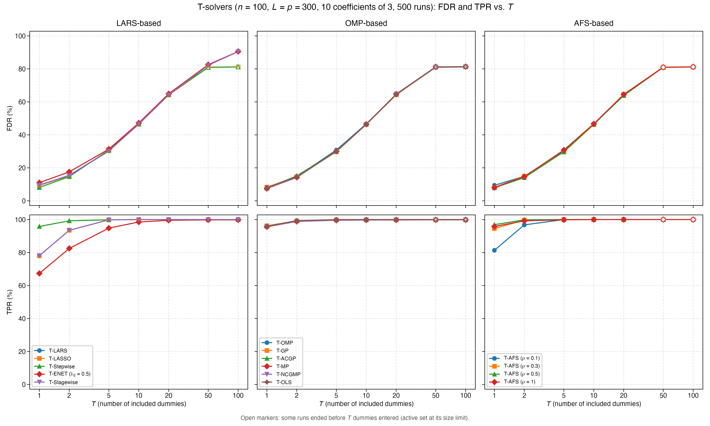
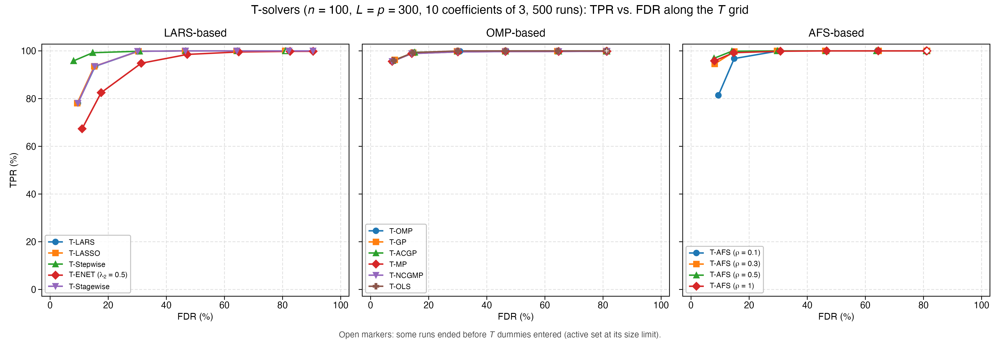
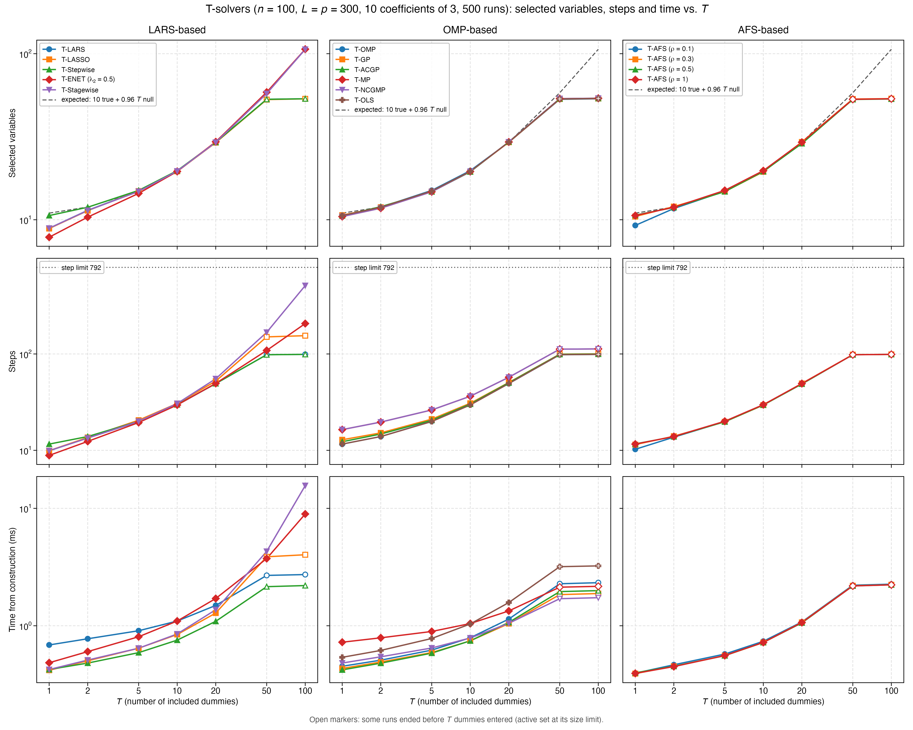
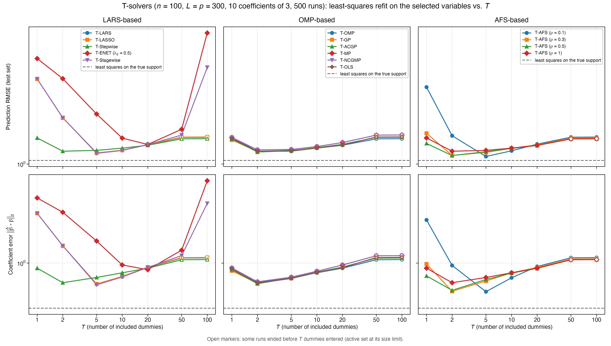

# Demo: FDR and TPR of the T-Solvers vs. T (R)

## Purpose

This demo compares the terminated solution paths of all demo T-solvers by their false discovery rate (FDR) and true
positive rate (TPR) as the number $T$ of included dummies grows. It mirrors the
[C++ demo](../../../../cpp/tsolvers/ad/demo_ts_perf_01_fdr_tpr_vs_T/README.md) and the
[Python demo](../../../../Python/tsolvers/ad/demo_ts_perf_01_fdr_tpr_vs_T/README.md) with the same settings, seeds and
console format, while R draws the data, so the numbers differ from both runs. Like them, it repeats the simulation
study of the R tlars vignette, runs it for every solver on the same data, and warm-starts each solver along the $T$
grid instead of fitting every $T$ from scratch. A least-squares refit on the selected variables then shows which $T$
gives the best estimate.

---

## Setup

- $n = 100$ observations and $p = 300$ variables with independent standard normal entries,
- ten true coefficients equal to 3 on a fixed random support, noise standard deviation about 1 (`snr = 90`),
- $L = p = 300$ standard normal dummies, drawn fresh in every run,
- $T \in \lbrace 1, 2, 5, 10, 20, 50, 100 \rbrace$ and 500 Monte Carlo runs,
- a fresh test set of 1,000 rows per run for the refit.

`draw_support()` of [`ts_perf_utils.R`](../../ts_perf_utils.R) draws the support once with `set.seed(12345)` and
`sort(sample.int(p, s))`, so it differs from the supports of the C++ and Python demos, and the demo prints it 1-based.
`gen_synthetic_data()` of [`ts_demo_utils.R`](../../ts_demo_utils.R) draws $\mathbf{X}$, $\mathbf{D}$ and the noise with
R's default generator, the Mersenne-Twister with normal draws by inversion. It sets the noise standard deviation to the
square root of the signal variance over `snr`, with the Bessel-corrected sample variance for $n \le 100$ as in the C++
data generator, so the signal variance of about $10 \cdot 3^2 = 90$ gives a noise level of about 1.

Each run keeps a copy of the raw $\mathbf{X}$ for the refit, centers and scales $\mathbf{X}$ and $\mathbf{D}$ in place
with `MLLpNormScaler` and centers $\mathbf{y}$ once. It hands them to all 15 solver configurations of
[`ts_perf_solvers.R`](../../ts_perf_solvers.R) as readers. These are the 12 solvers of the solver demos with their demo
settings (T-ENET with $\lambda_2 = 0.5$, T-NCGMP in its line-search variant) and T-AFS for
$\rho \in \lbrace 0.1, 0.3, 0.5, 1 \rbrace$. The readers are built with `normalize = FALSE`, `intercept = FALSE` and
`precentered = TRUE`. The centered design has rank $n - 1$, so the active sets stop at $n - 1 = 99$ variables, as with
a fitted intercept (T-ENET with $\lambda_2 > 0$ runs without this cap).

A variable counts as selected when its coefficient is nonzero, as in the T-Rex selector and the vignette. With the
selected set $\widehat{\mathcal{A}}$ and the true support $\mathcal{A}$, the false discovery proportion (FDP) and the
true positive proportion (TPP) of a run are

```math
\mathrm{FDP} = \frac{\lvert \widehat{\mathcal{A}} \setminus \mathcal{A} \rvert}
{\max(1, \lvert \widehat{\mathcal{A}} \rvert)},
\qquad
\mathrm{TPP} = \frac{\lvert \widehat{\mathcal{A}} \cap \mathcal{A} \rvert}{\max(1, \lvert \mathcal{A} \rvert)},
```

and FDR and TPR are their means over the runs.

---

## Running the demo

From the repository root, with the TRexSelector R package installed:

```bash
Rscript R/tsolvers/ad/demo_ts_perf_01_fdr_tpr_vs_T/demo_ts_perf_01_fdr_tpr_vs_T.R         # 500 runs, 6 workers
Rscript R/tsolvers/ad/demo_ts_perf_01_fdr_tpr_vs_T/demo_ts_perf_01_fdr_tpr_vs_T.R 20 8    # 20 runs, 8 workers
R/tsolvers/ad/demo_ts_perf_01_fdr_tpr_vs_T/generate_plots.sh                               # figures
```

The two optional arguments are the number of runs and of worker processes. `run_parallel()` of
[`ts_perf_utils.R`](../../ts_perf_utils.R) spreads the runs over R worker processes that `parallel::makePSOCKcluster()`
spawns, with no fork. Every worker loads the package and sets the library to one thread with
`trex_set_num_threads(1L)`, so each solver runs single-threaded inside its run, as the console header says. Spawned
workers run the demo in parallel on macOS, Linux and Windows alike. They also keep the thread setting, while the Open
Multi-Processing (OpenMP) runtime resets the thread count in a forked child.

The 500 runs take 13.0 s with 6 workers on an Apple Silicon machine, against 7.3 s for the C++ demo and 7.4 s for the
Python one, and the section on steps and run time shows where the extra time lies. The result files carry the number
of runs in their name (`fdr_tpr_vs_T_mc500.csv` and `.txt`), so a short test run does not overwrite the full one.
`generate_plots.sh` draws the figures with the ggplot2 module [`ts_plt_utils.R`](../../ts_plt_utils.R) into
`simulation_results/plots/`. Its `.pdf` files carry no creation date (`pdf(timestamp = FALSE)`), so a redraw of the
same results gives the same bytes. The output below is a run against library b95b984 (TRexSelector 2.0.0), and its
T-Stagewise rows come from a rerun of that solver alone against library 09debc6 with the same seeds. Run $k$ draws its
data with the seed `1000 + k` and its test set with the seed `2000000 + k`, so the results do not depend on the number
of workers.

---

## Console walk-through

### FDR and TPR

```text
n = 100, p = 300, L = p = 300, true coefficients: 10 x 3, SNR = 90
True support: 51 75 93 142 152 208 216 218 220 258
T grid: 1 2 5 10 20 50 100
15 solvers, 500 runs on 6 worker processes (single-threaded solvers)

FDR (%)
solver                     T=1     T=2     T=5    T=10    T=20    T=50   T=100
------------------------------------------------------------------------------
T-LARS                     9.6    15.5    30.4    46.4    64.2    81.0    81.2
T-LASSO                    9.3    15.2    30.4    46.4    64.2    80.9    81.2
T-Stepwise                 8.1    14.7    30.8    46.7    64.4    81.0    81.2
T-ENET (lambda2 0.5)      11.0    17.6    31.4    47.2    64.9    82.6    90.5
T-Stagewise                9.6    15.4    30.1    46.6    64.3    82.2    90.5
T-OMP                      8.1    14.7    30.8    46.7    64.4    81.0    81.2
T-GP                       8.3    14.7    29.8    46.3    64.3    81.1    81.3
T-ACGP                     7.6    15.2    29.9    46.4    64.8    81.2    81.3
T-MP                       7.4    14.2    30.1    46.4    64.7    81.2    81.4
T-NCGMP                    7.4    14.2    30.1    46.4    64.7    81.2    81.4
T-OLS                      8.0    14.5    30.0    46.4    64.5    81.1    81.3
T-AFS (rho 0.1)            9.4    14.9    30.2    46.6    64.1    81.0    81.2
T-AFS (rho 0.3)            8.1    14.9    29.6    46.2    64.6    81.1    81.2
T-AFS (rho 0.5)            7.9    14.1    29.7    46.5    63.8    80.9    81.1
T-AFS (rho 1)              8.1    14.7    30.8    46.7    64.4    81.0    81.2

TPR (%)
solver                     T=1     T=2     T=5    T=10    T=20    T=50   T=100
------------------------------------------------------------------------------
T-LARS                    78.1    93.5    99.8   100.0   100.0   100.0   100.0
T-LASSO                   78.1    93.5    99.8   100.0   100.0   100.0   100.0
T-Stepwise                95.8    99.2    99.9   100.0   100.0   100.0   100.0
T-ENET (lambda2 0.5)      67.4    82.5    94.8    98.5    99.6    99.8    99.8
T-Stagewise               78.1    93.5    99.8   100.0   100.0   100.0   100.0
T-OMP                     95.8    99.2    99.9   100.0   100.0   100.0   100.0
T-GP                      96.2    99.2    99.8    99.9    99.9    99.9    99.9
T-ACGP                    95.9    99.4    99.8    99.9    99.9    99.9    99.9
T-MP                      95.6    98.9    99.6    99.7    99.8    99.8    99.8
T-NCGMP                   95.6    98.9    99.6    99.7    99.8    99.8    99.8
T-OLS                     95.9    99.3   100.0   100.0   100.0   100.0   100.0
T-AFS (rho 0.1)           81.4    96.8   100.0   100.0   100.0   100.0   100.0
T-AFS (rho 0.3)           94.5    99.7   100.0   100.0   100.0   100.0   100.0
T-AFS (rho 0.5)           96.9    99.9   100.0   100.0   100.0   100.0   100.0
T-AFS (rho 1)             95.8    99.2    99.9   100.0   100.0   100.0   100.0
```

At $T = 1$ every solver keeps the FDR between 7.4% and 11.0%, and the TPR separates the families. The solvers that
refit by least squares after each entry (T-Stepwise, the orthogonal matching pursuit (OMP) family and T-AFS for
$\rho \ge 0.3$) find 94.5% to 96.9% of the true variables. T-LARS, T-LASSO and T-Stagewise find 78.1%, T-ENET 67.4%,
and T-AFS at $\rho = 0.1$ sits close to its least angle regression (LARS) end at 81.4%. The C++ and Python runs give
the same picture. Over all 105 entries the R tables differ from them by at most 2.1 percentage points in FDR and 1.4 in
TPR, and no difference exceeds 3.2 standard errors, so R agrees with both within the Monte Carlo error.

As $T$ grows, the FDR rises alike for all solvers, to about 30% at $T = 5$, 46% at $T = 10$ and 64%
at $T = 20$. This follows from the exchangeability of null variables and dummies. The 290 null variables and the 300
dummies are independent standard normal columns that carry no information about $\mathbf{y}$, so a solver cannot tell
them apart, and every order in which they enter the path is equally likely. When the $T$-th dummy enters, the number
$V_T$ of null variables that entered before it follows a negative hypergeometric distribution with mean

```math
\mathbb{E}[V_T] = \frac{p - s}{L + 1}\,T = \frac{290}{301}\,T \approx 0.96\,T.
```

With $s = 10$ true variables that are nearly always found, a path holds about $10 + 0.96\,T$ variables, which matches
the tables. At $T = 20$, for example, the paths of all solvers hold 28.8 to 29.5 variables, and 18.8 to 19.5 of them
are null against the expected 19.3. This is the idea behind the T-Rex selector. The included dummies count the null
variables that entered, so they estimate the false discoveries of a path. The TPR reaches at least 99.6% by $T = 5$ for
every solver except T-ENET, which needs $T = 20$ for 99.6%. A single terminated path therefore trades FDR against TPR
through $T$, and the T-Rex selector controls the FDR by averaging many such paths with a calibrated $T$ and $L$.

### Paths that end early

```text
Runs that reached T dummies (%)
solver                     T=1     T=2     T=5    T=10    T=20    T=50   T=100
------------------------------------------------------------------------------
T-LARS                     100     100     100     100     100      16       0
T-LASSO                    100     100     100     100     100      22       0
T-Stepwise                 100     100     100     100     100      19       0
T-ENET (lambda2 0.5)       100     100     100     100     100     100     100
T-Stagewise                100     100     100     100     100     100     100
T-OMP                      100     100     100     100     100      19       0
T-GP                       100     100     100     100     100      17       0
T-ACGP                     100     100     100     100     100      17       0
T-MP                       100     100     100     100     100      16       0
T-NCGMP                    100     100     100     100     100      16       0
T-OLS                      100     100     100     100     100      16       0
T-AFS (rho 0.1)            100     100     100     100     100      17       0
T-AFS (rho 0.3)            100     100     100     100     100      19       0
T-AFS (rho 0.5)            100     100     100     100     100      18       0
T-AFS (rho 1)              100     100     100     100     100      19       0

Average number of selected variables
solver                     T=1     T=2     T=5    T=10    T=20    T=50   T=100
------------------------------------------------------------------------------
T-LARS                     8.9    11.4    14.9    19.6    29.2    53.2    53.5
T-LASSO                    8.9    11.3    14.9    19.6    29.1    52.9    53.5
T-Stepwise                10.6    11.9    15.0    19.7    29.3    53.1    53.5
T-ENET (lambda2 0.5)       7.8    10.4    14.4    19.5    29.5    58.7   106.5
T-Stagewise                8.9    11.4    14.8    19.6    29.2    57.5   106.2
T-OMP                     10.6    11.9    15.0    19.7    29.3    53.1    53.5
T-GP                      10.7    11.9    14.8    19.5    29.3    53.3    53.7
T-ACGP                    10.6    12.0    14.7    19.4    29.5    53.6    53.9
T-MP                      10.5    11.7    14.7    19.5    29.4    53.6    53.9
T-NCGMP                   10.5    11.7    14.7    19.5    29.4    53.6    53.9
T-OLS                     10.6    11.9    14.9    19.6    29.3    53.4    53.7
T-AFS (rho 0.1)            9.2    11.7    14.9    19.6    29.0    53.2    53.6
T-AFS (rho 0.3)           10.5    12.0    14.8    19.4    29.4    53.3    53.6
T-AFS (rho 0.5)           10.7    11.9    14.8    19.5    28.8    53.0    53.4
T-AFS (rho 1)             10.6    11.9    15.0    19.7    29.3    53.1    53.5
```

The readers are precentered, so the active set of most solvers is capped at the rank $n - 1 = 99$ of the centered
design, dummies included. At $T = 50$ only 16% to 22% of the runs reach 50 dummies before the cap, and no run reaches
100. The paths then end with about 54 original variables and 45 dummies, and the FDR stays at about 81%. The open
markers in the figures show these $T$ values. T-NCGMP stops by the rules of T-MP and ends exactly like it.

Two solvers go further. T-ENET reaches 100 dummies in every run, because an elastic-net path with $\lambda_2 > 0$ may
hold more than $n$ variables, as in the algorithm of Zou and Hastie (2005). It ends at an FDR of 90.5% with about 106
selected variables. T-Stagewise freezes the variables it drops from the active set, and a frozen variable keeps its
coefficient, so its support grows past the cap while its active set stays at the cap. The dummies of the support count
toward $T$, so T-Stagewise reaches 50 dummies in every run and 100 dummies in 498 of the 500 runs. Its selection matches
the expected $10 + 0.96\,T$ with 57.5 variables at $T = 50$ and 106.2 at $T = 100$, more than $n$, and like T-ENET
it ends at an FDR of 90.5%. The cap still costs it steps, because its path cycles through drops and re-entries once the
active set is full. It needs 55.3 steps to reach $T = 20$, close to the 49 to 57 of the other solvers, but 167.7 to
reach $T = 50$ and 512.8 to reach $T = 100$, against 108.8 and 206.9 for T-ENET. On average it stays well below its
step limit of $8 \cdot 99 = 792$.

### Steps and run time

```text
Average number of steps
solver                     T=1     T=2     T=5    T=10    T=20    T=50   T=100
------------------------------------------------------------------------------
T-LARS                     9.9    13.4    19.9    29.6    49.2    98.4    99.0
T-LASSO                    9.9    13.6    20.5    30.6    52.3   150.4   154.8
T-Stepwise                11.6    13.9    20.0    29.7    49.3    98.2    99.0
T-ENET (lambda2 0.5)       8.8    12.4    19.4    29.5    49.5   108.8   206.9
T-Stagewise                9.9    13.4    20.0    30.6    55.3   167.7   512.8
T-OMP                     11.6    13.9    20.0    29.7    49.3    98.2    99.0
T-GP                      12.9    15.2    21.1    30.8    50.6    99.6   100.3
T-ACGP                    12.3    14.8    20.5    30.2    50.2    99.2    99.8
T-MP                      16.4    19.6    26.2    36.4    57.3   112.2   112.8
T-NCGMP                   16.4    19.6    26.2    36.4    57.3   112.2   112.8
T-OLS                     11.6    13.9    19.9    29.6    49.3    98.4    99.0
T-AFS (rho 0.1)           10.2    13.7    19.9    29.6    49.0    98.4    99.0
T-AFS (rho 0.3)           11.5    14.0    19.8    29.4    49.4    98.4    99.0
T-AFS (rho 0.5)           11.7    13.9    19.8    29.5    48.8    98.3    99.0
T-AFS (rho 1)             11.6    13.9    20.0    29.7    49.3    98.2    99.0

Average time from construction to T (ms, cumulative)
solver                     T=1     T=2     T=5    T=10    T=20    T=50   T=100
------------------------------------------------------------------------------
T-LARS                    0.69    0.78    0.91    1.10    1.49    2.68    2.73
T-LASSO                   0.42    0.50    0.64    0.84    1.28    3.87    4.03
T-Stepwise                0.42    0.48    0.59    0.75    1.09    2.15    2.20
T-ENET (lambda2 0.5)      0.48    0.60    0.81    1.10    1.71    3.74    8.95
T-Stagewise               0.42    0.51    0.64    0.85    1.37    4.30   15.62
T-OMP                     0.45    0.51    0.62    0.79    1.14    2.28    2.33
T-GP                      0.43    0.49    0.59    0.74    1.04    1.84    1.88
T-ACGP                    0.42    0.48    0.58    0.74    1.07    1.95    1.99
T-MP                      0.72    0.79    0.89    1.04    1.34    2.13    2.17
T-NCGMP                   0.48    0.54    0.65    0.79    1.05    1.70    1.73
T-OLS                     0.54    0.62    0.78    1.04    1.58    3.19    3.24
T-AFS (rho 0.1)           0.39    0.47    0.57    0.74    1.08    2.21    2.26
T-AFS (rho 0.3)           0.39    0.45    0.56    0.72    1.07    2.19    2.23
T-AFS (rho 0.5)           0.40    0.45    0.56    0.72    1.06    2.19    2.23
T-AFS (rho 1)             0.39    0.45    0.56    0.72    1.06    2.18    2.23
```

The steps match the C++ run within the Monte Carlo error. T-LASSO needs 150.4 steps at $T = 50$ against 98.4 for
T-LARS, as its capped paths drop and re-enter variables, and T-Stagewise needs 167.7 steps there and 512.8 at
$T = 100$, against 168.5 and 514.9 in C++.

Up to $T = 20$, where every path still reaches its $T$, a whole warm-started path takes 1.0 to 1.7 ms for every
solver, and T-OMP needs 1.14 ms, against 0.7 to 1.4 ms and 0.80 ms in C++. The R times lie above the C++ ones by a
nearly constant amount that is already there at $T = 1$. Up to $T = 20$ it comes to 0.22 to 0.34 ms for most solvers
and to 0.50 to 0.59 ms for T-LARS and T-MP, so it sits in the construction and the R calls around the path rather than
in the steps. The steps themselves cost about as much as in C++. From $T = 1$ to $T = 20$ the R paths take 6% to 13%
longer than the C++ ones, and T-LARS needs 0.020 ms per step on that stretch against 0.018 ms in C++. The offset
weighs most on the short paths, so R needs 1.9 to 4.0 times the C++ time at $T = 1$ and 1.2 to 1.7 times at $T = 20$.

The order of the solvers stays close to the C++ one. T-ENET and T-OLS need the most time to $T = 20$, 1.71 and
1.58 ms, while T-LARS and T-MP move up by their larger offset. T-LARS with 1.49 ms thus passes T-Stagewise with
1.37 ms, which comes third in C++. T-Stagewise rises to 4.30 ms at $T = 50$ and 15.6 ms at $T = 100$, where its path
cycles through drops and re-entries at the cap, close to the 4.08 and 16.0 ms of C++ and above the 3.73 and 13.8 ms
of Python. Summed over the 15 solvers, the paths to $T = 100$ take 55.8 ms per run in R against 52.2 ms in C++ and
48.2 ms in Python. The solvers therefore cost in R only about 7% more than in C++, and the extra wall time of R lies
in the parts that the tables do not time, such as drawing the data, the refits and the start of the workers. The
times at $T = 50$ and 100 describe the saturated regime rather than the solvers. They are measured inside the parallel
workers and serve for comparison only.

### Least-squares refit on the selected variables

After each $T$, the demo drops the dummies from the selection, fits least squares with an intercept on the selected
original variables of the unscaled data, and scores the fit on a fresh test set of 1,000 rows. `min_norm_lstsq()`
solves the fit through `svd()` with the singular-value cutoff of `np.linalg.lstsq`, so it returns the minimum-norm
solution. The refit on the true support is the reference, with a prediction root-mean-square error (RMSE) of 1.06
against the noise level $\sigma \approx 1$ and a coefficient error of 0.32.

```text
Prediction RMSE of the least-squares refit on the selected variables (test set)
solver                     T=1     T=2     T=5    T=10    T=20    T=50   T=100
------------------------------------------------------------------------------
T-LARS                    3.85    2.08    1.19    1.24    1.36    1.52    1.53
T-LASSO                   3.85    2.08    1.19    1.25    1.36    1.53    1.54
T-Stepwise                1.51    1.23    1.24    1.29    1.35    1.49    1.49
T-ENET (lambda2 0.5)      5.31    3.86    2.21    1.51    1.36    1.73    7.96
T-Stagewise               3.85    2.08    1.18    1.24    1.36    1.58    4.62
T-OMP                     1.51    1.23    1.24    1.29    1.35    1.49    1.49
T-GP                      1.46    1.22    1.23    1.30    1.36    1.53    1.53
T-ACGP                    1.49    1.21    1.24    1.30    1.37    1.53    1.53
T-MP                      1.52    1.25    1.26    1.32    1.41    1.58    1.58
T-NCGMP                   1.52    1.25    1.26    1.32    1.41    1.58    1.58
T-OLS                     1.50    1.22    1.23    1.29    1.35    1.53    1.54
T-AFS (rho 0.1)           3.38    1.57    1.13    1.23    1.37    1.53    1.53
T-AFS (rho 0.3)           1.63    1.15    1.20    1.28    1.35    1.51    1.51
T-AFS (rho 0.5)           1.39    1.14    1.22    1.28    1.34    1.49    1.49
T-AFS (rho 1)             1.51    1.23    1.24    1.29    1.35    1.49    1.49

Coefficient error of the refit, ||beta_hat - beta||_2
solver                     T=1     T=2     T=5    T=10    T=20    T=50   T=100
------------------------------------------------------------------------------
T-LARS                    3.48    1.54    0.59    0.71    0.90    1.13    1.14
T-LASSO                   3.48    1.54    0.59    0.72    0.90    1.14    1.15
T-Stepwise                0.88    0.61    0.70    0.78    0.88    1.09    1.09
T-ENET (lambda2 0.5)      5.11    3.57    1.74    0.95    0.85    1.38    7.85
T-Stagewise               3.48    1.54    0.58    0.71    0.90    1.21    4.45
T-OMP                     0.88    0.61    0.70    0.78    0.88    1.09    1.09
T-GP                      0.82    0.60    0.68    0.80    0.90    1.14    1.14
T-ACGP                    0.85    0.60    0.69    0.80    0.90    1.13    1.13
T-MP                      0.88    0.63    0.70    0.81    0.95    1.20    1.20
T-NCGMP                   0.88    0.63    0.70    0.81    0.95    1.20    1.20
T-OLS                     0.86    0.61    0.68    0.79    0.89    1.15    1.15
T-AFS (rho 0.1)           2.94    0.94    0.49    0.69    0.92    1.14    1.15
T-AFS (rho 0.3)           0.98    0.49    0.64    0.78    0.90    1.11    1.11
T-AFS (rho 0.5)           0.72    0.51    0.66    0.78    0.88    1.09    1.09
T-AFS (rho 1)             0.88    0.61    0.70    0.78    0.88    1.09    1.09

Least-squares refit on the true support: prediction RMSE 1.06, coefficient error 0.32

Failed solver runs: 0
Wall time: 13.0 s
```

Every solver has a sweet spot at a small $T$. The least-squares refit solvers reach a prediction RMSE of 1.14 to 1.25
already at $T = 2$, where they have found 98.9% to 99.9% of the true variables with few false ones. T-LARS, T-LASSO
and T-Stagewise miss more than a fifth of the true variables at $T = 1$ (RMSE 3.85) and are best at $T = 5$ (1.19 and
1.18), and T-ENET only at $T = 20$ (1.36). T-AFS at $\rho = 0.1$ reaches the smallest prediction error of all, 1.127
at $T = 5$ in `fdr_tpr_vs_T_mc500.csv`, ahead of T-AFS at $\rho = 0.5$ with 1.144 at $T = 2$. It also has the
smallest coefficient error, 0.488 at $T = 5$, just below the 0.493 of $\rho = 0.3$ at $T = 2$. Beyond the sweet spot
the errors grow slowly, because every further null variable in the refit adds estimation noise, to about 1.5 at the
cap. The refit does not blow up there, because the dummies are dropped and about 54 variables remain for 100 rows.

Only T-Stagewise and T-ENET, whose selections grow past $n$ at $T = 100$, end with a minimum-norm refit that
interpolates the training data. T-ENET reaches a prediction RMSE of 7.96 at $T = 100$, between the 7.32 of the Python
run and the 8.43 of the C++ run. T-Stagewise reaches 4.62 there, close to the 4.77 of Python. The C++ run ends it at
5.69 with a standard error of 0.60 against 0.17 in R, so that gap of 1.1 amounts to 1.7 combined standard errors. At
$T = 50$, with about 58 selected variables, T-Stagewise refits to 1.58 in all three runs.

---

## Figures

The first figure shows FDR (top row) and TPR (bottom row) against $T$, one column per library family. Solvers with
equal or nearly equal results overlap within a panel. T-LARS lies under T-LASSO, and T-MP under T-NCGMP. T-Stagewise
lies on T-LARS in TPR, and its FDR follows T-LARS up to $T = 20$ and T-ENET at $T = 50$ and 100.



The second figure shows TPR against FDR along the $T$ grid. The least-squares refit solvers start near the top left
corner, with a TPR of about 96% at an FDR of about 8%, while T-LARS, T-LASSO, T-Stagewise, T-ENET and T-AFS at
$\rho = 0.1$ need a larger $T$ and a higher FDR for the same TPR.



The third figure shows the remaining tables against $T$ on log axes. The dashed line in the top row is the expected
selection $10 + 0.96\,T$ derived above. The OMP family and T-AFS for $\rho \ge 0.3$ follow it until the active-set cap
stops their paths after $T = 20$. T-ENET, which has no cap at $n - 1$, and T-Stagewise, whose frozen coefficients
carry its selection past the cap, stay on it up to $T = 100$ with about 106 variables. T-LARS, T-LASSO, T-ENET,
T-Stagewise and T-AFS at $\rho = 0.1$ start below the line because they find fewer true variables at $T = 1$. The
middle row shows T-Stagewise climbing to 512.8 steps at $T = 100$, below the dotted step limit of 792, and T-LASSO
climbing at saturation. The bottom row shows the rise of T-Stagewise, T-LASSO and T-ENET at saturation, with
T-Stagewise the slowest solver at $T = 50$ and 100. T-LARS and T-MP start above the other solvers of their families by
their larger offset, until T-ENET and T-OLS catch up at $T = 10$ and pass them by $T = 20$.



The fourth figure shows both errors of the refit against $T$ on log axes, with the refit on the true support as the
dashed reference. The U shape of every solver marks its sweet spot, and the jumps of T-Stagewise and T-ENET at
$T = 100$ mark their selections past $n$.



---

## Technical notes

- `run_parallel()` starts the workers with `parallel::makePSOCKcluster()`. Each worker is a fresh R process that loads
  TRexSelector, receives the globals of the demo script through `parallel::clusterExport()` and calls
  `trex_set_num_threads(1L)`, as the initializer of the Python pool does. `parallel::parLapplyLB()` then hands the
  runs to the free workers one at a time. A forked worker of `parallel::mclapply()` would run only on macOS and Linux,
  and it would not keep a thread setting made before the fork, because the OpenMP runtime resets the thread count in a
  forked child.
- The loop of the vignette passes the loop index `t` instead of `T_vec[t]` to `tlars()`. The published curves are
  therefore the results for $T = 1, \dots, 7$, drawn at the positions 1, 2, 5, 10, 20, 50 and 100. This demo runs the
  intended grid.
- Every solver gets the seed of its run for its tie-break engine through `set_tie_seed()`, which resolves exact ties
  such as several dummies entering at once. The library default seeds that engine from `std::random_device`, which
  lets single runs differ between repetitions.
- The support is drawn once with `set.seed(12345)` and printed 1-based, as all indices of the R demos are. The C++ demo
  draws it with `std::sample` and `std::mt19937` and the Python demo with `np.random.default_rng()` from the same seed,
  so the three supports differ, and in the vignette it comes from an unseeded `sample()`.
- The active set is not the selection for every solver. T-Stagewise keeps frozen variables with their coefficients
  outside it, so `selected_predictors()` of [`ts_perf_utils.R`](../../ts_perf_utils.R) selects by nonzero coefficient,
  as the T-Rex selector does. For the same reason, `included_dummies()` lets a run reach $T$ when $T$ dummies carry a
  nonzero coefficient, the count at which the library stops the path.
- T-Stepwise and T-AFS at $\rho = 1$ give the same tables as T-OMP apart from the times, and T-NCGMP in its
  line-search variant the same as T-MP, as the shared paths of the
  [C++ T-solver README](../../../../cpp/tsolvers/README.md) state.
- The timed window runs from the construction of the solver to each $T$ and includes the R calls that read the
  selection in between. `Sys.time()` resolves it to about a microsecond, while `proc.time()` resolves only a
  millisecond. The refits run after the path, so they stay out of the solver times.
- R's Mersenne-Twister draws the data, so the tables differ from the C++ and Python runs of the same setup, while the
  settings, the seeds and the console format are the same.
