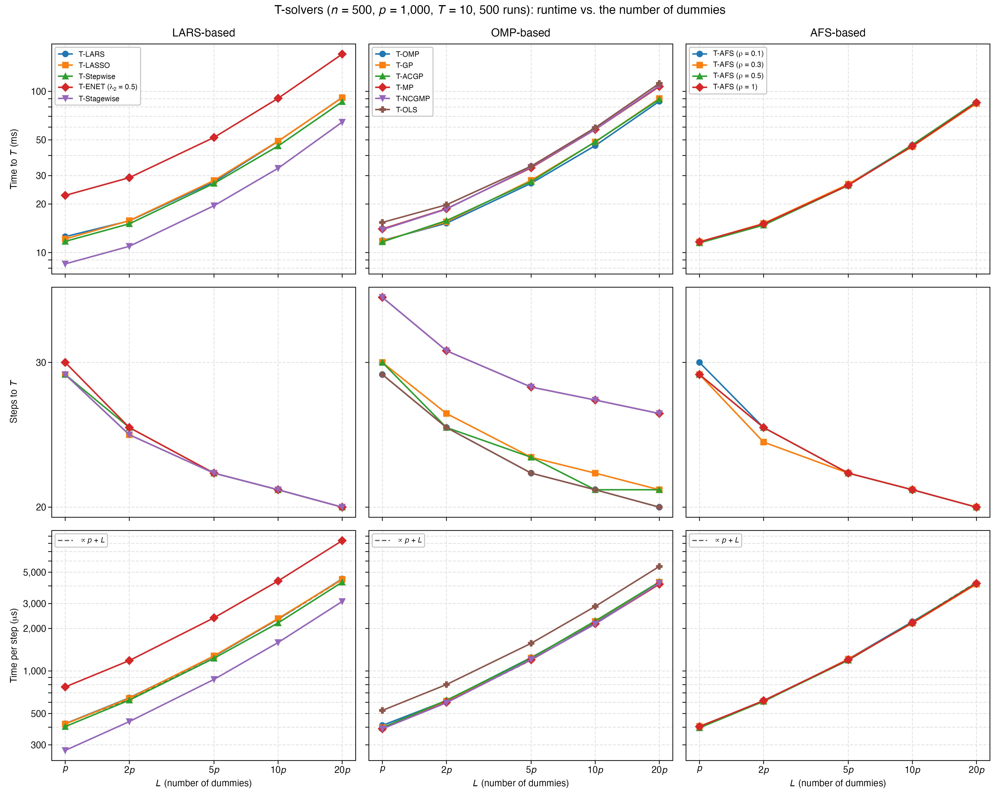
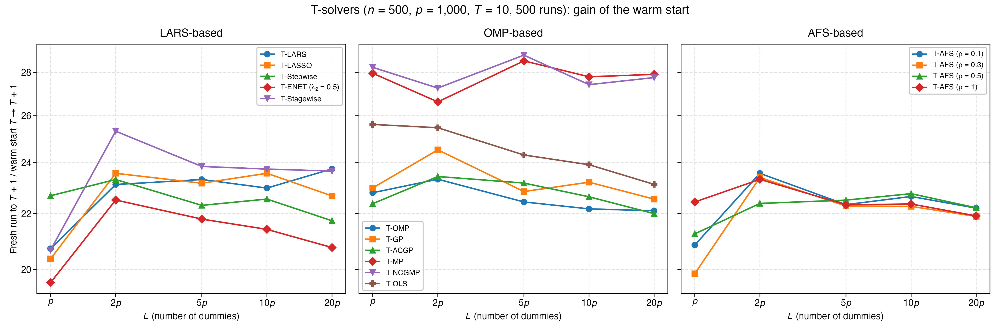

# Demo: Runtime of the T-Solvers vs. the Number of Dummies (R)

## Purpose

This demo measures how the run time of the terminated solution paths grows with the number $L$ of dummies, for all
demo T-solvers on the same data. It mirrors the
[C++ demo](../../../../cpp/tsolvers/ad/demo_ts_perf_02_runtime_vs_dummies/README.md) and the
[Python demo](../../../../Python/tsolvers/ad/demo_ts_perf_02_runtime_vs_dummies/README.md) with the same settings, seeds
and console format, while R draws the data. The solvers behind the binding are the same C++ code, so the times also show
how close the R demo comes to the C++ one. The demo splits the time to the $T$-th dummy into the number of steps and the
time per step, and it compares a warm start from $T$ to $T + 1$ with a fresh run to $T + 1$.

---

## Setup

- $n = 500$ observations and $p = 1{,}000$ variables with independent standard normal entries,
- ten true coefficients equal to 3 on a fixed random support, noise standard deviation about 1 (`snr = 90`),
- $L \in \lbrace p, 2p, 5p, 10p, 20p \rbrace$ standard normal dummies, and $T = 10$,
- 500 Monte Carlo runs, with medians over the runs.

Every run draws $20p = 20{,}000$ dummies once with R's Mersenne-Twister, and each $L$ uses the first $L$ of them, so
the dummy sets are nested across the grid. The support comes from `set.seed(12345)` as in
[demo_ts_perf_01](../demo_ts_perf_01_fdr_tpr_vs_T/README.md), and `reader_data()` of
[`ts_perf_utils.R`](../../ts_perf_utils.R) centers and scales $\mathbf{X}$ and $\mathbf{D}$ with `MLLpNormScaler` and
centers $\mathbf{y}$ once. Before any clock starts, the run copies the first $L$ dummy columns into a matrix of their
own for every $L$, while the Python demo reads them through views. All 15 solver configurations of demo_ts_perf_01 run
on these matrices as precentered readers with the seed of the run for their tie-breaking. For every $L$ and solver the
run measures the time from construction to $T = 10$ with its number of steps, the extra time of a warm start to
$T = 11$, and the time of a fresh run to $T = 11$, each with `Sys.time()`.

---

## Running the demo

From the repository root, with the TRexSelector R package installed:

```bash
Rscript R/tsolvers/ad/demo_ts_perf_02_runtime_vs_dummies/demo_ts_perf_02_runtime_vs_dummies.R        # 500 runs, 6 workers
Rscript R/tsolvers/ad/demo_ts_perf_02_runtime_vs_dummies/demo_ts_perf_02_runtime_vs_dummies.R 5 3    # 5 runs, 3 workers
R/tsolvers/ad/demo_ts_perf_02_runtime_vs_dummies/generate_plots.sh                                    # figures
```

The two optional arguments are the number of runs and of worker processes. `run_parallel()` of
[`ts_perf_utils.R`](../../ts_perf_utils.R) spreads the runs over R worker processes that `parallel::makePSOCKcluster()`
spawns, with no fork, and every worker sets the library to one thread with `trex_set_num_threads(1L)`. Each solver
therefore runs single-threaded inside its run, and the times show the cost of the algorithms rather than their
parallel speed. Spawned workers run on macOS, Linux and Windows alike and keep the thread setting, while the Open
Multi-Processing (OpenMP) runtime resets the thread count in a forked child, as the technical notes of
[demo_ts_perf_01](../demo_ts_perf_01_fdr_tpr_vs_T/README.md) explain.

The 500 runs take 578.6 s, about 10 minutes, with 6 workers on an Apple Silicon machine, against 545.8 s for the C++
demo and 545.5 s for the Python one. The result files carry the number of runs in their name
(`runtime_vs_dummies_mc500.csv` and `.txt`), so a short test run does not overwrite the full one. `generate_plots.sh`
draws the figures with the ggplot2 module [`ts_plt_utils.R`](../../ts_plt_utils.R) into `simulation_results/plots/`, and
its `.pdf` files carry no creation date (`pdf(timestamp = FALSE)`), so a redraw of the same results gives the same
bytes. The output below is a run against library b95b984 (TRexSelector 2.0.0). Two fixes in library 09debc6 change
the paths of T-Stagewise, so its rows come from a rerun of the 500 runs on that library in a session of their own, with
the same seeds and workers. The wall times quoted here are those of the first runs.

---

## Console walk-through

### Time and steps to $T = 10$

```text
n = 500, p = 1000, L in {1, 2, 5, 10, 20} x p, T = 10, true coefficients: 10 x 3, SNR = 90
15 solvers, 500 runs on 6 worker processes (single-threaded solvers)

Median time to T = 10 (ms)
solver                      L=p     L=2p     L=5p    L=10p    L=20p
-------------------------------------------------------------------
T-LARS                    12.55    15.73    27.43    48.97    91.65
T-LASSO                   12.15    15.78    28.00    49.11    91.41
T-Stepwise                11.73    15.08    26.85    45.83    86.26
T-ENET (lambda2 0.5)      22.62    29.15    51.77    90.55   170.28
T-Stagewise                8.50    10.93    19.53    33.34    64.45
T-OMP                     11.87    15.20    26.90    46.08    86.75
T-GP                      11.78    15.50    28.07    48.54    90.29
T-ACGP                    11.65    15.78    27.58    48.68    89.25
T-MP                      14.01    18.69    33.55    58.00   107.19
T-NCGMP                   13.88    18.60    33.87    58.10   108.66
T-OLS                     15.38    19.78    34.36    59.51   112.07
T-AFS (rho 0.1)           11.62    14.86    26.52    46.38    85.03
T-AFS (rho 0.3)           11.64    15.16    26.56    45.48    84.17
T-AFS (rho 0.5)           11.48    14.79    26.10    46.67    86.33
T-AFS (rho 1)             11.66    15.05    26.18    45.77    85.10

Median steps to T = 10
solver                      L=p     L=2p     L=5p    L=10p    L=20p
-------------------------------------------------------------------
T-LARS                     29.0     24.5     22.0     21.0     20.0
T-LASSO                    29.0     24.5     22.0     21.0     20.0
T-Stepwise                 29.0     25.0     22.0     21.0     20.0
T-ENET (lambda2 0.5)       30.0     25.0     22.0     21.0     20.0
T-Stagewise                29.0     24.5     22.0     21.0     20.0
T-OMP                      29.0     25.0     22.0     21.0     20.0
T-GP                       30.0     26.0     23.0     22.0     21.0
T-ACGP                     30.0     25.0     23.0     21.0     21.0
T-MP                       36.0     31.0     28.0     27.0     26.0
T-NCGMP                    36.0     31.0     28.0     27.0     26.0
T-OLS                      29.0     25.0     22.0     21.0     20.0
T-AFS (rho 0.1)            30.0     25.0     22.0     21.0     20.0
T-AFS (rho 0.3)            29.0     24.0     22.0     21.0     20.0
T-AFS (rho 0.5)            29.0     25.0     22.0     21.0     20.0
T-AFS (rho 1)              29.0     25.0     22.0     21.0     20.0
```

The number of steps falls from 29 at $L = p$ to 20 at $L = 20p$, and the exchangeability of null variables and dummies
from [demo_ts_perf_01](../demo_ts_perf_01_fdr_tpr_vs_T/README.md) predicts these counts. A path to the tenth dummy
holds the ten true variables and the ten dummies, plus on average

```math
\mathbb{E}[V_T] = \frac{p - s}{L + 1}\,T = \frac{990}{L + 1} \cdot 10
```

null variables: 9.9 at $L = p$, 4.9 at $L = 2p$, 2.0 at $L = 5p$, 1.0 at $L = 10p$ and 0.5 at $L = 20p$. The expected
path lengths of 29.9, 24.9, 22.0, 21.0 and 20.5 steps match the medians of most solvers within about one step. T-MP
and T-NCGMP need more steps, 36 at $L = p$, because matching pursuit can select a variable again. The median steps
agree with the C++ and Python runs within one step at every $L$.

The time to $T = 10$ grows about linearly with $L$ once $L \ge 2p$, as in C++. A path at $L = 20p$ costs 7.2 to 7.8
times a path at $L = p$ for 10.5 times as many columns, against 7.5 to 11.1 times in C++ and 7.2 to 8.0 times in
Python. T-LARS needs 12.6 ms at $L = p$, 1.06 times the 11.8 ms of C++, and 91.7 ms at $L = 20p$, 1.03 times the
88.6 ms of C++. Over all solvers the median factor over C++ falls from 1.27 at $L = p$ to 1.10 at $2p$ and stays at
1.03 to 1.04 from $5p$ on.

### Time per step

```text
Median time per step (us)
solver                      L=p     L=2p     L=5p    L=10p    L=20p
-------------------------------------------------------------------
T-LARS                    423.6    645.7   1269.3   2330.7   4487.5
T-LASSO                   421.5    641.3   1279.0   2351.3   4453.2
T-Stepwise                404.1    621.6   1230.1   2187.9   4251.5
T-ENET (lambda2 0.5)      770.8   1184.9   2378.8   4335.6   8368.3
T-Stagewise               274.0    438.5    872.0   1590.2   3104.1
T-OMP                     411.9    616.9   1244.6   2213.1   4242.2
T-GP                      398.3    611.9   1235.2   2244.6   4253.3
T-ACGP                    396.9    620.3   1230.8   2261.0   4265.7
T-MP                      390.0    599.5   1199.9   2158.1   4112.4
T-NCGMP                   390.0    595.6   1205.1   2148.9   4178.8
T-OLS                     525.7    801.6   1570.1   2865.2   5492.6
T-AFS (rho 0.1)           405.9    607.8   1215.4   2233.5   4163.5
T-AFS (rho 0.3)           405.9    608.5   1213.3   2180.9   4113.5
T-AFS (rho 0.5)           395.8    610.2   1191.7   2213.0   4210.2
T-AFS (rho 1)             403.9    617.1   1202.1   2195.1   4160.6
```

The time per step grows with the number of columns $p + L$, since every step scans the correlations of all columns.
T-LARS needs 0.42 ms per step at $L = p$ and 4.5 ms at $L = 20p$, 10.6 times as much for 10.5 times as many columns.
Every solver grows 10.1 to 11.3 times, against 10.7 to 15.6 times in C++ and 10.3 to 11.2 times in Python. The
orthogonal matching pursuit (OMP) family starts at 0.39 to 0.41 ms (T-OLS at 0.53 ms), above the 0.26 to 0.31 ms of
the C++ run, and at $L = 20p$ all solvers except T-ENET and T-Stagewise need 4.1 to 5.5 ms per step, where the scan
over the columns dominates. T-ENET needs about twice as long per step as the other solvers, 8.4 ms at $L = 20p$. More
dummies therefore cut the path by the null variables they keep out, but every step gets dearer.

T-Stagewise needs the least time per step at every $L$, 0.27 ms at $L = p$ and 3.1 ms at $L = 20p$, and it reaches
$T = 10$ first at every $L$, about 30% below the typical solver, as in the C++ run. Its rows come from a rerun in a
session of their own, so part of this lead may come from the timing of that session rather than from the solver.

### Warm start

```text
Median warm start T = 10 -> 11 (ms)
solver                      L=p     L=2p     L=5p    L=10p    L=20p
-------------------------------------------------------------------
T-LARS                    0.560    0.742    1.230    2.174    3.981
T-LASSO                   0.555    0.736    1.251    2.182    4.103
T-Stepwise                0.530    0.700    1.199    2.128    4.078
T-ENET (lambda2 0.5)      1.070    1.424    2.540    4.277    8.554
T-Stagewise               0.464    0.483    0.813    1.468    2.792
T-OMP                     0.537    0.715    1.257    2.147    4.095
T-GP                      0.536    0.692    1.286    2.149    4.156
T-ACGP                    0.543    0.747    1.259    2.228    4.169
T-MP                      0.523    0.767    1.190    2.122    4.030
T-NCGMP                   0.512    0.762    1.177    2.162    4.029
T-OLS                     0.600    0.852    1.464    2.621    5.058
T-AFS (rho 0.1)           0.547    0.707    1.217    2.127    4.042
T-AFS (rho 0.3)           0.554    0.710    1.249    2.140    4.008
T-AFS (rho 0.5)           0.548    0.733    1.202    2.151    4.061
T-AFS (rho 1)             0.544    0.669    1.185    2.153    4.071

Median fresh run to T = 11 over warm start 10 -> 11 (ratio)
solver                      L=p     L=2p     L=5p    L=10p    L=20p
-------------------------------------------------------------------
T-LARS                     20.7     23.1     23.3     23.0     23.7
T-LASSO                    20.4     23.6     23.2     23.6     22.7
T-Stepwise                 22.7     23.3     22.3     22.6     21.7
T-ENET (lambda2 0.5)       19.6     22.5     21.8     21.4     20.8
T-Stagewise                20.7     25.3     23.8     23.7     23.7
T-OMP                      22.8     23.3     22.4     22.2     22.1
T-GP                       23.0     24.5     22.8     23.2     22.6
T-ACGP                     22.4     23.4     23.2     22.6     22.0
T-MP                       28.0     26.6     28.6     27.8     27.9
T-NCGMP                    28.2     27.3     28.8     27.4     27.7
T-OLS                      25.6     25.5     24.3     23.9     23.1
T-AFS (rho 0.1)            20.9     23.6     22.3     22.7     22.2
T-AFS (rho 0.3)            19.9     23.4     22.3     22.3     21.9
T-AFS (rho 0.5)            21.3     22.4     22.5     22.8     22.2
T-AFS (rho 1)              22.4     23.3     22.3     22.4     21.9

Failed solver runs: 0
Wall time: 578.6 s
```

A warm start from $T = 10$ to 11 takes 0.51 to 0.60 ms at $L = p$ (T-ENET 1.07 ms and T-Stagewise 0.46 ms), against
0.40 to 0.56 ms in C++ (T-ENET 1.00 ms and T-Stagewise 0.38 ms), and 3.98 to 5.06 ms at $L = 20p$ (T-ENET 8.55 ms and
T-Stagewise 2.79 ms), against 3.90 to 4.25 ms (T-ENET 8.02 ms and T-Stagewise 2.72 ms). It
costs about 1/22 of a fresh run to 11 for most solvers over the whole range of $L$, with ratios of 19.6 to 25.6 at
$L = p$ and 20.8 to 23.7 at $L = 20p$, and about 1/28 for T-MP and T-NCGMP, whose paths are longer. The C++ ratios are
about 23 for most solvers and 27 to 31 for T-MP and T-NCGMP. A fresh run repeats the whole path of about 21 to 38
steps, while the warm start adds only the steps between the tenth and the eleventh dummy, on average
$1 + (p - s)/(L + 1)$, about two at $L = p$ and one at $L = 20p$.

### R and C++ times

Both demos run the same C++ solvers on data with the same distribution, and their wall times of 578.6 s and 545.8 s
differ by 6%. The medians of the solvers, summed over all solvers and $L$ for the path to $T = 10$, the warm start and
the fresh run, come to 6.49 s per run in R against 6.14 s in C++ and 6.49 s in Python. From $L = 5p$ on, the R medians
to $T = 10$ lie between 1% below and 15% above the C++ medians, with a typical excess of 3% to 4%. At $L = p$ they are
higher by 0.7 to 4.8 ms, or 6% to 46% and 27% for the typical solver. This extra also lifts the time per step at
$L = p$, since the time per step divides the whole time to $T$, construction included, by the steps. Against Python the
R medians of the solvers apart from T-Stagewise lie between 4% below and 12% above at every $L$, with a typical factor
of 1.00 to 1.02. The R demo thus runs the solvers as fast as the Python one, and since the solvers and their step
counts are the same as in C++, the extra of a few milliseconds at small $L$ points to the R side of the runs, such as
the calls through the binding, rather than to the algorithms.

The T-Stagewise rows of all three demos come from reruns in sessions of their own. The R rerun lies 6% to 9% above the
C++ one from $L = 2p$ on and 23% at $L = p$, within the range of the other solvers, while it runs 22% to 25% faster
than the Python rerun with the same steps. This gap reflects the sessions of the reruns rather than the bindings.

---

## Figures

The first figure shows the time to $T$, the steps and the time per step against $L$ on log axes, one column per
library family. The top row shows the time to $T$ rising with $L$ for every solver, with T-ENET above and T-Stagewise
below the rest of their family, and T-MP, T-NCGMP and T-OLS above the other OMP solvers. The middle row shows the
steps falling with $L$, with T-MP and T-NCGMP above the rest of the OMP family. The dashed line in the bottom row grows
in proportion to $p + L$ from the median of the family at $L = p$. It lies under the curves of most solvers, which
therefore follow it, while T-ENET and T-OLS run parallel to it a nearly constant factor above their families and
T-Stagewise runs parallel to it about a third below.



The second figure shows the ratio of a fresh run to $T + 1$ over the warm start from $T$ to $T + 1$. T-MP and T-NCGMP
lie above the other OMP solvers at every $L$. The curves of T-LARS, T-LASSO, T-ENET, T-Stagewise and T-AFS with
$\rho \le 0.5$ dip at $L = p$, and T-OLS falls from 25.6 at $L = p$ to 23.1 at $L = 20p$.



---

## Technical notes

- Every worker is a spawned R process that loads TRexSelector and calls `trex_set_num_threads(1L)`, as the
  technical notes of [demo_ts_perf_01](../demo_ts_perf_01_fdr_tpr_vs_T/README.md) explain, so the 6 workers share 6
  cores with single-threaded solvers. `parallel::parLapplyLB()` hands the runs to the free workers one at a time.
- At $L = 20p$ every worker holds about 84 megabytes (MB) of data in $\mathbf{X}$, $\mathbf{D}$ and $\mathbf{y}$,
  plus the copies of the first $L$ dummy columns for all five $L$, which take another 152 MB. The runs also share the
  memory bandwidth of the machine, so the absolute times serve for comparison only. T-MP and T-NCGMP follow the same
  path, and their median times to $T = 10$ differ by up to 1.4%, which marks the run-to-run noise of the medians.
  Their warm starts differ by up to 2.1%.
- The nested dummy sets keep the comparison across $L$ tight, because a larger $L$ adds dummies to the same data
  instead of drawing new ones. `data$D[, seq_len(factor * p), drop = FALSE]` copies the first $L$ columns once per run
  outside the timings. The copies are column-major like the views of the Python demo, so the solvers read the same
  layout.
- The times come from `Sys.time()` around the calls into the binding. It resolves about a microsecond, while
  `proc.time()` resolves only a millisecond. The times include the R side of each call and of the construction.
- R's Mersenne-Twister draws the data, so the steps and times differ from the C++ run in detail, while the settings,
  the seeds and the console format are the same.
