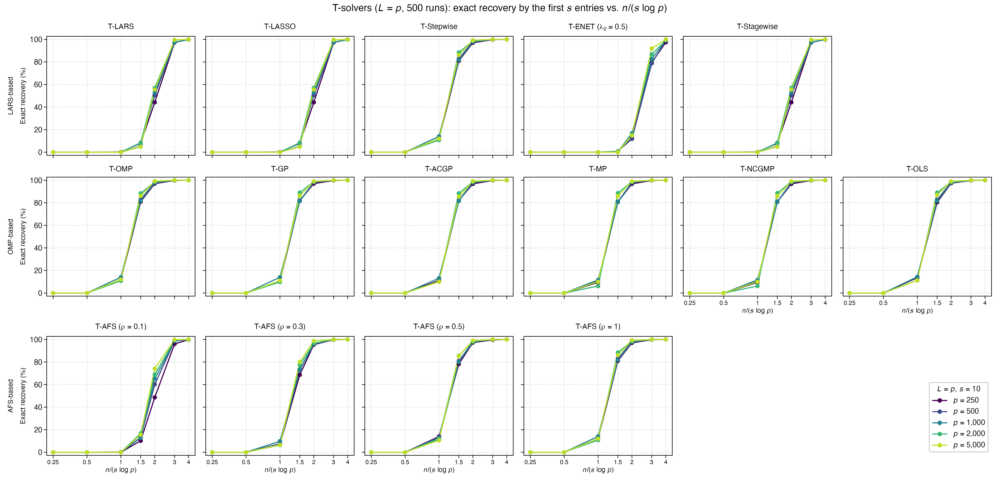
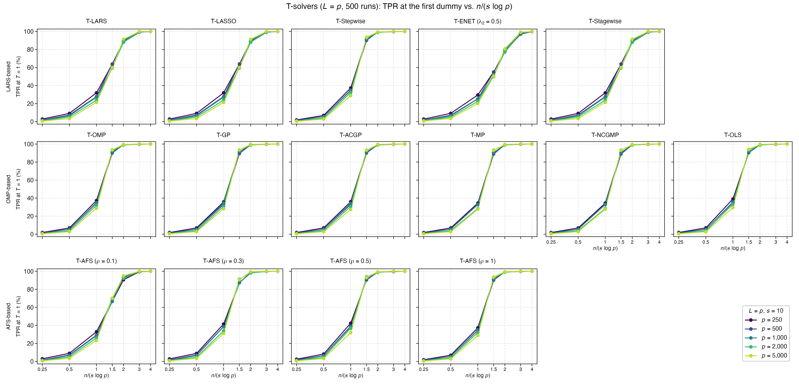
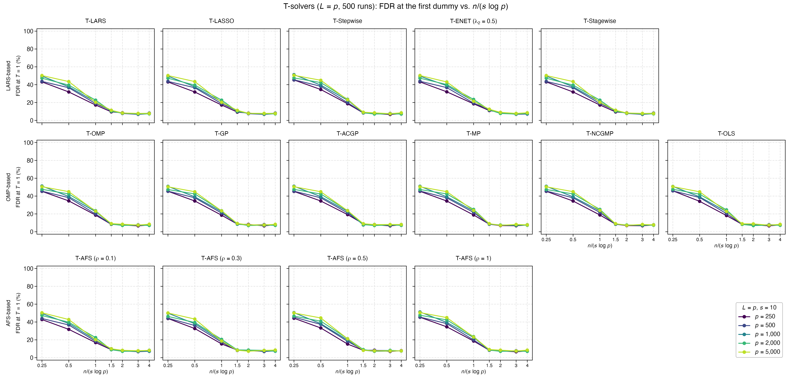
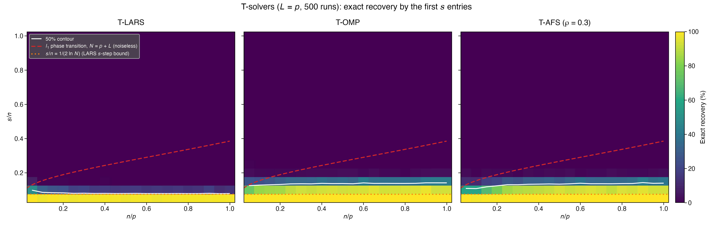

# Demo: Support Recovery of the T-Solvers vs. the Ratio n/(s log p) (R)

## Purpose

This demo measures how many observations the demo T-solvers need to recover the true support. It counts a run as an
exact recovery when the first $s$ distinct variables that enter the path are the $s$ true ones, so a null variable or
a dummy among them is a miss. Part 1 plots this probability against $n/(s \log p)$ for several $p$, and curves that
fall onto each other confirm that $n$ has to grow like $s \log p$. Part 2 draws the Donoho–Tanner diagram over $n/p$
and $s/n$ for three solvers. The demo mirrors the
[C++ demo](../../../../cpp/tsolvers/ad/demo_ts_perf_04_recovery_vs_dt_ratio/README.md) and the
[Python demo](../../../../Python/tsolvers/ad/demo_ts_perf_04_recovery_vs_dt_ratio/README.md) with the same settings,
seeds and console format, while R draws the supports and the data, so the numbers differ from both runs.

---

## Setup

- independent standard normal predictors and $L = p$ standard normal dummies,
- coefficients equal to 3 on a fixed random support and noise standard deviation about 1,
- every solver runs to the first dummy ($T = 1$), which also gives the true positive rate (TPR) and the false
  discovery rate (FDR) of that selection,
- 500 Monte Carlo runs.

**Part 1** uses $p \in \lbrace 250, 500, 1{,}000, 2{,}000, 5{,}000 \rbrace$ and $s = 10$, with

```math
n = \operatorname{round}\!\left(c \cdot s \ln p\right), \qquad c \in \lbrace 0.25, 0.5, 1, 1.5, 2, 3, 4 \rbrace,
```

so $n$ runs from 14 to 341. All 15 solver configurations of
[demo_ts_perf_01](../demo_ts_perf_01_fdr_tpr_vs_T/README.md) run on the same data.

**Part 2** uses $p = 400$ and the grid $n/p, s/n \in \lbrace 0.05, 0.10, \dots, 1 \rbrace$, so $n$ runs from 20 to
400 and every $s$ is a whole number. T-LARS, T-OMP and T-AFS ($\rho = 0.3$) run in each of the 400 cells.

For every data set `reader_data()` of [`ts_perf_utils.R`](../../ts_perf_utils.R) centers and scales $\mathbf{X}$ and
$\mathbf{D}$ in place with `MLLpNormScaler` and centers $\mathbf{y}$ once, and the solvers run on it as precentered
readers with the seed of the run for their tie-breaking. The seeds are those of the C++ demo. Part 1 draws its support
for every $p$ with `set.seed(12345)` and `sort(sample.int(p, s))` and the data of run `mc` with the seed `1000 + mc`,
and Part 2 draws the support of cell `c` with `12345 + c` and its data with `3000000 + 400 * mc + c`. R's
Mersenne-Twister turns these seeds into the supports and into the data of `gen_synthetic_data()`, and all indices are
1-based.

---

## Running the demo

From the repository root, with the TRexSelector R package installed:

```bash
demo=R/tsolvers/ad/demo_ts_perf_04_recovery_vs_dt_ratio/demo_ts_perf_04_recovery_vs_dt_ratio.R
Rscript $demo                 # 500 runs, 6 workers, Parts 1 and 2
Rscript $demo 5 3             # 5 runs, 3 workers
Rscript $demo 500 6 2         # Part 2 only
R/tsolvers/ad/demo_ts_perf_04_recovery_vs_dt_ratio/generate_plots.sh          # figures
```

The optional arguments are the number of runs, the number of worker processes and the parts to run. `run_parallel()`
of [`ts_perf_utils.R`](../../ts_perf_utils.R) spreads the tasks over R worker processes that
`parallel::makePSOCKcluster()` spawns, with no fork, and every worker sets the library to one thread with
`trex_set_num_threads(1L)`. Each solver therefore runs single-threaded inside its worker. Spawned workers run on
macOS, Linux and Windows alike and keep the thread setting, while the Open Multi-Processing (OpenMP) runtime resets the
thread count in a forked child, as the technical notes of [demo_ts_perf_01](../demo_ts_perf_01_fdr_tpr_vs_T/README.md)
explain.

With 6 workers on an Apple Silicon machine, Part 1 takes about 4.7 minutes (279.1 s) and Part 2 about 3.4 minutes
(203.4 s), against 144.1 s and 276.6 s for the C++ demo and 92.0 s and 72.8 s for the Python one. R thus needs 1.9
times the C++ time in Part 1 and 0.74 times in Part 2, and 3.0 and 2.8 times the Python time. The solvers cost in R
about what they cost in C++, as demo_ts_perf_01 shows, so the differences most likely come from the code around them,
such as drawing and scaling the data of every task. This demo does not time the solvers and the drawing of the data on
their own, so this reason is not proven.

The result files carry the number of runs in their name (`recovery_vs_dt_ratio_mc500` and `phase_transition_mc500`,
each as `.csv` and `.txt`), so a short test run does not overwrite the full one, and `generate_plots.sh 5` draws the
figures of a 5-run test. It draws them with the ggplot2 module [`ts_plt_utils.R`](../../ts_plt_utils.R), and its `.pdf`
files carry no creation date (`pdf(timestamp = FALSE)`), so a redraw of the same results gives the same bytes. The
output below is a run against library b95b984 (TRexSelector 2.0.0).

---

## Console walk-through

### Part 1: exact recovery vs. $n/(s \log p)$

The two extremes of the $p$ grid show the scaling, first $p = 250$:

```text
============================================================
T-Solver Performance: Recovery vs. n/(s log p)
============================================================
500 runs on 6 worker processes


============================================================
Part 1: Recovery vs. n/(s log p)
============================================================
p in {250, 500, 1000, 2000, 5000}, L = p, s = 10, n/(s log p) in {0.25, 0.5, 1, 1.5, 2, 3, 4}, T = 1
15 solvers, 500 runs

Exact recovery by the first s = 10 entries (%), p = 250
n/(s log p)               0.25     0.5       1     1.5       2       3       4
n                           14      28      55      83     110     166     221
------------------------------------------------------------------------------
T-LARS                     0.0     0.0     0.2     7.8    44.2    97.2   100.0
T-LASSO                    0.0     0.0     0.2     7.8    44.2    97.2   100.0
T-Stepwise                 0.0     0.0    11.8    81.0    97.0    99.8   100.0
T-ENET (lambda2 0.5)       0.0     0.0     0.0     0.6    12.4    79.4    97.4
T-Stagewise                0.0     0.0     0.2     7.8    44.2    97.2   100.0
T-OMP                      0.0     0.0    11.8    81.0    97.0    99.8   100.0
T-GP                       0.0     0.0    10.4    81.8    97.0    99.8   100.0
T-ACGP                     0.0     0.0    11.2    82.0    96.8    99.8   100.0
T-MP                       0.0     0.0     9.4    80.8    96.8    99.8   100.0
T-NCGMP                    0.0     0.0     9.4    80.8    96.8    99.8   100.0
T-OLS                      0.0     0.0    13.6    80.4    97.4    99.8   100.0
T-AFS (rho 0.1)            0.0     0.0     0.0    10.2    48.6    96.0    99.8
T-AFS (rho 0.3)            0.0     0.0     7.0    68.6    95.4    99.8   100.0
T-AFS (rho 0.5)            0.0     0.0    14.0    78.2    97.2    99.6   100.0
T-AFS (rho 1)              0.0     0.0    11.8    81.0    97.0    99.8   100.0
```

and then $p = 5{,}000$:

```text
Exact recovery by the first s = 10 entries (%), p = 5000
n/(s log p)               0.25     0.5       1     1.5       2       3       4
n                           21      43      85     128     170     256     341
------------------------------------------------------------------------------
T-LARS                     0.0     0.0     0.0     4.8    55.6    99.6   100.0
T-LASSO                    0.0     0.0     0.0     4.8    55.6    99.6   100.0
T-Stepwise                 0.0     0.0    12.0    86.2    99.2   100.0   100.0
T-ENET (lambda2 0.5)       0.0     0.0     0.0     0.0    14.8    92.0   100.0
T-Stagewise                0.0     0.0     0.0     4.8    55.6    99.6   100.0
T-OMP                      0.0     0.0    12.0    86.2    99.2   100.0   100.0
T-GP                       0.0     0.0    11.0    86.4    99.0   100.0   100.0
T-ACGP                     0.0     0.0    10.0    85.4    99.2   100.0   100.0
T-MP                       0.0     0.0    10.0    86.2    99.0   100.0   100.0
T-NCGMP                    0.0     0.0    10.0    86.2    99.0   100.0   100.0
T-OLS                      0.0     0.0    11.2    87.0    99.0   100.0   100.0
T-AFS (rho 0.1)            0.0     0.0     0.0    15.6    74.2    99.8   100.0
T-AFS (rho 0.3)            0.0     0.0     6.6    80.0    98.6   100.0   100.0
T-AFS (rho 0.5)            0.0     0.0    10.6    85.4    99.0   100.0   100.0
T-AFS (rho 1)              0.0     0.0    12.0    86.2    99.2   100.0   100.0
```

From $p = 250$ to $p = 5{,}000$ the number of variables grows 20-fold, and at the same $n/(s \log p)$ the recoveries
of the five $p$ lie within 13.2 percentage points of each other. Only T-AFS ($\rho = 0.1$) moves more at 2, from 48.6%
at $p = 250$ to 74.2% at $p = 5{,}000$. So $n$ has to grow like $s \log p$. The solvers fall into two groups. The
orthogonal matching pursuit (OMP) family, T-Stepwise and T-AFS with $\rho \ge 0.3$ recover the support in 68.6% to
89.0% of the runs at $n/(s \log p) = 1.5$ and in at least 95.4% at 2. T-LARS, T-LASSO, T-Stagewise and T-AFS with
$\rho = 0.1$ need about 1.5 times as many observations and reach 44.2% to 74.2% at 2. Their steep rise between 1.5 and
3 brackets the $s$-step bound of Donoho and Tsaig (2008), by which least angle regression (LARS) recovers the support
in its first $s$ steps once $n > 2 s \ln N$ with $N = p + L$ columns, which is $n/(s \log p) > 2.16$ to $2.25$ here.
T-ENET needs the most observations and recovers the support in 78.8% to 92.0% of the runs at 3.

T-AFS moves between the two groups. With $\rho = 0.1$ it takes small steps and follows T-LARS, ahead of it at 2 for
every $p$, and with $\rho = 1$ it takes full steps and equals T-OMP. T-OMP, T-Stepwise and T-AFS ($\rho = 1$) show the
same rows, and so do T-MP and T-NCGMP, as the shared paths of the
[C++ T-solver README](../../../../cpp/tsolvers/README.md) predict. T-OLS follows a selection rule of its own and differs
from T-OMP by up to 1.8 percentage points in exact recovery. T-LARS, T-LASSO and T-Stagewise also agree in every
exact-recovery entry, because they share the path up to the first drop, and their TPR and FDR differ by less than 0.4
percentage points.

The small rise with $p$ at a fixed ratio, for instance of T-OMP from 81.0% at $p = 250$ to 86.2% at $p = 5{,}000$ at
1.5, fits the dummies, which double the number of columns. Since $\ln(2p)/\ln p$ falls from 1.13 at $p = 250$ to 1.08
at $p = 5{,}000$, a fixed $n/(s \log p)$ gives slightly more observations per $s \ln N$ at larger $p$. The C++ and
Python runs show the same groups and identities. Over the 1,575 entries of the three measures, the R entries differ
from the C++ ones by at most 8.2 percentage points and from the Python ones by at most 7.0, which is 3.6 and 3.1
standard errors. Among that many entries such maxima fit the Monte Carlo error, so the three runs agree up to the data
that each of them draws.

### Part 1: TPR and FDR at the first dummy

```text
TPR at T = 1 (%), p = 1000
n/(s log p)               0.25     0.5       1     1.5       2       3       4
n                           17      35      69     104     138     207     276
------------------------------------------------------------------------------
T-LARS                     1.2     6.5    27.2    59.4    90.1    99.3   100.0
T-LASSO                    1.2     6.5    27.2    59.4    90.1    99.3   100.0
T-Stepwise                 0.9     5.5    34.9    91.2    99.4   100.0   100.0
T-ENET (lambda2 0.5)       1.2     6.4    25.2    49.9    79.6    97.9    99.9
T-Stagewise                1.2     6.5    27.2    59.4    90.1    99.3   100.0
T-OMP                      0.9     5.5    34.9    91.2    99.4   100.0   100.0
T-GP                       0.9     5.4    34.6    91.2    99.5   100.0   100.0
T-ACGP                     0.9     5.5    34.2    90.8    99.5   100.0   100.0
T-MP                       0.9     5.5    33.2    90.1    99.5   100.0   100.0
T-NCGMP                    0.9     5.5    33.2    90.1    99.5   100.0   100.0
T-OLS                      1.0     5.4    35.7    91.0    99.5   100.0   100.0
T-AFS (rho 0.1)            1.2     6.6    28.6    66.5    93.7    99.6   100.0
T-AFS (rho 0.3)            1.2     6.6    38.4    87.1    98.7   100.0   100.0
T-AFS (rho 0.5)            1.0     6.3    38.4    91.2    99.3   100.0   100.0
T-AFS (rho 1)              0.9     5.5    34.9    91.2    99.4   100.0   100.0

FDR at T = 1 (%), p = 1000
n/(s log p)               0.25     0.5       1     1.5       2       3       4
n                           17      35      69     104     138     207     276
------------------------------------------------------------------------------
T-LARS                    49.6    37.7    20.7    10.3     8.0     7.6     8.0
T-LASSO                   49.6    37.7    20.7    10.1     7.8     7.6     8.0
T-Stepwise                51.3    39.5    22.6     8.7     8.0     7.5     7.9
T-ENET (lambda2 0.5)      49.6    38.9    21.6    11.7     8.9     7.4     7.3
T-Stagewise               49.6    37.7    20.7    10.3     8.0     7.6     8.0
T-OMP                     51.3    39.5    22.6     8.7     8.0     7.5     7.9
T-GP                      50.9    39.2    22.6     8.4     7.6     7.2     8.0
T-ACGP                    51.1    39.4    22.9     7.6     8.2     7.3     8.1
T-MP                      51.0    39.2    23.3     8.8     7.4     7.3     7.9
T-NCGMP                   51.0    39.2    23.3     8.8     7.4     7.3     7.9
T-OLS                     50.8    39.2    22.6     8.7     7.7     7.6     8.2
T-AFS (rho 0.1)           49.5    38.3    20.0     9.2     8.1     7.5     7.1
T-AFS (rho 0.3)           49.9    38.1    18.8     8.3     7.6     7.8     7.3
T-AFS (rho 0.5)           50.5    38.1    19.8     8.3     7.2     7.4     7.6
T-AFS (rho 1)             51.3    39.5    22.6     8.7     8.0     7.5     7.9
```

The TPR at the first dummy follows the same two groups. At $n/(s \log p) = 1.5$ the OMP family finds about 91% of the
true variables and T-LARS about 59%, and from 3 on every solver finds at least 97.9% at $p = 1{,}000$. Once the true
variables come first, the FDR settles at 7% to 9% for every solver, which the exchangeability of null variables and
dummies from [demo_ts_perf_01](../demo_ts_perf_01_fdr_tpr_vs_T/README.md) predicts. Null variables and dummies are
about equally many ($p - s = 990$ and $L = 1{,}000$), so $V$ null variables enter before the first dummy with
probability about $(1/2)^{V+1}$, and

```math
\mathrm{FDR} \approx \sum_{k \ge 1} \left(\tfrac{1}{2}\right)^{k+1} \frac{k}{k + s} = 7.8\,\% \qquad (s = 10).
```

Over all five $p$ the columns 3 and 4 average an FDR of 7.6%, close to this value. With too few observations the true
variables rarely enter, and the FDR approaches 50% (49.5% to 51.3% at 0.25 for $p = 1{,}000$). The first entry is then
a dummy in about half of the runs, which leaves an empty selection, and a null variable in the other half. The console
then prints the tables for $p = 2{,}000$ and $5{,}000$, which `recovery_vs_dt_ratio_mc500.txt` also holds, and Part 1
ends with no failed solver run:

```text
Failed solver runs: 0
Wall time: 279.1 s
```

### Part 2: the Donoho–Tanner diagram

Each table lists the exact recovery in percent, with $s/n$ falling from the top row to the bottom one and $n/p$ growing
from left to right. The rows with $s/n \ge 0.30$ are zero in all three tables.

```text
============================================================
Part 2: Donoho-Tanner phase transition
============================================================
p = 400, L = p, n/p and s/n in {0.05, 0.10, ..., 1}, T = 1
T-LARS, T-OMP and T-AFS (rho 0.3), 500 runs per cell

Exact recovery by the first s entries (%), T-LARS
 s/n \ n/p 0.05 0.10 0.15 0.20 0.25 0.30 0.35 0.40 0.45 0.50 0.55 0.60 0.65 0.70 0.75 0.80 0.85 0.90 0.95 1.00
--------------------------------------------------------------------------------------------------------------
      1.00    0    0    0    0    0    0    0    0    0    0    0    0    0    0    0    0    0    0    0    0
      0.95    0    0    0    0    0    0    0    0    0    0    0    0    0    0    0    0    0    0    0    0
      0.90    0    0    0    0    0    0    0    0    0    0    0    0    0    0    0    0    0    0    0    0
      0.85    0    0    0    0    0    0    0    0    0    0    0    0    0    0    0    0    0    0    0    0
      0.80    0    0    0    0    0    0    0    0    0    0    0    0    0    0    0    0    0    0    0    0
      0.75    0    0    0    0    0    0    0    0    0    0    0    0    0    0    0    0    0    0    0    0
      0.70    0    0    0    0    0    0    0    0    0    0    0    0    0    0    0    0    0    0    0    0
      0.65    0    0    0    0    0    0    0    0    0    0    0    0    0    0    0    0    0    0    0    0
      0.60    0    0    0    0    0    0    0    0    0    0    0    0    0    0    0    0    0    0    0    0
      0.55    0    0    0    0    0    0    0    0    0    0    0    0    0    0    0    0    0    0    0    0
      0.50    0    0    0    0    0    0    0    0    0    0    0    0    0    0    0    0    0    0    0    0
      0.45    0    0    0    0    0    0    0    0    0    0    0    0    0    0    0    0    0    0    0    0
      0.40    0    0    0    0    0    0    0    0    0    0    0    0    0    0    0    0    0    0    0    0
      0.35    0    0    0    0    0    0    0    0    0    0    0    0    0    0    0    0    0    0    0    0
      0.30    0    0    0    0    0    0    0    0    0    0    0    0    0    0    0    0    0    0    0    0
      0.25    0    0    0    0    0    0    0    0    0    0    0    0    0    0    0    0    0    0    0    0
      0.20    0    0    0    0    0    0    0    0    0    0    0    0    0    0    0    0    0    0    0    0
      0.15    7    0    0    0    0    0    0    0    0    0    0    0    0    0    0    0    0    0    0    0
      0.10   49   31   26   25   19   20   17   17   15   17   17   15   16   15   15   14   14   19   13   14
      0.05  100   98   99   99   98   98   98   99   99   98   99   99   98   98   99   99   99   99   99   99

Exact recovery by the first s entries (%), T-OMP
 s/n \ n/p 0.05 0.10 0.15 0.20 0.25 0.30 0.35 0.40 0.45 0.50 0.55 0.60 0.65 0.70 0.75 0.80 0.85 0.90 0.95 1.00
--------------------------------------------------------------------------------------------------------------
      1.00    0    0    0    0    0    0    0    0    0    0    0    0    0    0    0    0    0    0    0    0
      0.95    0    0    0    0    0    0    0    0    0    0    0    0    0    0    0    0    0    0    0    0
      0.90    0    0    0    0    0    0    0    0    0    0    0    0    0    0    0    0    0    0    0    0
      0.85    0    0    0    0    0    0    0    0    0    0    0    0    0    0    0    0    0    0    0    0
      0.80    0    0    0    0    0    0    0    0    0    0    0    0    0    0    0    0    0    0    0    0
      0.75    0    0    0    0    0    0    0    0    0    0    0    0    0    0    0    0    0    0    0    0
      0.70    0    0    0    0    0    0    0    0    0    0    0    0    0    0    0    0    0    0    0    0
      0.65    0    0    0    0    0    0    0    0    0    0    0    0    0    0    0    0    0    0    0    0
      0.60    0    0    0    0    0    0    0    0    0    0    0    0    0    0    0    0    0    0    0    0
      0.55    0    0    0    0    0    0    0    0    0    0    0    0    0    0    0    0    0    0    0    0
      0.50    0    0    0    0    0    0    0    0    0    0    0    0    0    0    0    0    0    0    0    0
      0.45    0    0    0    0    0    0    0    0    0    0    0    0    0    0    0    0    0    0    0    0
      0.40    0    0    0    0    0    0    0    0    0    0    0    0    0    0    0    0    0    0    0    0
      0.35    0    0    0    0    0    0    0    0    0    0    0    0    0    0    0    0    0    0    0    0
      0.30    0    0    0    0    0    0    0    0    0    0    0    0    0    0    0    0    0    0    0    0
      0.25    0    0    0    0    0    0    0    0    0    0    0    0    0    0    0    0    0    0    0    0
      0.20    2    1    1    1    1    2    2    2    2    2    2    1    2    1    1    1    2    2    3    3
      0.15   26   24   27   30   34   34   33   37   35   36   34   41   36   37   37   36   37   41   41   41
      0.10   75   84   85   86   90   92   91   93   93   92   93   93   95   93   93   94   94   97   92   93
      0.05  100  100  100  100  100  100  100  100  100  100  100  100  100  100  100  100  100  100  100  100

Exact recovery by the first s entries (%), T-AFS (rho 0.3)
 s/n \ n/p 0.05 0.10 0.15 0.20 0.25 0.30 0.35 0.40 0.45 0.50 0.55 0.60 0.65 0.70 0.75 0.80 0.85 0.90 0.95 1.00
--------------------------------------------------------------------------------------------------------------
      1.00    0    0    0    0    0    0    0    0    0    0    0    0    0    0    0    0    0    0    0    0
      0.95    0    0    0    0    0    0    0    0    0    0    0    0    0    0    0    0    0    0    0    0
      0.90    0    0    0    0    0    0    0    0    0    0    0    0    0    0    0    0    0    0    0    0
      0.85    0    0    0    0    0    0    0    0    0    0    0    0    0    0    0    0    0    0    0    0
      0.80    0    0    0    0    0    0    0    0    0    0    0    0    0    0    0    0    0    0    0    0
      0.75    0    0    0    0    0    0    0    0    0    0    0    0    0    0    0    0    0    0    0    0
      0.70    0    0    0    0    0    0    0    0    0    0    0    0    0    0    0    0    0    0    0    0
      0.65    0    0    0    0    0    0    0    0    0    0    0    0    0    0    0    0    0    0    0    0
      0.60    0    0    0    0    0    0    0    0    0    0    0    0    0    0    0    0    0    0    0    0
      0.55    0    0    0    0    0    0    0    0    0    0    0    0    0    0    0    0    0    0    0    0
      0.50    0    0    0    0    0    0    0    0    0    0    0    0    0    0    0    0    0    0    0    0
      0.45    0    0    0    0    0    0    0    0    0    0    0    0    0    0    0    0    0    0    0    0
      0.40    0    0    0    0    0    0    0    0    0    0    0    0    0    0    0    0    0    0    0    0
      0.35    0    0    0    0    0    0    0    0    0    0    0    0    0    0    0    0    0    0    0    0
      0.30    0    0    0    0    0    0    0    0    0    0    0    0    0    0    0    0    0    0    0    0
      0.25    0    0    0    0    0    0    0    0    0    0    0    0    0    0    0    0    0    0    0    0
      0.20    2    0    2    1    1    1    2    1    2    2    2    1    1    1    2    2    1    1    2    3
      0.15   11   10   18   21   28   26   31   31   33   30   34   38   33   34   34   35   36   42   38   39
      0.10   58   57   68   78   85   88   89   90   91   93   92   93   94   93   91   94   93   96   93   93
      0.05  100   99  100  100  100  100  100  100  100  100  100  100  100  100  100  100  100  100  100  100

Failed solver runs: 0
Wall time: 203.4 s
```

T-LARS recovers the support in 98% to 100% of the runs at $s/n = 0.05$ over the whole range of $n/p$, in 13% to 49%
at 0.10 and in 7% or less above. Its edge lies at $s/n \approx 0.08$ from $n/p = 0.15$ on, right at the $s$-step
bound $1/(2 \ln N) = 0.075$ for $N = p + L = 800$ columns. T-OMP reaches further, with 75% to 97% at $s/n = 0.10$ and
24% to 41% at 0.15. T-AFS ($\rho = 0.3$) stays within 7.8 percentage points of T-OMP from $n/p = 0.25$ on and falls
behind below, by up to 26 percentage points at $n/p = 0.10$. The R diagram differs from the C++ one by at most 5.0
percentage points in a cell and from the Python one by at most 8.2, and no cell differs by more than 3.2 standard
errors.

The edges of T-LARS and T-OMP are nearly flat in $n/p$, and the edge of T-AFS rises from $s/n \approx 0.11$ at
$n/p \le 0.10$ to about the one of T-OMP at $n/p = 0.25$. A flat edge sits at a fixed $s/n$ and thus at a fixed
$n/(s \ln N)$, the scaling of Part 1. The edges also agree with Part 1 in numbers. At $p = 400$ the 50% edge of T-LARS
at $s/n \approx 0.08$ means $n/(s \log p) \approx 2.1$, and the edge of T-OMP at 0.13 to 0.14 means 1.2 to 1.3. The
two solvers cross 50% in Part 1 near these values, at about 2 and 1.3. All edges lie far below the $\ell_1$ phase
transition of Donoho and Tanner, which reaches $s/n = 0.39$ at $n/p = 1$. That curve marks where the $\ell_1$ solution
at the end of a noiseless path equals the true coefficients, while exact recovery here asks that no wrong variable
enters before the $s$ true ones.

---

## Figures

The first three figures show exact recovery, TPR and FDR at the first dummy against $n/(s \log p)$, one panel per
solver with the families in the rows and one curve per $p$. Every configuration reached the first dummy in every run,
so the figures carry no open markers.







The fourth figure shows the Donoho–Tanner diagram of Part 2 with the 50% contour of every solver. The dashed curve is
the noiseless $\ell_1$ phase transition for $N = p + L$ columns, computed from the statistical dimension of the
$\ell_1$ descent cone (Amelunxen, Lotz, McCoy and Tropp, 2014). The dotted line is the $s$-step bound
$s/n = 1/(2 \ln N)$.



---

## Technical notes

- A variable counts once among the first $s$ entries, also when T-MP selects it again or T-LASSO lets it enter
  again after a drop. `first_entries_exact()` reads the signed 1-based codes of `get_actions()`, where a negative code
  is a drop.
- The noise standard deviation stays at about 1 for every $s$, because the demo sets the signal-to-noise ratio of the
  data generator to $9s$, the signal variance of $s$ coefficients equal to 3. `gen_synthetic_data()` divides the
  variance of the drawn signal by this ratio.
- Part 1 draws its support once per $p$, and Part 2 once per cell. With independent standard normal predictors the
  place of the support does not matter.
- `run_parallel()` starts the 6 workers once per part, and every worker loads TRexSelector and calls
  `trex_set_num_threads(1L)`, so the 6 workers share 6 cores with single-threaded solvers. `parallel::parLapplyLB()`
  hands the tasks to the free workers. Part 1 sends its 17,500 tasks, one per configuration and run, one at a time,
  and Part 2 sends its 200,000 tasks, one per run and cell, in chunks of 64, so fewer messages pass between the parent
  and the workers.
- References: D. L. Donoho and Y. Tsaig, *Fast solution of ℓ1-norm minimization problems when the solution may
  be sparse*, IEEE Transactions on Information Theory 54(11), 2008. D. Amelunxen, M. Lotz, M. B. McCoy and
  J. A. Tropp, *Living on the edge: phase transitions in convex programs with random data*, Information and
  Inference 3(3), 2014.
