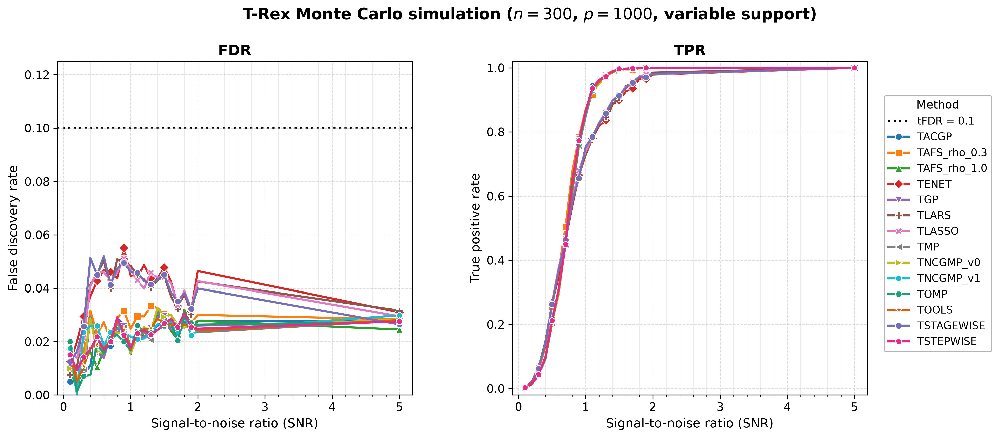
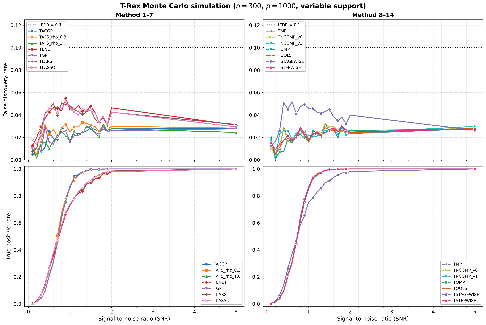

# Demo 03: Monte Carlo Simulation with Variable Support Indices

## Purpose

Investigate Terminating Random Experiments (T-Rex) selector performance, measured by the false discovery rate (FDR), the
true positive rate (TPR), the average dummy multiplier $L$ and the average stopping time $T$, when the **positions** of
the active variables are redrawn on every Monte Carlo (MC) trial, while the **number** of active variables stays fixed.
This isolates the effect of support location (rather than support size) and complements the fixed-support study in
Demo 02.

---

## Data Generation Parameters

- **Sample size**: $n = 300$
- **Number of features**: $p = 1{,}000$
- **True support cardinality**: fixed at $s = 10$ on every trial. The support **size does not vary**, and only the
  **indices** change — each trial shuffles $\lbrace0, \ldots, p-1\rbrace$ with `std::mt19937(seed + 500000)`, keeps
  the first 10, and sorts them.
- **True coefficients**: fixed $\beta_j = 1$ (`rnd_coef = false`)
- **Signal-to-noise ratio (SNR) grid**: a **21-point grid** — $\lbrace0.1, 0.2, \ldots, 2.0\rbrace$ (step $0.1$)
  plus $5.0$
- **Monte Carlo repetitions**: `num_MC = 200` trials per solver × SNR level
- **Data-generating process (DGP)**: $\mathbf{y} = \mathbf{X}\boldsymbol{\beta} + \boldsymbol{\epsilon}$,
  $\boldsymbol{\epsilon} \sim N(0, \sigma^2 I_n)$, Normal predictors and Normal noise

`main()` runs only the high-dimensional configuration ($n = 300$, $p = 1{,}000$).

---

## Control Parameters

```text
K = 20                           # Random experiments per T-loop iteration
max_dummy_multiplier = 10        # Max dummies L = 10p
use_max_T_stop = true            # Cap T ≤ ceil(n/2)
dummy_distribution = Normal      # Dummy predictors drawn from N(0,1)
lloop_strategy = HCONCAT         # Horizontally concatenated dummy columns
tloop_stagnation_stop = true     # Early exit when R_mat stagnates
tloop_max_stagnant_steps = 5     # Stagnation window (5 consecutive unchanged iterations)
tFDR = 0.1                       # Target FDR control level
```

The MC loop is parallelized with Open Multi-Processing (OpenMP) (`TREX_NUM_WORKERS` threads, default 8).

---

## Solvers Compared

The same **14** T-Rex base solvers as Demo 02, via the shared `make_default_solvers_to_test()` list (TLARS, TLASSO,
TENET, TSTAGEWISE, TSTEPWISE, TOMP, TGP, TACGP, TMP, TAFS_rho_0.3, TAFS_rho_1.0, TNCGMP_v1, TNCGMP_v0, TOOLS). Unlike
Demo 02, this demo also records the averaged dummy multiplier $L$ and stopping time $T$ per solver × SNR.

---

## Output Files

Both files are written to `simulation_results/data/`. The stem uses `tloop_max_stagnant_steps = 5` (hence
`stagnation_window_5`), prefixed with `demo_trex_03_mc_sim_variable_support_`.

### Main Result File

**`demo_trex_03_mc_sim_variable_support_trex_results_n300_p1000_stagnation_window_5.txt`**

Aligned table with four metric rows per solver — FDR, TPR, Avg L, Avg T — across the 21 SNR columns.

### Tidy-Format CSV

**`demo_trex_03_mc_sim_variable_support_trex_results_n300_p1000_stagnation_window_5.csv`**

Long/stacked format, header column order **`solver,metric,snr,value`**, with `FDR`, `TPR`, `AvgL`, and `AvgT` rows
per solver and SNR:

```text
solver,metric,snr,value
TLARS,FDR,0.100000,...
TLARS,TPR,0.100000,...
TLARS,AvgL,0.100000,...
TLARS,AvgT,0.100000,...
...
```

---

## Results Visualization

The suite-level plotting module [../trex_plt_utils.py](../trex_plt_utils.py)
renders the tidy comma-separated values (CSV) file three ways, the interactive one only on request (all written to
`simulation_results/plots/`).
Only the `FDR` and `TPR` rows are plotted, while the `AvgL` / `AvgT` rows are ignored
by the plotter.

### Overview (all 14 solvers)

FDR and TPR versus SNR over the fine 21-point grid, all
solvers on one pair of panels, with the legend just right of the TPR panel:



*Left:* even with the support indices redrawn every trial, FDR stays well below
the target `tFDR = 0.1` (black dotted line) for every solver across the whole SNR
grid, at most $0.055$ (TENET at SNR 0.9) — FDR control is robust to the location of the active set.
*Right:* the fine grid gives a smooth power curve, TPR climbing from near-zero at SNR 0.1 to
at least $0.98$ for every solver at SNR 2.0.

### Grouped 2×2 view (de-cluttered)

The same data with the solvers split into two halves (columns) and FDR/TPR on the
two rows, so each panel carries only ~7 curves — easier to read where they bunch
up. Both FDR panels share a y-scale for comparison:



### Interactive (Plotly HTML, on request)

`..._fdr_tpr_vs_snr.html` is a self-contained interactive figure — hover for exact
values and **click a solver in the legend to isolate its curve** in both panels.
Open it directly in a browser (it is not rendered inline on GitHub).
The `.html` figures are off by default and never committed, since each embeds a full copy
of plotly.js (about 5 MB). Run `./generate_plots.sh --plotly` to produce them locally.

```bash
open simulation_results/plots/demo_trex_03_mc_sim_variable_support_trex_results_n300_p1000_stagnation_window_5_fdr_tpr_vs_snr.html
```

Vector `.pdf` copies of both static figures sit alongside the `.png` files.

### Regenerating the figures

The wrapper picks up the repo's local `.venv` automatically (no manual path or
`activate` needed):

```bash
# From this demo folder:
./generate_plots.sh                 # overview + grouped (png+pdf)
./generate_plots.sh --plotly        # plus the interactive html (not committed)
./generate_plots.sh --tfdr 0.05     # e.g. a different target-FDR line
```

The shared [../trex_plt_utils.py](../trex_plt_utils.py) infers row colours from
the data and is used by every demo in this suite with the tidy
`solver,metric,snr,value` schema (demos 02/03/04/05).

---

## Running the Demo

```bash
./build/debug/bin/trex_selector_methods/ad/trex_core/demo_trex_03_mc_sim_variable_support/demo_trex_03_mc_sim_variable_support
```

### Note on `TNCGMP_v0` memory messages (benign)

With older library builds, the `TNCGMP_v0` (LineSearch / Matching Pursuit) block prints lines such as:

```text
[TNCGMP_LineSearch] [WARNING] LineSearch worst-case beta path is ~1.34 GiB (3000 x 60000 doubles); rely on T_stop early stopping.
```

This is **not** an error and does **not** indicate a failed run — the reported results are correct. It is a
*worst-case* memory estimate, because the LineSearch variant allows atom re-selection and therefore uses a uniquely
large step ceiling (`20 · p_tot`, vs `8 · min(...)` for the orthogonal matching pursuit (OMP) family of solvers). The
beta-path buffer is allocated **incrementally** and bounded by `T_stop` / stagnation stopping, so the full worst case is
virtually never reached. Only `v0` reports it, while `TNCGMP_v1` (FullyCorrective) does not. The message also fires
once per solver construction (i.e. per MC trial), which is why it can repeat.

Upstream this has been reclassified from an unconditional `logWarning` to a verbose-only `logInfo`, so recent library
builds are silent here unless verbosity is enabled.

---

## Key Questions Addressed

1. **Is FDR control robust to the location of the active set?**
   - Expected: FDR remains $\leq \mathrm{tFDR}$ regardless of which 10 indices are active.
   - The committed run confirms it, with a highest FDR of $0.055$ over all 14 solvers and 21 SNR points.

2. **How do the averaged $L$ and $T$ behave across SNR?**
   - The Avg L and Avg T rows expose how the dummy multiplier and stopping time adapt as signal strength rises.
   - In the committed run, averaged over the solvers, Avg L climbs from $2.6$ at SNR 0.1 to a peak of $7.1$ at
     SNR 0.4 and falls to $1.1$ at SNR 5.0. Avg T peaks later, at $6.4$ around SNR 0.8, and settles near $5$.

3. **How does TPR climb across the fine SNR grid?**
   - The 21-point grid gives a smooth power curve from weak to strong signal.
   - In the committed run the lowest TPR over the solvers is $0.729$ at SNR 1.0 and $0.979$ at SNR 2.0.

---

## Interpretation Guide

**What to look for:**

- **FDR stability**: Should remain $\leq \mathrm{tFDR}$ even as support indices change per trial.
- **TPR curve**: Smooth increase across the fine SNR grid.
- **Avg L / Avg T**: Diagnostic behaviour of the L-loop and T-loop across SNR.

**Comparison with Demo 02:**

- Demo 02 (fixed support indices) is the baseline.
- Demo 03 (support indices redrawn per trial, fixed cardinality) tests robustness to support location. Both demos
  run 200 trials per point, but demo 03 also uses the `HCONCAT` L-loop strategy and a stagnation window of 5
  (demo 02 uses `STANDARD` and 7), so the two are not a pure support-location comparison.
