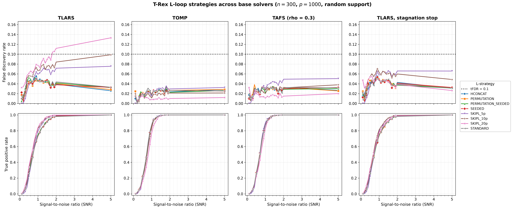
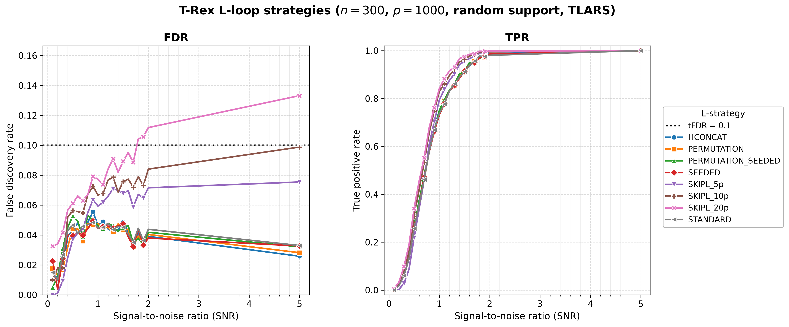

# Demo 04: L-Loop Strategy Comparison

## Purpose

Compare the **L-loop strategies** of the Terminating Random Experiments (T-Rex) Selector — the different mechanisms by
which the dummy-variable structure is generated/expanded across L-loop iterations — and repeat the whole comparison
across **three base solver families** (TLARS, TOMP, TAFS), plus TLARS_STAG, TLARS with the T-loop stagnation stop.
This shows how the L-loop strategy affects control of the false discovery rate (FDR), power as measured by the true
positive rate (TPR), and the calibrated dummy multiplier $L$ / stopping time $T$, and — crucially — where the
fixed-budget `SKIPL` FDR overshoot seen under TLARS comes from. It could be **specific to the least-angle regression
(LARS) path** or come from TLARS running without the stagnation stop. (The demo originally fixed the solver at TLARS. It
now sweeps all four, one result-file pair per solver, precisely to settle that question.)

---

## Data Generation Parameters

- **Sample size**: $n = 300$
- **Number of features**: $p = 1{,}000$
- **True support**: a random subset of size $s = 10$, **redrawn per trial** (`block_support = false`) by shuffling
  $\lbrace0, \ldots, p-1\rbrace$ with `std::mt19937(seed + 500000)`, keeping 10 indices and sorting them. A contiguous
  block support $\lbrace0, \ldots, s-1\rbrace$ is available via the `block_support = true` call, which is compiled but
  guarded by `if (false)`.
- **True coefficients**: fixed $\beta_j = 1$ (`rnd_coef = false`)
- **Signal-to-noise ratio (SNR) grid**: 21 values — $\lbrace0.1, 0.2, \ldots, 2.0\rbrace$ plus $5.0$
- **Monte Carlo (MC) repetitions**: `num_MC = 200` trials per strategy × SNR level
- **Data-generating process (DGP)**: $\mathbf{y} = \mathbf{X}\boldsymbol{\beta} + \boldsymbol{\epsilon}$,
  $\boldsymbol{\epsilon} \sim N(0, \sigma^2 I_n)$, Normal predictors and Normal noise
- **Base solvers** (outer sweep, one result-file pair each): **TLARS** (equiangular LARS path, and the stagnation stop
  AUTO-resolves to *disabled*), **TOMP** (greedy orthogonal matching pursuit, and the stagnation stop is *enabled*),
  **TAFS** (greedy adaptive forward selection, `rho_afs = 0.3`, and the stagnation stop is *enabled*) — the same three
  families as demo 05 — and **TLARS_STAG** (TLARS with the stagnation stop *enabled*, window 5). TAFS is the only one
  with a non-zero `rho_afs`, so the figures label it `TAFS (rho = 0.3)`
- **Target FDR (tFDR)**: $0.1$

---

## L-Loop Strategies Tested

`make_lloop_strategies()` sweeps the **six L-loop strategy types** defined by the library `LLoopStrategy` enum, with
`SKIPL` evaluated at three fixed dummy levels (5p, 10p, 20p) — **eight rows** in total.

The strategies span two orthogonal axes: **dummy source** (fresh independent draws per experiment vs one shared base
matrix whose rows are permuted per experiment) and **storage** (*stored* strategies keep matrices in the
`DummyGenerator` for the whole run, while *on-demand* strategies re-derive everything from the seed at each step, with
zero persistent state):

1. **STANDARD** — stored, with fresh independent and identically distributed (i.i.d.) dummy matrices at each L-loop
   iteration (conservative default, matches the Comprehensive R Archive Network (CRAN) R reference).
2. **HCONCAT** — stored, horizontally expands (concatenates) dummy columns and is prefix-stable.
3. **PERMUTATION** — stored base dummy matrix, re-used via deterministic **row permutations** per experiment.
4. **PERMUTATION_SEEDED** — seed-derived base + row permutations per experiment, with nothing stored. Bit-identical to
   PERMUTATION for the same seed.
5. **SEEDED** — seed-derived independent dummies per experiment and L-loop step, with nothing stored. It is the
   storage-free twin of STANDARD.
6. **SKIPL** — skip the L-loop entirely and use $L = \text{max\_dummy\_multiplier}$, evaluated at:
   - **SKIPL_5p** ($L = 5p$)
   - **SKIPL_10p** ($L = 10p$)
   - **SKIPL_20p** ($L = 20p$)

The library enum has **no** "Doubling" or "Fixed" strategy. (The former `DIRECT` / `PERMUTATION_DIRECT` names were
renamed to `SEEDED` / `PERMUTATION_SEEDED`, and the old names no longer exist.)

---

## Control Parameters

Set per solver × strategy (see the solver / strategy loops):

```text
solver_type = <varies>           # TLARS / TOMP / TAFS / TLARS_STAG (outer sweep)
solver_params.rho_afs = 0.3      # TAFS regularization (ignored by TLARS/TOMP)
tloop_stagnation_stop = AUTO     # Off for TLARS, on for TOMP/TAFS, forced on for TLARS_STAG
K = 20                           # Random experiments per T-loop iteration
max_dummy_multiplier = 10        # Default for adaptive strategies; 5 / 10 / 20 for SKIPL
use_max_T_stop = true            # Cap T ≤ ceil(n/2)
dummy_distribution = Normal      # Dummy predictors drawn from N(0,1)
lloop_strategy = <varies>        # Inner sweep across the 6 strategy types (8 rows)
tFDR = 0.1                       # Target FDR control level
```

The MC loop is parallelized with Open Multi-Processing (OpenMP) (`TREX_NUM_WORKERS` threads, default 8).

---

## Output Files

All files are written to `simulation_results/data/`. One `.txt` + `.csv` pair is written **per base solver**, and the
stem encodes the solver and the support scenario (`random_support` for the active run):

### Main Result Files

**`demo_trex_04_lloop_strategies_results_n300_p1000_{tlars,tomp,tafs,tlars_stag}_random_support.txt`**

Aligned table (written by the shared `save_and_print_mc_results`) with four metric rows — FDR, TPR, Avg L, Avg T — per
strategy across the 21 SNR columns. The row label is the strategy name (STANDARD, HCONCAT, PERMUTATION,
PERMUTATION_SEEDED, SEEDED, SKIPL_5p, SKIPL_10p, SKIPL_20p):

```text
======================================================================
=== T-Rex Results (averaged over 200 Monte Carlo runs) ===
======================================================================

  SNR                          0.10      0.20      0.30  ...
-----------------------------------------------------------...

STANDARD
  FDR                        0.0150    0.0099    0.0268  ...
  TPR                        0.0005    0.0180    0.0605  ...
  Avg L                      2.5300    4.3550    5.5600  ...
  Avg T                      3.8350    3.8650    3.8450  ...

HCONCAT
...
```

### Tidy-Format CSVs

**`demo_trex_04_lloop_strategies_results_n300_p1000_{tlars,tomp,tafs,tlars_stag}_random_support.csv`**

Long/stacked format, header column order **`solver,metric,snr,value`** (here the "solver" column holds the strategy
name, while the base solver is encoded in the file name), with `FDR`, `TPR`, `AvgL`, `AvgT` rows.

---

## Results Visualization

`./generate_plots.sh` renders two complementary views into
`simulation_results/plots/`: a **cross-solver comparison grid** (the figure for
this demo's core question) and the standard **per-solver figure sets**. Both are
regenerated only after the demo has been run for the base solvers (so the
per-solver comma-separated values (CSV) files exist), and TLARS_STAG joins once its CSV exists.

### Cross-solver comparison grid

The headline figure — a 2×4 grid, rows = metric (FDR / TPR), columns = base
solver (TLARS / TOMP / TAFS / TLARS with the stagnation stop), with all eight L-loop strategies drawn as lines in
every panel. Colours and markers are keyed to the strategy, so a given strategy is
the same colour in every panel and can be tracked across solvers. All FDR panels
share one y-scale and all TPR panels share `[0, 1]`, so the columns are directly
comparable:



This grid exists to answer one question. **Where does the fixed-budget `SKIPL` FDR
overshoot come from?** Read the top (FDR) row across the four
columns and check whether the `SKIPL_20p` / `SKIPL_10p` curves cross the
`tFDR = 0.1` line under TOMP, TAFS and TLARS with the stagnation stop the way they do under TLARS. It is produced
by the suite plotter's `grid` mode (`../trex_plt_utils.py grid --labels ... --csvs ...`), which reads all
solver CSVs at once and renders them on a shared scale.

#### What TLARS establishes, and the test the other columns run

Under **TLARS** (established, `num_MC = 200`, so a stable effect and not Monte
Carlo noise), the adaptive strategies (STANDARD, HCONCAT, PERMUTATION,
PERMUTATION_SEEDED, SEEDED) hold FDR near or below target — STANDARD even
trends *down* to ≈0.033 at SNR 5 — while the fixed-budget `SKIPL` levels rise in
ascending order of budget. `SKIPL_5p` stays under target (max FDR
≈0.075), `SKIPL_10p` ends just below the line at the very top of the grid (max ≈0.099), and
`SKIPL_20p` climbs steadily past the line from SNR ≈1.8 to **≈0.133** at SNR 5 — a
~3.3 pp overshoot. The overshoot is **monotone in the dummy budget** and tracks a
runaway stopping time `T`, and at SNR 5 the `Avg T` rows read `SKIPL_5p` `T ≈ 23`,
`SKIPL_10p` `T ≈ 75`, `SKIPL_20p` `T ≈ 144` — versus the true support size
`s = 10`.

All four columns come from library 09debc6. Library 415484d removed a lower clamp of the calibrated occurrences in
the estimate of the false discovery proportion (FDP), which had made the estimate too small in long T-loops. That
brought `SKIPL_10p` down from 0.115 to just below the target and shortened its T-loop from `T ≈ 89` to `T ≈ 75`,
while `SKIPL_20p` stayed where it was (0.135 before).

Library 09debc6 made SEEDED the storage-free twin of STANDARD. Its average $L$ over the SNR grid fell from 3.65 to
3.29 under TLARS and from 3.07 to 2.70 under TOMP, next to STANDARD's 3.26 and 2.70, while its FDR and TPR stayed
within MC noise. The trial data are seeded and the selector's dummies are not, so the other rows also move a little
from run to run.

**Mechanism.** `SKIPL` disables the L-loop and freezes the dummy multiplier at `L = {5, 10, 20}·p`. With `L = 20`, the
expected null inflow of one T-step, $(p - \sum_j \Phi_t(j)) / (Lp - t + 1)$, is about 0.05 and the T-loop reaches
`T ≈ 140`. The clamps on $\Phi'$ and on the FDP estimate play no part, because they never activate in this cell and the
selections are identical without them. A replay study with 200 seeded trials per cell (TLARS, `SKIPL_20p`, SNR 5,
realized FDR 0.136) gives this picture at the selected row:

- The total inflow is about right, because the null variables hold a mass of 7.0 against an expected 7.0.
- That mass collects on a few columns, because $\mathbf{X}$ and $\mathbf{y}$ are the same in every random experiment.
  There are 4.9 null variables above $\Phi = 0.5$, while independent experiments would give about $10^{-16}$.
- The gain above $\Phi = 0.5$ arrives in lumps. Two thirds of the steps add nothing, and the others add 0.29.
- After step 20 all of this gain is false, yet the estimate books only the expected inflow of each step with a gain,
  which is 1.9 against 2.9 realized. So the estimate falls behind and the T-loop rarely trips.

Smaller budgets keep more of it covered, because the inflow per step is larger (at `SKIPL_5p`, 1.0 booked against 0.65
realized). The estimate at the selected cell stays below the realized false discoveries at every budget (0.88 against
1.6 at `SKIPL_20p`, 0.63 against 0.89 at `SKIPL_5p`), so a smaller gap remains that this study does not explain. The
adaptive strategies calibrate `L ≈ 1` at high SNR and stop after a few steps. The estimate follows the T-Rex paper, and
the library keeps it.

**Original working hypothesis (refuted by the TLARS_STAG column).** The overshoot is **LARS-specific**. Once the 10
true variables are in
(early, at high SNR), the equiangular LARS path keeps admitting variables
*equiangular* to the current residual, so borderline noise variables and null
dummies enter at very similar correlation levels and are poorly separated in the
ordering — exactly the regime where an over-large fixed `L` biases the FDP estimate
optimistic. A greedy-orthogonal solver (TOMP) removes the selected direction's
component at each step, which should separate late noise from dummies more cleanly
and blunt the effect. TAFS (greedy adaptive forward selection) is the second
greedy check. The **TOMP** and **TAFS** columns of the grid are that test. If
`SKIPL_20p` stays controlled under the greedy solvers, the overshoot is a property
of the LARS path rather than of `SKIPL` in general. (Demo 05 already shows the
*adaptive* STANDARD strategy holds FDR across all three families, and this extends that
check to the fixed-budget SKIPL regime.)

> **Verdict.** The overshoot comes from the missing stagnation stop, not from the LARS path. Under TOMP the highest
> FDR over all eight strategies and 21 SNR values is 0.036, and under TAFS it is 0.051 (`SKIPL_5p` at SNR 5). Both
> run with the stagnation stop, which the AUTO setting of `tloop_stagnation_stop` enables for the greedy solvers
> only. The fourth column settles the cause. TLARS_STAG is the same LARS path with the stop on, and there the
> overshoot vanishes. `SKIPL_20p` ends at an FDR of 0.026 at SNR 5 instead of 0.133 (at most 0.055 over all SNR
> values), `SKIPL_10p` peaks at 0.070 instead of 0.099, no cell exceeds the target, and the T-loop stops at
> `T ≈ 7` instead of `T ≈ 144`.
>
> The stop does not repair the estimate (under TLARS_STAG the selected `SKIPL_20p` point at SNR 5 has an estimate of
> 0.013 and a realized FDR of 0.023), but it ends the T-loop before the null mass builds up.
>
> An over-large fixed dummy budget therefore only harms FDR control when nothing stops the T-loop. The price of the
> stop is a little power for `SKIPL_20p` at moderate SNR (TPR 0.78 instead of 0.84 at SNR 1), which closes again at
> high SNR. The adaptive strategies give the same FDR and TPR with and without the stop.

### Per-solver figure sets

For each base solver, the suite-level [../trex_plt_utils.py](../trex_plt_utils.py)
also renders the usual overview (all eight strategies on one FDR | TPR pair), a
de-cluttered grouped 2×2 view, and with `--plotly` a self-contained interactive Plotly `.html` page (the
CSV's "solver" column holds the strategy name, so the strategies are the legend).
The TLARS overview, for example:



The `_grouped` `.png` / `.pdf` and the interactive `.html` (hover for values, **click a
strategy in the legend to isolate it** in both panels) sit alongside, one set per
solver (`tlars` / `tomp` / `tafs` / `tlars_stag`). Open an `.html` file directly in a browser.
The `.html` figures are off by default and never committed, since each embeds a full copy
of plotly.js (about 5 MB). Run `./generate_plots.sh --plotly` to produce them locally.

```bash
open simulation_results/plots/demo_trex_04_lloop_strategies_results_n300_p1000_tlars_random_support_fdr_tpr_vs_snr.html
```

Vector `.pdf` copies of every static figure sit alongside the `.png` files.

### Regenerating the figures

Run the demo first (it writes the per-solver CSVs), then the wrapper — it
picks up the repo's local `.venv` automatically and renders **all**
per-solver sets plus the comparison grid:

```bash
# From this demo folder:
./generate_plots.sh                 # 4 per-solver sets (png+pdf) + the grid
./generate_plots.sh --plotly        # plus the interactive html (not committed)
./generate_plots.sh --tfdr 0.05     # e.g. a different target-FDR line
```

---

## Running the Demo

```bash
# Release build recommended — this sweep is 4 solvers × 8 strategies × 21 SNR × 200 MC.
./build/release/bin/trex_selector_methods/ad/trex_core/demo_trex_04_mc_sim_lloop_strategies/demo_trex_04_mc_sim_lloop_strategies
```

It writes one `.txt` + `.csv` pair per base solver into `simulation_results/data/`
(`..._tlars_...`, `..._tomp_...`, `..._tafs_...`, `..._tlars_stag_...`), re-saving after each solver
finishes. The full run is long (the fixed-budget `SKIPL_20p`/`SKIPL_10p` points of TLARS at
high SNR dominate, where the T-loop runs to `T ≈ 70–150`), so expect an
overnight run (15.6 hours on 8 threads, with TLARS at 5.9 hours, TOMP at 3.1, TAFS at 3.2 and TLARS_STAG at 3.5). With
`TREX_SOLVERS=TLARS_STAG` the demo runs that solver alone. Once the CSVs exist, render every figure with
`./generate_plots.sh`.

---

## Key Questions Addressed

1. **Do all L-loop strategies maintain FDR control?**
   - Expected: FDR $\leq$ tFDR across strategies.
   - The adaptive strategies keep it under all four solvers (at most $0.056$), while `SKIPL_20p` exceeds it under
     TLARS at high SNR, and only there (`SKIPL_10p` ends just below it at SNR 5).

2. **How does the calibrated $L$ differ between adaptive strategies and the SKIPL levels?**
   - The Avg L rows show the adaptive strategies' calibrated $L$ versus SKIPL's fixed 5p/10p/20p. At SNR 5 the
     adaptive strategies settle at $L \approx 1.1$ under every solver. Over the grid STANDARD and SEEDED need less
     than the other three (under TLARS $L \approx 3.3$ against $3.6$).

3. **Is TPR comparable across strategies at matched SNR?**
   - Expected: broadly comparable power, with strategy-specific variation.
   - At SNR 1 the adaptive strategies reach a TPR of $0.73\text{–}0.75$ under TLARS and $0.86\text{–}0.88$ under
     TOMP and TAFS. Under TLARS the SKIPL levels buy extra power ($0.79\text{–}0.84$) with their extra false
     discoveries.

4. **Is the `SKIPL` FDR overshoot specific to the LARS path?**
   - Compare the TLARS column of the grid (where `SKIPL_20p` overshoots and `SKIPL_10p` nears the target) against the
     TOMP / TAFS columns and against TLARS with the stagnation stop.
   - No. It is absent under TOMP and TAFS and also under TLARS_STAG, so it comes from TLARS running without the
     stagnation stop (see the verdict above).

---

## Interpretation Guide

**What to look for:**

- **FDR control**: the adaptive strategies keep FDR $\leq$ tFDR, while the fixed-budget SKIPL levels do **not**
  when the T-loop runs without the stagnation stop — `SKIPL_20p` overshoots and `SKIPL_10p` nears the target at
  high SNR under TLARS (see the discussion above). At `num_MC = 200` these curves are stable, so the overshoot is a
  real property of that regime, not sampling noise.
- **Cross-solver**: whether that overshoot survives under the TOMP / TAFS columns and under TLARS with the stagnation
  stop. In the committed run it survives under none of them.
- **Avg L / Avg T**: how each strategy calibrates the dummy structure and when the T-loop stops. Note the runaway
  `Avg T` under the larger SKIPL budgets.

**Practical significance:**

- The seed-based SEEDED / PERMUTATION_SEEDED strategies avoid holding any dummy matrix in memory — the preferred
  choice at scale.
- PERMUTATION and PERMUTATION_SEEDED produce bit-identical selections for the same seed, and they differ only in
  memory footprint.
- SKIPL trades adaptivity for a fixed, larger dummy budget — and, as this demo shows, an over-large fixed budget can
  break FDR control when the T-loop runs without the stagnation stop. It is a convenience/speed knob, not a drop-in
  replacement for the calibrated L-loop, and it belongs with the stagnation stop on.

This C++ demo is based on the R demo
`R/trex_selector_methods/ad/trex_core/demo_trex_04_mc_sim_lloop_strategies/demo_trex_04_mc_sim_lloop_strategies.R`
and mirrors it.
Both versions sweep the same four base solvers (TLARS / TOMP / TAFS / TLARS_STAG) to find the cause of the SKIPL
overshoot.
