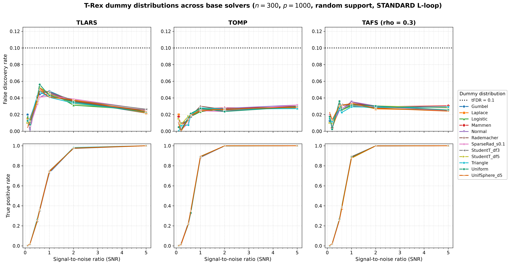
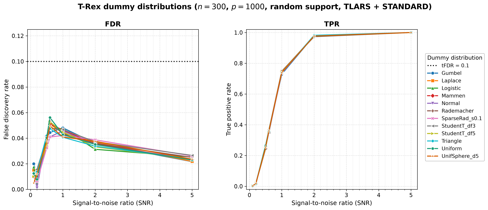

# Demo 05: Dummy Distribution Comparison

## Purpose

Compare the **dummy distributions** of the Terminating Random Experiments (T-Rex) Selector — the distribution from which
the injected dummy (null) variables are drawn — across **three base solver families** (TLARS, TOMP, TAFS), with the
L-loop strategy fixed at **STANDARD**. The T-Rex false discovery rate (FDR) calibration rests on exchangeability between
real null predictors and the dummies. Since dummies are centered and L2-normalized before entering the solver, their
*scale* is immaterial. What this demo probes is whether the *shape* of the dummy distribution (tail weight,
discreteness, skewness, sparsity, cross-column dependence) affects the achieved FDR / true positive rate (TPR) and the
calibrated dummy multiplier $L$ / stopping time $T$ — and whether any such effect depends on the solver family
(equiangular least-angle regression (LARS) path vs greedy forward selection).

---

## Data Generation Parameters

- **Sample size**: $n = 300$
- **Number of features**: $p = 1{,}000$
- **True support**: a random subset of size $s = 10$, **redrawn per trial** (`block_support = false`) by shuffling
  $\lbrace0, \ldots, p-1\rbrace$ with `std::mt19937(seed + 500000)`, keeping 10 indices and sorting them. A contiguous
  block support $\lbrace0, \ldots, s-1\rbrace$ is available via the `block_support = true` call, which is compiled but
  guarded by `if (false)`.
- **True coefficients**: fixed $\beta_j = 1$ (`rnd_coef = false`)
- **Signal-to-noise ratio (SNR) grid**: 7 values — $\lbrace0.1, 0.2, 0.5, 0.6, 1, 2, 5\rbrace$
- **Monte Carlo (MC) repetitions**: `num_MC = 200` trials per solver × distribution × SNR level
- **Data-generating process (DGP)**: $\mathbf{y} = \mathbf{X}\boldsymbol{\beta} + \boldsymbol{\epsilon}$,
  $\boldsymbol{\epsilon} \sim N(0, \sigma^2 I_n)$, Normal predictors and Normal noise
- **Base solvers** (outer sweep, one result file pair each):
  - **TLARS** — equiangular LARS path (T-loop stagnation stop AUTO-resolves to *disabled*),
  - **TOMP** — greedy orthogonal matching pursuit (stagnation stop AUTO-resolves to *enabled*),
  - **TAFS** — greedy adaptive forward selection with `rho_afs = 0.3` (stagnation stop AUTO-resolves to
    *enabled*), and the figures label it `TAFS (rho = 0.3)`
- **L-loop strategy**: STANDARD, fixed, with fresh independent and identically distributed (i.i.d.) dummy matrices at
  each L-loop iteration
- **Target FDR (tFDR)**: $0.1$

---

## Dummy Distributions Tested

`make_dummy_distributions()` sweeps the distribution types defined by the library `dummygen::Distribution` factory
(see `utils/datageneration/utils_dummygen.hpp`), with Student's t evaluated at two tail weights — **twelve rows** in
total:

1. **Normal** — $N(0, 1)$, the reference choice.
2. **Uniform** — $U(-\sqrt{3}, \sqrt{3})$, bounded with light tails.
3. **Rademacher** — $\lbrace-1, +1\rbrace$ equiprobable, discrete two-point.
4. **StudentT_df3** — heavy tails (df = 3, unit-variance scaled).
5. **StudentT_df5** — moderately heavy tails (df = 5, unit-variance scaled).
6. **Laplace** — double exponential with heavier-than-normal tails.
7. **Gumbel** — extreme-value distribution, skewed (centered at 0).
8. **Triangle** — bounded and symmetric, $(-\sqrt{6}, 0, \sqrt{6})$.
9. **Logistic** — tail weight between normal and Laplace.
10. **Mammen** — asymmetric golden-ratio two-point distribution.
11. **SparseRad_s0.1** — constrained sparse Rademacher, sparsity $s = 0.1$ (90% zeros, balanced $\pm 1$ entries).
12. **UnifSphere_d5** — uniform on the unit 5-sphere, so consecutive 5-column groups are dependent (norm constraint), a
    deliberate probe of the exchangeability axis.

**Note on UniformSphere**: the library requests dummies in multiples of $p = 1{,}000$, so the sphere dimension must
divide $p$. The factory default `dim = 3` would throw for this configuration, hence `dim = 5`.

All distributions use their unit-variance default parameters where applicable.

---

## Control Parameters

Set per solver × distribution (see the solver / distribution loops):

```text
solver_type = <varies>           # TLARS / TOMP / TAFS (outer sweep)
solver_params.rho_afs = 0.3      # TAFS regularization (ignored by TLARS/TOMP)
K = 20                           # Random experiments per T-loop iteration
max_dummy_multiplier = 10        # Upper bound for the adaptive L-loop
use_max_T_stop = true            # Cap T ≤ ceil(n/2)
dummy_distribution = <varies>    # Swept across the 12 rows (inner sweep)
lloop_strategy = STANDARD        # Fresh i.i.d. dummies per L-loop iteration, fixed
tloop_stagnation_stop = AUTO     # Disabled for TLARS, enabled for TOMP/TAFS
tFDR = 0.1                       # Target FDR control level
```

The MC loop is parallelized with Open Multi-Processing (OpenMP) (`TREX_NUM_WORKERS` threads, default 8).

---

## Output Files

All files are written to `simulation_results/data/`. One `.txt` + `.csv` pair is written **per solver**, and the stem
encodes the solver and the support scenario (`random_support` for the active run):

### Main Result Files

**`demo_trex_05_dummy_distributions_results_n300_p1000_{tlars,tomp,tafs}_random_support.txt`**

Aligned table (written by the shared `save_and_print_mc_results`) with four metric rows — FDR, TPR, Avg L, Avg T — per
distribution across the 7 SNR columns. The row label is the distribution name (Normal, Uniform, …, UnifSphere_d5):

```text
======================================================================
=== T-Rex Results (averaged over 200 Monte Carlo runs) ===
======================================================================

  SNR                          0.10      0.20      0.50      0.60      1.00      2.00      5.00
-----------------------------------------------------------------------------------------------

Normal
  FDR                        0.0125    0.0013    0.0415    0.0411    0.0457    0.0350    0.0234
  TPR                        0.0010    0.0205    0.2550    0.3475    0.7395    0.9780    1.0000
  Avg L                      2.4750    4.2150    5.9850    5.3300    2.9950    1.8250    1.1350
  Avg T                      3.9750    5.3800    5.3000    5.2300    5.9400    5.3250    5.1150

Uniform
...
```

### Tidy-Format CSVs

**`demo_trex_05_dummy_distributions_results_n300_p1000_{tlars,tomp,tafs}_random_support.csv`**

Long/stacked format, header column order **`solver,metric,snr,value`** (here the "solver" column holds the
distribution name, while the base solver is encoded in the file name), with `FDR`, `TPR`, `AvgL`, `AvgT` rows.

---

## Results Visualization

`./generate_plots.sh` renders two complementary views into
`simulation_results/plots/`: a **cross-solver comparison grid** (the figure for
this demo's core question) and the standard **per-solver figure sets**.

### Cross-solver comparison grid

The headline figure — a 2×3 grid, rows = metric (FDR / TPR), columns = base
solver (TLARS / TOMP / TAFS), with all twelve dummy distributions drawn as lines
in every panel. Colours and markers are keyed to the distribution, so a given
distribution is the same colour in every panel and can be tracked across solvers.
All FDR panels share one y-scale and all TPR panels share `[0, 1]`, so the panels
are directly comparable:



*Top row (FDR):* the twelve distributions stay bunched together and well under
`tFDR = 0.1` within each solver, so the dummy distribution's **shape** barely
moves FDR — but the *level* is solver-dependent (TLARS shows the familiar hump
near SNR 0.5–1, while the greedy TOMP / TAFS stay flatter and lower). *Bottom row
(TPR):* the distribution curves are indistinguishable — they overlap almost
perfectly — so the injected-dummy law does not affect power. Together this is the
demo's conclusion. After centering + L2 normalization, the dummy distribution is
effectively a free parameter, and that holds across all three solver families.

This grid is produced by the suite plotter's `grid` mode (`../trex_plt_utils.py
grid --labels TLARS TOMP TAFS --csvs ...`), which reads all three solver comma-separated
values (CSV) files at once and renders them on a shared scale.

### Per-solver figure sets

For each base solver, the suite-level [../trex_plt_utils.py](../trex_plt_utils.py)
also renders the usual overview (all twelve distributions on one FDR | TPR pair),
a de-cluttered grouped 2×2 view, and with `--plotly` a self-contained interactive Plotly `.html` page.
The TLARS overview, for example:



The `_grouped` `.png` / `.pdf` and the interactive `.html` (hover for values, **click a
distribution in the legend to isolate it** in both panels) sit alongside, one set
per solver (`tlars` / `tomp` / `tafs`). Open an `.html` file directly in a browser.
The `.html` figures are off by default and never committed, since each embeds a full copy
of plotly.js (about 5 MB). Run `./generate_plots.sh --plotly` to produce them locally.

```bash
open simulation_results/plots/demo_trex_05_dummy_distributions_results_n300_p1000_tlars_random_support_fdr_tpr_vs_snr.html
```

Vector `.pdf` copies of every static figure sit alongside the `.png` files.

### Regenerating the figures

The wrapper picks up the repo's local `.venv` automatically and renders **all**
three per-solver sets plus the comparison grid:

```bash
# From this demo folder:
./generate_plots.sh                 # 3 per-solver sets (png+pdf) + the grid
./generate_plots.sh --plotly        # plus the interactive html (not committed)
./generate_plots.sh --tfdr 0.05     # e.g. a different target-FDR line
```

---

## Running the Demo

```bash
./build/debug/bin/trex_selector_methods/ad/trex_core/demo_trex_05_mc_sim_dummy_distributions/demo_trex_05_mc_sim_dummy_distributions
```

The sweep runs 3 solvers × 12 distributions × 7 SNR values × 200 trials. The committed results took about 7 hours on
6 threads.

---

## Key Questions Addressed

1. **Is the FDR calibration robust to the dummy distribution?**
   - Expected: FDR $\leq$ tFDR for all unit-variance i.i.d. distributions, since dummies are L2-normalized and the
     calibration only relies on exchangeability with the null predictors.

2. **Do heavy tails, skewness, or discreteness matter after L2 normalization?**
   - Compare StudentT_df3 / Laplace (tails), Gumbel / Mammen (skewness), and Rademacher / SparseRad (discreteness)
     against the Normal reference.

3. **Does within-group dependence (UnifSphere_d5) degrade the calibration?**
   - The sphere rows deliberately violate the independent-columns assumption. Watch for FDR or Avg L deviations
     relative to the i.i.d. rows.

4. **Is the distribution-robustness solver-independent?**
   - Compare the TLARS (equiangular), TOMP, and TAFS (greedy) file pairs. The dummy calibration argument does not
     depend on the solver family, so the FDR-equivalence pattern should replicate across all three.

---

## Interpretation Guide

**What to look for:**

- **FDR equivalence**: the i.i.d. rows should all keep FDR $\leq$ tFDR with only MC noise between them.
- **TPR consistency**: only minor variation from Monte Carlo noise (`num_MC = 200`).
- **Avg L / Avg T**: whether the L-loop calibrates a different dummy budget for a given distribution shape.

**Practical significance:**

- If all shapes perform equivalently, the Normal default is justified and the distribution choice is a free parameter
  (e.g., Rademacher / SparseRad admit cheaper generation or sparse storage).
- Systematic deviations for the dependent UnifSphere rows would illustrate why the exchangeability requirement in
  `utils_dummygen.hpp` matters.

**Recorded results** (`simulation_results/`, `num_MC = 200`, TLARS + TOMP + TAFS). The FDR-equivalence pattern
replicates across all three solver families. For every solver, all twelve distribution rows behave equivalently. The
per-distribution mean FDR spans only 0.028–0.032 under TLARS, 0.017–0.020 under TOMP and 0.023–0.026 under TAFS, no
row exceeds an FDR of 0.056 at any SNR, and the TPR curves are indistinguishable and reach 1.0 at SNR 5.0. Even the
dependent UnifSphere_d5 rows show no systematic deviation. They have the highest mean FDR under TAFS (0.026 against
0.024 over all rows) but sit in the lower half under TLARS and TOMP, and their Avg L matches the i.i.d. rows. At this
($n$, $p$, dim) the within-group sphere dependence is too weak to break the calibration after L2 normalization. The
greedy TOMP and TAFS runs (stagnation stop enabled) are more conservative than TLARS (mean FDR ≈ 0.019 and ≈ 0.024
against ≈ 0.030), while the stopping times are similar (Avg T within 3.8–6.3 for TLARS, 4.9–6.2 for TOMP and 3.7–6.1
for TAFS).
