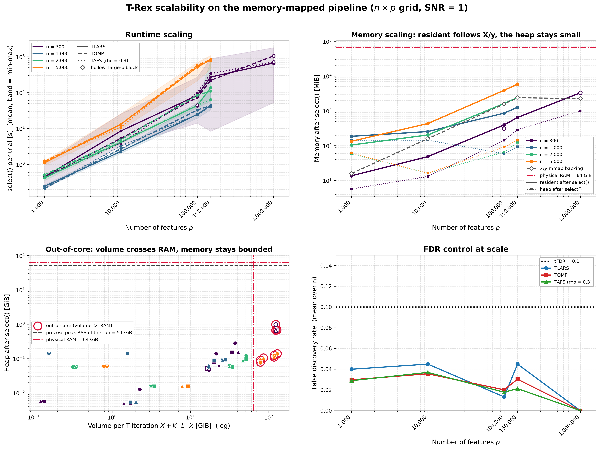

# Demo 08: Scalability Benchmark

## Purpose

Characterize **Terminating Random Experiments (T-Rex) selector runtime and memory usage** as $n$ and $p$ scale to
large sizes, and demonstrate that the selector goes **high-dimensional and
out-of-core**, into data volumes that exceed physical random-access memory
(RAM). Everything runs on the **fully memory-mapped pipeline**. Every Monte Carlo
(MC) trial generates its $\mathbf{X}/\mathbf{y}$ into memory-mapped (mmap) backing files
(`SyntheticDataMapped` over `memmap::MemoryMappedMatrix`, $\mathbf{X}$ never
materialized in RAM), and `use_memory_mapping = true` additionally memory-maps the
internal dummy matrices $\mathbf{D}$ and serializes solver warm-start state to
disk. The benchmark reports:

- **Runtime scaling** — wall-clock per phase (data generation, `select()`,
  $\text{per-}T\text{-iteration}$) as a function of $n$ and $p$
- **Memory scaling** — resident set size (RSS) after selection, process peak RSS,
  physical footprint, and the $\mathbf{X}/\mathbf{y}$ backing sizes on disk
- **Solver comparison** — TLARS vs. TOMP vs. TAFS at scale
- **Selection quality at scale** — false discovery rate (FDR), true positive rate (TPR), average $L$, average $T$ as
  a sanity check

---

## The Grid

Two blocks with separate output files and trial caches, `num_MC` sequential trials per $(n, p, \text{solver})$,
default 10 and settable through the command-line interface (CLI):

- **Base block** with `max_dummy_multiplier = 10`, the full cross of
  - $n \in \lbrace300, 1{,}000, 2{,}000, 5{,}000\rbrace$
  - $p \in \lbrace1{,}000, 10{,}000, 100{,}000, 150{,}000\rbrace$, log-spaced for the in-memory scaling, with
    $p = 150{,}000$ as the step into out-of-core
- **Large-p block** with `max_dummy_multiplier = 5`, few observations and up to a million predictors
  - $n = 300$
  - $p \in \lbrace100{,}000, 1{,}000{,}000\rbrace$, where $p = 100{,}000$ also runs in the base block at the cap of
    10, a direct comparison of the two caps

$\Rightarrow$ 16 + 2 grid points × 3 solvers. The quantity that decides whether a point runs in RAM or out-of-core
is the **data volume one T-iteration touches**. Each T-iteration runs all $K = 20$ random experiments, and each
experiment reads $\mathbf{X}$ and its own memory-mapped dummy file of $L \cdot p$ columns, so

```math
V = n \cdot p \cdot 8 \cdot (1 + K L) \ \text{bytes}.
```

At $L = 1$ this gives the following volumes in GiB (**bold** = above the 64 GiB RAM of the reference machine,
the columns $p \le 10{,}000$ stay below 8 GiB and are omitted):

| $n$ \\ $p$ | 100,000 | 150,000 | 1,000,000 |
| --- | --- | --- | --- |
| 300 | 4.7 | 7.0 | 46.9 |
| 1,000 | 15.6 | 23.5 | — |
| 2,000 | 31.3 | 46.9 | — |
| 5,000 | **78.2** | **117.3** | — |

A larger $L$ multiplies the dummy part, so a point with $L = 2$ already needs roughly twice the volume, and the
large-p point $n = 300$, $p = 1{,}000{,}000$ reaches 225.8 GiB at its cap $L = 5$. The output tables report the
volume at the realized mean $L$ (`VolGiB`) and mark points above physical RAM with `*`. The cells marked — are not
part of the grid.

The **disk** the memory-mapped dummy files may occupy in the worst case (all $K$ files filled up to the cap,
plus $\mathbf{X}$ and the solver checkpoints) is, in GiB,

| $n$ \\ $p$ | 1,000 | 10,000 | 100,000 | 150,000 | 1,000,000 |
| --- | --- | --- | --- | --- | --- |
| 300 | 0.5 | 5 | 46 (cap 10), 23 (cap 5) | 68 | 229 |
| 1,000 | 2 | 15 | 150 | 226 | — |
| 2,000 | 3 | 30 | 300 | 450 | — |
| 5,000 | 7 | 75 | 749 | **1,124** | — |

The largest need is 1,124 GiB at $n = 5{,}000$, $p = 150{,}000$. The cap of 5 keeps the large-p point at
$p = 1{,}000{,}000$ at 229 GiB, against 456 GiB at the base cap of 10.

The signal-to-noise ratio (SNR) is fixed at $1.0$ — it is deliberately **not** a scaling axis here (sweeping
it only burns time). That sweep belongs to Demos 02–07.

A tiny smoke grid ($n \in \lbrace150, 200\rbrace$, $p \in \lbrace500, 1{,}000\rbrace$, caps 10 and 5) is
available via the `smoke` argument for end-to-end pipeline verification.

### Memory behaviour

The whole pipeline is memory-mapped, so $\mathbf{X}/\mathbf{y}$ live on disk, the dummy matrices $\mathbf{D}$ are
memory-mapped, and solver warm-start state is serialized between T-loop iterations. Neither binding nor library
copies $\mathbf{X}$. The selector centers and normalizes it in place on the mapped file and restores it at the
end of `select()`.

The **anonymous heap** stays small. The coefficient path of every experiment is stored sparsely (one index and
value per active coefficient and step) and is reduced to the voting statistics right after the experiment, so
nothing of size $(p + L p) \times \text{steps}$ is ever allocated. What remains is about 16–32 bytes per column of
$[\mathbf{X}\,|\,\mathbf{D}]$ for the running experiment (correlations, inactive set, compensation terms) and a
few $p \times T$ accumulators of the voting statistics. The `Foot_MiB` column tracks this heap.

The **resident** memory is mostly page cache of the mapped files. While the volume $V$ fits into the page cache,
every T-iteration reads the dummy files from RAM. Once it does not, the dummy files are read back from the
solid-state drive (SSD) on every T-iteration and `select()` slows down several times (see the results). In the
recorded run, $n = 2{,}000$, $p = 150{,}000$ (47–51 GiB) still ran at in-memory speed, while $n = 5{,}000$,
$p = 100{,}000$ (78–86 GiB) did not. The page cache shares RAM with the rest of the system, and trials with
$L = 2$ double the volume.

A write into a memory-mapped file on a full disk would end the process with `SIGBUS` instead of an error, so the
library checks the free disk before it creates memory-mapped files and throws when they may not fit (library commit
`788cc46`). The demo also checks every point before its trials. A point whose worst-case disk need plus a 50 GiB
reserve does not fit the free space of the temp directory is skipped with a message, and the run goes on with the
next point.

### Calibration of the large-p block

A calibration run measured $L$ and $T$ at $p = 1{,}000{,}000$ before the grid was fixed (TLARS, one trial per
point, cap 5, library commit `788cc46`). At $n = 300$ one `select()` took 1,575 s, reached the cap $L = 5$ with
$T = 2$ and selected none of the 10 true variables. At $n = 500$ it took 1,102 s with $L = 3$ and found 4 of them
(TPR $0.40$). The process peak RSS was 45–49 GiB, mostly page cache of the mapped files. The earlier grid with
$n \in \lbrace300, 500\rbrace$ and $p$ up to $5{,}000{,}000$ would have taken about three weeks of machine time, so
the large-p block now stops at $n = 300$, $p = 1{,}000{,}000$. The calibration trial at $n = 300$ uses the seed of
trial 1 and counts as that trial of the large-p block.

---

## Data Generation Parameters

The data-generating process (DGP) mirrors **Demo 03** (variable support), with Normal predictors and Normal noise.

- **True support cardinality**: fixed at $s = 10$, while the **indices are redrawn
  per trial** via `draw_support` (uniform without replacement,
  `mt19937(seed + 500000)`)
- **True coefficients**: fixed $\beta_j = 1$ (`rnd_coef = false`)
- **SNR**: fixed at $1.0$
- Every trial writes its own mmap-backed $\mathbf{X}/\mathbf{y}$
  (`SyntheticDataMapped`), fed to the selector through `Eigen::Map` views and
  removed at end of scope by a Resource Acquisition Is Initialization (RAII)
  `MmapFileGuard` (declared before the data
  object so the mmap handles close before the files are deleted — exception-safe).

Trials run **sequentially** so wall-clock and RSS measurements are undistorted. The $K$ random experiments inside
`select()` also run one after another, and the `TREX_NUM_WORKERS` Open Multi-Processing (OpenMP) threads
(default 8) run the column loops inside each experiment (normalization, dummy generation and the solver's passes).
The demo sets them as `max_inner_threads` and as the library's default budget, which the data generation uses.

---

## Control Parameters

Every control option is set **explicitly and identically** in the C++, Python and R
demos (nothing left to a struct/helper default — that is what made the ports
diverge):

```text
K                        = 20        # Random experiments per T-loop iteration
max_dummy_multiplier     = 10 / 5    # Cap on L (base block / large-p block); drives the D volume
use_max_T_stop           = true      # Cap T <= ceil(n/2)
opt_threshold            = 0.75      # Voting/optimization threshold (C++ 0.75, Python default 0.02 — pinned)
dummy_distribution       = Normal    # Dummy predictors drawn from N(0,1)
lloop_strategy           = STANDARD  # Fresh i.i.d. dummy matrix per L-loop iteration
tloop_stagnation_stop    = true      # Early exit when R_mat stagnates
tloop_max_stagnant_steps = 5         # Stagnation window
parallel_rnd_experiments = false     # Sequential experiments; one D working set at a time
max_inner_threads        = 8         # TREX_NUM_WORKERS threads inside each experiment
use_memory_mapping       = true      # All points: X/y mmap + D mmap + solver serialization
tFDR                     = 0.1       # Target FDR control level
```

`parallel_rnd_experiments = false` is essential here, because the alternative (parallel
across the K experiments) holds up to *K* dummy-augmented working sets in RAM at
once, which defeats the out-of-core goal. `STANDARD` writes one memory-mapped dummy file per experiment and
regenerates all of them in every L-loop iteration, while the T-loop only reads them.

---

## Solvers Compared

Three base solvers spanning the least-angle regression (LARS) path and greedy families (Demo 05 configuration):

- **TLARS** — terminating LARS, an equiangular path that stops on its own
- **TOMP** — terminating orthogonal matching pursuit (OMP), a greedy solver
- **TAFS** — terminating adaptive forward selection (AFS), `rho_afs = 0.3` (TLARS/TOMP take `0`)

---

## Measurements

Per $(n, p)$ × solver, averaged/aggregated over the cached trials:

| Column | Meaning |
| --- | --- |
| `VolGiB` | Data volume per T-iteration $V$ at the mean realized $L$ (GiB) |
| `SelMean_s` | Mean `select()` wall-clock (s), the runtime of the figure |
| `SelMed_s` / `SelMin_s` / `SelMax_s` | Median / min / max `select()` wall-clock (s) |
| `DGP_s` | Data-generation wall-clock (s) |
| `s/Titer` | `select()` time per T-loop iteration (s) |
| `PeakRSS_MiB` | Process peak RSS (running maximum) |
| `RSS_MiB` | Post-`select()` resident set size |
| `Foot_MiB` | Physical footprint (anonymous heap incl. compressed/swapped pages) |
| `X+y_MiB` | $\mathbf{X}/\mathbf{y}$ mmap backing-file sizes on disk |
| `FDR` / `TPR` / `Avg_L` / `Avg_T` | Selection-quality sanity metrics |

RSS is read via `mach task_info(MACH_TASK_BASIC_INFO)` (macOS) / `/proc/self/statm`
(Linux), the physical footprint via `task_info(TASK_VM_INFO).phys_footprint`
(macOS) / `VmRSS + VmSwap` (Linux), and peak RSS via `getrusage`.

The runtime is evaluated as the **mean** `select()` time, the expected cost of one trial, with the min–max
range as its spread. The median stays as a table column. At $n = 300$ the per-trial time depends strongly on
how far $L$ climbs, so mean and median differ there by up to a factor of 3.4, while they agree within
0.86–1.15 for $n \ge 1{,}000$.

`PeakRSS_MiB` is the running maximum of the whole process, so every point after the largest one so far repeats
its value. The figure therefore shows the per-point resident memory and heap after `select()`, and the
process peak only as one line for the whole run. Running the two blocks in separate invocations keeps the base
block's peak out of the large-p table.

---

## Output Files

Written to `simulation_results/data/`, **re-derived from the trial cache and re-saved after each completed grid
point** (a crash or out-of-memory kill on a later, larger point preserves everything finished so far). The base
block uses the stem `demo_trex_08_scalability_results`, the large-p block `demo_trex_08_scalability_large_p`.

- **`<stem>_trials.csv`** — the **raw per-trial cache** (source of truth): one row per
  $(n, p, \text{solver}, \text{mc})$ with its seed and every measured quantity, appended as each trial finishes.
- **`<stem>.txt`** — per-solver aligned table, one row per $(n, p)$ grid point across the 14 metric columns,
  with out-of-core points marked `*`.
- **`<stem>.csv`** — tidy long summary, header column order `n,p,is_barrier,solver,num_mc,snr,metric,value`
  (`num_mc` is the actual cached trial count per cell, `is_barrier` = 1 where `VolGiB` exceeds RAM).

The smoke grid writes `demo_trex_08_scalability_smoke.{txt,csv}` and keeps its trial cache in the temp directory,
where the startup cleanup removes it, so every smoke run computes fresh.

---

## Expandability

The benchmark is designed to grow incrementally rather than be re-run from
scratch. Every trial is keyed by $(n, p, \text{solver}, \text{mc})$ in the raw
cache, and a run computes **only the trials it is missing**:

- **num_MC top-up** — run at `num_MC = 2` now, then `num_MC = 10` later computes
  just the 8 new trials per cell and re-aggregates, and the first 2 are reused.
- **Grid growth** — append new $n$ / $p$ values to a block's value lists later,
  so existing cells are reused and only the new ones are computed.
- **Trial-level resume** — a crash or out-of-memory kill mid-grid-point keeps every trial that
  already finished (each is flushed to the cache immediately).

Per-trial seeds are a stable function of $(n, p, \text{mc})$ —
`24 + n·100003 + p·13 + mc` (mod $2^{31}{-}1$), independent of grid position and
**identical to the Python and R demos' `_trial_seed`** — so reuse and reproducibility
survive reordering or extending the grid. (The languages seed identically, but the
*draws* still differ because `std::mt19937`, NumPy's and R's pseudo-random number generators
(PRNGs) are different generators.)

---

## Results Visualization

Demo 08's comma-separated values (CSV) files use the wider `n,p,is_barrier,solver,num_mc,snr,metric,value` schema
rather than the suite's tidy `solver,metric,snr,value`, so the suite plotter
handles them in a dedicated `scalability` mode
([`../trex_plt_utils.py`](../trex_plt_utils.py) `scalability <csv> [<csv> …]`). The CSVs of both blocks are read
by `read_scalability()`, concatenated, and rendered by `plot_scalability_dashboard()`. The result is a 2×2
dashboard (mean runtime vs $p$ with the min–max band, resident memory and heap after `select()` vs $p$, the heap
against the volume with the RAM line, the run's process peak and the out-of-core points ringed, and FDR control at
scale), in which the $n = 300$ line runs from $p = 1{,}000$ to $1{,}000{,}000$.
Points of the large-p block are white-filled, and its cap-5 point at $p = 100{,}000$ sits next to the base block's
point, which shows the two caps side by side. Render it with `./generate_plots.sh`.

---

## Simulation Results

The recorded run uses library commit `61fd84c`, 10 trials per $(n, p, \text{solver})$ and 8 OpenMP threads on a
machine with 64 GiB of RAM. It took 23.3 hours, 16.5 hours of trial time in the base block (480 trials) and
7.1 hours in the large-p block (60 trials, one of them the calibration trial).

At that commit the 8 threads ran the data generation, the normalization and the dummy generation, while each solver
ran single-threaded. Library commit `223c89e` made the library single-threaded by default, so the demo now sets
`max_inner_threads` and the solvers' passes run on the 8 threads as well. The runtimes below therefore come from the
earlier thread setting, and a rerun on the current code is pending. FDR and TPR do not depend on the thread count.

- **The pipeline processes data far beyond RAM.** The largest base point, $n = 5{,}000$, $p = 150{,}000$, touches
  117–129 GiB per T-iteration, twice the RAM, and every trial completes. The process peak RSS of the whole run is
  about 51 GiB in both blocks, below the 64 GiB of RAM, and the heap after `select()` stays at most 1.0 GiB at
  every point. The resident memory after `select()` follows the $\mathbf{X}/\mathbf{y}$ backing, up to 5.9 GiB at
  $n = 5{,}000$, $p = 150{,}000$.
- **Runtime grows about linearly in $p$ while the volume fits into RAM.** From $p = 10{,}000$ to $100{,}000$ the
  mean `select()` time rises about tenfold for $n = 1{,}000$ (2.3–3.3 s to 24–33 s) and $n = 2{,}000$
  (4.2–4.9 s to 43–83 s). At $n = 5{,}000$ it rises 40- to 50-fold (11–13 s to 510–571 s), because the
  $p = 100{,}000$ point exceeds RAM (78–86 GiB per T-iteration) and the dummy files are read from the SSD. The
  largest point takes 762–843 s per trial.
- **FDR stays below the target.** Every cell has a mean FDR of at most $0.089$, except TLARS at $n = 300$,
  $p = 150{,}000$ with $0.108$, a mean over only 10 trials. Averaged over $n$, the FDR per $p$ and solver is at most
  $0.045$.
- **Power is complete from $n = 1{,}000$ on and vanishes at $n = 300$ for large $p$.** Every point with
  $n \ge 1{,}000$ has a true positive rate (TPR) of $1.00$ with $L$ at about 1. At $n = 300$ the TPR falls from
  $0.71\text{–}0.83$ at $p = 1{,}000$ to $0.43\text{–}0.65$ at $p = 10{,}000$, $0.03\text{–}0.18$ at $p = 100{,}000$ and
  $150{,}000$, and $0.00\text{–}0.01$ at $p = 1{,}000{,}000$, while $L$ climbs to 4–6. The ratio $n / (s \ln p)$ orders
  these points, unlike $n / p$. The power is complete from about 8.4 on (every $n \ge 1{,}000$) and drops between
  about 4.3 and 2.2 (the $n = 300$ row), while $n = 1{,}000$, $p = 150{,}000$ (with $n / p = 0.0067$) keeps full
  power where $n = 300$, $p = 10{,}000$ (with $n / p = 0.03$) loses about half of it.
- **The cap of 5 halves the cost at $n = 300$, $p = 100{,}000$.** The base block (cap 10) needs 73–96 s per trial
  with $L = 4.4\text{–}5.1$ and a TPR of $0.03\text{–}0.06$, while the large-p block (cap 5) needs 43–45 s with
  $L = 3.6\text{–}3.8$ and a TPR of $0.00\text{–}0.03$. The power is already gone at this point, so the lower cap costs
  little.
- **$p = 1{,}000{,}000$ at $n = 300$** takes 669–1,050 s per trial (mean), touches 123–127 GiB per T-iteration at
  the realized $L$ of 2.7–2.8, and selects almost nothing (TPR at most $0.01$, FDR $0$).
- Mean and median `select()` time agree within a factor of 0.86–1.15 for $n \ge 1{,}000$. At $n = 300$ they
  differ by up to 3.4, because a trial with a high $L$ takes many times longer than one with $L = 1$–2.

Mean runtime (top left), resident memory and heap after `select()` (top right), the heap against the volume per
T-iteration with the RAM line and the run's process peak (bottom left), and FDR per solver averaged over $n$
(bottom right). White-filled points belong to the large-p block.



The committed `demo_trex_08_scalability_smoke.{txt,csv}` is the end-to-end smoke recording.

---

## Building and Running

Release build is recommended (the large points are heavy):

```bash
cd TRexSelector_Examples/cpp
cmake --build build/release --target demo_trex_08_mc_sim_scalability

bin=build/release/bin/trex_selector_methods/ad/trex_core/demo_trex_08_mc_sim_scalability/demo_trex_08_mc_sim_scalability
"$bin" base      # base block, num_MC = 10 (long-running)
"$bin" large     # large-p block, num_MC = 10 (needs up to 230 GiB free disk)
"$bin" large 2   # large-p block, num_MC = 2 (first pass; top up later)
"$bin"           # both blocks in one process, base first
"$bin" smoke     # tiny end-to-end smoke check (num_MC = 2)
"$bin" smoke 3   # smoke grid, num_MC = 3

TREX_SOLVERS=TLARS "$bin" calib   # calibration: large-p block at its smallest p, TLARS, num_MC = 1
```

The optional integer argument sets `num_MC`, and re-running with a larger value tops
up the trial cache rather than recomputing. `calib` runs only the smallest $p$ of the large-p block
(default `num_MC = 1`), and its trials stay in the large-p cache as regular trials. `TREX_SOLVERS` (comma
separated) limits which solvers compute new trials, while the cached trials of the other solvers still enter the
tables. Grid points run smallest-first and the
summaries are re-derived from the cache after each point. The benchmark sweeps its
own memory-mapped orphans (`demo08_scalability_*`, `trex_memmap_*`, `trex_warmstart_*`) at startup and
on exit / `SIGINT` / `SIGTERM` / `SIGBUS` (`SIGKILL` cannot be trapped, so the next startup sweep
reclaims it). The memory-mapped files go to the temp directory (`TMPDIR`), which must sit on the volume with the
free disk shown in the console header.

### Nightly runner

The full benchmark in all three languages takes days, so
[`../../../run_demo08_nightly.sh`](../../../run_demo08_nightly.sh) works it off in portions, the C++ base and
large-p blocks first, then Python and R. `start` runs or continues it in the background (one instance only, the
Mac stays awake), and `start cpp` restricts it to the two C++ steps. `stop` creates the file named by
`TREX_STOP_FILE`, so the demo ends after its current trial with exit code 75 and the runner ends with it. The
next `start` resumes at the first missing trial. Logs go to `cpp/trex_selector_methods/logs/demo08_nightly/`.

```bash
cpp/trex_selector_methods/run_demo08_nightly.sh start cpp   # run or continue the C++ steps
cpp/trex_selector_methods/run_demo08_nightly.sh stop        # end after the current trial
cpp/trex_selector_methods/run_demo08_nightly.sh steps       # list the steps, runs nothing
```
