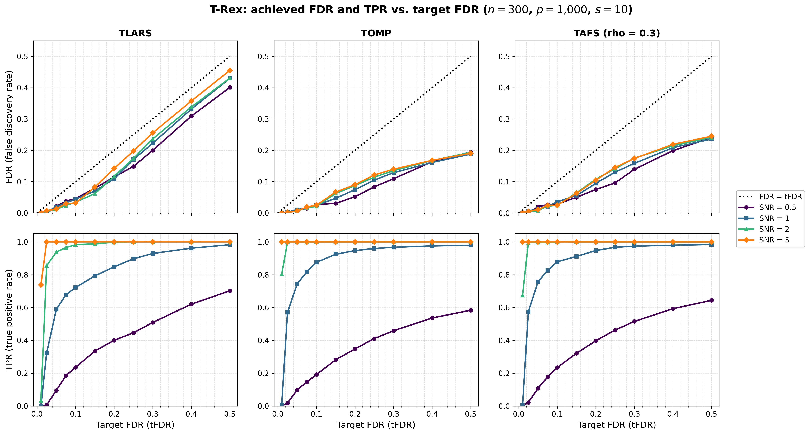

# Demo 09: Achieved FDR and TPR vs. Target FDR

## Purpose

The Terminating Random Experiments (T-Rex) selector controls the false discovery rate (FDR) at a target level
$\mathrm{tFDR}$ that the user chooses. This demo sweeps $\mathrm{tFDR}$ and records the achieved FDR, the mean false
discovery proportion over the trials, and the true positive rate (TPR) for three base solvers and four
signal-to-noise ratios (SNR). FDR control shows as an FDR curve on or below the diagonal $\mathrm{FDR} = \mathrm{tFDR}$,
and the TPR curve shows how much power each level of control costs.

---

## Data Generation Parameters

The data follow [Demo 03](../demo_trex_03_mc_sim_variable_support/README.md).

- $n = 300$ observations and $p = 1{,}000$ predictors, Normal predictors and Normal noise.
- A true support of $s = 10$ variables, redrawn in every trial by shuffling $\lbrace0, \ldots, p-1\rbrace$ with
  `std::mt19937(seed + 500000)`, with unit coefficients $\beta_j = 1$.
- $\mathrm{SNR} \in \lbrace0.5, 1, 2, 5\rbrace$, calibrated as in all demos of this suite.

---

## Selector

The selector follows [Demo 05](../demo_trex_05_mc_sim_dummy_distributions/README.md) with Normal dummies.

```text
K                    = 20         # random experiments
max_dummy_multiplier = 10         # cap on L
dummy_distribution   = Normal
lloop_strategy       = STANDARD   # fresh dummies in every L-loop iteration
use_max_T_stop       = true
stagnation stop      = AUTO       # off for TLARS, on for TOMP and TAFS
rho_afs              = 0.3        # TAFS only
```

- **Base solvers**: TLARS, TOMP and TAFS ($\rho = 0.3$).
- **Target FDR grid**: $\mathrm{tFDR} \in \lbrace0.01, 0.025, 0.05, 0.075, 0.1, 0.15, 0.2, 0.25, 0.3, 0.4, 0.5\rbrace$.

---

## Monte Carlo Design

- 200 Monte Carlo (MC) trials per (solver, SNR, tFDR) cell, 132 cells and 26,400 selector runs in total.
- Trial $m$ of an SNR uses the data seed $24 + 1000 \cdot i_{\mathrm{SNR}} + m$ for every tFDR and every solver, so
  the curves along tFDR compare the same data sets and differ only through the target level.
- The selector is seeded with the trial seed, so every cell is reproducible.
- Every finished cell is cached in `simulation_results/cache/`, and a stopped run resumes at the first missing cell.
  A completed run removes the cache.

---

## Output Files

Written to `simulation_results/data/`:

- `demo_trex_09_mc_sim_target_fdr.txt` — one table per solver, with an FDR and a TPR row per SNR and one column per
  tFDR.
- `demo_trex_09_mc_sim_target_fdr.csv` — tidy long table with the columns `solver,snr,tfdr,metric,mean,sd`. The
  metrics are `FDR`, `TPR`, `AvgL` (mean calibrated dummy multiplier) and `AvgT` (mean stopping time), and `sd` is
  filled for FDR and TPR.

`./generate_plots.sh` renders `simulation_results/plots/demo_trex_09_mc_sim_target_fdr.{png,pdf}` with the `sweep`
mode of [`../trex_plt_utils.py`](../trex_plt_utils.py). The top row shows the achieved FDR against tFDR with the
diagonal, and the bottom row shows the TPR, one column per solver and one line per SNR.

---

## Running the Demo

```bash
cd TRexSelector_Examples/cpp
cmake --build build/release --target demo_trex_09_mc_sim_target_fdr

bin=build/release/bin/trex_selector_methods/ad/trex_core/demo_trex_09_mc_sim_target_fdr/demo_trex_09_mc_sim_target_fdr
"$bin"        # full run, 200 trials per cell
"$bin" 2      # smoke run, 2 trials per cell
trex_selector_methods/ad/trex_core/demo_trex_09_mc_sim_target_fdr/generate_plots.sh
```

The trials of a cell run in parallel on `TREX_NUM_WORKERS` OpenMP threads (default 8). The full run takes about three
hours on 8 threads.

---

## Simulation Results

The full run with 200 trials per cell took 2 h 43 min on 8 threads against library 415484d.

```text
==============================================================================
=== T-Rex achieved FDR / TPR vs. target FDR (mean over 200 trials) ===
    n = 300, p = 1000, s = 10, K = 20, STANDARD L-loop, Normal dummies
==============================================================================

TLARS
  tFDR             0.010   0.025   0.050   0.075   0.100   0.150   0.200   0.250   0.300   0.400   0.500
  FDR SNR 0.5      0.000   0.000   0.021   0.038   0.046   0.079   0.115   0.149   0.200   0.309   0.401
  TPR SNR 0.5      0.000   0.007   0.095   0.185   0.236   0.335   0.401   0.446   0.509   0.620   0.702
  FDR SNR 1        0.000   0.004   0.019   0.033   0.044   0.070   0.109   0.171   0.223   0.331   0.430
  TPR SNR 1        0.000   0.324   0.589   0.678   0.722   0.793   0.849   0.897   0.930   0.962   0.983
  FDR SNR 2        0.001   0.004   0.012   0.024   0.035   0.062   0.117   0.174   0.236   0.338   0.431
  TPR SNR 2        0.032   0.855   0.938   0.966   0.983   0.988   0.998   1.000   1.000   1.000   1.000
  FDR SNR 5        0.001   0.007   0.013   0.030   0.031   0.083   0.142   0.198   0.256   0.357   0.455
  TPR SNR 5        0.738   1.000   1.000   1.000   1.000   1.000   1.000   1.000   1.000   1.000   1.000

TOMP
  tFDR             0.010   0.025   0.050   0.075   0.100   0.150   0.200   0.250   0.300   0.400   0.500
  FDR SNR 0.5      0.000   0.000   0.008   0.015   0.027   0.031   0.052   0.083   0.109   0.164   0.194
  TPR SNR 0.5      0.000   0.017   0.098   0.146   0.192   0.282   0.348   0.411   0.459   0.537   0.584
  FDR SNR 1        0.000   0.003   0.011   0.016   0.024   0.047   0.075   0.105   0.129   0.161   0.188
  TPR SNR 1        0.008   0.570   0.744   0.818   0.876   0.925   0.947   0.960   0.967   0.976   0.980
  FDR SNR 2        0.000   0.002   0.007   0.017   0.021   0.062   0.088   0.114   0.135   0.167   0.194
  TPR SNR 2        0.802   1.000   1.000   1.000   1.000   1.000   1.000   1.000   1.000   1.000   1.000
  FDR SNR 5        0.000   0.002   0.006   0.019   0.025   0.067   0.090   0.121   0.140   0.168   0.191
  TPR SNR 5        1.000   1.000   1.000   1.000   1.000   1.000   1.000   1.000   1.000   1.000   1.000

TAFS
  tFDR             0.010   0.025   0.050   0.075   0.100   0.150   0.200   0.250   0.300   0.400   0.500
  FDR SNR 0.5      0.000   0.000   0.020   0.027   0.029   0.050   0.075   0.096   0.140   0.199   0.241
  TPR SNR 0.5      0.000   0.021   0.108   0.177   0.235   0.322   0.398   0.463   0.516   0.593   0.644
  FDR SNR 1        0.000   0.006   0.013   0.021   0.036   0.056   0.094   0.131   0.158   0.209   0.236
  TPR SNR 1        0.004   0.574   0.757   0.827   0.879   0.912   0.948   0.967   0.974   0.980   0.984
  FDR SNR 2        0.001   0.004   0.008   0.022   0.025   0.064   0.108   0.141   0.175   0.214   0.241
  TPR SNR 2        0.675   0.995   0.998   0.998   1.000   1.000   1.000   1.000   1.000   1.000   1.000
  FDR SNR 5        0.001   0.005   0.011   0.024   0.025   0.063   0.105   0.145   0.174   0.219   0.245
  TPR SNR 5        1.000   1.000   1.000   1.000   1.000   1.000   1.000   1.000   1.000   1.000   1.000
```



### FDR control

The achieved FDR stays below the target in all 132 cells. TLARS follows the diagonal most closely, because its T-loop
runs without a stagnation stop and ends only when the estimated false discovery proportion would exceed the target
(mean stopping time 21 to 24 at tFDR 0.5 for SNR $\ge 1$). It reaches an FDR of 0.43 to 0.46 at tFDR 0.5 for
SNR $\ge 1$. TOMP and TAFS leave the diagonal from tFDR 0.15 on and level off at an FDR of about 0.19 and 0.24. Their
stagnation stop ends the T-loop once the selected set has not changed for five steps (mean stopping time 7 to 8),
which protects these greedy solvers from the noise trap and leaves part of a large budget unused.

A first run against library 61fd84c exceeded the target with TLARS at SNR 5 (0.530 at tFDR 0.5 and 0.415 at 0.4). The
library clamped the calibrated occurrences $\Phi'$, which enter the estimated false discovery proportion, at zero.
That capped the false-discovery mass of a variable at one and made the estimate too small in long T-loops. Library
415484d removes that lower clamp, as in the T-Rex paper. On the same seeds the fix lowers the FDR in 53 cells, all at
$\mathrm{tFDR} \ge 0.15$, by up to 0.077, costs at most 0.010 in TPR, and leaves every cell up to tFDR 0.1 unchanged
to the last digit.

### Power

The TPR shows what each level of control costs. A target of 0.01 calibrates $L$ to the cap of 10 or close to it, and
the selector then finds the true variables only at SNR 5 (TPR 0.74 to 1.00). From tFDR 0.025 on, the power at SNR 5
is complete, and at SNR 2 TOMP and TAFS reach 0.995 or more while TLARS needs tFDR 0.1 for 0.98. At SNR 1 the TPR
rises from 0.32 to 0.57 at tFDR 0.025 to 0.72 to 0.88 at 0.1 and 0.85 to 0.95 at 0.2, and TOMP and TAFS lead TLARS
at every target up to 0.4, mostly at a lower FDR. At SNR 0.5 the power grows slowly and almost linearly, from about
0.1 at tFDR 0.05 to 0.58 to 0.70 at 0.5.

### Consistency with demo 05

At tFDR 0.1 the cells repeat the Normal-dummy row of
[demo 05](../demo_trex_05_mc_sim_dummy_distributions/README.md), which draws different data sets and runs the
selector unseeded. All 20 FDR and TPR differences with a nonzero standard deviation stay below $|z| = 1.5$
(standard error from the demo 09 standard deviations), and the largest is the TLARS FDR at SNR 5 (0.031 against
0.023).
