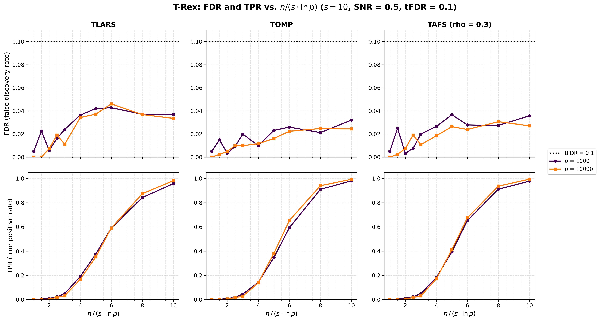
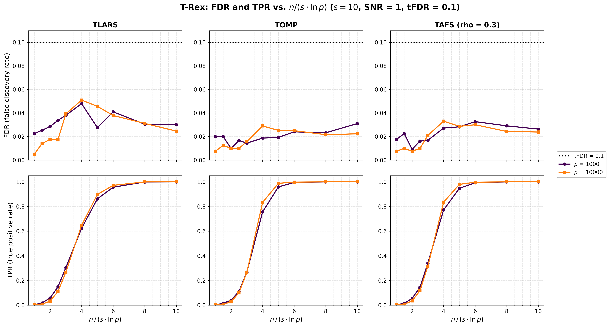
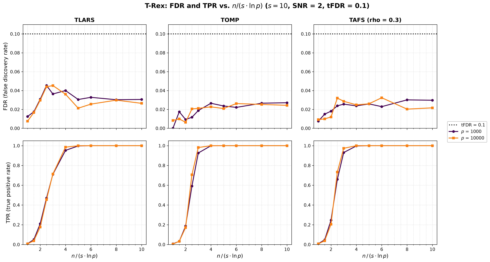

# Demo 10: FDR and TPR vs. the Sample-Size Ratio n / (s ln p)

## Purpose

Sparse recovery needs the number of observations $n$ to grow like $s \log p$, with $s$ true variables among $p$
predictors (the Donoho–Tanner scaling). This demo sets

```math
n = \operatorname{round}\!\left(c \cdot s \ln p\right)
```

for a grid of ratios $c$ and two numbers of predictors, and records the false discovery rate (FDR) and the true
positive rate (TPR) of the Terminating Random Experiments (T-Rex) selector at a target FDR of $0.1$. Curves of the two
$p$ that fall onto each other on the $c$ axis confirm that $c$ governs the power of the FDR-controlled selection.

[Demo 08](../demo_trex_08_mc_sim_scalability/README.md) already shows the drop of the TPR between $c \approx 2$ and
$c \approx 8$ at a signal-to-noise ratio (SNR) of 1, and the T-solver demo
[demo_ts_perf_04](../../../../tsolvers/ad/demo_ts_perf_04_recovery_vs_dt_ratio/README.md) shows the path-level
counterpart (exact support recovery at the first dummy, without FDR control).

---

## Data Generation Parameters

The data follow [Demo 03](../demo_trex_03_mc_sim_variable_support/README.md) except for $n$.

- $p \in \lbrace1{,}000, 10{,}000\rbrace$ predictors, Normal predictors and Normal noise.
- A true support of $s = 10$ variables, redrawn in every trial by shuffling $\lbrace0, \ldots, p-1\rbrace$ with
  `std::mt19937(seed + 500000)`, with unit coefficients $\beta_j = 1$.
- $c \in \lbrace1, 1.5, 2, 2.5, 3, 4, 5, 6, 8, 10\rbrace$, so $n$ runs from 69 to 691 at $p = 1{,}000$ and from 92 to
  921 at $p = 10{,}000$.
- $\mathrm{SNR} \in \lbrace0.5, 1, 2\rbrace$.

---

## Selector

The selector follows [Demo 05](../demo_trex_05_mc_sim_dummy_distributions/README.md) with Normal dummies, at a target
FDR of $0.1$.

```text
tFDR                 = 0.1
K                    = 20         # random experiments
max_dummy_multiplier = 10         # cap on L
dummy_distribution   = Normal
lloop_strategy       = STANDARD   # fresh dummies in every L-loop iteration
use_max_T_stop       = true
stagnation stop      = AUTO       # off for TLARS, on for TOMP and TAFS
rho_afs              = 0.3        # TAFS only
```

The base solvers are TLARS, TOMP and TAFS ($\rho = 0.3$).

---

## Monte Carlo Design

- 200 Monte Carlo (MC) trials per (solver, $p$, $c$, SNR) cell, 180 cells and 36,000 selector runs in total.
- Trial $m$ of a cell uses the data seed $24 + 1000 \cdot i_{\mathrm{SNR}} + 100{,}000 \cdot i_c + 10^7 \cdot i_p + m$
  for every solver, so the solvers see the same data sets.
- The selector is seeded with the trial seed, so every cell is reproducible.
- Every finished cell is cached in `simulation_results/cache/`, and a stopped run resumes at the first missing cell.
  A completed run removes the cache.

---

## Output Files

Written to `simulation_results/data/`:

- `demo_trex_10_mc_sim_dt_ratio.txt` — one table per solver and SNR, with the sample sizes and an FDR and a TPR row
  per $p$, one column per $c$.
- `demo_trex_10_mc_sim_dt_ratio.csv` — tidy long table with the columns `solver,snr,p,n,c,metric,mean,sd`. The
  metrics are `FDR`, `TPR`, `AvgL` (mean calibrated dummy multiplier) and `AvgT` (mean stopping time), and `sd` is
  filled for FDR and TPR.

`./generate_plots.sh` renders one figure per SNR,
`simulation_results/plots/demo_trex_10_mc_sim_dt_ratio_snr*.{png,pdf}`, with the `sweep` mode of
[`../trex_plt_utils.py`](../trex_plt_utils.py). The top row shows the FDR against $c$ with the target line, and the
bottom row shows the TPR, one column per solver and one line per $p$.

---

## Running the Demo

```bash
cd TRexSelector_Examples/cpp
cmake --build build/release --target demo_trex_10_mc_sim_dt_ratio

bin=build/release/bin/trex_selector_methods/ad/trex_core/demo_trex_10_mc_sim_dt_ratio/demo_trex_10_mc_sim_dt_ratio
"$bin"        # full run, 200 trials per cell
"$bin" 2      # smoke run, 2 trials per cell
trex_selector_methods/ad/trex_core/demo_trex_10_mc_sim_dt_ratio/generate_plots.sh
```

The trials of a cell run in parallel on `TREX_NUM_WORKERS` OpenMP threads (default 8).

---

## Simulation Results

The full run with 200 trials per cell took 15 h 42 min on 8 threads against library 61fd84c. The cells at
$p = 10{,}000$ in the transition from no power to full power dominate the time, because the calibration drives $L$ up
to about 6 there, while it stays near 1 once the power is complete. The tables for SNR 1 are representative, and the
text file holds all nine.

```text
TLARS  |  SNR = 1
  c                    1.0     1.5     2.0     2.5     3.0     4.0     5.0     6.0     8.0    10.0
  n  p=1000             69     104     138     173     207     276     345     414     553     691
  FDR p=1000         0.022   0.025   0.029   0.034   0.038   0.048   0.028   0.041   0.030   0.030
  TPR p=1000         0.003   0.019   0.058   0.148   0.304   0.624   0.862   0.957   0.999   1.000
  n  p=10000            92     138     184     230     276     368     461     553     737     921
  FDR p=10000        0.005   0.014   0.018   0.017   0.039   0.051   0.046   0.038   0.031   0.025
  TPR p=10000        0.002   0.008   0.033   0.110   0.267   0.647   0.898   0.972   1.000   1.000

TOMP  |  SNR = 1
  c                    1.0     1.5     2.0     2.5     3.0     4.0     5.0     6.0     8.0    10.0
  n  p=1000             69     104     138     173     207     276     345     414     553     691
  FDR p=1000         0.020   0.020   0.010   0.017   0.014   0.019   0.019   0.024   0.023   0.031
  TPR p=1000         0.003   0.015   0.041   0.111   0.269   0.756   0.959   0.995   1.000   1.000
  n  p=10000            92     138     184     230     276     368     461     553     737     921
  FDR p=10000        0.007   0.013   0.010   0.010   0.016   0.029   0.025   0.025   0.022   0.022
  TPR p=10000        0.002   0.008   0.027   0.101   0.266   0.834   0.988   0.998   1.000   1.000

TAFS  |  SNR = 1
  c                    1.0     1.5     2.0     2.5     3.0     4.0     5.0     6.0     8.0    10.0
  n  p=1000             69     104     138     173     207     276     345     414     553     691
  FDR p=1000         0.018   0.022   0.009   0.016   0.017   0.027   0.028   0.033   0.029   0.026
  TPR p=1000         0.003   0.015   0.054   0.146   0.342   0.773   0.948   0.993   1.000   1.000
  n  p=10000            92     138     184     230     276     368     461     553     737     921
  FDR p=10000        0.007   0.010   0.007   0.010   0.021   0.033   0.029   0.030   0.024   0.024
  TPR p=10000        0.002   0.008   0.035   0.117   0.316   0.836   0.980   0.997   1.000   1.000
```

The ratios $c$ at which the TPR crosses 0.5 and 0.9, interpolated linearly between the grid points:

| Solver | SNR | $c$ at TPR 0.5, $p = 1{,}000$ | $c$ at TPR 0.5, $p = 10{,}000$ | $c$ at TPR 0.9, $p = 1{,}000$ | $c$ at TPR 0.9, $p = 10{,}000$ |
| --- | --- | --- | --- | --- | --- |
| TLARS | 0.5 | 5.58 | 5.62 | 9.00 | 8.47 |
| TLARS | 1 | 3.61 | 3.61 | 5.40 | 5.03 |
| TLARS | 2 | 2.56 | 2.59 | 3.78 | 3.69 |
| TOMP | 0.5 | 5.62 | 5.43 | 7.93 | 7.71 |
| TOMP | 1 | 3.47 | 3.41 | 4.71 | 4.43 |
| TOMP | 2 | 2.39 | 2.31 | 2.96 | 2.85 |
| TAFS | 0.5 | 5.41 | 5.33 | 7.91 | 7.71 |
| TAFS | 1 | 3.37 | 3.35 | 4.73 | 4.45 |
| TAFS | 2 | 2.31 | 2.28 | 2.94 | 2.85 |







### The ratio c governs the power

The TPR curves of the two $p$ fall onto each other on the $c$ axis. For every solver and SNR the TPR crosses 0.5 at
the same $c$ within 0.2, although $p$ grows tenfold and $n$ grows by a third at the same $c$. Above 0.5 the curve of
$p = 10{,}000$ runs slightly ahead and reaches 0.9 at a $c$ that is 2 % to 7 % smaller. In 13 of the 74 cells in
which the TPR varies, the two $p$ differ by more than three standard errors, and in 12 of them $p = 10{,}000$ is
ahead. The dummies explain this small drift, as in the T-solver demo
[demo_ts_perf_04](../../../../tsolvers/ad/demo_ts_perf_04_recovery_vs_dt_ratio/README.md). The selector works on
$N = (1 + L) \, p$ columns, and since $\ln N / \ln p = 1 + \ln(1 + L) / \ln p$ falls with $p$, a fixed $c$ gives the
larger $p$ slightly more observations per $s \ln N$.

The SNR shifts the transition along the $c$ axis. The TPR crosses 0.5 at $c \approx 5.3\text{–}5.6$ at SNR 0.5, at
$c \approx 3.4\text{–}3.6$ at SNR 1 and at $c \approx 2.3\text{–}2.6$ at SNR 2. TOMP and TAFS reach 0.9 earlier than
TLARS, at $c \approx 4.4\text{–}4.7$ instead of $5.0\text{–}5.4$ at SNR 1 and at $c \approx 2.9$ instead of $3.7$ at
SNR 2. At SNR 1 the transition matches the power loss that [Demo 08](../demo_trex_08_mc_sim_scalability/README.md)
shows across its $n \times p$ grid.

### FDR control

The FDR stays below the target of 0.1 in all 180 cells, with a largest value of 0.051 (TLARS, SNR 1, $c = 4$,
$p = 10{,}000$). It is lowest where the power is low, because the selector then selects little or nothing, and it
settles at 0.02 to 0.05 once the true variables are found.
