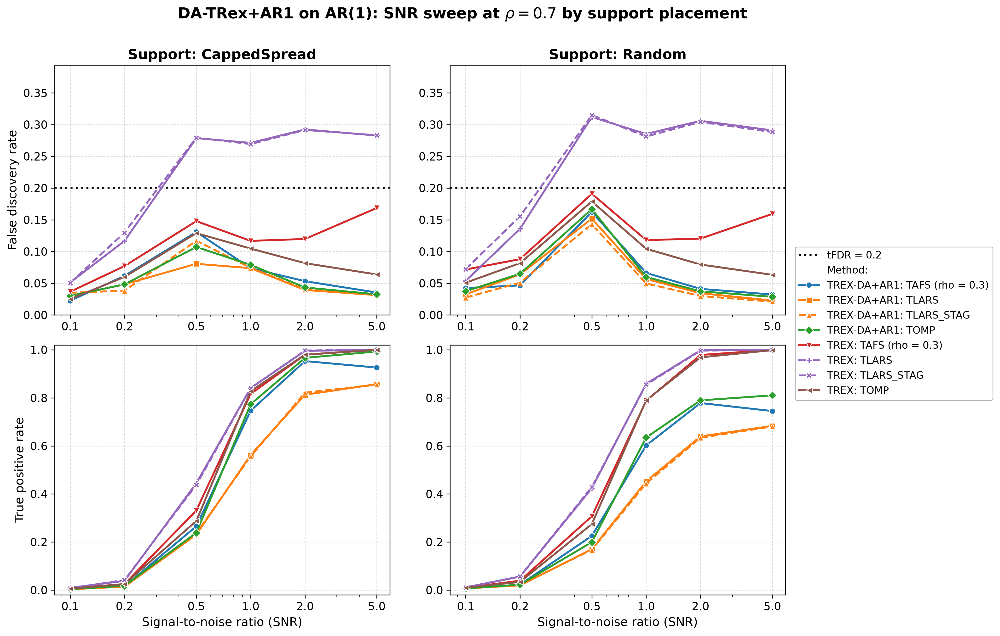
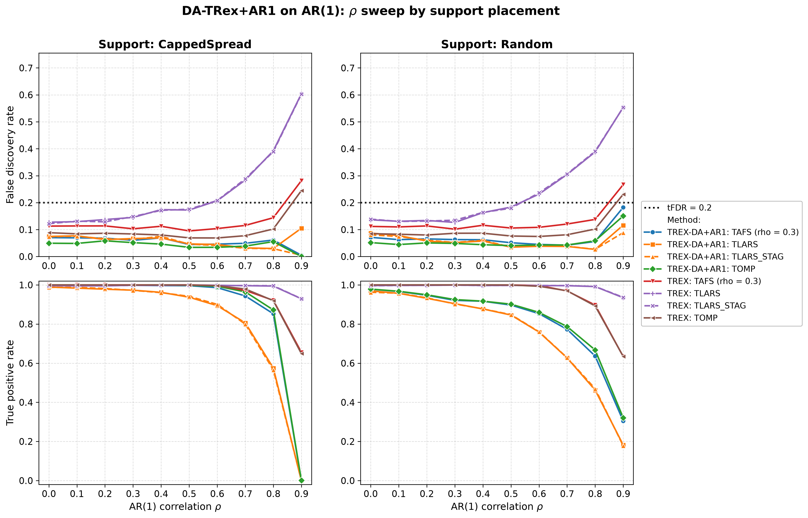
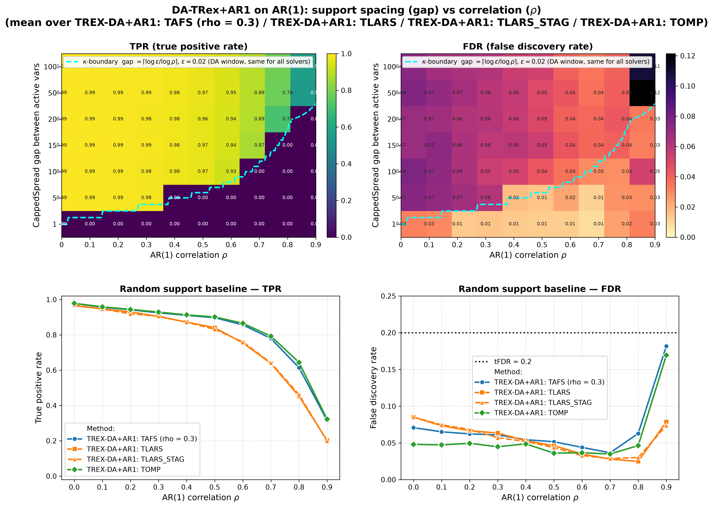

# Demo 01: DA-TRex+AR1 on AR(1) Toeplitz Data

The following demo presents Monte-Carlo (MC) results for **DA-TRex+AR1** — the dependency-aware (DA) Terminating Random
Experiments (T-Rex) selector for the first-order autoregressive (AR(1)) model — vs. the **classical (no-DA) T-Rex
selector** on AR(1) Toeplitz data ($n=300$, $p=1{,}000$, $s=10$, amplitude $3.0$, target false discovery rate (FDR)
$\mathrm{tFDR}=0.2$, $K=20$ random experiments, $\mathrm{MC}=200$ per grid point, and solvers TLARS / TAFS / TOMP, plus
TLARS_STAG, TLARS with the T-loop stagnation stop, see the [suite README](../README.md)).

The greedy solvers use *exchangeable tie-breaking* (`exch_tie_alpha = 0.25` for TAFS/TOMP, `0` for TLARS).
Look up `Exchangeable_Tie_Breaking_DA_TRex.md` in the TRex_Research documentation.
TAFS additionally runs with its adaptive forward-selection (AFS) correlation parameter `rho_afs = 0.3`
(`0` for TLARS/TOMP), which is why the figures label it `TAFS (rho = 0.3)`.
With this fix, **all four DA solvers are FDR-controlled across the entire $\rho$ grid and both support placements** —
including the previously violating greedy-solver cells at $\rho = 0.9$ with power
(e.g. gap=100: TAFS $0.24 \to 0.15$, TOMP $0.21 \to 0.12$), where TAFS/TOMP now also retain more power than DA-TLARS.

---

## Setup — data generating process and selector configuration

**Linear model.** Each Monte-Carlo trial draws

```math
y = X\beta + \varepsilon, \qquad X \in \mathbb{R}^{n \times p},\; n = 300,\; p = 1{,}000,
```

where $\beta$ has $s = 10$ nonzero entries of amplitude $3.0$ on the support (placed by the `CappedSpread` or
`Random` policy, see the parts below) and $\varepsilon_i \stackrel{\text{iid}}{\sim} \mathcal{N}(0, \sigma^2)$ with
the noise variance calibrated to the target signal-to-noise ratio (SNR),
$\sigma^2 = \widehat{\mathrm{Var}}(X\beta) / \mathrm{SNR}$.

**Covariance model (AR(1) Toeplitz).** The rows of $X$ are independent and identically distributed (i.i.d.)
zero-mean Gaussian with autoregressive column dependence,

```math
X_{i,1} = \eta_{i,1}, \qquad
X_{i,j} = \rho\, X_{i,j-1} + \sqrt{1-\rho^2}\; \eta_{i,j}, \qquad
\eta_{i,j} \stackrel{\text{iid}}{\sim} \mathcal{N}(0,1),
```

so that

```math
\Sigma_{jk} = \rho^{|j-k|}
```

Neighboring columns are the strongest-correlated, and the correlation decays geometrically with index distance.

In the following we refer to a linear signal to noise ratio

```math
\mathrm{SNR} = \frac{\mathrm{Var}(X\beta)}{\sigma^2}
```

to assess the performance of the method.

---

## Running the Demo

```bash
./build/release/bin/trex_selector_methods/ad/trex_da/demo_trex_da_01_mc_sim_ar1/demo_trex_da_01_mc_sim_ar1
```

Afterwards, regenerate the figures from the comma-separated values (CSV) files with
[`generate_plots.sh`](generate_plots.sh).

---

## Output Files

Data tables are written to `simulation_results/data/` (`.txt` pretty-printed, `.csv` tidy long format):

- `da_trex_mc_da_ar1_snr_capped.txt` / `.csv`
- `da_trex_mc_da_ar1_snr_random.txt` / `.csv`
- `da_trex_mc_da_ar1_rho_capped.txt` / `.csv`
- `da_trex_mc_da_ar1_rho_random.txt` / `.csv`
- `da_trex_mc_da_ar1_gap_rho.txt` / `.csv`

Figures (`.png` and `.pdf`) go to `simulation_results/plots/`. With `--plotly`, `./generate_plots.sh` also writes
interactive Plotly `.html` pages for the per-CSV overviews. They are not committed to the repository, since each
embeds a full copy of plotly.js (about 5 MB).

---

## Part 1 — SNR sweep (at $\rho = 0.7$)

DA-TRex+AR1 vs. base T-Rex over $\mathrm{SNR} \in \lbrace0.1, 0.2, 0.5, 1, 2, 5\rbrace$, CappedSpread vs. Random
support:



All four DA solvers stay below $\mathrm{tFDR}=0.2$ at every SNR (at most $0.17$), while base T-Rex TLARS violates from
$\mathrm{SNR}=0.5$ on (FDR $0.27\text{–}0.31$). The DA cost in true positive rate (TPR) appears from $\mathrm{SNR}=0.5$
on and is largest for TLARS, peaking at $\mathrm{SNR}=1$ (DA $0.56$ vs. base $0.84$ CappedSpread, $0.45$ vs. $0.86$
Random). At $\mathrm{SNR}=2$ it is still $0.81$ vs. $1.00$ (CappedSpread) and $0.64$ vs. $1.00$ under Random support,
where the active variables are not kept apart by construction. The greedy solvers pay less (TOMP $0.97$ vs. $0.98$
CappedSpread and $0.79$ vs. $0.97$ Random). TLARS_STAG gives the same FDR and TPR as TLARS within Monte Carlo
noise.

---

## Part 2 — $\rho$ sweep (at $\mathrm{SNR} = 2$)

DA-TRex+AR1 vs. base T-Rex over $\rho \in \lbrace0.0, 0.1, \dots, 0.9\rbrace$.



- **CappedSpread (max_gap = 20), left column:** the $\rho = 0.9$ point is the **collapse regime** for this support
  gap $20 < \kappa = 38$, so all active variables fall inside each other's correction windows, DA suppresses
  everything (TPR $\approx 0$), and the tiny residual FDR values are rare lone-survivor events (binary per-trial
  false discovery proportion (FDP) — hence the large standard deviation (sd) in the tables).
- **Random support, right column:** most actives stay isolated, so power persists to $\rho = 0.9$
  (TPR $\approx 0.30\text{–}0.32$ for the greedy DA solvers) while FDR stays controlled ($0.15\text{–}0.18$). Base T-Rex
  TLARS climbs to $\approx 0.55$.
- **TLARS_STAG:** same power as DA-TLARS, while its T-loop stops after at most $7$ steps, where DA-TLARS runs up to
  $T \approx 49$ at high $\rho$. Its FDR is at most $0.09$ over both $\rho$ sweeps.

Against the previous run on library commit `44cf1ab`, TAFS and TOMP lose FDR beyond Monte Carlo noise in all three
parts, in the DA rows as in the base rows, while their TPR stays flat. Over the $112$ DA cells of the demo the mean FDR
drops from $0.079$ to $0.055$ for TAFS and from $0.068$ to $0.045$ for TOMP, by up to $7.8$ standard errors in a single
cell, while the mean TPR moves from $0.685$ to $0.687$ and stays at $0.693$. The base rows of Parts 1 and 2 lose less
(TAFS $0.144$ to $0.125$, TOMP $0.118$ to $0.094$), and DA-TLARS and TLARS_STAG move much less ($0.065$ to $0.057$ and
$0.058$ to $0.049$). All three language trees show the same drop. Library commit `415484d` removed the lower clamp
$\Phi' \geq 0$ from the FDP estimate, which makes the estimate larger, and it is the only library change on the path
of TAFS and TOMP. Both stop their T-loop on stagnation, so the larger estimate raises the voting threshold instead of
shortening the loop. TLARS runs without the stagnation stop, so there the estimate can end the T-loop earlier. Base
TLARS on CappedSpread support now averages $7.7$ instead of $10.8$ steps over the $\rho$ sweep ($17.5$ instead of
$43.4$ at $\rho = 0.9$), while its FDR barely moves ($0.244$ to $0.237$).

---

## Part 3 — 2D gap × $\rho$ study ($\mathrm{SNR} = 2$)

`CappedSpread(gap)` for gap $\in \lbrace100, 50, 20, 15, 10, 5, 1\rbrace$ plus a Random-support column, over the
full $\rho$ grid, per solver. The overlaid $\kappa$-boundary ($\kappa = \lceil \log \varepsilon / \log \rho \rceil$,
$\varepsilon = 0.02$) marks where active variables enter each other's DA correction windows, so below it TPR collapses
by construction.



- **Heatmaps (top row)** show the **mean over the four DA solvers** per (gap, $\rho$) cell, and the dashed
  $\kappa$-boundary is the DA correction-window threshold gap $= \lceil \log 0.02 / \log \rho \rceil$
  ($\varepsilon = 0.02$ = `rho_thr_DA`) — a property of the correction itself, identical for all four solvers.
- **Random-support baseline (bottom row)** shows one line per method.
- **TPR heatmap** — the sharp $\kappa$-boundary cliff (gap $< \kappa \Rightarrow$ TPR $\approx 0$) is a structural
  property of the AR1 correction window, not a solver artifact.
- **FDR heatmap** — with the exchangeable-tie fix, the wide-gap / $\text{high-}\rho$ corner
  (gap $= 100/50$, $\rho = 0.9$) is now controlled for TAFS ($0.15/0.17$) and TOMP ($0.12/0.15$). Before the fix these
  cells sat at $0.21\text{–}0.27$, driven by collinear shadows (distance-1 neighbors of true actives) that greedy
  winner-take-all selection let through the DA deflation.
- **TLARS_STAG below the boundary** — where the support gap is smaller than $\kappa$ and no true variable survives
  (gap $\le 20$ at $\rho = 0.9$), DA-TLARS still raises false alarms in $9\text{–}17\,\%$ of the runs, while TLARS_STAG
  stays at or below $2.5\,\%$. The long T-loop of DA-TLARS most likely gives null variables more chances to collect
  votes, which the stagnation stop cuts short.

---

## References

- Machkour, J., Muma, M., & Palomar, D. P., "FDR-Controlled Sparse Index Tracking with Autoregressive Stock
  Dependency Models", European Signal Processing Conference (EUSIPCO), 2024, pp. 2662–2666,
  [DOI link](https://ieeexplore.ieee.org/document/10715329).
