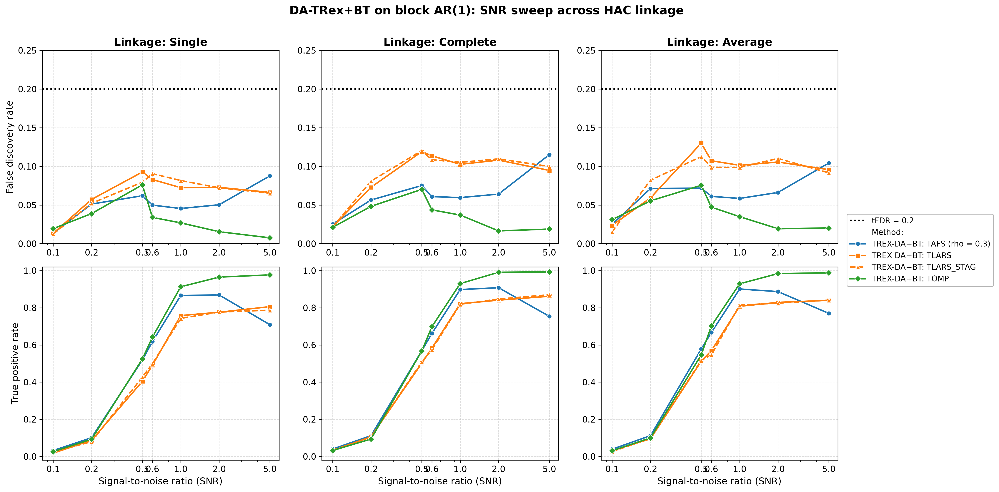
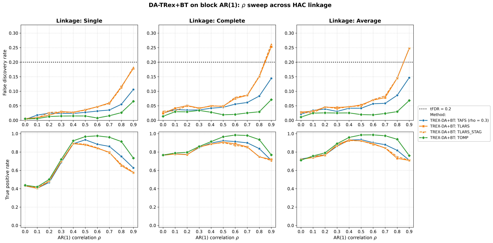
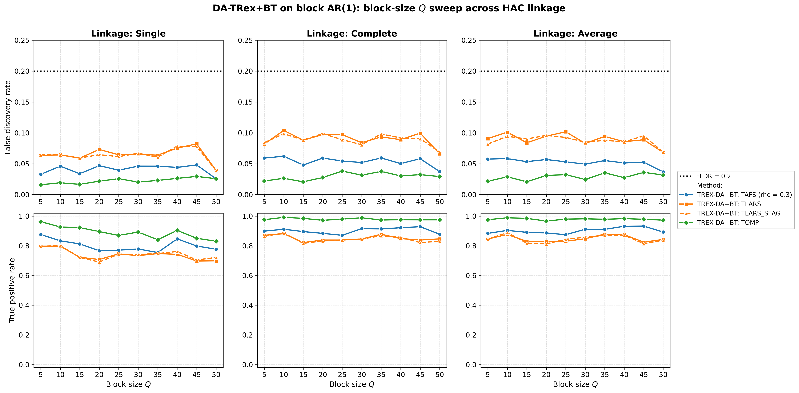
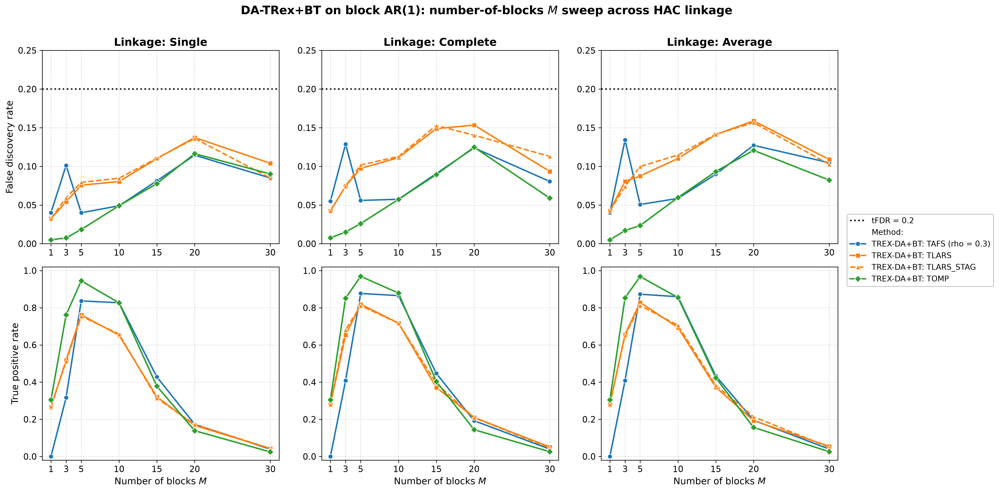

# Demo 03: DA-TRex+BT (Binary-Tree Dependency-Aware T-Rex) on Block-Diagonal AR(1) Data

Monte-Carlo (MC) results for **DA-TRex+BT** — the Binary-Tree (BT) Dependency-Aware (DA) Terminating Random Experiments
(T-Rex) selector (`DAMethod::BT`) — on a clean block-diagonal first-order autoregressive (AR(1)) design (no white-noise
padding), sweeping the signal-to-noise ratio (SNR), $\rho$, block size $Q$, and number of blocks $M$, each across the
three hierarchical agglomerative clustering (HAC) linkage methods (Single / Complete / Average). Common setup: $n=150$,
amplitude $1.0$, target false discovery rate (FDR) $\mathrm{tFDR}=0.2$, $K=20$ random experiments, $\mathrm{MC}=200$ per
grid point, and solvers TLARS / TAFS / TOMP, plus TLARS_STAG (TLARS with the T-loop stagnation stop, see the
[suite README](../README.md)). The R and Python versions live in the folders of the same name
([R](../../../../../R/trex_selector_methods/ad/trex_da/demo_trex_da_03_mc_sim_ar1_blocks/),
[Python](../../../../../Python/trex_selector_methods/ad/trex_da/demo_trex_da_03_mc_sim_ar1_blocks/)).

The greedy solvers use *exchangeable tie-breaking* (`exch_tie_alpha = 0.25` for TAFS/TOMP, `0` for
TLARS). See `Exchangeable_Tie_Breaking_DA_TRex.md` in the TRex_Research documentation.
TAFS additionally runs with its adaptive forward-selection (AFS) correlation parameter `rho_afs = 0.3`
(`0` for TLARS/TOMP), which is why the figures label it `TAFS (rho = 0.3)`.

---

## Setup — the DA-TRex+BT selector

The selector deflates each variable's ordinary relative occurrence $\Phi_{T,L}(j)$ by the penalty
$\Psi_{T,L}^{\mathrm{BT}}(j) \in [1/2, 1]$ built from its most similar competitor within its
variable group,

```math
\Phi^{\mathrm{BT}}_{T,L}(j) := \Psi^{\mathrm{BT}}_{T,L}(j) \cdot \Phi_{T,L}(j),
```

where the **BT group design** obtains the groups $\mathrm{Gr}(j)$ from a **binary tree**. Variables
are clustered by hierarchical agglomerative clustering (HAC) on the dissimilarity
$1 - |\mathrm{corr}(\boldsymbol x_j, \boldsymbol x_{j'})|$ and the dendrogram cut defines disjoint
groups (see [Demo 02](../demo_trex_da_02_mc_sim_ar1_blocks_plus_white/README.md) for the full penalty
formula). The **linkage method** sets the between-cluster distance during agglomeration —
**Single** ($\min$, prone to chaining), **Complete** ($\max$, compact clusters), **Average**
(mean, unweighted pair group method with arithmetic mean (UPGMA)) — and every sweep below runs once per linkage to probe
its influence.

## Setup — data generating process (`dgp_ar1_block`)

The design consists of $M$ statistically independent AR(1) blocks of size $Q$ — and nothing else.
Unlike Demo 02 there is no white-noise padding, so *every* column belongs to a correlated block and
$p = M \cdot Q$. The within-block correlation follows the $Q \times Q$ Toeplitz matrix

```math
\left[\boldsymbol{\Sigma}_{m}(\rho)\right]_{j,k} = \rho^{|j-k|},
\qquad m = 1, \ldots, M,
```

generated per block via the recursion $z_{j} = \rho\, z_{j-1} + \sqrt{1-\rho^{2}}\,\varepsilon_{j}$
with $z_1, \varepsilon_j \sim \mathcal{N}(0,1)$, giving the block-diagonal covariance

```math
\boldsymbol{\Sigma} =
\begin{bmatrix}
\boldsymbol{\Sigma}_1(\rho) & & \\
& \ddots & \\
& & \boldsymbol{\Sigma}_M(\rho)
\end{bmatrix} \in \mathbb{R}^{p \times p},
\qquad p = M \cdot Q.
```

At the base point the problem is *low-dimensional* ($p = 25 \ll n = 150$). The $Q$ sweep pushes it
past $p > n$ ($p = 250$ at $Q = 50$), and the $M$ sweep reaches $p = n = 150$ at $M = 30$.

**Support (`OnePerBlock`).** Exactly one representative per AR(1) block,

```math
\mathcal{S} = \{s_1, \ldots, s_M\}, \qquad s_m \in \{(m-1)Q + 1, \ldots, mQ\},
```

so $s = M$ and every block carries a signal.

**Linear model and SNR control.** Each trial draws $y = X\beta + \varepsilon$ with active amplitude
$\beta_{s_m} = 1.0$, $\varepsilon_i \stackrel{\text{iid}}{\sim} \mathcal{N}(0, \sigma^2)$, and
$\sigma^2 = \widehat{\mathrm{Var}}(X\beta)/\mathrm{SNR}$.

**Base parameters** (each sweep varies one dimension, ceteris paribus): $M=5$, $Q=5$ ($p=25$,
$s=5$), $\rho=0.7$, $\mathrm{SNR}=2.0$, seed $2026$.

---

## Running the Demo

```bash
./build/release/bin/trex_selector_methods/ad/trex_da/demo_trex_da_03_mc_sim_ar1_blocks/demo_trex_da_03_mc_sim_ar1_blocks
```

Afterwards, regenerate the figures from the comma-separated values (CSV) files with
[`generate_plots.sh`](generate_plots.sh).

---

## Output Files

Data tables are written to `simulation_results/data/` (24 files = 12 scenario stems, one
`.txt`+`.csv` pair each):

- `da_trex_mc_da_ar1_blocks_snr_{Single,Complete,Average}.txt` / `.csv`
- `da_trex_mc_da_ar1_blocks_rho_{Single,Complete,Average}.txt` / `.csv`
- `da_trex_mc_da_ar1_blocks_Q_{Single,Complete,Average}.txt` / `.csv`
- `da_trex_mc_da_ar1_blocks_M_{Single,Complete,Average}.txt` / `.csv`

Figures go to `simulation_results/plots/`: one overview of the FDR and the true positive rate (TPR) per sweep × linkage
(`.png` and `.pdf`, plus an interactive Plotly `.html` page with `--plotly`), plus one linkage-comparison grid
(Single/Complete/Average columns) per sweep — the four grids embedded below.

---

## Part 1 — SNR sweep ($\mathrm{SNR} \in \lbrace0.1, 0.2, 0.5, 0.6, 1, 2, 5\rbrace$)

- **FDR stays under the $\mathrm{tFDR}=0.2$ target at every SNR** (worst cell $0.130$, TLARS at
  $\mathrm{SNR}=0.5$ under Average linkage) — but visibly higher than the white-noise-diluted Demo 02
  ($\leq 0.032$ over its SNR sweep, at its stricter target of $0.1$ and twice the sample size, so the gap reflects the
  target and $n$ as well as the null structure). In an all-block design every false discovery candidate is a
  correlated shadow.
- TPR: TOMP is the strongest from $\mathrm{SNR}=0.6$ on ($0.97\text{–}0.99$ from $\mathrm{SNR}=2$), while TLARS reaches
  $0.78\text{–}0.86$. TAFS peaks at $\mathrm{SNR}=1\text{–}2$ ($0.87\text{–}0.91$) and then *declines* to
  $\approx 0.71\text{–}0.77$ at $\mathrm{SNR}=5$ — the same non-monotonicity seen in Demo 02.
- Linkage has only a mild effect here, and Complete/Average buy a few TPR points over Single.



---

## Part 2 — $\rho$ sweep ($\rho \in \lbrace0.0, 0.1, \ldots, 0.9\rbrace$)

- **FDR rises steadily with $\rho$ and TLARS breaks the target at $\rho=0.9$** under Complete and Average
  linkage ($0.253$ / $0.247$), and reaches $0.179$ under Single linkage, while TAFS stays below it
  ($0.11\text{–}0.15$) and TOMP stays controlled ($0.07$). TLARS_STAG shows nearly the same values, so the
  stagnation stop does not cure this violation. Strong within-block correlation makes the block shadows
  progressively harder to deflate — the block-design counterpart of the $\text{high-}\rho$ corner seen in
  Demos 01 and 07.
- **Single linkage again loses power at low $\rho$**: TPR $0.41\text{–}0.44$ at $\rho \leq 0.1$ vs.
  $0.71\text{–}0.79$ for Complete/Average — with weak within-block correlation the Single-linkage cut
  groups variables by noise. From $\rho \approx 0.4$ to $\rho = 0.7$ the linkages stay within about $0.06$ of each
  other, before Single falls behind again at $\rho \geq 0.8$ (up to $0.14$ at $\rho = 0.9$, TLARS).
- TPR peaks $\text{mid-}\rho$ and falls toward $\rho=0.9$ (TOMP $0.73\text{–}0.77$, TAFS $0.63\text{–}0.71$,
  TLARS $0.58\text{–}0.72$).



---

## Part 3 — Block-size $Q$ sweep ($Q \in \lbrace5, 10, \ldots, 50\rbrace$, $p = 5Q$ grows to $250 > n$)

- FDR is comfortably controlled over the whole sweep (max $0.104$, TLARS) even as the design crosses
  into the high-dimensional regime ($p = 250 > n = 150$ at $Q=50$).
- Complete/Average linkage handle growing blocks gracefully (TOMP $0.97\text{–}0.99$, TAFS $0.87\text{–}0.93$
  throughout), while **Single linkage bleeds power as $Q$ grows** (TOMP down to $0.83$, TLARS $0.70$ at
  $Q \ge 45$) — the same fragility as in Demo 02's $Q$ sweep, though milder (Single trails Complete/Average by up to
  $0.16$ TPR here against $0.20$ there), plausibly because there is no white pool to merge into.



---

## Part 4 — Number-of-blocks $M$ sweep ($M \in \lbrace1, 3, 5, 10, 15, 20, 30\rbrace$, $s = M$, $p = 5M$)

- This is the stress dimension. Here $s = M$ grows while $n = 150$ and the amplitude stay fixed. **TPR collapses
  for $M \gtrsim 20$** ($\approx 0.14\text{–}0.21$ at $M=20$, $\leq 0.06$ at $M=30$, where $p = n$),
  while FDR stays below target throughout (max $0.159$) — the selector fails *safe*.
- The $M=1$ corner is degenerate ($p=5$, one active variable), so all solvers are weak
  (TPR $\leq 0.31$) and TAFS never finds the active variable (TPR $0$). In $4\text{–}5.5\,\%$ of the runs it selects
  a null variable instead (FDR $0.040\text{–}0.055$) — with a single signal there is no occurrence spread for the
  DA deflation to work with.
- The sweet spot sits at $M \approx 5\text{–}10$, where TOMP holds $0.83\text{–}0.97$ TPR with FDR
  $\le 0.06$.



---

## TLARS_STAG

TLARS_STAG (TLARS with the T-loop stagnation stop) matches TLARS in every sweep, with mean FDR and TPR changes below
$0.001$ and at most $0.022$ less TPR in a single cell. Its T-loop stops after at most $7$ steps, where TLARS runs to
a median of $32$ and up to $42$ steps. It also inherits TLARS' violation at $\rho = 0.9$, so that violation does not
come from the long T-loop.

---

## Interpretation

- Read this demo against **Demo 02** (same block AR(1) core plus $975$ white-noise columns,
  $n=300$, and the stricter target $\mathrm{tFDR}=0.1$). The pure block design at half the sample size shows higher
  realized FDR in $396$ of the $408$ shared cells — culminating in TLARS's $\rho=0.9$ violation — and lower TPR in
  $337$. It is the harder problem, although the two demos differ in $n$ and the target as well as in the white
  padding.
- The linkage story is consistent across both demos. Linkage matters little at the well-correlated base point,
  but **Single linkage is the fragile choice** at low $\rho$ and large $Q$, so Complete or Average are
  the safer defaults.
- Solver ranking on block designs: **TOMP is the most robust** (best TPR in $80$ and lowest FDR in $90$ of
  the $102$ cells), TAFS in between with its high-SNR power decline, TLARS the most FDR-fragile at strong
  within-block correlation.
