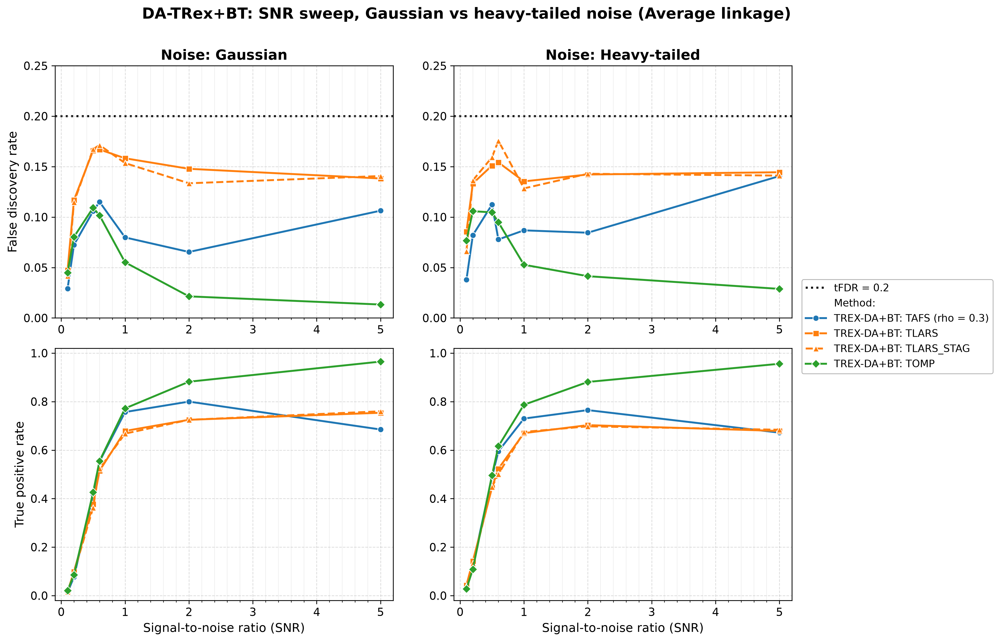
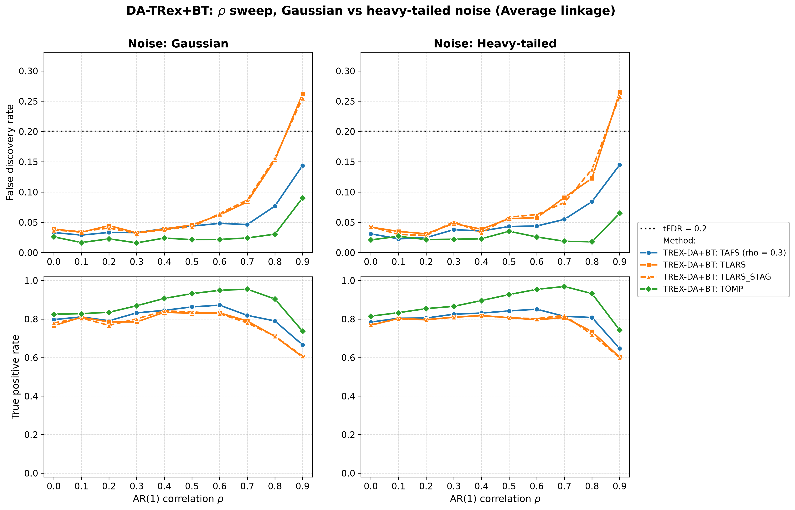
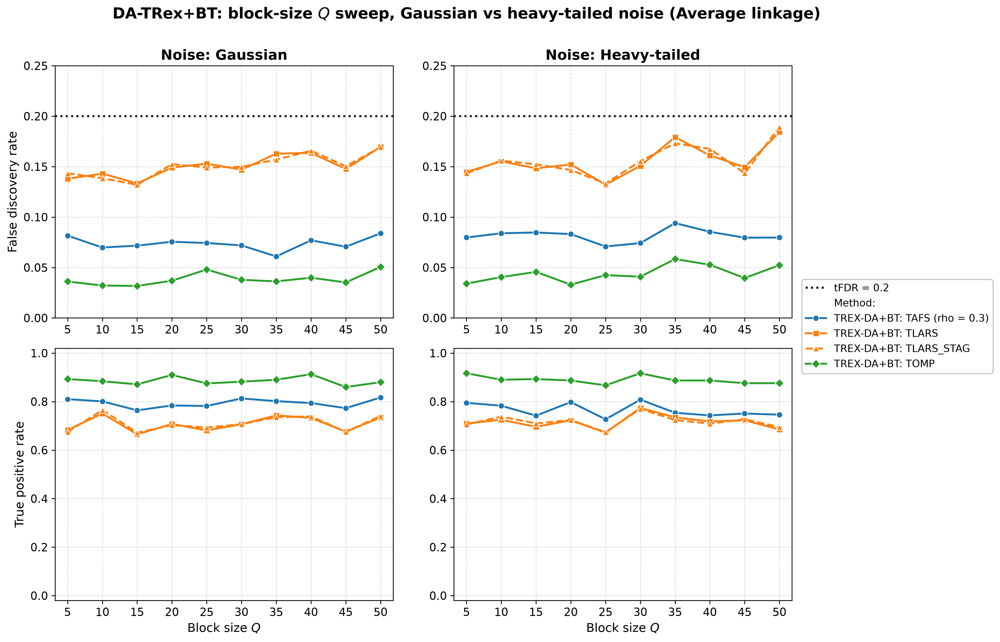
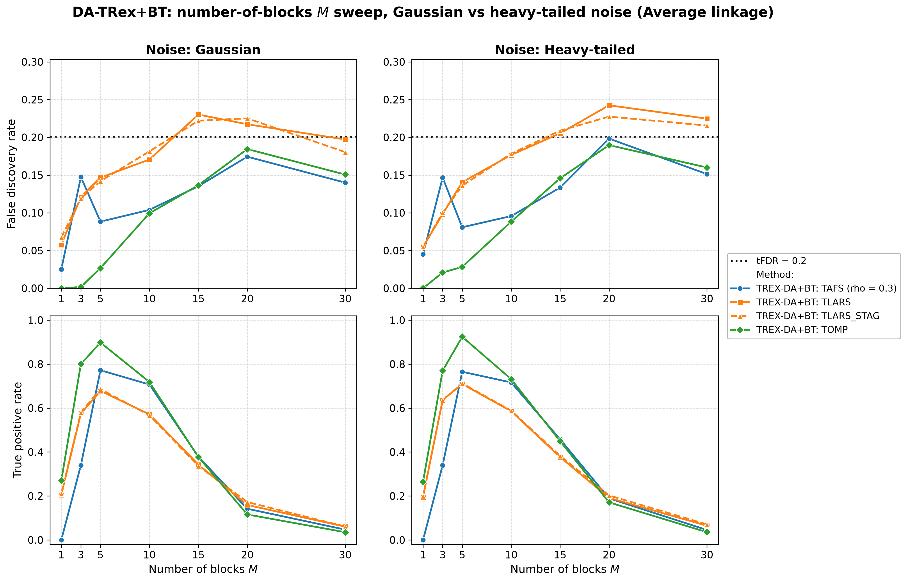
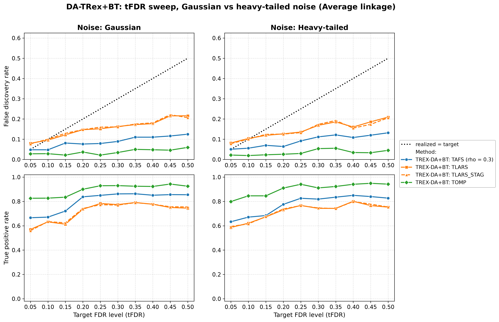
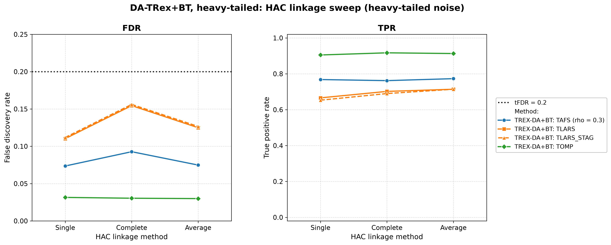

# Demo 04: DA-TRex+BT (Binary-Tree Dependency-Aware T-Rex) on Heavy-Tailed Block Data

Monte-Carlo (MC) results for **DA-TRex+BT** — the Binary-Tree (BT) Dependency-Aware (DA) Terminating Random Experiments
(T-Rex) selector (`DAMethod::BT`) — on a **heavy-tailed** block-diagonal Toeplitz design, where the predictors always
follow a multivariate $\text{Student-}t(\nu{=}3)$ law, and the response noise is either Gaussian (**s1_Gauss**) or
$t(\nu{=}3)$ (**s2_Heavy**). Five ceteris-paribus sweeps (signal-to-noise ratio (SNR), $\rho$, block size $Q$, number of
blocks $M$, target false discovery rate (FDR)) plus a dedicated linkage sweep are each run under both noise scenarios
and the three hierarchical agglomerative clustering (HAC) linkage methods (Single / Complete / Average). Common setup:
$n=150$, amplitude $1.0$, $\rho=0.8$, $\nu=3$, $\mathrm{tFDR}=0.2$, $K=20$ random experiments, $\mathrm{MC}=200$ per
grid point, and solvers TLARS / TAFS / TOMP, plus TLARS_STAG (TLARS with the T-loop stagnation stop, see the
[suite README](../README.md)). This is the heavy-tailed analogue of the Gaussian block design in the R
legacy reference [`Results_trex_da_05_bt_ar1_block_sweeps`](#references). The R and Python versions live in the folders
of the same name ([R](../../../../../R/trex_selector_methods/ad/trex_da/demo_trex_da_04_mc_sim_ht_blocks/),
[Python](../../../../../Python/trex_selector_methods/ad/trex_da/demo_trex_da_04_mc_sim_ht_blocks/)).

The greedy solvers use *exchangeable tie-breaking* (`exch_tie_alpha = 0.25` for TAFS/TOMP, `0` for
TLARS). See `Exchangeable_Tie_Breaking_DA_TRex.md` in the TRex_Research documentation.
TAFS additionally runs with its adaptive forward-selection (AFS) correlation parameter `rho_afs = 0.3`
(`0` for TLARS/TOMP), which is why the figures label it `TAFS (rho = 0.3)`.

---

## Setup — the DA-TRex+BT selector

The selector deflates each variable's ordinary relative occurrence $\Phi_{T,L}(j)$ by the penalty
$\Psi_{T,L}^{\mathrm{BT}}(j) \in [1/2, 1]$ built from its most similar competitor within its
variable group,

```math
\Phi^{\mathrm{BT}}_{T,L}(j) := \Psi^{\mathrm{BT}}_{T,L}(j) \cdot \Phi_{T,L}(j),
```

where the **BT group design** obtains the groups $\mathrm{Gr}(j)$ from a **binary tree**. Variables
are clustered by hierarchical agglomerative clustering (HAC) on the dissimilarity
$1 - |\mathrm{corr}(\boldsymbol x_j, \boldsymbol x_{j'})|$ and the dendrogram cut defines disjoint
groups (see [Demo 02](../demo_trex_da_02_mc_sim_ar1_blocks_plus_white/README.md) for the full penalty
formula). The **linkage method** sets the between-cluster distance during agglomeration —
**Single** ($\min$, prone to chaining), **Complete** ($\max$, compact clusters), **Average**
(mean, unweighted pair group method with arithmetic mean (UPGMA)). Because heavy-tailed data make the sample
correlations that drive HAC noisier, every sweep is run once per linkage and Part 6 probes linkage directly.

## Setup — data generating process (`dgp_block_toeplitz_hvt`)

The design consists of $M$ statistically independent first-order autoregressive (AR(1)) blocks of size $Q$ — and
nothing else. As in Demo 03 there is no white-noise padding, so *every* column belongs to a correlated block and
$p = M \cdot Q$. The within-block correlation follows the $Q \times Q$ Toeplitz matrix

```math
\left[\boldsymbol{\Sigma}_{m}(\rho)\right]_{j,k} = \rho^{|j-k|},
\qquad m = 1, \ldots, M,
```

giving the block-diagonal scale matrix

```math
\boldsymbol{\Sigma} =
\begin{bmatrix}
\boldsymbol{\Sigma}_1(\rho) & & \\
& \ddots & \\
& & \boldsymbol{\Sigma}_M(\rho)
\end{bmatrix} \in \mathbb{R}^{p \times p},
\qquad p = M \cdot Q.
```

**Heavy-tailed predictors.** Each block is drawn as a **multivariate $\text{Student-}t$** with $\nu$ degrees
of freedom and scale matrix $\boldsymbol\Sigma_m$, via the Gaussian scale-mixture

```math
\boldsymbol{X}_i^{(m)} = \sqrt{\tfrac{\nu}{u_{i,m}}}\; \boldsymbol{L}_m \boldsymbol{z}, \qquad
\boldsymbol{z} \sim \mathcal{N}(\boldsymbol{0}, \boldsymbol{I}_Q),\;\;
u_{i,m} \sim \chi^2_{\nu},
```

where $\boldsymbol L_m$ is the Cholesky factor of $\boldsymbol\Sigma_m$ and the mixing variable
$u_{i,m}$ is drawn independently per row $i$ and block $m$. The correlation structure $\rho^{|j-k|}$
is preserved. The marginals are $t(\nu)$ (finite variance $\tfrac{\nu}{\nu-2}$ for $\nu=3$), so the
tails are much heavier than Gaussian.

**Support (`OnePerBlock`).** Exactly one representative per AR(1) block (the block's first column),

```math
\mathcal{S} = \{s_1, \ldots, s_M\}, \qquad s_m = (m-1)Q + 1,
```

so $s = M$ and every block carries a signal.

**Linear model, noise scenarios, and SNR control.** Each trial draws $y = X\beta + \varepsilon$ with
active amplitude $\beta_{s_m} = 1.0$ and SNR-calibrated noise variance
$\sigma^2 = \widehat{\mathrm{Var}}(X\beta)/\mathrm{SNR}$. The two scenarios differ only in the noise
law:

- **s1_Gauss:** $\varepsilon_i \stackrel{\text{iid}}{\sim} \mathcal{N}(0, \sigma^2)$,
- **s2_Heavy:** $\varepsilon_i \propto t(\nu)$, variance-matched to $\sigma^2$ (scaled by
  $\sqrt{\sigma^2 (\nu-2)/\nu}$).

Note that the **predictors are heavy-tailed in *both* scenarios** — the s1/s2 switch isolates the
additional effect of heavy-tailed *noise* on top of an already heavy-tailed design.

**Base parameters** (each sweep varies one dimension, ceteris paribus): $M=5$, $Q=5$ ($p=25$,
$s=5$), $\rho=0.8$, $\nu=3$, $\mathrm{SNR}=2.0$, seed $2026$.

---

## Running the Demo

```bash
./build/release/bin/trex_selector_methods/ad/trex_da/demo_trex_da_04_mc_sim_ht_blocks/demo_trex_da_04_mc_sim_ht_blocks
```

Afterwards, regenerate the figures from the comma-separated values (CSV) files with
[`generate_plots.sh`](generate_plots.sh).

---

## Output Files

Data tables are written to `simulation_results/data/` (64 files — the largest output set of any demo
here: 32 scenario stems, one `.txt`+`.csv` pair each). Five sweeps
(`snr`, `rho`, `Q`, `M`, `tFDR`) × 2 noise scenarios × 3 linkages = 30 stems following the pattern
`da_trex_mc_da_ht_blocks_{snr|rho|Q|M|tFDR}_{s1_Gauss|s2_Heavy}_{Single|Complete|Average}.{txt,csv}`, plus
the dedicated linkage-sweep section's 2 stems
`da_trex_mc_da_ht_blocks_linkage_{s1_Gauss|s2_Heavy}.{txt,csv}` (which omit the trailing linkage suffix
since linkage itself is the swept variable).

Figures go to `simulation_results/plots/`: per-CSV FDR and true positive rate (TPR) overviews (`.png` and `.pdf`, plus
an interactive Plotly `.html` page with `--plotly`), one linkage-comparison grid per (sweep × scenario), and
— embedded below — one **Gaussian-vs-heavy scenario grid** per sweep (at Average linkage). The scenario grid is the
figure for this demo's core question, namely how much heavy tails cost in FDR control and power.

---

## Part 1 — SNR sweep ($\mathrm{SNR} \in \lbrace0.1, 0.2, 0.5, 0.6, 1, 2, 5\rbrace$)

- **TOMP is the clear winner**. FDR falls to $\approx 0.01\text{–}0.05$ from $\mathrm{SNR}=2$ on while TPR climbs to
  $0.96\text{–}0.97$ at $\mathrm{SNR}=5$. TAFS peaks around $\mathrm{SNR}=1\text{–}2$ (TPR $\approx 0.71\text{–}0.81$,
  FDR $\leq 0.10$) then *declines* toward $\mathrm{SNR}=5$ ($\approx 0.63\text{–}0.72$) — the same non-monotonicity
  seen in the Gaussian block demos.
- **TLARS runs closest to the $\mathrm{tFDR}=0.2$ target** (FDR up to $0.18$ from $\mathrm{SNR}=0.5$ on) with
  the lowest power at $\mathrm{SNR}=1\text{–}2$ ($\approx 0.61\text{–}0.75$), and at $\mathrm{SNR}=5$ it passes the
  declining TAFS.
- **Gaussian vs. heavy-tailed noise changes little**. The two columns stay close (mean absolute gap $0.03$ over the
  sweep, at most $0.11$ in a single cell), because the predictors are heavy-tailed in both cases and dominate the added
  noise.



---

## Part 2 — $\rho$ sweep ($\rho \in \lbrace0.0, 0.1, \ldots, 0.9\rbrace$)

- **FDR rises with $\rho$ and TLARS breaks the target at $\rho = 0.9$** ($0.22\text{–}0.27$ over both noise
  scenarios and all linkages), while TAFS stays below it ($0.12\text{–}0.17$) and **TOMP stays controlled**
  ($0.06\text{–}0.09$). Strong within-block correlation makes the block shadows progressively harder to deflate —
  the block counterpart of the $\text{high-}\rho$ corner in Demos 01 and 07.
- TPR peaks at $\rho = 0.6\text{–}0.7$ for TOMP (up to $0.97$) and TAFS (up to $0.87$), while TLARS has no common
  peak (up to $0.85$). All fall at $\rho=0.9$ (TOMP $0.71\text{–}0.75$, TAFS $0.61\text{–}0.67$, TLARS
  $0.52\text{–}0.64$). At $\rho \le 0.2$ Single linkage costs power, as in Demo 03.
- Again the two noise scenarios track each other closely.



---

## Part 3 — Block-size $Q$ sweep ($Q \in \lbrace5, 10, \ldots, 50\rbrace$, $p = 5Q$ grows to $250 > n$)

- Performance is **remarkably flat across the whole sweep**, even as the design crosses well into the
  high-dimensional regime ($p = 250 > n = 150$ at $Q=50$). TOMP holds TPR $\approx 0.74\text{–}0.92$ with
  FDR $\leq 0.06$, and TAFS has TPR $\approx 0.62\text{–}0.83$ with FDR $\approx 0.05\text{–}0.10$.
- **TLARS runs closest to the target at every $Q$** ($\mathrm{FDR} \approx 0.09\text{–}0.19$, closest at
  $Q = 50$) — looser than in the fully-Gaussian Demo 03, whose $Q$-sweep TLARS FDR stays at $0.04\text{–}0.10$.
  Demo 03 runs at $\rho = 0.7$ against $\rho = 0.8$ here, and at the same $\rho$ the two demos give TLARS about the
  same FDR (see the Interpretation).



---

## Part 4 — Number-of-blocks $M$ sweep ($M \in \lbrace1, 3, 5, 10, 15, 20, 30\rbrace$, $s = M$, $p = 5M$)

- This is the stress dimension. Here $s = M$ grows while $n=150$ and the amplitude stay fixed. **TPR collapses for
  $M \gtrsim 15\text{–}20$** ($\approx 0.11\text{–}0.21$ at $M=20$, $\leq 0.07$ at $M=30$, where $p = n$),
  while FDR climbs to $0.16\text{–}0.26$ at $M=20$. TLARS breaches the target there ($0.20\text{–}0.24$), TAFS comes
  close ($0.17\text{–}0.20$), and TOMP stays just below ($0.16\text{–}0.19$).
- The $M=1$ corner is degenerate ($p=5$, a single active variable), and TAFS never finds the active variable
  (TPR $0.00$). In $2.5\text{–}4.5\,\%$ of the runs it selects a null variable instead — with one signal there is no
  occurrence spread for the DA deflation to exploit.
- The sweet spot sits at $M \approx 5\text{–}10$, where TOMP holds $\approx 0.71\text{–}0.92$ TPR at FDR
  $\approx 0.02\text{–}0.10$.



---

## Part 5 — Target-FDR sweep ($\mathrm{tFDR} \in \lbrace0.05, 0.10, \ldots, 0.50\rbrace$)

Unique to Demos 04–05, this part sweeps the *target* FDR to check calibration of the realized FDR.

- **Realized FDR rises with the target**, as it should, although not strictly (the mean over the six cells of every
  solver dips at $\mathrm{tFDR}=0.40$), and each solver has a
  floor it cannot dip below. **TLARS is the least conservative** — its realized FDR *exceeds* the
  target only for the smallest targets ($0.06\text{–}0.10$ at $\mathrm{tFDR}=0.05$, $0.08\text{–}0.12$ at
  $\mathrm{tFDR}=0.1$) and stays below it from there on ($0.11\text{–}0.15$ at $\mathrm{tFDR}=0.2$,
  $0.16\text{–}0.23$ at $\mathrm{tFDR}=0.5$), so it cannot deliver very low FDR. **TAFS** runs below the
  target (e.g. $0.05\text{–}0.09$ at $\mathrm{tFDR}=0.2$), and **TOMP is markedly conservative**
  ($0.03\text{–}0.04$ at $\mathrm{tFDR}=0.2$, still only $0.04\text{–}0.06$ at $\mathrm{tFDR}=0.5$).
- Power rises with the target up to about $\mathrm{tFDR}=0.25$ and then levels off, and TOMP stays high throughout
  ($\approx 0.79\text{–}0.95$).

Against the previous run, this sweep shows one systematic move. Library commit `415484d` removed the lower clamp
$\Phi' \geq 0$ from the false discovery proportion (FDP) estimate, so the realized FDR now falls from a target of about
$0.30$ upward, while targets up to $0.20$ move only by noise. At $\mathrm{tFDR}=0.5$ the mean FDR over the six scenario
and linkage cells drops from $0.249$ to $0.198$ for TLARS, from $0.218$ to $0.193$ for TLARS_STAG, from $0.152$ to
$0.126$ for TAFS and from $0.077$ to $0.050$ for TOMP. Power does not pay for this, because the mean TPR of the same
cells stays within noise (TLARS $0.733$ to $0.748$, TLARS_STAG $0.748$ to $0.752$, TAFS $0.836$ to $0.843$, TOMP $0.936$
to $0.934$).



---

## Part 6 — HAC linkage sweep (Single / Complete / Average, base parameters)

At the well-correlated base point ($\rho=0.8$) **linkage choice barely matters**: TOMP FDR
$\approx 0.03$ / TPR $\approx 0.89\text{–}0.92$, TAFS FDR $\approx 0.05\text{–}0.09$ / TPR $\approx 0.76\text{–}0.80$,
TLARS FDR $\approx 0.11\text{–}0.15$ / TPR $\approx 0.64\text{–}0.73$ — Single, Complete and Average land within
a few points of one another under both noise scenarios (at most $0.09$ TPR, TLARS). As Demo 03 shows, linkage
differences open up mainly at *low* $\rho$ and *large* $Q$, where the correlation signal HAC relies on is weak.



---

## TLARS_STAG

TLARS_STAG (TLARS with the T-loop stagnation stop) matches TLARS in every sweep, with mean TPR and FDR changes of at
most $0.001$ and at most $0.026$ less TPR in a single cell. Its T-loop stops after at most $7$ steps, where TLARS runs
to a median of $33$ and up to $46$ steps. It exceeds the target by more than two standard errors in $8$ cells, against
$11$ for TLARS.

---

## Interpretation

- **Heavy-tailed *predictors* are the dominant stressor, not the noise.** Across every sweep the
  s1_Gauss and s2_Heavy columns stay close. Since $X$ is $t(3)$ in both scenarios, adding a
  variance-matched $t(3)$ *noise* on top changes little (mean over the DA cells FDR $0.094$ / $0.096$ and TPR
  $0.659$ / $0.664$). The cost of the heavy-tailed predictors shows only against the fully-Gaussian Demo 03.
- **Heavy-tailed predictors cost power more than FDR control.** The $\rho$ sweeps of Demo 03 and of this demo share
  $n$, $p$, $M$, $Q$, $s$, SNR, tFDR, the support placement, the seeds and the solver pool, and differ only in the
  $t(3)$ mixing of $X$ (plus the $t(3)$ noise of the s2_Heavy scenario). From $\rho = 0.4$ on the TPR here is
  up to $0.116$ lower than in Demo 03 (Average linkage, every solver and both noise laws, apart from one cell that is
  $0.004$ higher), while at $\rho \le 0.2$ it is up to $0.114$ higher. TLARS's FDR is not systematically looser at the
  same $\rho$ ($0.153$ with Gaussian and $0.123$ with heavy noise against $0.146$ at $\rho = 0.8$, $0.262$ / $0.265$
  against $0.247$ at $\rho = 0.9$). The looser TLARS FDR on this demo's $Q$ sweep ($0.09\text{–}0.19$ against
  $0.04\text{–}0.10$ in Demo 03) is consistent with the higher base correlation, $\rho = 0.8$ against $0.7$ (Demo 03
  gives $0.146$ at $\rho = 0.8$, inside this range), while its further rise at large $Q$ has no Gaussian counterpart
  in the data.
- **Solver ranking is consistent** with the other block demos. **TOMP is the most robust** (highest
  TPR in $243$ and lowest FDR in $240$ of the $270$ cells), TAFS sits in between with its high-SNR power decline,
  and **TLARS is the most FDR-fragile** — it breaches the target at $\rho = 0.9$ and at $M = 20$, comes closest to
  it at the largest $Q$, and is the least conservative on the target FDR (tFDR) sweep (cannot reach low realized FDR).
- The failure modes are *safe*. Where the problem becomes too hard ($M \to 30$, $p \to n$), power
  collapses toward zero rather than FDR exploding.
- **Linkage** is a minor knob at this correlation level, while Complete or Average remain the safe defaults
  for the regimes (low $\rho$, large blocks) where it starts to matter.

---

## References

- R legacy simulation (Gaussian block baseline this demo extends with heavy tails):
  `TRex Legacy CRAN Simulations/trex_da/simulation_results/Results_trex_da_05_bt_ar1_block_sweeps.md`.
- R legacy simulation for the white-padded block variant (extended with heavy tails in
  [Demo 05](../demo_trex_da_05_mc_sim_ht_blocks_plus_white/README.md)):
  `.../Results_trex_da_06_bt_ar1_pwhiteblock_sweeps.md`.
- Machkour, J., Muma, M., & Palomar, D. P., "The Terminating-Random Experiments Selector: Fast
  High-Dimensional Variable Selection with False Discovery Rate Control," 2024.
