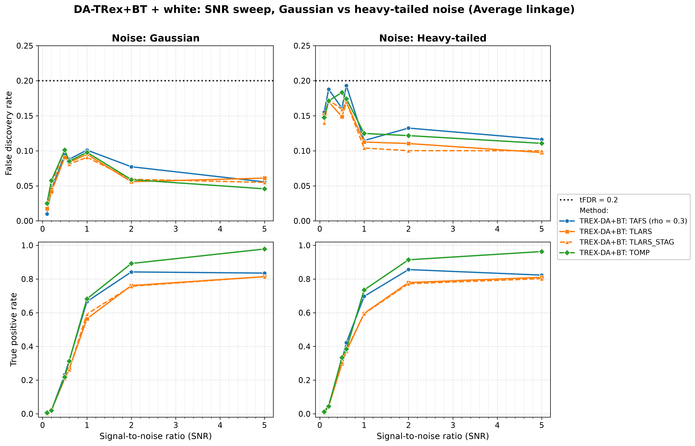
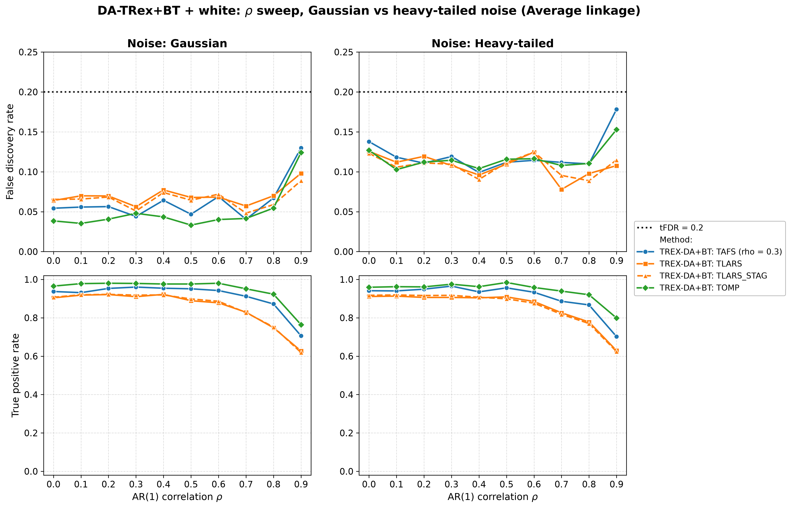
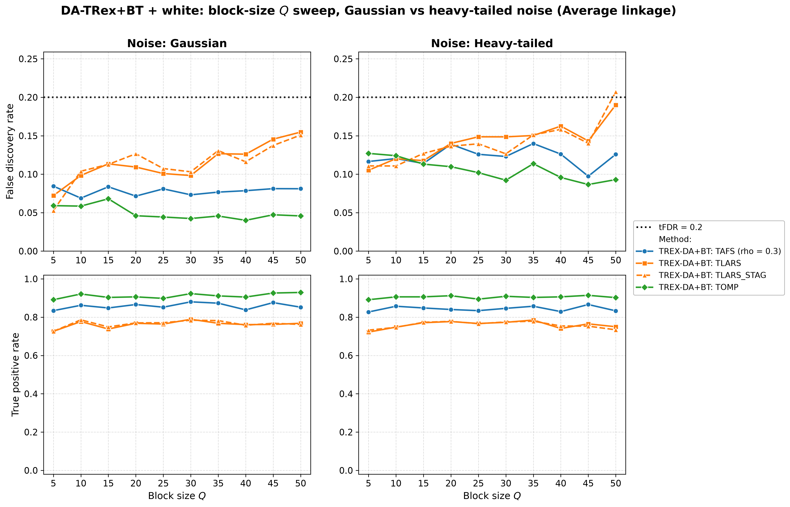
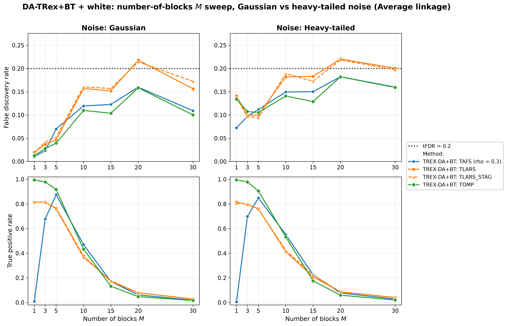
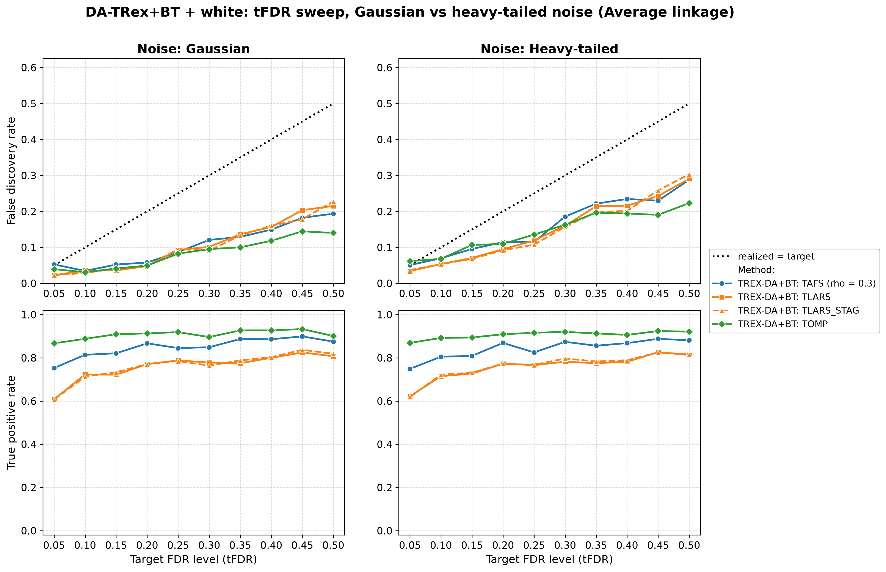

# Demo 05: DA-TRex+BT (Binary-Tree Dependency-Aware T-Rex) on Heavy-Tailed Block + White-Noise Data

Monte-Carlo (MC) results for **DA-TRex+BT** — the Binary-Tree (BT) Dependency-Aware (DA) Terminating Random Experiments
(T-Rex) selector (`DAMethod::BT`) — on the "combined effects" design of heavy-tailed (multivariate $t_{\nu}$)
first-order autoregressive (AR(1)) Toeplitz blocks embedded in a larger design padded with independent and identically
distributed (i.i.d.) $\text{Student-}t$ white-noise columns. It merges Demo 02's white-noise dilution with Demo 04's
heavy-tailed robustness study, sweeping the signal-to-noise ratio (SNR), $\rho$, block size $Q$, number of blocks $M$,
and the target false discovery rate (FDR) level $\mathrm{tFDR}$ — each across two noise scenarios (Gaussian vs.
heavy-tailed response noise) and the three hierarchical agglomerative clustering (HAC) linkage methods. Common setup:
$n=150$, $p_{\text{total}}=500$, amplitude $1.0$, $\nu=3$, $\mathrm{tFDR}=0.2$ (except the target FDR (tFDR) sweep),
$K=20$ random experiments, $\mathrm{MC}=200$ per grid point, and solvers TLARS / TAFS / TOMP, plus TLARS_STAG (TLARS
with the T-loop stagnation stop, see the [suite README](../README.md)). The R and Python versions live in the folders of
the same name ([R](../../../../../R/trex_selector_methods/ad/trex_da/demo_trex_da_05_mc_sim_ht_blocks_plus_white/),
[Python](../../../../../Python/trex_selector_methods/ad/trex_da/demo_trex_da_05_mc_sim_ht_blocks_plus_white/)).

The greedy solvers use *exchangeable tie-breaking* (`exch_tie_alpha = 0.25` for TAFS/TOMP, `0` for
TLARS). See `Exchangeable_Tie_Breaking_DA_TRex.md` in the TRex_Research documentation.
TAFS additionally runs with its adaptive forward-selection (AFS) correlation parameter `rho_afs = 0.3`
(`0` for TLARS/TOMP), which is why the figures label it `TAFS (rho = 0.3)`.

---

## Setup — the DA-TRex+BT selector

The selector deflates each variable's ordinary relative occurrence $\Phi_{T,L}(j)$ by the penalty
$\Psi_{T,L}^{\mathrm{BT}}(j) \in [1/2, 1]$ built from its most similar competitor within its
variable group, with the groups obtained from a **binary tree**: HAC clustering on the dissimilarity
$1 - |\mathrm{corr}(\boldsymbol x_j, \boldsymbol x_{j'})|$, dendrogram cut into disjoint groups
(see [Demo 02](../demo_trex_da_02_mc_sim_ar1_blocks_plus_white/README.md) for the full penalty
formula). Every sweep runs across the three HAC **linkage methods** (Single / Complete / Average).
For heavy-tailed data the *sample* correlations feeding the clustering are themselves noisier, so
linkage robustness is part of what this demo probes.

## Setup — data generating process (`dgp_ht_block_white`)

The design concatenates $M$ statistically independent **heavy-tailed** blocks of size $Q$ with a
white-noise block. Each block starts from the $Q \times Q$ AR(1) Toeplitz correlation

```math
\left[\boldsymbol{\Sigma}_{m}(\rho)\right]_{j,k} = \rho^{|j-k|},
\qquad m = 1, \ldots, M,
```

and transforms the Gaussian draw into a **multivariate $t_{\nu}$** vector,

```math
\boldsymbol{X}_{i}^{(m)} = \frac{\boldsymbol{Z}_{i}^{(m)}}{\sqrt{U_{i}^{(m)} / \nu}},
\qquad
\boldsymbol{Z}^{(m)}_{i} \sim \mathcal{N}(\boldsymbol{0}, \boldsymbol{\Sigma}_{m}(\rho)),
\quad U_{i}^{(m)} \sim \chi^2_{\nu},
```

with all $\boldsymbol Z_{i}^{(m)}, U_{i}^{(m')}$ independent across blocks.
**Heavy-tail behavior:** when a block draws $U_i^{(m)}$ near zero, *all* $Q$ variables of that block
explode simultaneously (within-block tail dependence), while the other blocks are unaffected —
extreme events are block-local. The remaining $p_{\text{white}} = p_{\text{total}} - M \cdot Q$
columns are i.i.d. $t_{\nu}$ white noise, so the full design is heavy-tailed but only the blocks are
correlated.

**Noise scenarios.** The response is $y = X\beta + \varepsilon$ with

- `s1_Gauss`: $\varepsilon_i \stackrel{\text{iid}}{\sim} \mathcal{N}(0, \sigma^2)$ — heavy-tailed
  design, Gaussian noise,
- `s2_Heavy`: $\varepsilon_i \stackrel{\text{iid}}{\sim} t_{\nu}$ (scaled) — heavy tails in *both*
  design and noise,

and $\sigma^2 = \widehat{\mathrm{Var}}(X\beta)/\mathrm{SNR}$ in both cases.

**Support (`OnePerBlock`).** One representative per heavy-tailed block, $s = M$, all actives in the
block part (amplitude $1.0$).

**Base parameters** (each sweep varies one dimension, ceteris paribus): $M=5$, $Q=5$
($p_{\text{ar}}=25$, $p_{\text{white}}=475$, $s=5$), $\rho=0.8$, $\nu=3$, $\mathrm{SNR}=2.0$,
seed $2026$.

---

## Running the Demo

```bash
./build/release/bin/trex_selector_methods/ad/trex_da/demo_trex_da_05_mc_sim_ht_blocks_plus_white/demo_trex_da_05_mc_sim_ht_blocks_plus_white
```

Afterwards, regenerate the figures from the comma-separated values (CSV) files with
[`generate_plots.sh`](generate_plots.sh).

---

## Output Files

Data tables are written to `simulation_results/data/` (60 files = 30 scenario stems, one
`.txt`+`.csv` pair each):
`da_trex_mc_da_ht_blocks_plus_white_{snr,rho,Q,M,tFDR}_{s1_Gauss,s2_Heavy}_{Single,Complete,Average}.txt` / `.csv`.

Figures go to `simulation_results/plots/`: one FDR and true positive rate (TPR) overview (`.png` and `.pdf`, plus an
interactive Plotly `.html` page with `--plotly`) per sweep × scenario × linkage, one linkage-comparison grid per
sweep × scenario, and one **Gaussian-vs-heavy scenario grid** per sweep (at Average linkage) — the five scenario
grids, this demo's core exhibits, are embedded below.

---

## Part 1 — SNR sweep ($\mathrm{SNR} \in \lbrace0.1, 0.2, 0.5, 0.6, 1, 2, 5\rbrace$)

- **Gaussian noise is controlled.** FDR peaks at $0.12$ (TLARS_STAG at $\mathrm{SNR}=0.5$) — under the
  $\mathrm{tFDR}=0.2$ target everywhere.
- **Heavy-tailed noise pushes FDR toward the target** — up to $0.19$ (TAFS at $\mathrm{SNR}=0.6$, Average linkage),
  still without a violation. Heavy noise costs essentially no power.
- TPR is nearly scenario-independent: TOMP $0.89\text{–}0.98$ from $\mathrm{SNR}=2$, TAFS
  $\approx 0.82\text{–}0.86$, TLARS $\approx 0.74\text{–}0.82$.



---

## Part 2 — $\rho$ sweep ($\rho \in \lbrace0.0, 0.1, \ldots, 0.9\rbrace$)

- FDR rises with $\rho$ in both scenarios and stays controlled, at most $0.133$ in the Gaussian scenario and
  $0.179$ in the heavy one (both TAFS under Complete linkage at $\rho = 0.9$).
- TPR holds up well to $\rho = 0.8$ (TOMP $\approx 0.91\text{–}0.92$) and drops at $\rho = 0.9$
  (TOMP $\approx 0.76\text{–}0.80$, TAFS $\approx 0.70\text{–}0.71$, TLARS $\approx 0.62\text{–}0.64$) — the usual
  strong-correlation power cost, essentially identical across noise scenarios. At $\rho \le 0.2$ Single linkage costs
  power, as in Demo 03.



---

## Part 3 — Block-size $Q$ sweep ($Q \in \lbrace5, 10, \ldots, 50\rbrace$)

The block part grows as $p_{\text{ar}} = 5Q$, while the white padding shrinks as $p_{\text{white}} = 500 - 5Q$.

- TPR is remarkably flat in $Q$ (TOMP $0.86\text{–}0.93$, TAFS $0.79\text{–}0.88$, TLARS $0.66\text{–}0.80$ over both
  scenarios and all linkages) — growing the correlated blocks inside a fixed $p_{\text{total}}$ barely affects
  power here.
- FDR: Gaussian scenario controlled (max $0.166$, TLARS), while in the heavy scenario TLARS and TLARS_STAG reach the
  target at $Q = 50$ ($0.19\text{–}0.21$ under Complete/Average).



---

## Part 4 — Number-of-blocks $M$ sweep ($M \in \lbrace1, 3, 5, 10, 15, 20, 30\rbrace$, $s = M$)

- The power collapse hits **earlier and harder than in the Gaussian demos 02/03**. TPR is already
  down to $\leq 0.10$ at $M=20$ and $\leq 0.04$ at $M=30$ (vs. $\approx 0.2$ at $M=20$ in Demo 03) —
  spreading a fixed signal budget over many *heavy-tailed* blocks at $n=150$ is the hardest setting
  in this suite.
- During the collapse the realized FDR drifts over target for TLARS in both scenarios (up to $0.22$ at $M = 20$, and
  just above the target in single cells at $M = 10$ and $30$) — with almost nothing selected, a single false discovery
  dominates the false discovery proportion (FDP) ratio, so these cells are high-variance.
- The $M=1$ corner separates the solvers sharply. TOMP finds the lone signal essentially always
  (TPR $0.98\text{–}1.00$), TLARS $\approx 0.8$, TAFS almost never ($\le 0.03$) — the same TAFS
  single-signal failure seen in Demos 02 and 03.



---

## Part 5 — tFDR sweep ($\mathrm{tFDR} \in \lbrace0.05, 0.10, \ldots, 0.50\rbrace$)

- Realized FDR **tracks at or below the target across the whole range** (the identity line is the
  reference in these panels). The only excess beyond $0.005$ is a tiny $+0.01$ overshoot of TOMP at the strictest
  target ($\mathrm{tFDR}=0.05$) under heavy-tailed noise.
- The selector grows increasingly *conservative* as the target loosens — at $\mathrm{tFDR}=0.5$
  TOMP realizes only $0.08\text{–}0.22$ — while TOMP's TPR saturates around $0.9$ from
  $\mathrm{tFDR}\approx 0.2$ on, so loosening the target beyond that buys little power.

Against the previous run on library commit `44cf1ab`, this sweep shows the same systematic move as Demo 04. Library
commit `415484d` removed the lower clamp $\Phi' \geq 0$ from the FDP estimate, so the realized FDR now falls from a
target of about $0.35$ upward, while targets up to $0.30$ move only by noise. At $\mathrm{tFDR}=0.5$ the mean FDR over
the six scenario and linkage cells drops from $0.295$ to $0.213$ for TLARS, from $0.285$ to $0.215$ for TLARS_STAG, from
$0.265$ to $0.201$ for TAFS and from $0.196$ to $0.152$ for TOMP. Power does not pay for this, because the mean TPR of
the same cells stays within noise (TLARS $0.808$ to $0.820$, TLARS_STAG $0.819$ to $0.825$, TAFS $0.887$ to $0.881$,
TOMP $0.908$ in both runs). The other four sweeps move only within Monte Carlo noise.



---

## TLARS_STAG

TLARS_STAG (TLARS with the T-loop stagnation stop) matches TLARS in every sweep, with mean changes of $-0.001$ in FDR
and $+0.0004$ in TPR. The largest single-cell difference is $-0.028$ in FDR at a cell where both T-loops stop early
($5.1$ steps for TLARS_STAG against $6.3$ for TLARS), which is Monte Carlo noise. Its T-loop stops after at most $7$
steps, where TLARS runs to a median of $12$ and up to $39$ steps.

---

## Interpretation

- Read as the "combined effects" check against **Demo 03** (Gaussian, no white noise), **Demo 02**
  (Gaussian, with white noise), and **Demo 04** (heavy-tailed, no white noise). The white-noise
  padding again *helps* FDR control (in the Gaussian scenario the mean FDR over the DA cells is $0.074$ here against
  $0.094$ in Demo 04, mostly through TLARS with $0.083$ against $0.128$, while TOMP runs slightly higher here), although
  Demo 04 also has far fewer variables ($p = 25$ against $500$), so the gap is not due to the padding alone.
  Heavy-tailed *response* noise is what pushes cells to the target (mean $0.118$ against $0.074$) — the two
  effects partially offset.
- Heavy tails cost almost no power. Their price is paid in FDR, which moves toward the target in the `s2_Heavy`
  scenario. Violations occur only during the $M$-collapse and, as a touch of the target, at $Q = 50$.
- Solver ranking matches the block-design pattern: **TOMP strongest** (highest TPR, usually lowest
  FDR), TLARS weakest in power and the only solver with real violations, TAFS in
  between but unusable in the single-signal corner.
