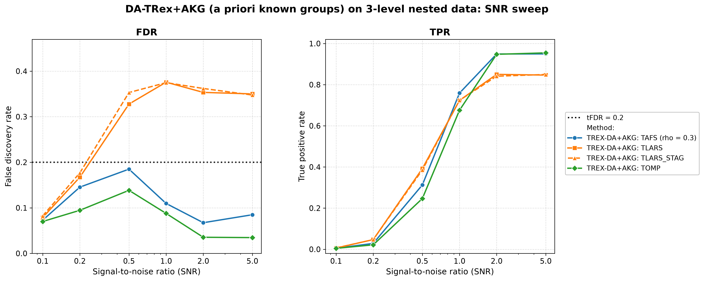

# Demo 06: DA-TRex+AKG (A Priori Known Groups) on Multi-Level Nested Data

Monte-Carlo (MC) results for **DA-TRex+AKG** — the dependency-aware Terminating Random Experiments (T-Rex) selector with
**a priori known groups (AKG)**, where the true group structure is supplied to the selector as a hard **constraint** on
its dependency tree (constrained sub-clustering), instead of letting hierarchical agglomerative clustering (HAC)
discover the structure from scratch. The data-generating process (DGP) is a three-level nested latent-factor model with
a non-exchangeable Toeplitz leaf layer. Common setup: $n=300$, $p=1{,}000$, $s=10$, `Random` support, target false
discovery rate (FDR) $\mathrm{tFDR}=0.2$, $K=20$ random experiments, $\mathrm{MC}=200$ per grid point, solvers TLARS /
TAFS / TOMP plus TLARS_STAG (TLARS with the T-loop stagnation stop, see the [suite README](../README.md)), and a
signal-to-noise ratio (SNR) sweep $\mathrm{SNR} \in \lbrace0.1, 0.2, 0.5, 1, 2, 5\rbrace$. The greedy
solvers use *exchangeable tie-breaking* (`exch_tie_alpha = 0.25` for TAFS/TOMP, `0` for TLARS). See
`Exchangeable_Tie_Breaking_DA_TRex.md` in the TRex_Research documentation. TAFS additionally runs with its adaptive
forward-selection (AFS) correlation parameter `rho_afs = 0.3` (`0` for TLARS/TOMP), which is why the figures label it
`TAFS (rho = 0.3)`.

---

## Setup — the DA-TRex+AKG selector (constrained sub-clustering)

The known three-level hierarchy is passed via `da_ctrl.prior_groups`. The
`PRIOR_GROUPS` method treats these labels as **merge constraints**, not as deflation
neighbourhoods:

1. the **finest common refinement** of the supplied levels (here the groups of 10) partitions the
   variables — two variables can only ever share a deflation neighbourhood if they share a group
   on every level,
2. **HAC runs within each constraint group** (`hc_linkage`, correlation distance) — merges across
   group boundaries are structurally impossible,
3. the calibration **rho grid is data-driven**, with the pooled within-group dendrogram heights
   subsampled to `hc_grid_length` (default $\min(20, p) = 20$) grid points, terminated by the
   conservative $\rho = 1$ singleton anchor (every neighbourhood empty $\Rightarrow$ the paper's
   maximal penalty $\Psi = 1/2$ everywhere),
4. the binary-tree (BT) style occurrence deflation and 3D $(T, v, \rho)$ calibration (see
   [Demo 02](../demo_trex_da_02_mc_sim_ar1_blocks_plus_white/README.md) for the penalty formula)
   run unchanged on these tight within-group neighbourhoods.

**Why not use the raw groups as neighbourhoods?** That was the earlier behaviour, and it
fails by design, because the nearest-partner penalty
$\Psi_j = 1/(2 - \min_{j' \in \mathrm{Gr}(j)} |\Phi_j - \Phi_{j'}|)$ presumes tight, near-exchangeable
neighbourhoods. Inside a 10/50/250-member group nearly every variable has *some*
member with an almost identical occurrence, so the denominator of $\Psi_j$ tends to $2$ uniformly and the shadow/active
ranking is left invariant. The full analysis, including the archived results of the old behaviour,
is in `TRex_Research/documentation/Prior_Groups_Deflation_Mismatch_DA_TRex.md` (§1–§8 the
mismatch, §9 this resolution).

**Relation to BT.** The method is now exactly "BT, tightened by prior knowledge". It uses the same
machinery, but the tree can never merge across known group boundaries, so actives are never deflated against
unrelated variables. A separate BT reference run on this DGP (TLARS, $\mathrm{SNR}=2$, $\mathrm{MC}=100$, archived in
that document) shows the same FDR behaviour ($0.355$ against $0.380$ for the constrained method in that run, $0.353$
here) but markedly *lower* power (true positive rate (TPR) $0.701$ against $0.844$, $0.850$ here) — the constraints buy
power, not a different failure mode. The figures label the method `TREX-DA+AKG: <solver>`.

## Setup — data generating process (`dgp_groups_toeplitz_leaf`)

Each predictor is a sum of nested latent factors plus a correlated leaf term,

```math
X_{i,j} = \sum_{x=1}^{L-1} \sqrt{\rho_x - \rho_{x+1}}\; f_{g_x(j)}
        + \sqrt{\rho_0 - \rho_1}\; u_{g_0(j),\,j}
        + \sqrt{1-\rho_0}\;\eta_{i,j},
```

where the coarser levels $x \geq 1$ use one standard-normal latent factor per group, and the finest
level ($x = 0$) uses a **Toeplitz-correlated leaf block** — within each finest group the leaf
variables $u_r$ satisfy $\mathrm{Cov}(u_r, u_s) = \phi^{|r-s|}$ with $\phi_{\text{leaf}} = 0.5$ —
so even the members of a finest-level group are *not* exchangeable.

- **Three nested grouping levels** over $p = 1{,}000$, with groups of $10$ on the finest level $x = 0$
  ($100$ groups), groups of $50$ on level $x = 1$ ($20$ groups) and groups of $250$ on level $x = 2$ ($4$ groups).
- **Cumulative correlation masses** (fine → coarse): $\rho = \lbrace0.55, 0.25, 0.10\rbrace$. The group of 250
  contributes $0.10$ of each variable's variance, the group of 50 another $0.15$ and the Toeplitz leaf of the group
  of 10 another $0.30$, while $0.45$ is idiosyncratic. Two members of the same group of 10 therefore correlate at
  $0.25 + 0.30 \cdot 0.5^{|r-s|}$, that is $0.25\text{–}0.40$, members of the same group of 50 but different groups of
  10 at $0.25$ and members of the same group of 250 but different groups of 50 at $0.10$.
- Support: $s = 10$ active variables drawn by the `Random` policy per trial, amplitude from the
  shared `SimConfig` defaults, and $y = X\beta + \varepsilon$ with
  $\sigma^2 = \widehat{\mathrm{Var}}(X\beta)/\mathrm{SNR}$.

---

## Running the Demo

```bash
./build/release/bin/trex_selector_methods/ad/trex_da/demo_trex_da_06_mc_sim_groups/demo_trex_da_06_mc_sim_groups
```

Afterwards, regenerate the figure from the comma-separated values (CSV) file with
[`generate_plots.sh`](generate_plots.sh).

---

## Output Files

Data tables are written to `simulation_results/data/`:

- `da_trex_mc_da_groups_toeplitz_leaf.txt` / `.csv`

The figure (`.png` and `.pdf`, plus an interactive Plotly `.html` page with `--plotly`) goes to
`simulation_results/plots/`.

---

## Results — SNR sweep

- **The greedy solvers are controlled everywhere and win on power once the signal is clear**. TOMP's maximum FDR is
  $0.138$ (dropping to $\approx 0.035$ from $\mathrm{SNR}=2$ on) with TPR up to $0.955$, while TAFS — which violated at
  $\mathrm{SNR}=0.5$ under the old raw-group deflation ($0.211$) — is now controlled at every grid
  point (max $0.185$) with TPR up to $0.950$. TAFS overtakes TLARS in TPR from $\mathrm{SNR}=1$ on, and TOMP overtakes
  it from $\mathrm{SNR}=2$ on. Below that, TLARS has the higher TPR ($0.392$ against $0.313$ for TAFS and $0.247$ for
  TOMP at $\mathrm{SNR}=0.5$), bought with an FDR of $0.328$.
- **TLARS remains the outlier among the solvers**, with FDR $\approx 0.33\text{–}0.38$ from $\mathrm{SNR}=0.5$ on
  (vs. the $\mathrm{tFDR}=0.2$ target) and TPR $\approx 0.85$ from $\mathrm{SNR}=2$ on. Its power is higher than under
  the old raw-group deflation (TPR capped at $0.80$ there) while its FDR stays in the same range
  ($0.33\text{–}0.35$ there), because the tight neighbourhoods deflate actives less, which buys power but also stops
  masking part of the least-angle regression (LARS) shadow leak.
- **TLARS_STAG shows the same violation** ($0.35\text{–}0.37$ from $\mathrm{SNR}=0.5$ on) with the same power,
  although its T-loop stops after $4\text{–}5$ steps instead of TLARS' $7\text{–}10$. The leak therefore does not come
  from a long T-loop, which supports the structural explanation below.
- The BT reference run (see Setup) shows the same TLARS FDR on this DGP with *less* power — the
  residual violation is a property of the shared BT deflation machinery under LARS-type occurrence
  profiles, not of the prior-groups path.

Against the previous run on library commit `44cf1ab`, TAFS and TOMP lose $0.007\text{–}0.019$ of FDR at
$\mathrm{SNR}=2$ and $5$ while their TPR stays flat. All three language trees show the same drop, so it is more than
Monte Carlo noise. The corrected false discovery proportion (FDP) estimate of library commit `415484d` causes it,
because it is the only library change on the path of the two solvers. Both stop their T-loop on stagnation, so the
larger estimate raises the voting threshold instead of shortening the loop.



---

## Interpretation — why does TLARS still fail although the groups are known?

With the constrained sub-clustering, the deflation operates on tight, data-driven neighbourhoods
inside the true groups — the structure the nearest-partner penalty

```math
\Psi_j = \frac{1}{2 - \min_{j' \in \mathrm{Gr}(j)} |\Phi_j - \Phi_{j'}|}
```

was designed for. What it *cannot* repair is the penalty's **pairwise symmetry**. It deflates a
shadow and its nearest neighbour (typically the true active) by the same factor, leaving their
*ranking* invariant. Whether the ranking is decided correctly is therefore up to the solver's
occurrence profile:

- **Greedy solvers thrive** at moderate within-group correlation ($0.25\text{–}0.40$ inside a group of 10, far from
  Demo 01's near-collinear $0.9$). Winner-take-all in-group competition reliably crowns the *true*
  active once the signal is clear. Their low FDR is consistent with shadows that finish near $\Phi = 0$ and never
  reach the voting threshold.
- **The LARS path distributes credit**. After an active enters, its group siblings still carry
  residual correlation with $y$ and collect *intermediate* occurrences — distinct from both the
  active's high $\Phi$ and the bulk at $\approx 0$, exactly the profile a symmetric pairwise
  penalty cannot separate. The dummy-calibrated FDP estimate $\widehat{\mathrm{FDP}}$
  cannot see them either (dummies are uncorrelated with $X$), so they are selected. The FDR plateau, *flat in SNR*,
  is consistent with a structural leak. Shadows inherit signal through the shared group factors and rise together
  with the actives.
- Together with Demo 01 this brackets the design space. *Mutual deflation* handles the
  near-collinear regime (where LARS naturally produces ties — and the greedy solvers needed the
  `exch_tie_alpha` fix), while *winner-take-all* handles the moderate-correlation regime (where
  LARS's graded credit-sharing defeats the deflation). TLARS on moderate multi-level correlation
  falls into the gap between the two mechanisms — with or without prior knowledge.

**Follow-ups worth running**: (a) an *asymmetric* penalty (gap-to-leader instead of
nearest-partner) — the one §7 candidate the constrained sub-clustering does not subsume,
(b) sweep the finest mass $\rho_0$ toward $0.9$ — TLARS should *recover* as the fine groups approach
exchangeability and mutual deflation kicks in, and (c) log per-trial occurrence histograms per solver
to verify the "intermediate shadow occurrence" picture directly.
