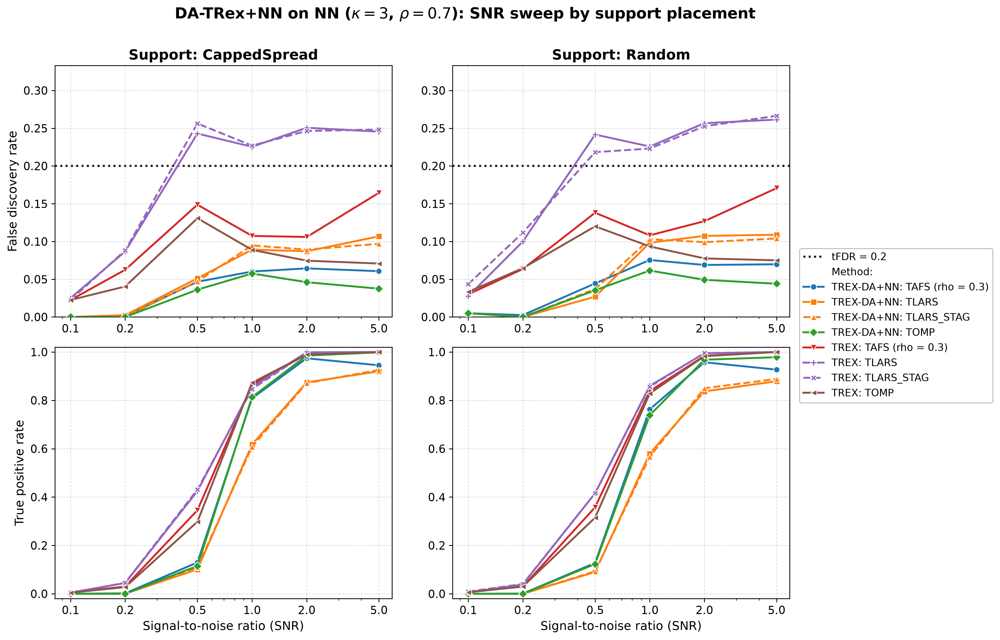
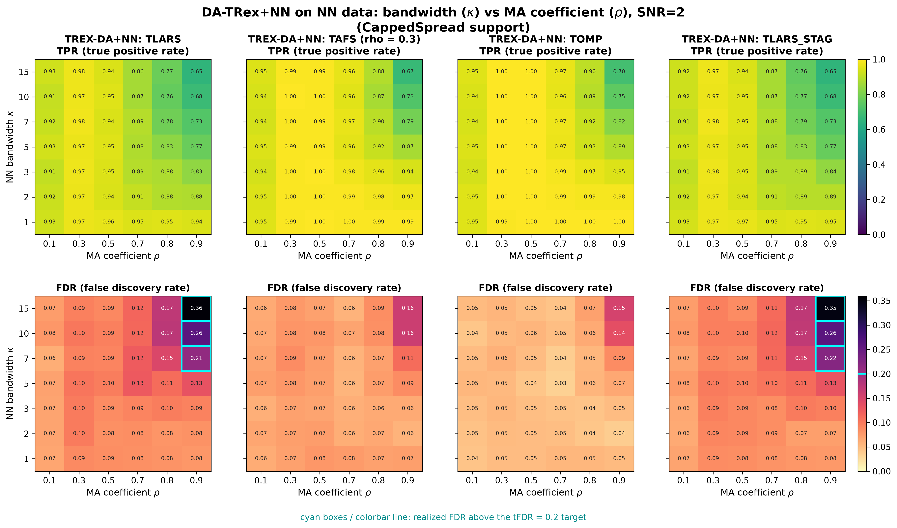
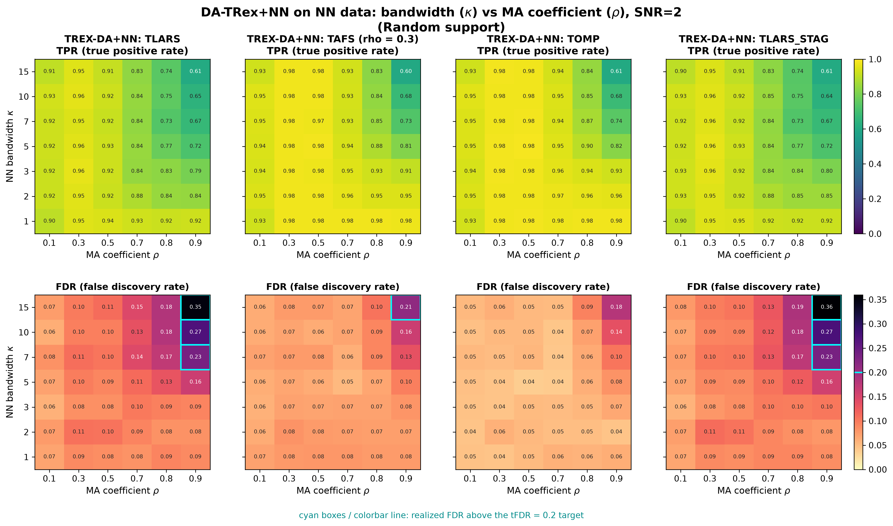
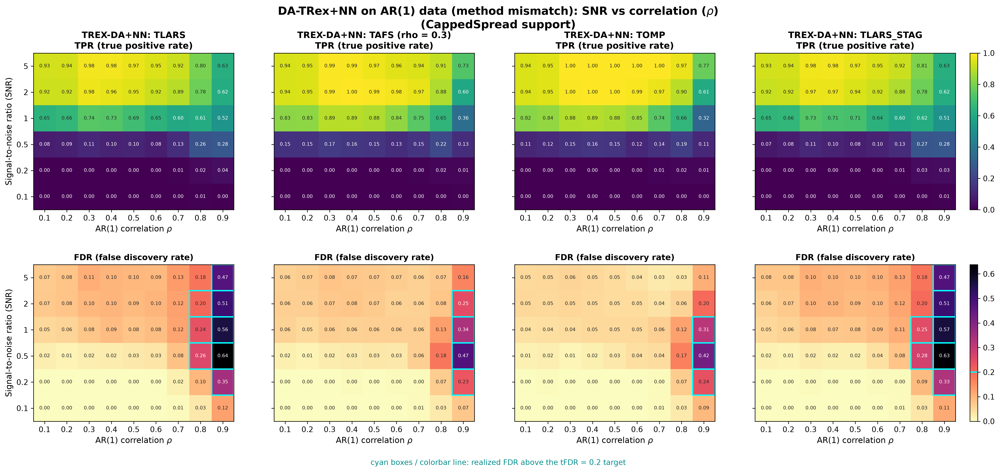
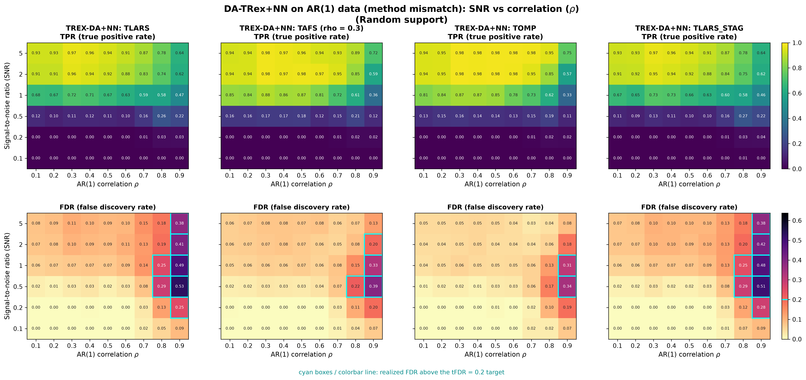

# Demo 07: DA-TRex+NN (Nearest-Neighbor Dependency-Aware T-Rex) on Banded Data + AR(1) Method-Mismatch Study

Monte-Carlo (MC) results for **DA-TRex+NN** — the Nearest-Neighbor (NN) Dependency-Aware (DA) Terminating Random
Experiments (T-Rex) selector (`DAMethod::NN`) — on banded moving-average (MA($\kappa$)) data — the correctly-specified
case — plus a **method-mismatch stress test** applying the same NN correction to first-order autoregressive (AR(1))
data. Common setup: $n=300$, $p=1{,}000$, $s=10$, amplitude $3.0$, target false discovery rate (FDR)
$\mathrm{tFDR}=0.2$, $K=20$ random experiments, $\mathrm{MC}=200$ per grid point, and solvers TLARS / TAFS / TOMP, plus
TLARS_STAG (TLARS with the T-loop stagnation stop, see the [suite README](../README.md)). Part 1 additionally runs the
classical no-DA T-Rex baseline.

The greedy solvers use *exchangeable tie-breaking* (`exch_tie_alpha = 0.25` for TAFS/TOMP, `0` for TLARS).
See `Exchangeable_Tie_Breaking_DA_TRex.md` in the TRex_Research documentation.
TAFS additionally runs with its adaptive forward-selection (AFS) correlation parameter `rho_afs = 0.3`
(`0` for TLARS/TOMP), which is why the figures label it `TAFS (rho = 0.3)`.

---

## Setup — the DA-TRex+NN selector

The DA-TRex+NN selector deflates each variable's ordinary relative occurrence $\Phi_{T,L}(j)$ by a penalty
built from its most similar competitor within a group of correlated variables,

```math
\Phi^{\mathrm{NN}}_{T,L}(j, \rho_{\text{thr}}) := \Psi^{\mathrm{NN}}_{T,L}(j, \rho_{\text{thr}}) \cdot \Phi_{T,L}(j),
\qquad
\Psi^{\mathrm{NN}}_{T,L}(j, \rho_{\text{thr}}) :=
\begin{cases}
\displaystyle \frac{1}{2 - \underset{j' \in \mathrm{Gr}(j, \rho_{\text{thr}})}{\min}
  \left| \Phi_{T,L}(j) - \Phi_{T,L}(j') \right|}\,,
& \mathrm{Gr}(j, \rho_{\text{thr}}) \neq \emptyset \\[10pt]
\displaystyle 1/2, & \mathrm{Gr}(j, \rho_{\text{thr}}) = \emptyset
\end{cases}
```

with the **NN group design**, in which every variable correlated with $j$ beyond a threshold joins its group,

```math
\mathrm{Gr}(j, \rho_{\text{thr}}) := \left\{ j' \in \{1, \ldots, p\} \setminus \{j\} :
\left|\mathrm{corr}(\boldsymbol{x}_j, \boldsymbol{x}_{j'})\right| \geq \rho_{\text{thr}} \right\}.
```

Unlike the `BT` (binary-tree) design, these groups may overlap arbitrarily. A true active whose group members
all carry clearly *lower* occurrences keeps $\Psi \approx 1$ (no penalty), while a collinear shadow whose occurrence
resembles its group's leader is deflated toward $1/2$. Selection then thresholds
$\widehat{\mathcal{A}} = \lbrace j : \Phi_{T,L}^{\mathrm{NN}}(j, \rho_{\text{thr}}) > v \rbrace$ as usual.

## Setup — data generating processes

**NN / MA($\kappa$) model (Parts 1–2, `dgp_nn`).** The $j$-th predictor is a causal convolution of independent and
identically distributed (i.i.d.) standard-normal innovations $\eta$ across columns (a finite-impulse-response filter of
length $\kappa+1$),

```math
X_{i,j} = \sum_{l=0}^{\kappa} \theta_l\, \eta_{i,j+l},
\qquad
\theta_l = c\,\rho^{\,l},
\qquad
c = \Bigl(\textstyle\sum_{m=0}^{\kappa} \rho^{2m}\Bigr)^{-1/2},
```

i.e. the coefficients follow a geometric path with common ratio $\rho$ and are normalized to unit variance.
The resulting covariance is **banded Toeplitz**: for column distance $d = |j-k| \leq \kappa$,

```math
\Sigma_{jk} = c^2 \rho^{d} \sum_{l=0}^{\kappa-d} \rho^{2l},
\qquad
\Sigma_{jk} = 0 \;\text{ for } |j-k| > \kappa,
```

so correlation decays roughly geometrically *inside* the band and **cuts off exactly at bandwidth $\kappa$** —
the hallmark difference to AR(1), whose correlation never truly vanishes. (Note that "nearest-neighbor" classically
refers to a banded *precision* matrix. The MA($\kappa$) model instead has a banded *covariance* and a dense
precision. $\rho$ here is the common ratio of the filter, not the lag-1 autocorrelation, although for
$\kappa \gg 1$ the correlation at distance $d$ approaches $\rho^d$.)

**AR(1) model (Part 3, `dgp_ar1` — same data-generating process (DGP) as Demo 01).**

```math
X_{i,j} = \rho\, X_{i,j-1} + \sqrt{1-\rho^2}\; \eta_{i,j},
\qquad
\Sigma_{jk} = \rho^{|j-k|},
```

geometrically decaying but *unbanded* correlation — deliberately mismatched to the NN correction's finite-range
group design.

**Linear model and signal-to-noise ratio (SNR) control.** Each trial draws $y = X\beta + \varepsilon$ with
$\varepsilon_i \stackrel{\text{iid}}{\sim} \mathcal{N}(0, \sigma^2)$ and
$\sigma^2 = \widehat{\mathrm{Var}}(X\beta)/\mathrm{SNR}$. The $s=10$ active coefficients (amplitude $3.0$) are
placed by two support policies:

- **CappedSpread**: deterministic even spacing, $\text{gap} = \min(\lfloor p/s \rfloor, \text{max\_gap}=20)$,
  i.e. support $\lbrace1, 21, 41, \ldots, 181\rbrace$ — fixed across trials,
- **Random**: drawn uniformly without replacement, redrawn each trial.

---

## Running the Demo

```bash
./build/release/bin/trex_selector_methods/ad/trex_da/demo_trex_da_07_mc_sim_nn/demo_trex_da_07_mc_sim_nn
```

Afterwards, regenerate the figures from the comma-separated values (CSV) files with
[`generate_plots.sh`](generate_plots.sh).

---

## Output Files

Data tables are written to `simulation_results/data/` (`.txt` pretty-printed, `.csv` tidy long format):

- `da_trex_mc_da_nn_snr_capped.txt` / `.csv`, `da_trex_mc_da_nn_snr_random.txt` / `.csv` (Part 1)
- `da_trex_mc_da_nn_kappa_rho.txt` / `.csv` (Part 2, two-support 2D schema)
- `da_trex_mc_da_nn_ar_snr_rho.txt` / `.csv` (Part 3, two-support 2D schema)

Figures (`.png` and `.pdf`, plus uncommitted interactive `.html` pages with `./generate_plots.sh --plotly`) go to
`simulation_results/plots/`, and the 2D CSVs are rendered by the plotter's `sweep2d` mode.

---

## Part 1 — SNR sweep on NN data ($\kappa = 3$, $\rho = 0.7$)

DA-TRex+NN vs. base T-Rex over $\mathrm{SNR} \in \lbrace0.1, 0.2, 0.5, 1, 2, 5\rbrace$, CappedSpread vs. Random support:

- All four DA solvers stay below $\mathrm{tFDR}=0.2$ at every SNR (worst cell $\approx 0.11$), while base T-Rex TLARS
  violates from $\mathrm{SNR}=0.5$ on (FDR $\approx 0.23\text{–}0.26$), and base TAFS comes closest to the target at
  $\mathrm{SNR}=5$ ($0.16\text{–}0.17$).
- From $\mathrm{SNR}=2$ on, the DA cost in true positive rate (TPR) is modest and concentrates in DA-TLARS (e.g.
  $0.84\text{–}0.87$ vs. base $1.00$ at $\mathrm{SNR}=2$), while DA-TAFS/TOMP reach $\approx 0.96\text{–}0.99$. Below
  that the cost is larger (at $\mathrm{SNR}=1$ DA-TLARS $0.58\text{–}0.62$ vs. base $0.85\text{–}0.86$, and at
  $\mathrm{SNR}=0.5$ all DA rows stay at $0.09\text{–}0.13$ vs. base $0.30\text{–}0.43$).
- DA-TLARS runs its T-loop almost to the cap ($T \approx 138$ of $150$), and TLARS' path then selects so many columns
  that some of them become linearly dependent, which the console reports as `collinear; dropped`. TLARS_STAG stops
  after $8$ steps with the same FDR and TPR.
- The two support placements behave nearly identically — with a hard correlation cutoff at $\kappa=3$, the
  CappedSpread actives (spacing 20) sit far outside each other's bands, and Random placements put a pair of actives
  within $\kappa$ of each other in only about a quarter of the trials.



---

## Part 2 — 2D $\kappa \times \rho$ sweep on NN data ($\mathrm{SNR} = 2$)

Per-solver TPR/FDR heatmaps over $\kappa \in \lbrace1,2,3,5,7,10,15\rbrace$ (band width) $\times$
$\rho \in \lbrace0.1, 0.3, 0.5, 0.7, 0.8, 0.9\rbrace$ (filter common ratio). FDR cells above the target are outlined in
cyan.

- **FDR control holds almost everywhere**. Violations appear only in the top-right corner ($\rho = 0.9$ *and*
  $\kappa \geq 7$), where the effective correlation neighborhood is both wide and strong. TLARS is hit hardest
  ($0.36$ at $\kappa=15$, $\rho=0.9$, CappedSpread), TAFS exceeds the target once ($0.21$), and TOMP stays
  controlled everywhere (at most $0.18$).
- From $\kappa = 7$ on, the groups grow with $\kappa$ and residual shadow discoveries accumulate — the NN analogue
  of Demo 01's gap-vs-window story, but entering through the band width rather than the support spacing.
- **TPR degrades gracefully** toward the same corner, down to about $0.6$ for every solver at $\kappa = 15$,
  $\rho = 0.9$, and is essentially flat elsewhere.
- TLARS_STAG gives the same heatmaps as TLARS (mean FDR and TPR changes below $0.002$).

Against the previous run on library commit `44cf1ab`, DA-TAFS and DA-TOMP lose FDR beyond Monte Carlo noise in all
three parts while their TPR stays flat. Over their $204$ cells the mean FDR drops from $0.086$ to $0.070$ for TAFS and
from $0.072$ to $0.055$ for TOMP, most on this $\kappa \times \rho$ grid ($0.103$ to $0.077$ and $0.084$ to $0.057$),
while the mean TPR moves from $0.655$ to $0.657$ and stays at $0.661$. DA-TLARS and TLARS_STAG move much less
($0.111$ to $0.105$ and $0.109$ to $0.103$), and the base TAFS and TOMP rows of Part 1 lose about $0.01$ ($0.114$ to
$0.104$ and $0.087$ to $0.074$). All three language trees show the same drop. Library commit `415484d` removed the
lower clamp $\Phi' \geq 0$ from the false discovery proportion (FDP) estimate, which makes the estimate larger, and it
is the only library change on the path of TAFS and TOMP. Both stop their T-loop on stagnation, so the larger estimate
raises the voting threshold instead of shortening the loop.





---

## Part 3 — 2D SNR $\times$ $\rho$ sweep on AR(1) data (method mismatch)

The same DA-TRex+NN selector applied to AR(1) data over $\mathrm{SNR} \in \lbrace0.1, \ldots, 5\rbrace$ $\times$
$\rho \in \lbrace0.1, \ldots, 0.9\rbrace$:

- **Up to $\rho \approx 0.7$ the mismatch is benign**. FDR stays at or below target for all solvers and SNRs —
  the NN groups capture enough of the (rapidly decaying) AR(1) neighborhood to deflate the nearby shadows.
- **At $\rho = 0.8\text{–}0.9$ control breaks down sharply** (up to $0.64$ for TLARS at $\mathrm{SNR}=0.5$,
  $\rho=0.9$). AR(1) correlation beyond the effective NN window leaks through as false discoveries, exactly the
  failure mode the finite-range group design cannot see (a plausible reading the data do not test directly). TOMP
  is again the most robust but still violates at $\rho = 0.9$, and TLARS_STAG shows the same violations as TLARS.
- Read this against **Demo 01** (same AR(1) data, correctly-specified `AR1` correction, FDR-controlled over the
  full $\rho$ grid). The gap between the two quantifies the price of the wrong dependency model — negligible at
  moderate correlation, large in the strong-correlation regime.




