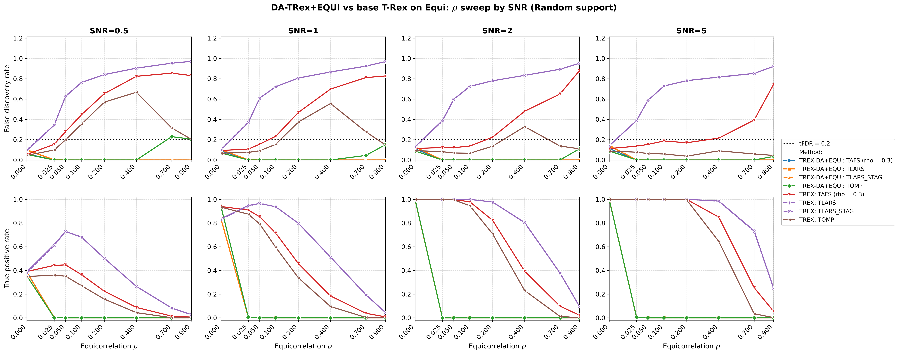

# Demo 08: DA-TRex+EQUI on Equicorrelated (EQUI) Data — 2D SNR × ρ Sweep

Monte-Carlo (MC) results for the dependency-aware (DA) selector **DA-TRex+EQUI** vs. the **classical (no-DA) Terminating
Random Experiments (T-Rex) selector** on equicorrelated (EQUI) data. The demo runs one 2D sweep. For each
signal-to-noise ratio (SNR) column in $\lbrace0.5, 1, 2, 5\rbrace$, it runs a full $\rho$ sweep over
$\lbrace0, 0.025, 0.05, 0.1, 0.2, 0.4, 0.7, 0.9\rbrace$, dense near $0$ to locate the DA suppression cliff. Common
configuration: $n=300$, $p=1{,}000$, $s=10$, amplitude $3.0$, target false discovery rate (FDR) $\mathrm{tFDR}=0.2$,
$K=20$ random experiments, $\mathrm{MC}=200$ per grid point, `Random` support with a full redraw per trial, and solvers
TLARS / TAFS / TOMP with *exchangeable tie-breaking* (`exch_tie_alpha = 0.25` for the greedy solvers TAFS/TOMP, `0` for
the path solver TLARS), plus TLARS_STAG (TLARS with the T-loop stagnation stop, window 7), each with its base (no-DA)
T-Rex comparison row — 8 method rows per grid point. TAFS
additionally runs with its adaptive forward-selection (AFS) correlation parameter `rho_afs = 0.3` (`0` for TLARS/TOMP),
which is why the figures label it `TAFS (rho = 0.3)`.

The R and Python versions live in the folders of the same name
([R](../../../../../R/trex_selector_methods/ad/trex_da/demo_trex_da_08_mc_sim_equi_and_bt/),
[Python](../../../../../Python/trex_selector_methods/ad/trex_da/demo_trex_da_08_mc_sim_equi_and_bt/)).
The legacy Comprehensive R Archive Network (CRAN) runs used $n=150$, $p=500$, $s=5$, while this demo runs at the common
$n=300$, $p=1{,}000$, $s=10$ scale of the C++ suite.

> **Purpose**: Equicorrelation is the stress case of the `trex_da` framework — every column loads
> on one shared factor, so there is no "distance" to exploit the way the first-order autoregressive (AR(1)) model has,
> and **individual variable selection is structurally infeasible for any method**. The 2D layout shows the three facts
> that make this demo worth keeping: (1) the DA suppression cliff sits at very small $\rho$, (2) it is SNR-independent —
> signal strength never rescues it, and (3) at $\rho = 0$ everything works, anchoring the comparison. DA-EQUI fails
> *safe* (selects nothing), base T-Rex fails *unsafe* (FDR far above target).
>
> **Scope note**: earlier revisions of this demo also carried binary-tree (BT) hierarchical-block SNR and
> linkage sweeps on block-equicorrelated data. They were dropped as redundant — the BT method is
> exercised on better-suited block designs throughout Demos 02–05 (legacy reference:
> `Results_trex_da_03_bt_equi_blocks.md`).

---

## Setup — data generating process

### Sparse linear model and SNR control

Each Monte-Carlo trial draws

```math
\boldsymbol{y} = \boldsymbol{X} \boldsymbol{\beta} + \boldsymbol{\varepsilon},
\qquad \boldsymbol{\varepsilon} \sim \mathcal{N}(0,\,\sigma^2 \boldsymbol{I}_n),
\quad \boldsymbol{\varepsilon} \perp \boldsymbol{X},
```

with a **sparse coefficient vector** $\boldsymbol{\beta} \in \mathbb{R}^p$ whose support and
sparsity level are

```math
\mathcal{S} = \operatorname{supp}(\boldsymbol{\beta}) = \{j : \beta_j \neq 0\},
\qquad s = |\mathcal{S}| = 10 \ll p,
```

all active coefficients set to amplitude $3.0$, support placed by the `Random` policy with a full
redraw per trial. The noise variance is calibrated to the target signal-to-noise ratio,

```math
\mathrm{SNR} = \frac{\operatorname{Var}(\boldsymbol{X} \boldsymbol{\beta})}{\sigma^{2}},
\qquad \sigma^2 = \widehat{\operatorname{Var}}(\boldsymbol{X}\boldsymbol{\beta}) / \mathrm{SNR}.
```

### Equicorrelation (`dgp_equi`)

$n$ observations on $p$ predictors are generated through a **single latent factor model**:

```math
X_{i,j} = \sqrt{\rho}\, f_i + \sqrt{1-\rho}\, \eta_{i,j},
\qquad f_i \overset{\text{i.i.d.}}{\sim} \mathcal{N}(0,1),
\quad \eta_{i,j} \overset{\text{i.i.d.}}{\sim} \mathcal{N}(0,1),
```

with all variables mutually independent. Each row

```math
\boldsymbol{x}_i = (X_{i,1},\ldots,X_{i,p})^\top
```

is then an independent and identically distributed (i.i.d.) draw from a zero-mean Gaussian with **compound symmetry**
covariance

```math
\boldsymbol{\Sigma}_{\text{equi}} =
(1 - \rho) \, \boldsymbol{I}_p + \rho \, \mathbf{1}_p \mathbf{1}_p^{\top},
\qquad [\boldsymbol{\Sigma}_{\text{equi}}]_{jj} = 1 \;\forall j,
```

valid for $\rho \in \left(-\tfrac{1}{p-1},\, 1\right)$ (the demo uses $\rho \in [0, 0.9]$). The
eigenstructure is fully explicit:

```math
\begin{aligned}
\lambda_1 &= 1 + (p-1)\rho && \text{multiplicity 1 (eigenvector } \mathbf{1}_p/\sqrt{p}) \\
\lambda_2 &= 1 - \rho && \text{multiplicity } p-1
\end{aligned}
```

When $\rho \leq \rho_{\text{thr\_DA}}$ the single factor is negligible. As $\rho \to 1$ the $p-1$
minor eigenvalues collapse to zero, the predictor matrix becomes rank-1, and the regression is
unidentifiable — unlike AR(1), the correlation is *uniform* across all variable pairs, so there is
no isolation of actives by index distance. The shared factor puts every variable inside every
other variable's DA correction set, and the correction deflates all candidates at once.

### Sweep design

- **Outer loop (SNR columns)**: $\mathrm{SNR} \in \lbrace0.5, 1, 2, 5\rbrace$, one output file pair per
  column, disjoint seed blocks per column (statistically independent columns).
- **Inner sweep ($\rho$)**: $\rho \in \lbrace0, 0.025, 0.05, 0.1, 0.2, 0.4, 0.7, 0.9\rbrace$ — front-loaded
  at small $\rho$, where the suppression cliff is expected (the legacy 1D sweeps bracket it only
  as "somewhere in $(0, 0.1]$").

---

## Reference behavior (previous runs)

- **Legacy R CRAN** (`Results_trex_da_02_equi.md`, $n=150$, $p=500$, $s=5$): total suppression at
  every grid point except $\rho = 0$ — true positive proportion (TPP) $=$ false discovery proportion (FDP) $= 0$ across
  all SNRs at $\rho = 0.25$, and power only at $\rho = 0.0$ in the $\rho$ sweep (TPP $\approx 1.0$, FDP $\approx 0.13$).
- **C++ 1D sweeps (superseded by this 2D sweep)**: reproduced the legacy behavior
  exactly at $n=300$, $p=1{,}000$ — at $\rho = 0$ all six methods controlled
  (FDR $\approx 0.12\text{–}0.14$, true positive rate (TPR) $\approx 1$). From $\rho = 0.1$ on, DA was in total
  suppression (TLARS consuming all $T = 150$ dummies without votes) while base TLARS jumped to FDR $0.73$ and climbed to
  $0.96$ at $\rho = 0.9$.

---

## Running the Demo

```bash
./build/release/bin/trex_selector_methods/ad/trex_da/demo_trex_da_08_mc_sim_equi_and_bt/demo_trex_da_08_mc_sim_equi_and_bt
```

Afterwards, regenerate the figures from the comma-separated values (CSV) files with
[`generate_plots.sh`](generate_plots.sh).

---

## Output Files

Data tables are written to `simulation_results/data/` (`.txt` pretty-printed, `.csv` tidy long
format), one pair per SNR column:

- `da_trex_mc_da_equi_rho_snr0p5.txt` / `.csv`
- `da_trex_mc_da_equi_rho_snr1.txt` / `.csv`
- `da_trex_mc_da_equi_rho_snr2.txt` / `.csv`
- `da_trex_mc_da_equi_rho_snr5.txt` / `.csv`

The single figure goes to `simulation_results/plots/`:

- `da_trex_mc_da_equi_rho_snr_grid.png` / `.pdf` — a 2×4 grid with rows = FDR/TPR, columns = SNR,
  and x-axis = $\rho$ on a square-root scale so the dense $\text{low-}\rho$ cliff region stays readable.
  (One-off per-CSV overviews can still be produced on demand via
  `./generate_plots.sh <csv>`.)

---

## Results (MC = 200, library 09debc6)



- **The DA suppression cliff sits at the first nonzero grid point, $\rho = 0.025$, in every SNR
  column.** At $\rho = 0$ all four DA solvers are controlled (FDR $0.06\text{–}0.15$) with the power
  the SNR allows (TPR $0.35\text{–}0.39$ at SNR $0.5$, $0.84\text{–}0.94$ at SNR $1$, at least $0.996$ at
  SNR $2/5$). At $\rho = 0.025$ they are already dead (TPR $\le 0.005$, TLARS consuming all
  $T = 150$ dummies), and from $\rho = 0.05$ on the TPR stays at or below $0.002$. **Signal strength never moves
  the cliff** — it only changes how much power is lost at it. DA-EQUI works only where no
  correction is needed.
- **Base T-Rex TLARS fails unsafe from the same grid point**: FDR $0.34\text{–}0.39$ at
  $\rho = 0.025$, climbing monotonically to $0.92\text{–}0.97$ at $\rho = 0.9$ in every column — at
  SNR $5$, $\rho = 0.4$ it finds essentially all actives (TPR $0.99$) buried in garbage
  (FDR $0.82$).
- **High-SNR nuance on the greedy base side**: at SNR $= 5$, base TOMP is FDR-controlled at
  *every* $\rho$ (FDR $\le 0.09$) with full power through $\rho = 0.2$ (TPR $\ge 0.996$, and $0.65$ at
  $\rho = 0.4$), and base TAFS is at/near the limit from $\rho = 0.1$ to $0.4$ (FDR $0.17\text{–}0.22$). At lower
  SNR both violate early. At SNR $0.5$ base TAFS exceeds the target from $\rho = 0.05$ on and base TOMP from
  $\rho = 0.1$ ($0.198$ at $\rho = 0.05$), and at SNR $1$ base TAFS does from $\rho = 0.1$ and base TOMP from
  $\rho = 0.2$. So for moderate equicorrelation and strong signal, plain greedy T-Rex (TOMP) is the most reliable
  selector, while the DA-EQUI correction selects almost nothing there.
- **TLARS_STAG matches TLARS in both rows.** With the stagnation stop, FDR and TPR differ from TLARS by at most
  $0.01$, while the T-loop of the DA row stops after at most $8$ steps instead of running into the cap of $150$, and
  the base row's median $T$ drops from $49$ to $10$.
- **DA-TOMP raises false alarms at high $\rho$ and low SNR.** At SNR $0.5$ its FDR reaches $0.230$ at
  $\rho = 0.7$ and $0.205$ at $\rho = 0.9$, slightly above the target, while it finds no true variable there. The
  next section explains this false-alarm plateau, and the check at the end of this document repeats it with
  $1{,}000$ runs per cell. The crossing at $\rho = 0.7$ is Monte Carlo noise, and the plateau itself sits at about the
  target level.

Against the previous run on library commit `44cf1ab`, TAFS and TOMP lose FDR beyond Monte Carlo noise wherever they
select variables, while their TPR stays flat. Over all $32$ cells the base rows drop from $0.394$ to $0.385$ (TAFS) and
from $0.191$ to $0.179$ (TOMP), most at SNR $2$ and $5$. At $\rho = 0$, the only point where DA-EQUI selects, the mean
FDR over the four SNR columns drops from $0.112$ to $0.093$ for DA-TAFS and from $0.094$ to $0.076$ for DA-TOMP. All
three language trees show the same drop. Library commit `415484d` removed the lower clamp $\Phi' \geq 0$ from the FDP
estimate, which makes the estimate larger, and it is the only library change on the path of TAFS and TOMP. Both stop
their T-loop on stagnation, so the larger estimate raises the voting threshold instead of shortening the loop. Base
TLARS runs without the stagnation stop, so there the estimate ends the T-loop earlier. Its mean $T$ falls from $87$ to
$69$, while its FDR barely moves ($0.674$ to $0.668$).

**Bottom line**: equicorrelation defeats individual variable selection for the DA framework —
DA-EQUI fails *safe* (selects nothing for any $\rho \ge 0.025$, regardless of SNR, apart from the false-alarm
plateau of DA-TOMP below), base T-Rex TLARS fails *unsafe* (FDR up to $0.97$). The demo's value is documenting this
boundary of the method precisely.

---

## The false-alarm plateau of DA-TOMP

Where DA-TOMP finds no true variable (TPR $\approx 0$), every run selects either nothing (FDP $0$) or only null
variables (FDP $1$). The FDR is then the share of runs with a false alarm, which is why `sd_FDR` equals
$\sqrt{\mathrm{FDR}\,(1 - \mathrm{FDR})}$ in these cells. Three facts explain where these false alarms come from and why
their rate levels off near the target.

### 1. A lone winner passes the EQUI correction

DA-EQUI deflates the voting share $\Phi_j$ of every variable by its distance to the nearest share of all other
variables (the penalty $\Psi$ of Definition 1 in the T-Rex+DA paper):

```math
\Phi_j^{\mathrm{DA}} = \frac{\Phi_j}{2 - \Delta_j},
\qquad
\Delta_j = \min_{k \neq j} \lvert \Phi_j - \Phi_k \rvert \in [0, 1].
```

A variable can only be selected if its deflated share exceeds the voting threshold, which is at least $1/2$:

```math
\frac{\Phi_j}{2 - \Delta_j} > \frac{1}{2}
\quad\Longleftrightarrow\quad
\Phi_j + \frac{\Delta_j}{2} > 1 .
```

Variables with similar shares have $\Delta_j \approx 0$ and would need $\Phi_j > 1$, which is impossible. This is the
suppression cliff, because the $10$ true variables carry similar shares. A *lone winner* is the opposite case. One
variable is chosen in all $K$ experiments ($\Phi_j = 1$) and no other in any ($\Phi_k = 0$), so $\Delta_j = 1$, the
deflation is the identity, and $\Phi_j^{\mathrm{DA}} = 1$ passes every threshold.

### 2. TOMP produces lone winners at high $\rho$

With $\boldsymbol x_k = \sqrt{\rho}\,\boldsymbol f + \sqrt{1-\rho}\,\boldsymbol\eta_k$, the score of a real column in
TOMP's first step is

```math
c_k = \boldsymbol{x}_k^{\top}\boldsymbol{y}
= \sqrt{\rho}\,\boldsymbol{f}^{\top}\boldsymbol{y} + \sqrt{1-\rho}\,\boldsymbol{\eta}_k^{\top}\boldsymbol{y}.
```

The first term is the same for every real column and lifts all of them far above the dummies, which are independent
of $\boldsymbol{y}$. The order among the real columns comes from the second term alone, so the $1{,}000$ columns are
nearly exchangeable, and the top one is a null variable in most runs. The $K = 20$ experiments of one run share
$\boldsymbol{X}$ and $\boldsymbol{y}$ and differ only in their dummies, so all of them make the same first pick
$j^\star$. Once TOMP has projected $\boldsymbol x_{j^\star}$ out, the shared factor is largely gone from the
residual. At low SNR the remaining real columns no longer beat the best of the dummies, so the next entry is a dummy
and the experiment ends. The result is $\Phi_{j^\star} = 1$ with all other shares $0$, the lone winner of fact 1. At
higher SNR the residual still carries the true signal, more real columns get votes, and the lone winner disappears,
which is why the effect fades with the SNR.

### 3. Exchangeable tie-breaking keeps the rate near the target

With `exch_tie_alpha` $= \alpha > 0$, TOMP treats a real column $k$ as tied with the top column $j^{\star}$ when the
two are correlated by at least $0.5$ and the score gap lies within $\alpha$ standard deviations of its ranking noise,

```math
c_{j^\star} - \lvert c_k \rvert \le \alpha\,\hat\sigma_r\,\lVert \boldsymbol x_{j^\star} - \boldsymbol x_k \rVert,
\qquad \hat{\sigma}_r = \lVert \boldsymbol{r} \rVert / \sqrt{n},
```

and picks one member of the tie set at random. Every experiment draws its own pick, so the votes spread over several
columns, all $\Delta_j$ stay small, and fact 1 rejects them. A lone winner now survives only when the top score leads
the runner-up by more than the band. For $m$ exchangeable scores in units of their standard deviation, extreme value
theory gives $\sqrt{2 \ln m}\,(X_{(1)} - X_{(2)}) \to \mathrm{Exp}(1)$, and the band is $\sqrt{2}\,\alpha$ in these
units, so

```math
P(\text{lone winner}) \approx P\left(X_{(1)} - X_{(2)} > \sqrt{2}\,\alpha\right)
\approx \exp\left(-2\alpha\sqrt{\ln m}\right).
```

For $\alpha = 0.25$ and $m \approx 1{,}000$ this is $0.27$ (a direct simulation of $1{,}000$ normal scores gives
$0.30$), and for $\alpha = 0$ it is $1$. Neither $\rho$ nor the SNR enter, so the rate levels off into a plateau once
the first pick dominates. The plateau is close to the target $\mathrm{tFDR} = 0.2$ by coincidence. Its level is set by
$\alpha$ and $p$, not by the target, and a wider band such as $\alpha = 0.5$ would lower it to about $0.07$. The runs
observed below lie a little under the bound (selections in $21\text{–}24\,\%$ of the runs), because an isolated top
column is necessary for a lone winner but does not guarantee it.

---

## Check with 1,000 runs per cell

A one-off probe repeated the DA-TOMP setting of this demo at SNR $0.5$ with fresh seeds (disjoint from the demo's) and
$1{,}000$ runs per cell, once with the suite's tie-breaking and once without it. At this size the standard error near
the target is $0.013$.

| $\rho$ | FDR, `exch_tie_alpha = 0.25` | FDR, `exch_tie_alpha = 0` |
| --- | --- | --- |
| 0.5 | 0.004 | 0.000 |
| 0.6 | 0.045 | 0.007 |
| 0.7 | 0.163 | 0.385 |
| 0.8 | 0.213 | 0.937 |
| 0.9 | 0.206 | 0.968 |
| 0.95 | 0.219 | 0.967 |

- **The crossing at $\rho = 0.7$ is Monte Carlo noise.** The demo's $0.230$ was a high draw, and with $1{,}000$ runs the
  rate is $0.163$, clearly below the target. An earlier probe of the same kind found $0.176$.
- **The plateau sits at about the target level.** Pooled over $\rho \ge 0.8$ it is $638$ false alarms in $3{,}000$
  runs, an FDR of $0.213$, at most about one percentage point above the target ($1.7$ standard errors).
- **Every false alarm is a lone winner.** Each one selects exactly one variable, with deflated share $1$ and all other
  shares $0$, and in about $95\,\%$ of the cases that variable is a null.
- **Without tie-breaking the FDR control collapses.** Nearly every run at $\rho \ge 0.8$ then ends in a lone winner, as
  fact 3 predicts for $\alpha = 0$.
