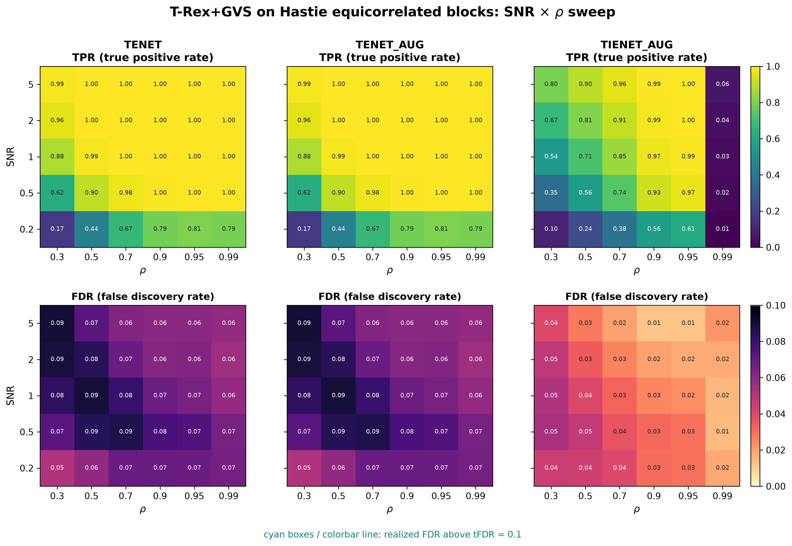
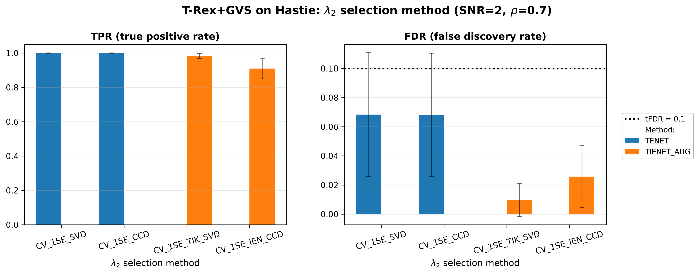
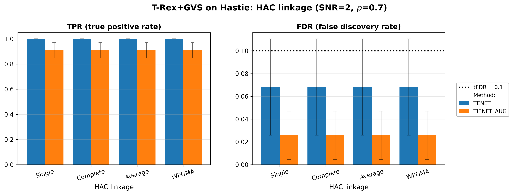
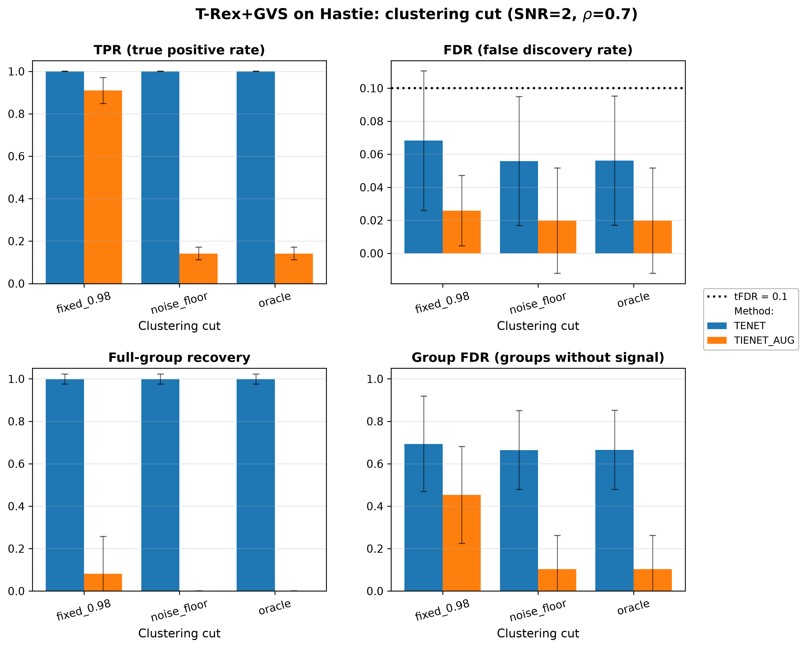

# Demo 01: T-Rex+GVS on Hastie's Equicorrelated Blocks

## Purpose

The following demo presents the Terminating Random Experiments (T-Rex) selector with Grouped Variable Selection
(GVS), in short T-Rex+GVS, according to [[1]](#references) and [[2]](#references). We evaluate grouped-signal
recovery under strong equicorrelation, using the classical three-group design of
 Zou & Hastie (2005) [[3]](#references).
 In our demos all variables within an active group are themselves active, so the task is recovering all
 of them, but on an individual-variable basis, rather than using a group-level selection method.
 See [What is actually measured](../README.md#what-is-actually-measured-in-these-demos).
 For details on grouped variable selection and false discovery rate (FDR) control see [[4]](#references).

---

## Data Generation Parameters (`make_hastie_dgp`)

We consider the linear model:

```math
\boldsymbol{y} = \boldsymbol{X}\boldsymbol{\beta} + \boldsymbol{\epsilon},
\qquad \boldsymbol{\epsilon} \sim \mathcal{N}(\boldsymbol{0}, \sigma_{\varepsilon}^2 \boldsymbol{I}_n)
```

- $\boldsymbol{y} \in \mathbb{R}^n$ is the response vector.
- $\boldsymbol{X} \in \mathbb{R}^{n \times p}$ is the design matrix.
- $\boldsymbol{\beta} \in \mathbb{R}^p$ is the coefficient vector, with $s$ nonzero entries.
- $\boldsymbol{\epsilon}$ is the noise vector, independent and identically distributed (i.i.d.) standard normal.
- $\sigma_{\varepsilon}^2$ is the noise variance, calibrated to achieve a target linear signal-to-noise ratio (SNR).
- $n = 200$, $p = 500$, $s = 150$.

The design matrix $\boldsymbol{X}$ is generated from a latent-factor model with three active groups:

```math
X_{ij} = Z_{i,\,g(j)} + \sigma_x\, \xi_{ij}, \qquad \xi_{ij} \sim \mathcal{N}(0,1).
```

- Three latent factors $Z_{\cdot,k} \sim \mathcal{N}(0,1)$ for $k \in \lbrace0,1,2\rbrace$.
- **Group 0** (columns 0–49), **Group 1** (columns 50–99), **Group 2** (columns 100–149) — all active, $\beta_j = 3$.
- **Background** (columns 150–499): i.i.d. $\mathcal{N}(0,1)$, each a singleton group.
- Within-group correlation $\rho = 1/(1+\sigma_x^2)$, and the default $\sigma_x = \sqrt{0.01}$ gives
  $\rho \approx 0.99$.
- SNR calibrated via $\sigma_{\varepsilon}^2 = \mathrm{Var}(\boldsymbol{X}\beta)/\mathrm{SNR}$.

---

## Control Parameters

```text
K = 20                       # Random experiments per T-loop iteration
tFDR = 0.1                   # Target FDR
corr_max = 0.98              # HAC cut (Part 4 adds the noise floor and oracle groups)
hc_linkage = Single          # Single-linkage HAC
lambda2_method = CV_1SE_CCD  # Elastic-net penalty selection, EN rows (TENET, TENET_AUG)
lambda2_method = CV_1SE_IEN_CCD  # IEN rows (TIENET_AUG), Part 2 adds CV_1SE_TIK_SVD
cv_dfmax_ratio = 1.0         # IEN support cap 1.0 * n_train = 180 > s = 150 (default 0.8 gives 144)
MC = 200                     # Monte Carlo repetitions per grid point
```

---

## Methods Compared

Three T-Rex+GVS solver variants:

- **TENET** — terminating elastic net pathwise solver (`GVSType::EN`, `ENSolverType::TENET`) derived on the idea of a
  pathwise solver introduced in [[3]](#references).
- **TENET_AUG** — terminating elastic net solver based on row-augmented data to solve via a terminating lasso
   (`GVSType::EN`, `ENSolverType::TENET_AUG`) as proposed in [[1]](#references).
- **TIENET_AUG** — terminating elastic net solver based on row-augmented data to solve via a terminating lasso
   the informed elastic net (`GVSType::IEN`) proposed in [[2]](#references).

---

## Four Parts

1. **2-D SNR $\times$ $\rho$ sweep** — TENET / TENET_AUG / TIENET_AUG over
   $\mathrm{SNR} \in \lbrace0.2, 0.5, 1, 2, 5\rbrace$ and
   $\rho \in \lbrace0.30, 0.50, 0.70, 0.90, 0.95, 0.99\rbrace$ (derived via
   $\sigma_x = \sqrt{(1-\rho)/\rho}$), 200 Monte Carlo (MC) trials per cell.
2. $\lambda_2$**-method comparison** — `CV_1SE_SVD` vs. `CV_1SE_CCD` for TENET, and the two rules built for the
   informed elastic net (IEN) geometry, `CV_1SE_TIK_SVD` vs. `CV_1SE_IEN_CCD`, for TIENET_AUG, at the fixed
   operating point $\mathrm{SNR}=2$, $\rho=0.7$.
3. **Hierarchical agglomerative clustering (HAC) linkage comparison** — Single / Complete / Average / weighted pair
   group method with arithmetic mean (WPGMA) linkage at the same fixed
   operating point (TENET and TIENET_AUG).
4. **Clustering-cut comparison** — TENET and TIENET_AUG at the same fixed operating point (`CV_1SE_CCD` for TENET,
   `CV_1SE_IEN_CCD` for TIENET_AUG, single linkage) under three groupings. These are the fixed cut
   `corr_max = 0.98` of Parts 1–3, the Bonferroni noise floor (`corr_max` = 0.346 here, the absolute correlation
   that independent columns exceed with probability at most $0.05$ over all $p(p-1)/2$ column pairs, via the
   Fisher $z$ transform) and the oracle groups of the design. Besides the variable-level FDR and true positive rate
   (TPR) it reports group-level rates.

Parts 2–3 are supplementary robustness checks over the $\lambda_2$-selection and linkage implementation choices.
Part 4 shows what real groups do to the two solver families, while Parts 1–3 keep the fixed cut.

Part 4 computes its group-level rates against the oracle groups, the three active blocks and every background
column as its own singleton group:

- **group hit** — share of the active groups with at least one selected variable,
- **group full** — share of the active groups selected in full,
- **group FDR** — share of the groups touched by the selection that hold no active variable,
- **groups** — number of clusters with at least two members that the selector formed.

> **T-Rex+GVS controls the FDR of the selected variables, not a group FDR.** As implemented, the selector is
> designed to keep the variable-level FDR at or below $\mathrm{tFDR} = 0.1$, and every FDR of Parts 1–4 is this
> variable-level rate. It is not designed to control a group-level FDR, so the group rates of Part 4 are
> descriptive and carry no target. Each of the 350 background columns is a group of its own, so a few falsely
> selected background variables already outnumber the three active groups among the selected groups. A group FDR
> far above $0.1$ next to a variable-level FDR below $0.1$ is therefore expected and does not indicate a loss of
> FDR control.

---

## Output Files

Written to `simulation_results/data/`:

- `gvs_Hastie_2d.txt` / `.csv` — 2-D SNR $\times$ $\rho$ grid (Part 1).
- `gvs_Hastie_lambda2_method.txt` / `.csv` — $\lambda_2$-selection comparison (Part 2).
- `gvs_Hastie_hc_linkage.txt` / `.csv` — HAC-linkage comparison (Part 3).
- `gvs_Hastie_cut.txt` / `.csv` — clustering-cut comparison (Part 4).

Figures in Portable Network Graphics (PNG) and Portable Document Format (PDF) go to `simulation_results/plots/`,
produced by `./generate_plots.sh`.

---

## Running the Demo

```bash
./build/release/bin/trex_selector_methods/ad/trex_gvs/demo_trex_gvs_01_mc_sim_hastie_en_blocks/demo_trex_gvs_01_mc_sim_hastie_en_blocks
./generate_plots.sh   # render the figures below from the saved CSVs
```

The environment variable `TREX_GVS_PARTS` selects the parts (default `1234`, and `TREX_GVS_PARTS=4` runs only Part 4).

---

## Simulation Results

### Part 1 — 2-D SNR $\times$ $\rho$ sweep

- FDR stays at or below the $\mathrm{tFDR} = 0.1$ target everywhere (no cyan violation outlines, at most $0.09$),
  and **TENET** and **TENET_AUG** reach a TPR of $\approx 1$ once $\mathrm{SNR} \gtrsim 1$ and
  $\rho \ge 0.5$.
- **TIENET_AUG** is more conservative (FDR at most $0.053$, below TENET in all 30 cells) and has less power,
  most of all at low $\rho$. From $\mathrm{SNR} = 1$ on it reaches a TPR of $0.97\text{–}0.999$ for
  $\rho = 0.9\text{–}0.95$, against $0.85\text{–}0.96$ at $\rho = 0.7$ and $0.54\text{–}0.80$ at $\rho = 0.3$. Its
  power collapses in the extreme $\rho = 0.99$ column (TPR $0.007\text{–}0.062$), where the within-group columns
  become nearly collinear. This conservatism is not specific to this design — the same pattern recurs across the
  other block demos in this folder.
- Below $\rho = 0.99$ a stronger within-group correlation helps both solver families at low SNR. At
  $\mathrm{SNR} = 0.2$ the TPR rises from $0.165$ at $\rho = 0.3$ to $0.808$ at $\rho = 0.95$ for TENET and from
  $0.099$ to $0.612$ for TIENET_AUG. The grouping does not cause this gain. HAC clusters on the distance
  $1 - |\mathrm{corr}|$ and joins each group at a distance of about $1 - \rho$, but the fixed cut at
  `corr_max = 0.98` lies above the within-group correlation for every $\rho < 0.99$ (at $\rho = 0.95$ the largest
  within-group sample correlation is about $0.97$), so it leaves every variable in its own cluster.
- Only the extreme $\rho = 0.99$ column is cut into groups. A plausible reading of the TIENET_AUG collapse is that
  each active group then forms one cluster and TIENET_AUG keeps very few members per cluster. Its TPR there rises
  from $0.007$ at $\mathrm{SNR} = 0.2$ to $0.062$ at $\mathrm{SNR} = 5$, about 1 to 9 of the 150 active variables,
  so at most about three per group.

TPR (top) and FDR (bottom) heatmaps, one column per solver. FDR cells above the
$\mathrm{tFDR} = 0.1$ target would be outlined in cyan.



---

### Part 2 — $\lambda_2$ selection method

- For TENET, `CV_1SE_SVD` and `CV_1SE_CCD` give essentially the same FDR/TPR ($0.068$ / $1.000$), so at this
  operating point the pipeline is insensitive to the ridge-shaped penalty-selection backend.
- For TIENET_AUG, the two IEN-geometry rules differ. `CV_1SE_TIK_SVD` reaches FDR $0.010$ and TPR $0.983$, and
  `CV_1SE_IEN_CCD` FDR $0.026$ and TPR $0.909$. The elastic net (EN) rules are not compared on this track, because
  an EN tuner would fit the wrong objective there (the library maps `CV_1SE_CCD` to `CV_1SE_IEN_CCD` on the IEN
  track).
- `CV_1SE_IEN_CCD` cross-validates $\lambda_2$ jointly with $\lambda_1$, and its $\lambda_1$ path stops at
  `cv_dfmax_ratio` $\cdot\, n_{\mathrm{train}}$ selected variables. The library default $0.8$ gives $144$, below the
  $s = 150$ true variables of this design, so Demos 01–07 set `cv_dfmax_ratio = 1.0` ($180$ variables). All $200$
  picks are still boundary picks at this cap. With the default cap the previous run gave FDR $0.040$ and TPR $0.830$.
- `CV_1SE_TIK_SVD` has no such cap, but it needs fewer within-group contrasts than training samples
  ($p - M < n_{\mathrm{train}}$, with $M$ the number of clusters). This holds here, where no groups form, and the
  library refuses the rule otherwise, for example on the trap blocks of Demo 04 at $\rho = 0.99$. The sweeps of
  Demos 01–07 therefore use `CV_1SE_IEN_CCD`, like Demo 08 (see
  [Demo 08](../demo_trex_gvs_08_mc_sim_block_bench/README.md)).

Grouped bar charts at the fixed operating point $\mathrm{SNR} = 2$, $\rho = 0.7$. Error bars show
$\pm 1$ Monte Carlo standard deviation.



---

### Part 3 — HAC linkage

- Single / Complete / Average / WPGMA linkage produce numerically identical results (FDR $0.068$ and TPR $1.000$
  for TENET, FDR $0.026$ and TPR $0.909$ for TIENET_AUG), equal to the Part 1 cell at this operating point.
- At $\rho = 0.7$ the fixed cut at `corr_max = 0.98` lies far above the within-group correlation, so it leaves every
  variable in its own cluster under any linkage, and this point cannot show a linkage effect. The linkage rule would
  matter only where the cut forms groups, as in the $\rho = 0.99$ column of Part 1, which this comparison does not
  cover.
- Taken together, Parts 2 and 3 show that at $\mathrm{SNR} = 2$, $\rho = 0.7$ the TENET results do not depend on
  the ridge-shaped $\lambda_2$-selection backend (`CV_1SE_SVD` or `CV_1SE_CCD`), and no result depends on the
  linkage rule. TIENET_AUG, in contrast, depends on its IEN rule.

Grouped bar charts at the same fixed operating point as Part 2. Error bars show $\pm 1$ Monte
Carlo standard deviation.



---

### Part 4 — Clustering cut

- With the fixed cut `corr_max = 0.98` the selector forms no group at this operating point, and both solvers
  reproduce the Part 3 single-linkage numbers exactly (FDR $0.068$ and TPR $1.000$ for TENET, FDR
  $0.026$ and TPR $0.909$ for TIENET_AUG). The noise floor forms $3.03$ clusters with at
  least two members on average, against 3 for the oracle groups, and gives nearly the same rates as the oracle groups
  for both solvers.
- **TENET** keeps its TPR of $1.000$ under real groups, and its FDR drops slightly, from $0.068$ to
  $0.056$. The Python and R runs show the same drop ($0.070$ to $0.058$ and $0.067$ to $0.053$). Its group FDR of
  $0.66\text{–}0.69$ next to a variable-level FDR below $0.1$ is the effect described under
  [Four Parts](#four-parts). The few falsely selected background variables are singleton groups, and next to the three
  active groups they make up about two thirds of the selected groups. The selector does not control this rate.
- **TIENET_AUG** keeps only a few variables per active group once the groups are real. Its TPR falls from
  $0.909$ to $0.141$, about 21 of the 150 active variables or 7 per group, while it hits every active group
  (group hit $1.00$). Its variable FDR falls from $0.026$ to $0.020$ and its group FDR from $0.45$ to $0.10$, and its
  full-group recovery falls from $0.08$ to $0$. A plausible reading is that the IEN penalty acts on the sum of the
  coefficients within each group, so a few members already carry the signal of their group. This matches the
  TIENET_AUG collapse in the $\rho = 0.99$ column of Part 1, the only column where the fixed cut forms groups, and
  supports the reading given there.
- Real groups therefore leave the EN selection nearly unchanged and reduce the IEN selection to a few representatives
  per group. Parts 1–3 and Demos 02–07 keep the fixed cut `corr_max = 0.98`, which groups only variables correlated
  above $0.98$, so outside such extreme correlations both solver families are evaluated on individual variables.

Grouped bar charts at the same fixed operating point as Parts 2 and 3. The top row shows the variable-level TPR and
FDR, and the bottom row shows the full-group recovery and the group FDR, which carries no target. Error bars show
$\pm 1$ Monte Carlo standard deviation.



---

## References

1. Machkour, J., Muma, M., & Palomar, D. P., "False Discovery Rate Control for Grouped Variable Selection
   in High-Dimensional Linear Models using the T-Knock Filter.", European Signal Processing Conference (EUSIPCO), 2022,
    pp. 892–896, European Association for Signal Processing (EURASIP).
    [DOI-Link](https://doi.org/10.23919/EUSIPCO55093.2022.9909883)
2. Machkour, J., Muma, M., & Palomar, D. P., "The Informed Elastic Net for Fast Grouped Variable Selection and
   FDR Control in Genomics Research.", Workshop on Computational Advances in Multi-Sensor Adaptive Processing (CAMSAP),
    2023, pp. 466–470, IEEE.
    [DOI-Link](https://doi.org/10.1109/CAMSAP58249.2023.10403489)
3. Zou, H., & Hastie, T. (2005). "Regularization and variable selection via the elastic net." *Journal of the Royal
   Statistical Society: Series B (Statistical Methodology)*, 67(2), pp. 301–320.
   [DOI-Link](https://doi.org/10.1111/j.1467-9868.2005.00503.x)
4. Dai, R., & Barber, R. F., "The knockoff filter for FDR control in group-sparse and multitask regression."
   Proceedings of the 33rd International Conference on Machine Learning (ICML), vol. 48, pp. 1851–1859, 2016.
   [DOI-Link](http://proceedings.mlr.press/v48/daia16.pdf)
