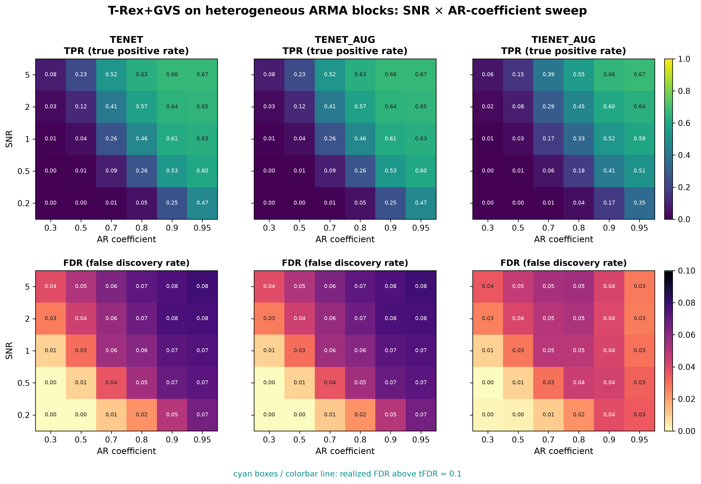

# Demo 07: T-Rex+GVS on Heterogeneous ARMA Blocks

## Purpose

Stress-test the Terminating Random Experiments (T-Rex) selector with Grouped Variable Selection (GVS), in short
T-Rex+GVS, when different blocks follow
 **different time-series structures** rather than a single uniform correlation model.
 This is the most heterogeneous of the four-block scenarios.
 Each block has its own autoregressive moving-average (ARMA) specification, testing
 whether the selector can still recover grouped signal when "the group correlation model" is not one fixed thing.
 Selection and evaluation are per variable (see
 [What is actually measured](../README.md#what-is-actually-measured-in-these-demos)).

---

## Data Generation Parameters (`make_arma_blocks_dgp`)

We consider again the linear model:

```math
\boldsymbol{y} = \boldsymbol{X}\boldsymbol{\beta} + \boldsymbol{\epsilon},
\qquad \boldsymbol{\epsilon} \sim \mathcal{N}(\boldsymbol{0}, \sigma_{\varepsilon}^2 \boldsymbol{I}_n)
```

- $\boldsymbol{y} \in \mathbb{R}^n$ is the response vector.
- $\boldsymbol{X} \in \mathbb{R}^{n \times p}$ is the design matrix.
- $\boldsymbol{\beta} \in \mathbb{R}^p$ is the coefficient vector, with $s$ nonzero entries.
- $\boldsymbol{\epsilon}$ is the noise vector, independent and identically distributed (i.i.d.) standard normal.
- $\sigma_{\varepsilon}^2$ is the noise variance, calibrated to achieve a target linear signal-to-noise ratio (SNR).
- $n = 200$, $p = 500$, $s = 150$ (the sum of the three active blocks).

The design matrix keeps the 4-block geometry of Demos 03/05/06 (sizes $\lbrace20, 50, 80, 65\rbrace$, 215 grouped
 columns in total), but **each block follows a distinct ARMA process**. Every block column is simulated with a 100-step
 burn-in and then standardized to unit empirical variance, matching R's `arima.sim` approach:

- **Block 0** (20 vars, active, $\beta_j = 3$): first-order autoregressive (AR(1)), $\phi_1 = \texttt{ar\_coef}$.
- **Block 1** (50 vars, active): moving-average (MA(3)), $\theta = (0.5, 0.3, 0.1)$.
- **Block 2** (80 vars, active): ARMA(2,1), $\phi = (\tfrac{5}{6}\,\texttt{ar\_coef}, \tfrac{1}{6}\,\texttt{ar\_coef})$,
  $\theta = 0.5$.
- **Block 3** (65 vars, inactive trap): AR(1), $\phi_1 = \texttt{ar\_coef}$ — structurally identical to Block 0.
- Gap columns (between and around the blocks) are i.i.d. $\mathcal{N}(0,1)$.

Unlike Demo 06, the sweep parameter here is `ar_coef` (shared by the AR(1) and ARMA(2,1) blocks), **not** $\rho$ —
 the MA(3) block has no AR component at all, so it does not respond to the sweep.

The two AR coefficients of the ARMA(2,1) block keep a ratio of 5 to 1 and sum to `ar_coef`, so the block is stationary
for every `ar_coef` in $(0, 1)$. The former $\phi = (\texttt{ar\_coef}, \texttt{ar\_coef}/5)$ summed to
$1.2 \cdot \texttt{ar\_coef}$ and turned the block explosive for `ar_coef` $\ge 5/6$, so at $0.9$ and $0.95$ its
columns were nearly collinear.

---

## Control Parameters

```text
K = 20                          # Random experiments per T-loop iteration
tFDR = 0.1                      # Target FDR
corr_max = 0.98                 # HAC auto-clustering correlation threshold
hc_linkage = Single             # Single-linkage HAC
lambda2_method = CV_1SE_CCD     # Elastic-net penalty selection, EN rows (TENET, TENET_AUG)
lambda2_method = CV_1SE_IEN_CCD # IEN rows (TIENET_AUG)
cv_dfmax_ratio = 1.0            # IEN support cap 1.0 * n_train = 180 (default 0.8 gives 144)
MC = 200                        # Monte Carlo repetitions per grid point
```

---

## Methods Compared

Three T-Rex+GVS solver variants: **TENET** (elastic net) [[3]](#references),
**TENET_AUG** (row-augmented elastic net) [[1]](#references), and **TIENET_AUG** (informed
elastic net) [[2]](#references). All use single-linkage hierarchical agglomerative clustering
(HAC) grouping. TENET and TENET_AUG select $\lambda_2$ with `CV_1SE_CCD`, and TIENET_AUG with
`CV_1SE_IEN_CCD`, the rule built for the informed elastic net geometry, with its support cap raised to
$180$ variables (see [Demo 01](../demo_trex_gvs_01_mc_sim_hastie_en_blocks/README.md), Part 2).

---

## The Sweep

A single **2-D SNR $\times$ `ar_coef` grid**, over
$\mathrm{SNR} \in \lbrace0.2, 0.5, 1, 2, 5\rbrace$ and
`ar_coef` $\in \lbrace0.30, 0.50, 0.70, 0.80, 0.90, 0.95\rbrace$
(the AR coefficient shared by the AR(1) and ARMA(2,1) blocks), 200 Monte Carlo (MC) trials per cell. Because the
MA(3) block carries no AR component, only three of the four blocks respond to the `ar_coef` axis.

---

## Output Files

Written to `simulation_results/data/`:

- `gvs_arma_blocks_2d.txt` / `.csv` — mean false discovery proportion (FDP) / true positive proportion (TPP) over the
  SNR $\times$ `ar_coef` grid.

Figures in Portable Network Graphics (PNG) and Portable Document Format (PDF) go to `simulation_results/plots/`,
produced by `./generate_plots.sh`.

---

## Running the Demo

```bash
./build/release/bin/trex_selector_methods/ad/trex_gvs/demo_trex_gvs_07_mc_sim_arma_blocks/demo_trex_gvs_07_mc_sim_arma_blocks
./generate_plots.sh   # render the figure below from the saved CSV
```

---

## Simulation Results

- **TENET** and **TENET_AUG** return identical numbers in every cell (means and standard deviations alike) and keep
   the false discovery rate (FDR) below the $\mathrm{tFDR} = 0.1$ target everywhere (at most $0.079$, no cyan
   outlines). Their FDR grows with `ar_coef` at every SNR, from at most $0.039$ at `ar_coef` $= 0.3$ to
   $0.066\text{–}0.079$ at $0.95$. The trap block (AR(1), same `ar_coef` as the active AR(1) block) is structurally
   similar to an active block and is the main test of false-group exclusion here. The FDR stays below the target
   despite it, although the demo does not record which false discoveries fall into the trap.
- Their true positive rate (TPR) rises with both SNR and `ar_coef`. At $\mathrm{SNR} = 5$ it climbs from $0.077$ at
   `ar_coef` $= 0.3$ to $0.664$ at $0.9$ and $0.666$ at $0.95$, and at $\mathrm{SNR} = 0.2$ from $0.000$ to $0.465$.
   The ceiling of about two thirds matches 100 of the 150 active variables, the size of the AR(1) and ARMA(2,1) blocks
   together. A plausible reading is that the MA(3) block, whose correlation vanishes beyond lag 3 and does not follow
   the sweep, stays mostly unselected, but the demo records no per-block rates.
- **TIENET_AUG** is more conservative, with an FDR of at most $0.055$, and at `ar_coef` $\ge 0.9$ and
   $\mathrm{SNR} = 5$ it matches the TPR of TENET ($0.657\text{–}0.672$ against $0.664\text{–}0.666$). From
   $\mathrm{SNR} = 0.5$ on its FDR peaks at `ar_coef` $= 0.7\text{–}0.8$ and falls again toward $0.95$ (at most
   $0.042$ at `ar_coef` $\ge 0.9$ and $\mathrm{SNR} \ge 2$), while the FDR of TENET keeps rising there.
- Against Demo 06 (AR(1) in every block, with $\rho$ in the role of `ar_coef`), the ARMA design has the higher TPR at
   low coefficients and the lower ceiling. Up to a coefficient of $0.7$ it gives the higher TENET TPR at 14 of the 15
   shared grid points ($0.230$ against $0.134$ at $0.5$ and $\mathrm{SNR} = 5$, for example). Its ARMA(2,1) block is
   more strongly correlated at short lags than an AR(1) block with the same coefficient (lag-1 autocorrelation
   $0.59$, $0.71$ and $0.83$ against $0.3$, $0.5$ and $0.7$), because its MA term adds correlation. At $0.9$ and
   $\mathrm{SNR} \ge 0.5$, in contrast, Demo 06 reaches $0.62\text{–}0.95$ against $0.53\text{–}0.66$ here, and its
   top TENET TPR is $0.959$ against $0.666$.
- With the former explosive ARMA(2,1) block (see the data generation section), the TENET TPR leveled off at
   $0.55\text{–}0.62$ from `ar_coef` $= 0.7\text{–}0.8$ on, and TIENET_AUG collapsed to a TPR of about $0.01$ at
   `ar_coef` $\ge 0.9$ with many `collinear; dropped` console messages. Both effects came from the nearly collinear
   block, and the stationary block shows neither.

TPR (top) and FDR (bottom) heatmaps over the SNR $\times$ `ar_coef` grid, one column per solver
(row axis = SNR, column axis = AR coefficient). FDR cells above the $\mathrm{tFDR} = 0.1$ target
would be outlined in cyan (none are here).



---

## References

1. Machkour, J., Muma, M., & Palomar, D. P., "False Discovery Rate Control for Grouped Variable Selection
   in High-Dimensional Linear Models using the T-Knock Filter.", European Signal Processing Conference (EUSIPCO), 2022,
    pp. 892–896, European Association for Signal Processing (EURASIP).
    [DOI-Link](https://doi.org/10.23919/EUSIPCO55093.2022.9909883)
2. Machkour, J., Muma, M., & Palomar, D. P., "The Informed Elastic Net for Fast Grouped Variable Selection and
   FDR Control in Genomics Research.", Workshop on Computational Advances in Multi-Sensor Adaptive Processing (CAMSAP),
    2023, pp. 466–470, IEEE.
    [DOI-Link](https://doi.org/10.1109/CAMSAP58249.2023.10403489)
3. Zou, H., & Hastie, T. (2005). "Regularization and variable selection via the elastic net." *Journal of the Royal
   Statistical Society: Series B (Statistical Methodology)*, 67(2), pp. 301–320.
   [DOI-Link](https://doi.org/10.1111/j.1467-9868.2005.00503.x)
