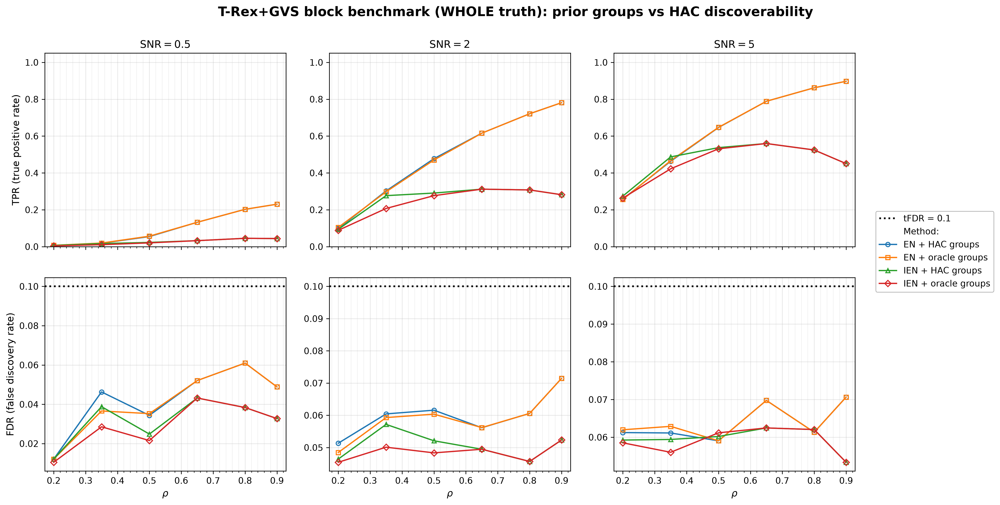
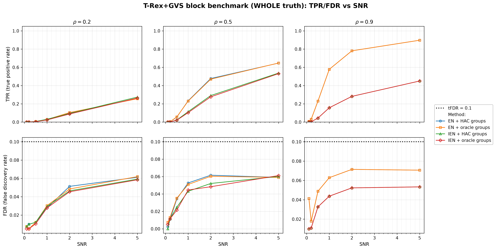
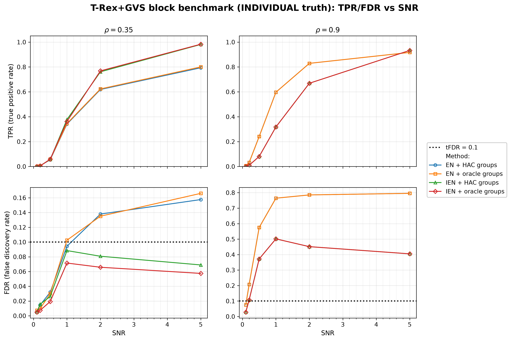

# Demo 08: T-Rex+GVS Block Benchmark — Value of Prior Group Information

## Purpose

Quantify what **prior group knowledge is actually worth** to the Terminating Random Experiments (T-Rex) selector with
Grouped Variable Selection
 (GVS), in short T-Rex+GVS, as a function of how easily the groups could have been discovered from the data anyway.
 Four method variants factorize the question into elastic net (EN) vs. informed elastic net (IEN), each run once with
 groups discovered by hierarchical agglomerative clustering (HAC) and once with the true ("oracle") groups from the
 data-generating process (DGP).
 The headline sweep moves the within-block correlation $\rho$ across the HAC discoverability boundary set by
 `corr_max = 0.5`. Below it the clustered methods see near-singletons and the oracle prior is the only source of
 group structure, while above it HAC rediscovers the blocks and the prior becomes redundant.
 Selection and evaluation are per variable (see
 [What is actually measured](../README.md#what-is-actually-measured-in-these-demos)).

---

## Data Generation Parameters (`make_block_equicorr_dgp`)

We consider again the linear model:

```math
\boldsymbol{y} = \boldsymbol{X}\boldsymbol{\beta} + \boldsymbol{\epsilon},
\qquad \boldsymbol{\epsilon} \sim \mathcal{N}(\boldsymbol{0}, \sigma_{\varepsilon}^2 \boldsymbol{I}_n)
```

- $\boldsymbol{y} \in \mathbb{R}^n$ is the response vector.
- $\boldsymbol{X} \in \mathbb{R}^{n \times p}$ is the design matrix.
- $\boldsymbol{\beta} \in \mathbb{R}^p$ is the coefficient vector, with $s$ nonzero entries.
- $\boldsymbol{\epsilon}$ is the noise vector, independent and identically distributed (i.i.d.) standard normal.
- $\sigma_{\varepsilon}^2$ is the noise variance, calibrated to achieve a target linear signal-to-noise ratio (SNR).
- $n = 200$, $p = 500$, and $s$ depends on the truth scenario below.

The design matrix consists of $G = 100$ equal-size blocks of `block_size` $= 5$ variables each, drawn from the
 unit-variance equicorrelated latent-factor model:

```math
X_{ij} = \sqrt{\rho}\, Z_{i,g(j)} + \sqrt{1-\rho}\, \xi_{ij},
\qquad Z_{\cdot,k},\ \xi_{ij} \sim \mathcal{N}(0,1).
```

- `n_active_blocks` $= 10$ blocks are chosen at random per trial, and each receives a random-sign coefficient
   $\beta = \pm 3$.
- The DGP exports `prior_groups[j] = j / 5` — the exact generating block of every column — which the oracle
   variants pass to `TRexGVSControlParameter::prior_groups`.

### Truth scenarios

- **WHOLE** (headline): all 5 variables of each active block are active, $s = 50$. This matches the grouped-selection
   premise of the T-Rex+GVS papers — active groups are fully active — so coordinate-level false discovery rate (FDR)
   and true positive rate (TPR) are the right metrics.
- **INDIVIDUAL** (cautionary appendix): exactly 1 of the 5 variables per active block is active, $s = 10$. The four
   null siblings of each active variable are exchangeable with it up to the $(1-\rho)$ idiosyncratic component, so
   no selector that aggregates evidence across correlated variables can control the coordinate-level FDR here —
   this scenario is included to show that failure mode explicitly, not as a benchmark to win.

---

## Four Methods Compared

| Method | `GVSType` | Groups |
| --- | --- | --- |
| **M1 (EN + HAC)** | EN [[1]](#references) | discovered per trial via single-linkage HAC at `corr_max` |
| **M2 (EN + oracle)** | EN [[1]](#references) | true `prior_groups` from the DGP |
| **M3 (IEN + HAC)** | IEN [[2]](#references) | discovered per trial via single-linkage HAC at `corr_max` |
| **M4 (IEN + oracle)** | IEN [[2]](#references) | true `prior_groups` from the DGP |

The group information enters the two solvers differently. The EN variants use it **only** to draw
 group-correlated dummy (random-experiment) columns, while IEN additionally ties the group members together
 through its group-indicator row augmentation — and those indicator rows are tiled across the dummy layers as
 well, so every variable's group-aligned dummies share its group geometry. The oracle prior can therefore
 matter more — in either direction — for IEN than for EN.

The two tracks also choose $\lambda_2$ differently. The EN variants cross-validate it on the original
 $(\boldsymbol{X}, \boldsymbol{y})$ with the ridge-shaped rule `CV_1SE_CCD`, so their penalty is identical for the
 clustered and oracle groups. At $\mathrm{SNR} \le 0.5$ this cross-validation lands on large values ($10^6$ to
 $10^7$), often the first point of its grid, because the cross-validation curve is flat there. The IEN variants use
 the IEN-geometry rule `CV_1SE_IEN_CCD`, which cross-validates $\lambda_2$ jointly with $\lambda_1$ on the group
 structure the variant is given, so the clustered and oracle runs get different penalties (e.g. $0.40$ vs. $0.14$ at
 $\rho = 0.35$, $\mathrm{SNR} = 5$). Its $\lambda_1$ path stops at $0.8\, n_{\mathrm{train}} = 144$ selected
 variables, well above the $s \le 50$ true variables here. Demos 01–07 use the same rule for their IEN rows, with the
 cap raised to $n_{\mathrm{train}} = 180$ because most of them have $s = 150$
 (see [Demo 01](../demo_trex_gvs_01_mc_sim_hastie_en_blocks/README.md)). The IEN rule also returns
 boundary picks, in $8{,}326$ of the $19{,}200$ IEN selections ($43\,\%$). Of these, $85\,\%$ fall at
 $\mathrm{SNR} \le 0.5$, mostly on the last (largest) point of its $\lambda_2$ grid. The library reports such picks
 on the console and keeps them.

---

## Control Parameters

```text
K = 20                # Random experiments per T-loop iteration
tFDR = 0.1            # Target FDR
corr_max = 0.5        # HAC discoverability boundary (cut height 1 - corr_max)
hc_linkage = Single   # Single-linkage HAC
lambda2_method        # CV_1SE_CCD (EN rows M1/M2), CV_1SE_IEN_CCD (IEN rows M3/M4)
b = 3.0               # Nonzero coefficient magnitude (random sign per block)
MC = 200              # Monte Carlo repetitions per grid cell
```

Seeds are staggered per grid cell (`cell_base_seed = base_seed + cell_index * num_MC`, with
`cell_index = i_rho * n_snr + i_snr` over the scenario's own $\rho$ grid), so each $(\rho, \mathrm{SNR})$ cell
draws from a distinct seed band, and all four methods see identical data within a trial.

---

## The Sweep

- **WHOLE**: a 2-D $\rho \times \mathrm{SNR}$ grid over $\rho \in \lbrace0.2, 0.35, 0.5, 0.65, 0.8, 0.9\rbrace$ and
  $\mathrm{SNR} \in \lbrace0.1, 0.2, 0.5, 1, 2, 5\rbrace$, 200 Monte Carlo (MC) trials per cell. The $\rho$ grid
  deliberately brackets `corr_max` $= 0.5$, because single-linkage merges within-block pairs at distance
  $\approx 1 - \rho$, so for $\rho \le 0.35$ every merge lies above the fixed cut height $1 -$ `corr_max` $= 0.5$ and
  no group survives the cut (purity $0$, $M \approx 500$ singletons). The point $\rho = 0.5$ sits on the boundary
  (purity $\approx 0.57$, $M \approx 180$), while $\rho \ge 0.65$ is fully discovered (purity $1.0$, $M = 100$).
  Holding `corr_max` fixed while $\rho$ varies models a **mis-specified discovery threshold** — the practical
  situation where the true correlation level is unknown — not a limitation of the clustering itself, which
  recovers these blocks whenever the cut is set below the within-block correlation.
- **INDIVIDUAL**: the same SNR grid at the low/high pair $\rho \in \lbrace0.35, 0.9\rbrace$.

---

## Metrics Reported

The primary metrics are the usual **coordinate-level FDR/TPR** — the quantities the T-Rex selector actually
 controls and targets. The saved tables additionally report block-level and grouping diagnostics:

- **`blk_hit`** — share of active blocks with at least one selected variable (a block-level TPR), or
  **`full_blk`** — share of active blocks recovered in their entirety (WHOLE tables).
- **`block_FDR`** — share of hit blocks that are truly null.
- **`purity`** — share of true blocks whose members all land in one discovered group ($1.0$ by construction for
  oracle runs).
- **`T_stop`**, **`M_found`** — selector diagnostics.

> The block-level numbers are **descriptive diagnostics only**. T-Rex+GVS as implemented controls the FDR of the
> selected variables and is not designed to control a block-level FDR, so no target and no guarantee attach to
> `block_FDR`, and a value above $\mathrm{tFDR}$ does not indicate a loss of FDR control. A block-level error rate
> is a different quantity with its own definition of a false discovery (cf.
> [the group-FDR discussion](../README.md#what-is-actually-measured-in-these-demos)).

---

## Output Files

Written to `simulation_results/data/`, one pair per truth scenario:

- `gvs_block_bench_whole.txt` / `.csv`
- `gvs_block_bench_individual.txt` / `.csv`

Each `.txt` reproduces the console grid tables, and each `.csv` is a tidy long-format table with all four methods'
aggregates per $(\rho, \mathrm{SNR})$ cell. Figures in Portable Network Graphics (PNG) and Portable Document Format
(PDF) go to `simulation_results/plots/`, produced by `./generate_plots.sh`.

---

## Running the Demo

```bash
./build/release/bin/trex_selector_methods/ad/trex_gvs/demo_trex_gvs_08_mc_sim_block_bench/demo_trex_gvs_08_mc_sim_block_bench
./generate_plots.sh   # render the figures below from the saved CSVs
```

Both scenarios run in the same invocation and print one grid table per scenario, per $\rho$ value.

---

## Simulation Results

### WHOLE truth — value of the prior vs. $\rho$ (headline)

- **FDR is controlled everywhere**. The realized coordinate-level FDR never exceeds $0.071$ against the
   $\mathrm{tFDR} = 0.1$ target, for all four methods across the entire grid.
- **For the EN variants the prior is inert**. M1 and M2 differ by at most $0.007$ TPR at every grid point. Since
   EN consumes the group information only through the dummy correlation structure, knowing the true groups
   neither helps nor hurts it here.
- **For IEN the oracle prior costs some power at $\rho = 0.35$.** Below the discoverability boundary the
   `corr_max` $= 0.5$ cut sits above the within-block correlation, so no merge survives it (purity $0$,
   $M \approx 500$) and clustered IEN works with per-variable rows, while the oracle variant gets the true 5-member
   groups. At $\rho = 0.35$ clustered IEN reaches TPR $0.098$, $0.277$ and $0.487$ at $\mathrm{SNR} = 1$, $2$ and
   $5$, against $0.060$, $0.207$ and $0.422$ for oracle IEN, gaps of $5.1$, $6.8$ and $5.4$ combined Monte Carlo
   standard errors. At $\rho = 0.2$ the gap is at most $0.011$ ($0.27$ vs. $0.26$ at $\mathrm{SNR} = 5$), and at the
   boundary ($\rho = 0.5$, purity $0.57$) at most $0.014$ ($0.29$ vs. $0.28$ at $\mathrm{SNR} = 2$), both within two
   standard errors. From $\rho \ge 0.65$ both IEN variants are numerically identical because HAC recovers exactly
   the true blocks.
- **The IEN-geometry $\lambda_2$ rule removes most of the oracle penalty of the earlier setup.** With the ridge-shaped
   `CV_1SE_CCD`, which gave both IEN variants the same $\lambda_2$, the oracle's 5-member ties coupled each active with
   its group-aligned dummies. The false discovery proportion (FDP) estimate then stayed high and the T-loop terminated
   early, so oracle IEN lost most of its power (TPR $0.11$ vs. $0.40$ clustered at $\rho = 0.35$, $\mathrm{SNR} = 5$,
   with $\overline T_{\mathrm{stop}} = 6.1$ vs. $12.6$). The IEN rule picks a smaller $\lambda_2$ for the oracle
   groups ($0.14$ vs. $0.40$). The oracle T-loop still stops earlier ($13.7$ vs. $14.9$ steps at
   $\mathrm{SNR} = 5$, $11.6$ vs. $13.2$ at $\mathrm{SNR} = 2$). A plausible reading is a weaker form of the same
   effect, which would fit the remaining power gap above.
- **IEN gains a lot but stays more conservative than EN** (TPR at most $0.56$ for $\rho \ge 0.5$, up from $0.17$ with
   `CV_1SE_CCD`, vs. up to $0.90$ for EN), at FDR at most $0.062$.

TPR (top) and FDR (bottom) vs. $\rho$, one panel per SNR $\in \lbrace0.5, 2, 5\rbrace$, one line per method.
The dashed red line marks the $\mathrm{tFDR} = 0.1$ target.



- The supplementary vs.-SNR view below shows the same data at three discoverability regimes
   ($\rho = 0.2$ undiscoverable, $0.5$ partial, $0.9$ fully discovered). The EN pair overlaps in every panel,
   and EN recovery grows with both SNR and $\rho$ (TPR $0.26$, $0.65$ and $0.90$ at $\mathrm{SNR} = 5$). A plausible
   reading is that stronger within-block correlation concentrates the signal on fewer effective directions, which
   helps whole-block recovery. IEN grows with SNR but, above the boundary, not with $\rho$ at $\mathrm{SNR} \ge 2$.
   At $\mathrm{SNR} = 5$ it falls from $0.559$ at $\rho = 0.65$ to $0.450$ at $\rho = 0.9$, while its T-loop stops
   sooner ($10.3$ to $7.4$ steps).



### INDIVIDUAL truth — cautionary appendix

- **Coordinate-level FDR control collapses by construction once siblings correlate strongly.** At $\rho = 0.9$
   the EN methods realize FDR $\approx 0.78\text{–}0.80$ from $\mathrm{SNR} = 2$ on (target $0.1$) while selecting the
   active variable's whole block. IEN sits at $0.40\text{–}0.50$ from $\mathrm{SNR} = 1$ on, with TPR rising to $0.93$
   at $\mathrm{SNR} = 5$. Oracle and clustered variants are identical here — no amount of correct group knowledge
   identifies *which* exchangeable member is active.
- At the weaker $\rho = 0.35$ the violation is mild for EN (FDR up to $\approx 0.17$ at high SNR), while both IEN
   variants keep FDR below the target (at most $0.088$ clustered and $0.072$ oracle) and reach TPR $0.98$ at
   $\mathrm{SNR} = 5$, against $0.79\text{–}0.80$ for EN. The group ties concentrate the selection on one
   representative per block. Oracle IEN gives the lower FDR in all three cells from $\mathrm{SNR} = 1$ on
   ($0.057\text{–}0.072$ vs. $0.069\text{–}0.088$ clustered), a consistent sign, but each single gap stays below two
   combined Monte Carlo standard errors ($|z| = 1.3\text{–}1.6$).
- The block-level diagnostics in the saved tables stay small ($\mathrm{block\_FDR} \approx 0.12$ at
   $\rho = 0.9$ for EN), so the method still finds the right *blocks* while the coordinate-level FDR fails.
   T-Rex+GVS is not designed to control a block-level FDR, so this value is descriptive and carries no guarantee.

TPR (top) and FDR (bottom) vs. SNR, one panel per $\rho \in \lbrace0.35, 0.9\rbrace$. Note the different FDR
axis scales.



---

## References

1. Machkour, J., Muma, M., & Palomar, D. P., "False Discovery Rate Control for Grouped Variable Selection
   in High-Dimensional Linear Models using the T-Knock Filter.", European Signal Processing Conference (EUSIPCO), 2022,
    pp. 892–896, European Association for Signal Processing (EURASIP).
    [DOI-Link](https://doi.org/10.23919/EUSIPCO55093.2022.9909883)
2. Machkour, J., Muma, M., & Palomar, D. P., "The Informed Elastic Net for Fast Grouped Variable Selection and
   FDR Control in Genomics Research.", Workshop on Computational Advances in Multi-Sensor Adaptive Processing (CAMSAP),
    2023, pp. 466–470, IEEE.
    [DOI-Link](https://doi.org/10.1109/CAMSAP58249.2023.10403489)
