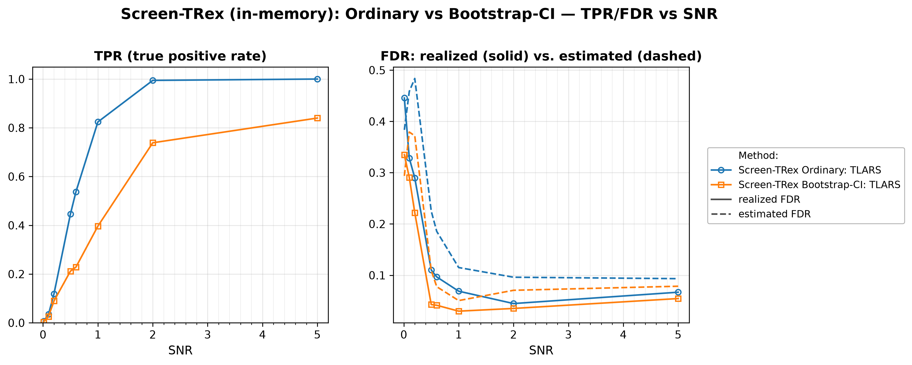

# Demo 01: Screen-TRex on an i.i.d. Gaussian Design

## Purpose

The demo establishes the **baseline behaviour of Screen-TRex** [[1]](#references) on the easiest
 possible design, independent Gaussian predictors with no correlation structure at all.
Two thresholding rules are compared — the **Ordinary** majority-vote rule ($\Phi_j > 0.5$) and the
 **Bootstrap-CI** rule, built on a bootstrap confidence interval (CI) — over a signal-to-noise sweep.
Everything the later demos add (correlation, dependency-aware corrections, biobank routing, solver
 backends) is measured against the numbers established here.
Screening returns a *candidate set*, and the false discovery rate (FDR) and the true positive rate (TPR) are evaluated
 on the individual selected variables
 (see [What is actually measured](../README.md#what-is-actually-measured-in-these-demos)).

---

## Data Generation Parameters (`make_iid_dgp`)

We consider the linear model:

```math
\boldsymbol{y} = \boldsymbol{X}\boldsymbol{\beta} + \boldsymbol{\epsilon},
\qquad \boldsymbol{\epsilon} \sim \mathcal{N}(\boldsymbol{0}, \sigma_{\varepsilon}^2 \boldsymbol{I}_n)
```

- $\boldsymbol{y} \in \mathbb{R}^n$ is the response vector.
- $\boldsymbol{X} \in \mathbb{R}^{n \times p}$ is the design matrix.
- $\boldsymbol{\beta} \in \mathbb{R}^p$ is the coefficient vector, with $s$ nonzero entries.
- $\boldsymbol{\epsilon}$ is the noise vector, independent and identically distributed (i.i.d.) normal.
- $\sigma_{\varepsilon}^2$ is the noise variance, calibrated to achieve a target linear signal-to-noise ratio (SNR).
- $n = 300$, $p = 1{,}000$, $s = 10$ (high-dimensional, $p > n$).

The design matrix has **no correlation structure**:

```math
X_{ij} \sim \mathcal{N}(0,1) \quad \text{i.i.d.}
```

- The active support is drawn uniformly at random *per Monte Carlo (MC) trial*, so the results are not tied to
   one support pattern.
- All active coefficients are $\beta_j = 1$. The support draw uses its own random number generator (RNG) seed,
   the trial seed plus `500000`, so it stays independent of the design and noise draws.

---

## Control Parameters

```text
K = 20                       # Random experiments per T-loop iteration
R_boot = 1000                # Bootstrap replicates (Bootstrap-CI rule only)
ci_grid_step = 0.001         # Bootstrap-CI threshold grid granularity
solver = TLARS               # T-Rex solver backend
MC = 200                     # Monte Carlo repetitions per grid point
```

Note that Screen-TRex has **no target-FDR parameter**, because unlike the classical Terminating Random Experiments
(T-Rex) selector, screening
 thresholds the voting statistic instead of calibrating to a user-specified level.

---

## Methods Compared

Two Screen-TRex thresholding rules [[1]](#references), both using `ScreenTRexMethod::TREX`:

- **Screen-TRex Ordinary** — selects $\lbrace j : \Phi_j > 0.5 \rbrace$, a simple majority vote of the random
   experiments.
- **Screen-TRex Bootstrap-CI** — builds a bootstrap confidence band around the estimated FDR curve
   (`R_boot = 1000` replicates) and picks its threshold from that band.

Both report an **estimated FDR** alongside the realized FDR/TPR.

---

## The Sweep

A single **SNR sweep** over $\mathrm{SNR} \in \lbrace0.01, 0.1, 0.2, 0.5, 0.6, 1, 2, 5\rbrace$, 200 MC trials per
point, with a fresh design, support, and noise draw in every trial.

---

## Output Files

Written to `simulation_results/data/`:

- `scr_screen_trex_snr_n300_p1000.txt` / `.csv` — FDR, TPR, and estimated FDR per method and SNR level.

Figures in Portable Network Graphics (PNG) and Portable Document Format (PDF) go to `simulation_results/plots/`,
produced by `./generate_plots.sh`.

---

## Running the Demo

```bash
./build/release/bin/trex_selector_methods/ad/trex_screening/demo_trex_scr_01_mc_sim_screen_trex/demo_trex_scr_01_mc_sim_screen_trex
./generate_plots.sh   # render the figure below from the saved CSV
```

---

## Simulation Results

- **Screening is not FDR-controlling at low SNR.** At $\mathrm{SNR} \le 0.2$ the realized FDR runs between
   $0.22$ and $0.45$ for both rules, while the TPR stays at or below $0.12$. Screening has no target level that
   would hold the FDR down when almost no signal can be recovered.
- **Both rules become reliable once signal is present.** From $\mathrm{SNR} \ge 0.5$ the Ordinary rule's
   FDR drops to $0.11$ and settles around $0.04\text{–}0.07$, while its TPR climbs $0.45 \to 1.00$. All ten
   active variables are recovered at $\mathrm{SNR} = 5$.
- **Bootstrap-CI is the conservative rule, with lower FDR and clearly less power.** Its FDR stays below $0.06$ for
   $\mathrm{SNR} \ge 0.5$, less than half the Ordinary rule's up to $\mathrm{SNR} = 1$ and about $0.8$ times it at
   $\mathrm{SNR} = 2$ and $5$. It pays for this with TPR $0.84$ vs. $1.00$ at $\mathrm{SNR} = 5$ and a much
   wider gap mid-sweep ($0.40$ vs. $0.82$ at $\mathrm{SNR} = 1$). Choose it when false discoveries are costlier
   than missed ones.
- **The internal FDR estimate is conservative here.** For $\mathrm{SNR} \ge 0.5$ it sits *above* the
   realized FDR for both rules (e.g. $0.115$ vs. $0.069$ for Ordinary at $\mathrm{SNR} = 1$) — it
   over-states the error rate rather than hiding it. At the lowest SNR points it becomes unreliable in both
   directions. Demo 03 shows this same estimate failing far more dramatically under correlation.

TPR (left) and FDR (right) vs. SNR, one line per thresholding rule. On the FDR panel the solid
line is the realized FDR and the dashed line the procedure's own estimated FDR.



---

## References

1. Machkour, J., Muma, M., & Palomar, D. P., "False Discovery Rate Control for Fast Screening of
   Large-Scale Genomics Biobanks.", IEEE Statistical Signal Processing Workshop (SSP), 2023,
    pp. 666–670, IEEE.
    [DOI-Link](https://doi.org/10.1109/SSP53291.2023.10207957)
