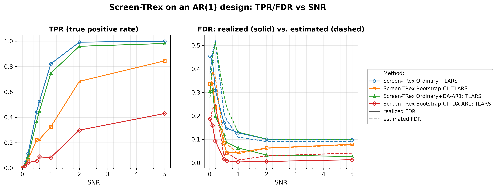
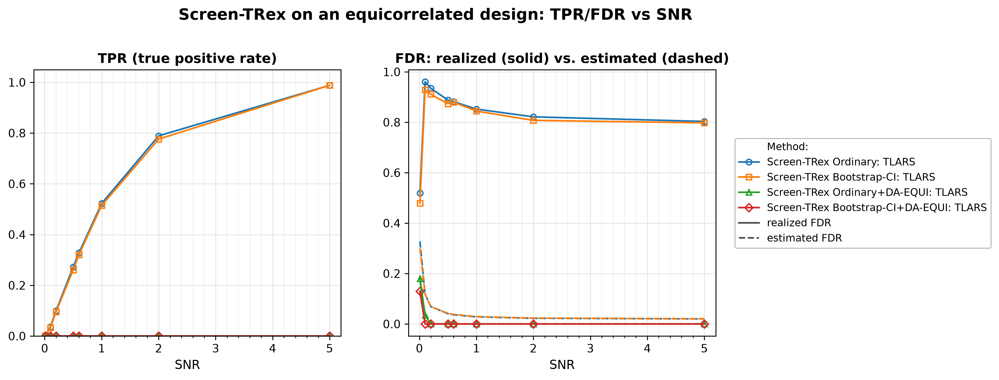
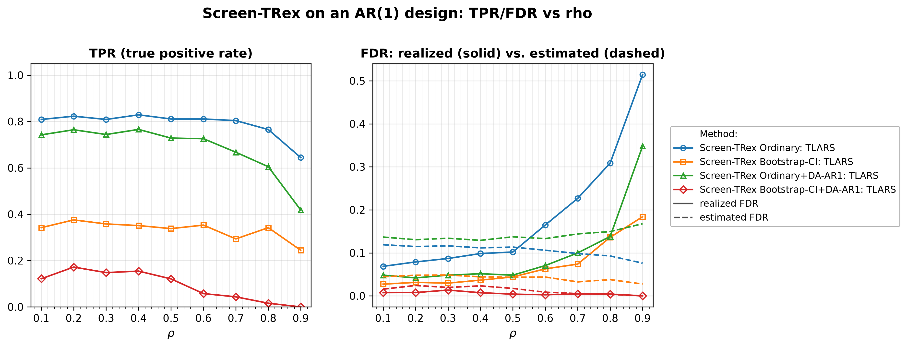
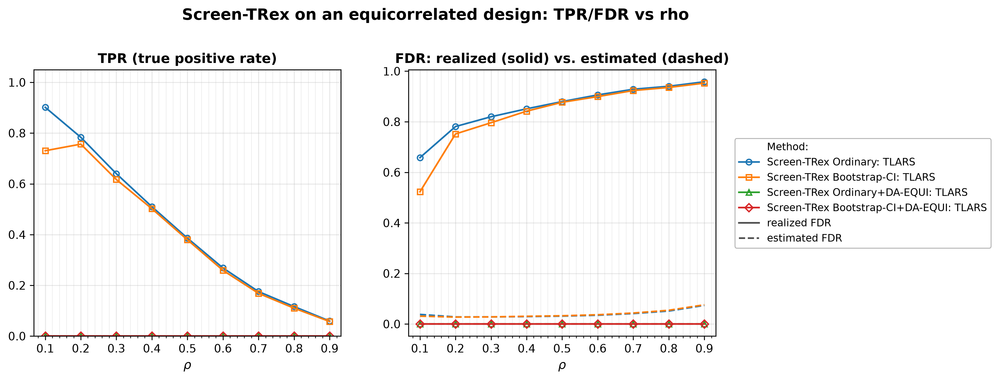
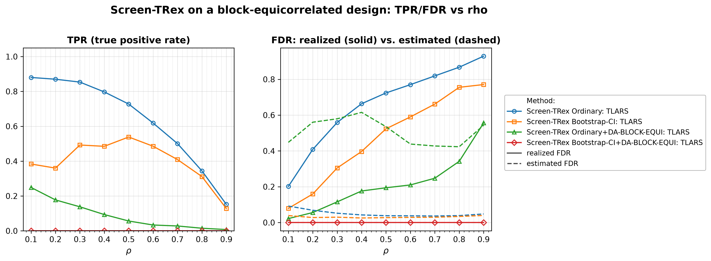

# Demo 03: Screen-TRex under Correlated Designs

## Purpose

The demo measures what **predictor correlation does to Screen-TRex**, and whether the **dependency-aware (DA)**
 variants repair the damage.
 Three correlation structures are put in front of the screener — first-order autoregressive (AR(1)),
 equicorrelated, and
 block-equicorrelated — and in each case the plain Ordinary rule and the Bootstrap-CI rule, built on a bootstrap
 confidence interval (CI), are compared against their DA counterparts, which deflate the vote share of every
 variable that resembles a correlated neighbour.
 Demo 01 established the independent and identically distributed (i.i.d.) baseline that the results here are read
 against.
 Screening returns a *candidate set*, and the false discovery rate (FDR) and the true positive rate (TPR) are evaluated
 on the individual selected variables
 (see [What is actually measured](../README.md#what-is-actually-measured-in-these-demos)).

---

## Data Generation Parameters (`make_ar1_dgp`, `make_equi_dgp`, `make_block_equi_dgp`)

We consider the linear model:

```math
\boldsymbol{y} = \boldsymbol{X}\boldsymbol{\beta} + \boldsymbol{\epsilon},
\qquad \boldsymbol{\epsilon} \sim \mathcal{N}(\boldsymbol{0}, \sigma_{\varepsilon}^2 \boldsymbol{I}_n)
```

- $\boldsymbol{y} \in \mathbb{R}^n$ is the response vector.
- $\boldsymbol{X} \in \mathbb{R}^{n \times p}$ is the design matrix.
- $\boldsymbol{\beta} \in \mathbb{R}^p$ is the coefficient vector, with $s$ nonzero entries.
- $\boldsymbol{\epsilon}$ is the noise vector, i.i.d. normal.
- $\sigma_{\varepsilon}^2$ is the noise variance, calibrated to achieve a target linear signal-to-noise ratio (SNR).
- $n = 300$, $p = 1{,}000$, $s = 10$ (high-dimensional, $p > n$).

Three correlation structures are used. **AR(1)**, a decaying-correlation chain:

```math
x_j = \rho\, x_{j-1} + \sqrt{1 - \rho^2}\, w_j
\qquad \Longrightarrow \qquad
\mathrm{corr}(x_j, x_{j'}) = \rho^{|j - j'|}
```

**Equicorrelated**, one shared latent factor $z$ driving every column, so *all* pairs correlate equally:

```math
x_j = \sqrt{\rho}\, z + \sqrt{1 - \rho}\, w_j
\qquad \Longrightarrow \qquad
\mathrm{corr}(x_j, x_{j'}) = \rho \quad \forall\, j \neq j'
```

**Block-equicorrelated**, the same construction but with one latent factor $z_k$ per block, so columns
 correlate at $\rho$ *within* a block and are independent across blocks. Five contiguous blocks of 200
 columns each are used.

- All columns are **standardised to zero mean and unit variance** after generation, which leaves the column
   correlations, and so the meaning of $\rho$, unchanged.
- $\boldsymbol{\beta}$ has $p_1 = 10$ **evenly spaced** active entries, all of equal magnitude, and the
   design and the noise are drawn afresh in every Monte Carlo (MC) trial.

---

## Control Parameters

```text
K = 20                       # Random experiments per T-loop iteration
rho_thr_DA = 0.02            # DA skip threshold (EQUI, BLOCK-EQUI), sets the DA-AR1 window
n_blocks = 5                 # Blocks assumed by the DA-BLOCK-EQUI variant (Part 5)
R_boot = 1000                # Bootstrap replicates (Bootstrap-CI rule only)
ci_grid_step = 0.001         # Bootstrap-CI threshold grid granularity
solver = TLARS               # T-Rex solver backend
MC = 200                     # Monte Carlo repetitions per grid point
```

Note that Screen-TRex has **no target-FDR parameter**, because unlike the classical Terminating Random Experiments
(T-Rex) selector, screening
 thresholds the voting statistic instead of calibrating to a user-specified level.

---

## Methods Compared

Every part compares four methods — the two thresholding rules of Demo 01, plain and dependency-aware
 [[1]](#references):

- **Screen-TRex Ordinary** — majority vote $\lbrace j : \Phi_j > 0.5 \rbrace$, no correlation handling
   (`ScreenTRexMethod::TREX`).
- **Screen-TRex Bootstrap-CI** — bootstrap confidence band around the estimated FDR curve
   (`R_boot = 1000` replicates), no correlation handling.
- **Screen-TRex + DA** — the same two rules on top of a **dependency-aware** adjustment
   (`TREX_DA_AR1`, `TREX_DA_EQUI`, or `TREX_DA_BLOCK_EQUI`), defined below.

The DA adjustment deflates each vote share before the threshold is applied,

```math
\Phi'_j = \frac{\Phi_j}{2 - \min_{k \in \mathcal{N}(j),\, k \neq j} |\Phi_j - \Phi_k|},
```

where the neighbourhood $\mathcal{N}(j)$ holds the variables within the AR(1) window, all variables (EQUI), or
 the variables of the same block (BLOCK-EQUI). A variable whose vote share matches a correlated neighbour's is
 divided by up to 2, so a cluster of near-duplicate predictors cannot inflate the selection on its own. The
 EQUI and BLOCK-EQUI adjustments are skipped when the estimated correlation does not exceed `rho_thr_DA = 0.02`,
 while for AR1 the threshold sets the window half-width $\kappa = \lceil \log 0.02 / \log \hat\rho \rceil$.

The DA variant is always matched to the design that generated the data — this demo therefore reports the
 **best case for DA**, not a misspecification study. All methods also report an **estimated FDR**
 alongside the realized FDR/TPR. Under correlation the gap between the two becomes the main story.

---

## The Five Parts

| Part | Design | Fixed | Sweep | DA variant |
| :--- | :----- | :---- | :---- | :--------- |
| 1 | AR(1) | $\rho = 0.5$ | SNR $\in \lbrace0.01, 0.1, 0.2, 0.5, 0.6, 1, 2, 5\rbrace$ | DA-AR1 |
| 2 | Equicorrelated | $\rho = 0.4$ | same SNR grid | DA-EQUI |
| 3 | AR(1) | SNR $= 1$ | $\rho \in \lbrace0.1, \dots, 0.9\rbrace$ | DA-AR1 |
| 4 | Equicorrelated | SNR $= 1$ | $\rho \in \lbrace0.1, \dots, 0.9\rbrace$ | DA-EQUI |
| 5 | Block-equicorrelated (5 blocks) | SNR $= 1$ | $\rho \in \lbrace0.1, \dots, 0.9\rbrace$ | DA-BLOCK-EQUI |

Parts 1–2 ask *how much signal is needed at a fixed correlation level*, while Parts 3–5 ask *how much
 correlation the screener survives at a fixed signal level*. 200 MC trials per grid point throughout.

---

## Output Files

Written to `simulation_results/data/`, each as `.txt` (human-readable table) and `.csv` (tidy long):

- `scr_ar1_snr_n300_p1000_rho0.50` — Part 1: AR(1), SNR sweep.
- `scr_equi_snr_n300_p1000_rho0.40` — Part 2: equicorrelated, SNR sweep.
- `scr_ar1_rho_n300_p1000_snr1.00` — Part 3: AR(1), $\rho$ sweep.
- `scr_equi_rho_n300_p1000_snr1.00` — Part 4: equicorrelated, $\rho$ sweep.
- `scr_block_equi_rho_n300_p1000_blocks5_snr1.00` — Part 5: block-equicorrelated, $\rho$ sweep.

Each file holds FDR, TPR, and estimated FDR per method and grid point. Figures in Portable Network Graphics (PNG) and
Portable Document Format (PDF) go to `simulation_results/plots/`, produced by `./generate_plots.sh`.

---

## Running the Demo

```bash
./build/release/bin/trex_selector_methods/ad/trex_screening/demo_trex_scr_03_mc_sim_correlated/demo_trex_scr_03_mc_sim_correlated
./generate_plots.sh   # render the figures below from the saved CSVs
```

---

## Simulation Results

### Part 1 — AR(1) Design, SNR Sweep ($\rho = 0.5$)

- **AR(1) correlation is survivable.** At $\rho = 0.5$ the Ordinary rule's FDR falls $0.45 \to 0.10$ across the
   sweep while TPR climbs $0.002 \to 1.00$, recovering all ten active variables at $\mathrm{SNR} = 5$. For
   $\mathrm{SNR} \ge 0.5$ the TPR matches Demo 01 within $0.013$, while the FDR runs $0.03\text{–}0.06$ higher
   ($0.128$ vs. $0.069$ at $\mathrm{SNR} = 1$). The two demos also differ in the support placement (evenly spaced
   here, random there), so the data cannot attribute this gap to the correlation alone. Local, decaying
   dependence does not break the screener.
- **DA lowers the error rate at a modest power cost.** Ordinary+DA-AR1 roughly *halves* the plain
   Ordinary FDR at $\mathrm{SNR} = 1$ ($0.063$ vs. $0.128$) and cuts it to $0.28\text{–}0.33$ times its value
   at $\mathrm{SNR} = 2$ and $5$ ($0.033$ vs. $0.101$ at $\mathrm{SNR} = 2$). It gives up $0.074$ TPR at
   $\mathrm{SNR} = 1$ ($0.748$ vs. $0.822$) and $0.02\text{–}0.03$ at $\mathrm{SNR} \ge 2$.
- **Bootstrap-CI+DA-AR1 is extremely conservative.** Its FDR never exceeds $0.0151$ once
   $\mathrm{SNR} \ge 0.5$, but its TPR tops out at $0.430$ at $\mathrm{SNR} = 5$ — it buys near-zero
   false discoveries by leaving more than half the true signal on the table.
- **The internal estimate is still well-behaved here.** For $\mathrm{SNR} \ge 0.5$ it tracks the realized FDR
   of the two plain rules within $0.042$ and never lies more than $0.019$ below it. For the DA rules it sits
   2 to 5 times above the realized FDR (Ordinary+DA-AR1: $0.131$ estimated vs. $0.063$ realized at
   $\mathrm{SNR} = 1$). The equicorrelated parts below show where this breaks.

TPR (left) and FDR (right) vs. SNR, one line per method. On the FDR panel the solid line is
the realized FDR and the dashed line the procedure's own estimated FDR.



### Part 2 — Equicorrelated Design, SNR Sweep ($\rho = 0.4$)

- **Equicorrelation breaks screening outright.** Even at a moderate $\rho = 0.4$, the Ordinary rule's FDR
   sits between $0.80$ and $0.96$ for every $\mathrm{SNR} \ge 0.1$ — four out of five selections are
   false — and it is still $0.803$ at $\mathrm{SNR} = 5$, where TPR has reached $0.988$. More signal
   recovers the true variables but does *not* clean up the candidate set.
- **Plain Bootstrap-CI is no better.** Its FDR stays at $0.80\text{–}0.93$ for $\mathrm{SNR} \ge 0.1$, with
   nearly the Ordinary rule's TPR.
- **DA-EQUI rejects the whole tied top of the vote and selects nothing.** From $\mathrm{SNR} = 0.2$ on both
   DA-EQUI rules return empty sets (FDR $=$ TPR $= 0$), and below that their few selections are all false
   (Ordinary FDR $0.18$ at $\mathrm{SNR} = 0.01$ and $0.035$ at $\mathrm{SNR} = 0.1$, TPR $0$). Screen-TRex
   runs a single step ($T = 1$), so the vote shares are coarse and dozens of variables reach exactly
   $\Phi_j = 1$, the ten active ones together with the nulls that share their factor. Every one of them has a
   twin with the same share, the adjustment divides it by $2 - 0 = 2$, and $\Phi'_j = 0.5$ fails the strict
   majority rule $\Phi'_j > 0.5$. The reference R package TRexSelector (`screen_trex()`) uses the same
   adjustment and the same strict rule, and on identical data it selects nothing as well. Under
   equicorrelation the DA-EQUI variants of Screen-TRex therefore carry no information.
- **A non-monotone artifact at the bottom of the sweep.** The realized Ordinary FDR is *lower* at
   $\mathrm{SNR} = 0.01$ ($0.519$) than at $\mathrm{SNR} = 0.1$ ($0.961$). This is not a sweet spot, because at
   $\mathrm{SNR} = 0.01$ the rule finds almost nothing true (TPR $= 0.002$). Low-SNR FDR numbers must be read
   alongside the TPR column.
- **The FDR estimate has already come apart.** For $\mathrm{SNR} \ge 0.1$ the plain rules report
   $0.020\text{–}0.118$ while the realized FDR is $0.80\text{–}0.96$, a factor of 8 to 40 too low, in the
   optimistic direction.

TPR (left) and FDR (right) vs. SNR, one line per method. Solid = realized FDR, dashed =
estimated FDR.



### Part 3 — AR(1) Design, $\rho$ Sweep (SNR $= 1$)

- **Degradation is gradual and only bites at high $\rho$.** The Ordinary rule holds FDR near
   $0.07\text{–}0.10$ up to $\rho = 0.5$, then deteriorates to $0.165$, $0.227$, $0.309$, and finally $0.514$
   at $\rho = 0.9$. TPR is remarkably stable ($\approx 0.81$) up to $\rho = 0.7$ and drops to $0.766$ at
   $\rho = 0.8$ and $0.645$ at $\rho = 0.9$.
- **DA-AR1 buys roughly one step of the $\rho$ grid.** Ordinary+DA-AR1 lowers FDR at every $\rho$
   ($0.348$ vs. $0.514$ at $\rho = 0.9$, and $0.138$ vs. $0.309$ at $\rho = 0.8$) at a cost of six to
   twenty-three points of TPR. It is a real improvement, but it delays the failure rather than preventing it.
- **Bootstrap-CI+DA-AR1 keeps the FDR near zero by declining to select.** Its FDR stays within
   $0.000\text{–}0.014$ across the *entire* $\rho$ range — nominally the best result in this demo — but its TPR
   peaks at $0.172$ at $\rho = 0.2$ and falls to $0.058$ at $\rho = 0.6$ and $0.000$ at $\rho = 0.9$. At high
   correlation it returns essentially an empty set. This is an FDR/power trade, not a free fix, and a near-zero
   FDR is only meaningful when read next to its TPR.
- **The estimate degrades in step with the method.** At $\rho = 0.9$ Ordinary reports $0.076$ against a
   realized $0.514$ — the estimate is least trustworthy exactly where the user most needs a warning.

TPR (left) and FDR (right) vs. $\rho$, one line per method. Solid = realized FDR, dashed = estimated FDR.



### Part 4 — Equicorrelated Design, $\rho$ Sweep (SNR $= 1$)

- **Failure from the very first grid point.** Ordinary FDR starts at $0.658$ for $\rho = 0.1$ and rises
   monotonically to $0.958$ at $\rho = 0.9$, while TPR collapses $0.902 \to 0.060$. Unlike AR(1), there
   is no usable region of the sweep.
- **No variant rescues it.** Plain Bootstrap-CI tracks the Ordinary rule from $\rho = 0.2$ on (FDR
   $0.75 \to 0.95$) and lies clearly below it only at $\rho = 0.1$ ($0.523$ vs. $0.658$). Both DA-EQUI rules
   select nothing at any $\rho$ (FDR $=$ TPR $= 0$), for the tie reason explained in Part 2.
- **The demo's central caution is that the FDR estimate is wildly optimistic exactly where the method
   fails.** Across the whole sweep the estimate reports $0.028\text{–}0.074$ while the realized FDR is
   $0.66\text{–}0.96$, a gap of a factor of thirteen to thirty.
   Under equicorrelation the procedure's self-assessment cannot be trusted at all. Contrast this with
   Demo 01, where the same estimate sat *above* the realized FDR and erred on the safe side.

TPR (left) and FDR (right) vs. $\rho$, one line per method. Solid = realized FDR, dashed = estimated FDR.



### Part 5 — Block-Equicorrelated Design, $\rho$ Sweep (SNR $= 1$, 5 blocks)

- **Block structure sits between the two extremes — but closer to the bad one.** Ordinary FDR grows
   $0.202 \to 0.929$ over the sweep. It is far better than the fully equicorrelated case at low $\rho$
   ($0.202$ vs. $0.658$ at $\rho = 0.1$), plausibly because independence *across* blocks survives, but by
   $\rho = 0.9$ the two designs are equally hopeless.
- **DA-BLOCK-EQUI trades almost all power for a low FDR.** Ordinary+DA-BLOCK-EQUI keeps the FDR at
   $0.02\text{–}0.21$ up to $\rho = 0.6$ (against $0.20\text{–}0.77$ without DA), but its TPR falls from $0.249$
   at $\rho = 0.1$ to $0.034$ at $\rho = 0.6$ and $0.008$ at $\rho = 0.9$. The adjustment works within each
   block, so the tie effect of Part 2 halves every variable whose vote share has a twin in its block, and
   only shares that stand alone in their block survive.
- **Bootstrap-CI+DA-BLOCK-EQUI selects nothing** at any $\rho$ (FDR $=$ TPR $= 0$).
- **The estimate is again too optimistic for the plain rules, though less catastrophically at weak
   correlation.** Ordinary reports $0.036\text{–}0.092$ against a realized $0.20\text{–}0.93$, a factor of $2.2$
   too low at $\rho = 0.1$ but of $19\text{–}22$ from $\rho = 0.5$ on. As in Part 4, it gives no signal that
   anything has gone wrong. With DA-BLOCK-EQUI it turns pessimistic instead
   ($0.42\text{–}0.62$ against a realized $0.02\text{–}0.56$). It lies above the realized FDR up to
   $\rho = 0.8$ and just below it at $\rho = 0.9$ ($0.543$ vs. $0.556$).

TPR (left) and FDR (right) vs. $\rho$, one line per method. Solid = realized FDR, dashed = estimated FDR.



---

## References

1. Machkour, J., Muma, M., & Palomar, D. P., "False Discovery Rate Control for Fast Screening of
   Large-Scale Genomics Biobanks.", IEEE Statistical Signal Processing Workshop (SSP), 2023,
    pp. 666–670, IEEE.
    [DOI-Link](https://doi.org/10.1109/SSP53291.2023.10207957)
