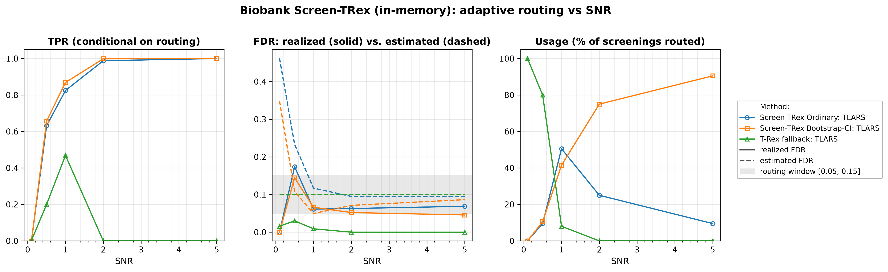
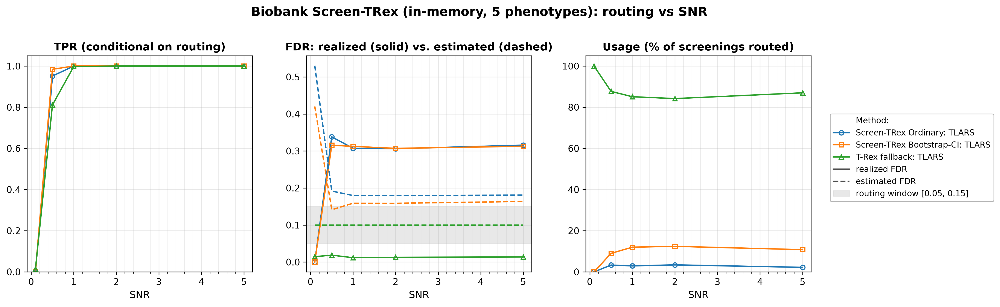

# Demo 04: Biobank Screen-TRex (Algorithm 1) — In-Memory

## Purpose

The demo illustrates the **Biobank Screen-TRex workflow** ("Algorithm 1") of [[1]](#references),
 which screens *many phenotypes* against a single shared design matrix $\boldsymbol{X}$.
For every phenotype the selector derives two estimates of the false discovery rate (FDR) from one Screen-TRex run,
 one for the **Screen-TRex Ordinary** majority-vote rule and one for **Screen-TRex Bootstrap-CI**, whose threshold
 comes from a bootstrap confidence interval (CI). A screening result is accepted only if its estimated FDR lies in the
 window $\lbrack 0.05, 0.15\rbrack$, and if neither estimate does, the phenotype falls back to the **classical
 Terminating Random Experiments (T-Rex) selector** at a target FDR of $0.10$.
The interesting quantity is therefore not a single error rate but the *routing behaviour*, meaning which method
 handles which phenotype and how well each performs on the subset it was given.
This demo keeps the dummy matrices **in memory** (`use_memory_mapping = false`), while demo 05 runs the identical
 study with memory-mapped, disk-backed dummy matrices.
Screening returns a *candidate set*, and the FDR and the true positive rate (TPR) are evaluated on the individual
 selected variables
 (see [What is actually measured](../README.md#what-is-actually-measured-in-these-demos)).

---

## Data Generation Parameters (`datagen::SyntheticData`)

We consider the linear model:

```math
\boldsymbol{y} = \boldsymbol{X}\boldsymbol{\beta} + \boldsymbol{\epsilon},
\qquad \boldsymbol{\epsilon} \sim \mathcal{N}(\boldsymbol{0}, \sigma_{\varepsilon}^2 \boldsymbol{I}_n)
```

- $\boldsymbol{y} \in \mathbb{R}^n$ is the response vector.
- $\boldsymbol{X} \in \mathbb{R}^{n \times p}$ is the design matrix.
- $\boldsymbol{\beta} \in \mathbb{R}^p$ is the coefficient vector, with $s$ nonzero entries.
- $\boldsymbol{\epsilon}$ is the noise vector, independent and identically distributed (i.i.d.) normal.
- $\sigma_{\varepsilon}^2$ is the noise variance, calibrated to a target linear signal-to-noise ratio (SNR) as the
   sample variance of $\boldsymbol{X}\boldsymbol{\beta}$ (divisor $n$) divided by the SNR.
- $n = 300$, $p = 1{,}000$, with $s = 10$ in Part 1 and $s = 5$ in Part 2 (high-dimensional, $p > n$).

The design matrix has **no correlation structure**:

```math
X_{ij} \sim \mathcal{N}(0,1) \quad \text{i.i.d.}
```

- The active support is drawn uniformly at random *per Monte Carlo (MC) trial*, so the results are not tied to
   one support pattern.
- All active coefficients are $\beta_j = 1$. The supports come from one random number generator (RNG) per SNR
   level, seeded at `24 + 1000 * snr_idx` in Part 1 and `77 + 1000 * snr_idx` in Part 2 and drawn trial after trial,
   so they stay apart from the design and noise draws. `datagen::SyntheticData` derives those from the trial seed,
   `1000 * snr_idx + mc` in Part 1.
- In Part 2 all $q = 5$ phenotypes of a trial share **one design matrix** $\boldsymbol{X}$ (seed
   `X_seed = 5000 * snr_idx + mc + 1`), while phenotype `k` receives its **own random support** and its own noise
   draw (seed `q * (num_MC * snr_idx + mc) + k + 1`). This is the biobank setting, where a single genotype matrix is
   screened against many traits.

---

## Control Parameters

```text
K = 20                       # Random experiments per T-loop iteration
lower_bound_FDR = 0.05       # Lower edge of the acceptable estimated-FDR window
upper_bound_FDR = 0.15       # Upper edge of the acceptable estimated-FDR window
target_FDR_trex = 0.10       # Target FDR of the classical T-Rex fallback
R_boot = 1000                # Bootstrap replicates (Bootstrap-CI rule only)
ci_grid_step = 0.001         # Bootstrap-CI threshold grid granularity
solver = TLARS               # T-Rex solver backend
use_memory_mapping = false   # Dummy matrices held in memory
MC = 200                     # Monte Carlo repetitions per grid point
```

The window $\lbrack 0.05, 0.15\rbrack$ is the routing criterion. A screening result is *accepted* only if the
 procedure's own estimated FDR lands inside it.

---

## Methods Compared

The three routing outcomes of Algorithm 1 [[1]](#references), all using `ScreenTRexMethod::TREX`:

- **Screen-TRex Ordinary** — the majority-vote rule ($\Phi_j > 0.5$).
- **Screen-TRex Bootstrap-CI** — the bootstrap confidence-band rule (`R_boot = 1000` replicates).
- **T-Rex fallback: TLARS** — the classical T-Rex selector at `target_FDR_trex = 0.10`, used when neither
   screening rule produces an acceptable estimate.

Both estimates come from the same $K$ random experiments, because the Bootstrap-CI rule is applied to the result of
 the Ordinary run. The library then takes the decision step of Algorithm 1 (`applyDecisionLogic()` in
 `trex_biobank_screening.cpp`):

- If exactly one estimate lies in the window, that rule is used.
- If both lie in the window, the rule with the larger estimate is used, and a tie goes to Bootstrap-CI.
- If neither lies in the window, the phenotype goes to the T-Rex fallback.

All reported FDR and TPR values are **conditional on routing**. They average only over the phenotypes that
 were actually handled by the respective method. The additional **Usage %** row is unconditional and states
 what fraction of all screenings each method took. A row with low usage therefore rests on few phenotypes (Usage
 times 200 in Part 1, times 1,000 in Part 2), and a row with $0\%$ usage is an average over an empty set, not a
 performance statement. The **Est. FDR** row of a screening rule averages that rule's own estimate over *all*
 screenings, because both estimates are computed for every phenotype. For the fallback it is its target $0.10$.

---

## The Two Parts

- **Part 1 — single phenotype.** One response per trial, $s = 10$ active variables, SNR sweep over
   $\lbrace0.1, 0.5, 1, 2, 5\rbrace$, 200 MC trials per grid point.
- **Part 2 — $q = 5$ phenotypes sharing one $\boldsymbol{X}$.** $s = 5$ active variables per phenotype, the
   same SNR grid and 200 MC trials, hence $5 \times 200 = 1{,}000$ phenotype screenings per SNR level.

---

## Output Files

Written to `simulation_results/data/`:

- `scr_biobank_snr_n300_p1000_s10.txt` / `.csv` — Part 1: Usage %, FDR, TPR, and estimated FDR
   per method and SNR level.
- `scr_biobank_multi_n300_p1000_q5_s5.txt` / `.csv` — Part 2: the same metrics for the
   multi-phenotype study.

Figures in Portable Network Graphics (PNG) and Portable Document Format (PDF) go to `simulation_results/plots/`,
produced by `./generate_plots.sh`.

---

## Running the Demo

```bash
./build/release/bin/trex_selector_methods/ad/trex_screening/demo_trex_scr_04_mc_sim_biobank/demo_trex_scr_04_mc_sim_biobank
./generate_plots.sh   # render the figures below from the saved CSVs
```

---

## Simulation Results

### Part 1 — Single Phenotype ($s = 10$)

- **The routing does what it is designed to do.** At $\mathrm{SNR} = 0.1$ every phenotype ($100.0\%$) ends up
   at the classical T-Rex fallback, because neither screening estimate falls into the window, and on average both
   lie far above it ($0.462$ Ordinary, $0.349$ Bootstrap-CI). As SNR grows the traffic shifts to the screening
   routes. At $\mathrm{SNR} = 1$ the split is $50.5\%$ Ordinary / $41.5\%$ Bootstrap-CI / $8.0\%$ fallback, and at
   $\mathrm{SNR} = 5$ Bootstrap-CI handles $90.5\%$ of all screenings while the fallback is never invoked.
- **Conditional error control on the screening routes is good once signal is present.** From
   $\mathrm{SNR} \ge 1$ the realized FDR runs $0.061\text{–}0.069$ for Ordinary and $0.066 \to 0.046$ for
   Bootstrap-CI, around $0.05\text{–}0.07$, while TPR reaches $1.000$ for both at $\mathrm{SNR} = 5$. The Ordinary
   value at $\mathrm{SNR} = 5$ rests on 19 cases (usage $9.5\%$). The one badly behaved point is
   $\mathrm{SNR} = 0.5$, where the few phenotypes that do pass the window still realize an FDR of $0.174$
   (Ordinary, 19 cases) and $0.144$ (Bootstrap-CI, 21 cases), both small-sample averages.
- **The fallback's TPR of $0.000$ at $\mathrm{SNR} = 2$ and $5$ is not a failure.** Its usage is $0.0\%$ at
   those points. Nothing is routed to it, so the conditional average is taken over an empty set and prints
   as zero. Where the fallback *is* used it behaves as expected. At $\mathrm{SNR} = 1$ (16 cases) it realizes an
   FDR of $0.009$ against its target of $0.10$ with a TPR of $0.469$, so it is the conservative option that
   trades away power for safety.
- **The estimates track the realized rates reasonably here.** The Est. FDR row averages over all cases while the
   realized FDR covers only the routed ones, so the comparison is indicative. Bootstrap-CI's estimate falls from
   $0.349$ to $0.049\text{–}0.086$ for $\mathrm{SNR} \ge 1$ and sits close to the realized $0.046\text{–}0.066$,
   above it at $\mathrm{SNR} = 2$ and $5$ and below it at $\mathrm{SNR} = 1$. Ordinary's estimate settles near
   $0.095\text{–}0.117$ against a realized $0.061\text{–}0.069$, erring on the safe side.

TPR (conditional on routing), FDR (solid = realized, dashed = the rule's own estimate averaged over all cases, with
the fallback's dashed line at its target $0.10$ and the $\lbrack 0.05, 0.15\rbrack$ routing window shaded), and
per-method Usage % vs. SNR.



### Part 2 — Five Phenotypes Sharing One Design ($q = 5$, $s = 5$)

- **The fallback dominates.** Across the whole sweep the classical T-Rex selector handles $84.2\%\text{–}100.0\%$
   of all screenings ($100.0\%$ at $\mathrm{SNR} = 0.1$, $87.0\%$ at $\mathrm{SNR} = 5$). The screening rules
   take only a few percent each (Ordinary $2.2\%\text{–}3.4\%$, Bootstrap-CI $9.0\%\text{–}12.4\%$ for
   $\mathrm{SNR} \ge 0.5$). Unlike Part 1, more signal shifts **little** traffic to the screening
   routes.
- **Where the screening routes are used, they are poorly calibrated.** For $\mathrm{SNR} \ge 0.5$ the
   realized FDR of the accepted screening results is $0.306\text{–}0.338$ (Ordinary, 22 to 34 cases per level) and
   $0.307\text{–}0.316$ (Bootstrap-CI), roughly twice the upper edge of the routing window, although every accepted
   case had an estimate inside it. The estimate does not track the truth in this regime. Averaged over all cases
   the estimates are $0.180\text{–}0.192$ (Ordinary) and $0.141\text{–}0.164$ (Bootstrap-CI), at the upper edge of
   the window or above it, so a phenotype reaches a screening rule only when its estimate happens to fall into it.
- **A plausible reading is the small support, and this is the cautionary result of the pair.** TPR is $1.000$ for
   both screening rules from $\mathrm{SNR} = 1$ on. With all five true variables found, one false selection gives a
   false discovery proportion (FDP) of $1/6 \approx 0.17$ and two give $2/7 \approx 0.29$, so a realized FDR near
   $0.31$ cannot come from single false selections alone. The library screens each phenotype on its own, so for a
   single phenotype the two parts differ only in the support size ($s = 10$ against $5$). With $s = 5$ each false
   selection weighs more in the FDP, which fits the higher estimates and realized rates, but the data do not test
   this mechanism.
- **The fallback stays well behaved on the bulk of the traffic.** Its realized FDR is $0.012\text{–}0.019$
   against a target of $0.10$, with TPR rising $0.014 \to 1.000$ over the sweep. In this configuration the
   conservative route is both the most used and the most reliable one.

TPR (conditional on routing), FDR (solid = realized, dashed = the rule's own estimate averaged over all cases, with
the fallback's dashed line at its target $0.10$ and the $\lbrack 0.05, 0.15\rbrack$ routing window shaded), and
per-method Usage % vs. SNR.



---

## References

1. Machkour, J., Muma, M., & Palomar, D. P., "False Discovery Rate Control for Fast Screening of
   Large-Scale Genomics Biobanks.", IEEE Statistical Signal Processing Workshop (SSP), 2023,
    pp. 666–670, IEEE.
    [DOI-Link](https://doi.org/10.1109/SSP53291.2023.10207957)
