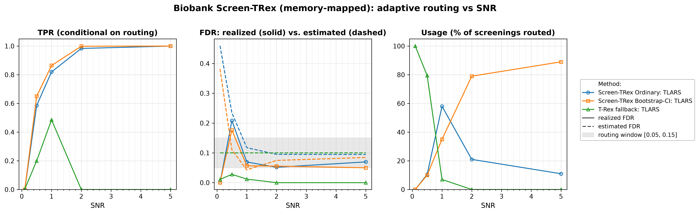
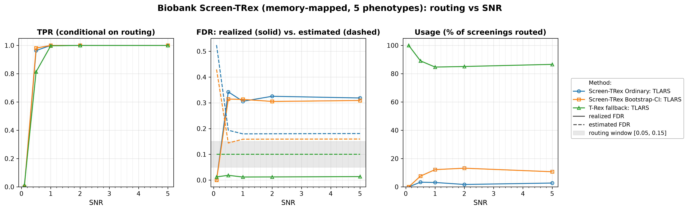

# Demo 05: Biobank Screen-TRex (Algorithm 1) — Memory-Mapped

## Purpose

The demo repeats the **Biobank Screen-TRex workflow** ("Algorithm 1") of demo 04 with
 **memory-mapped dummy matrices** (`use_memory_mapping = true`), the storage mode intended for
 biobank-scale problems where holding the dummy matrices in random-access memory (RAM) is infeasible.
 The algorithm is unchanged. For every phenotype the selector derives two estimates of the false discovery rate (FDR)
 from one Screen-TRex run, one for the **Screen-TRex Ordinary** majority-vote rule and one for
 **Screen-TRex Bootstrap-CI**, whose threshold comes from a bootstrap confidence interval (CI). A screening result is
 accepted only if its estimated FDR lies in the window $\lbrack 0.05, 0.15\rbrack$, and if neither estimate does, the
 phenotype falls back to the **classical Terminating Random Experiments (T-Rex) selector** at a target FDR of $0.10$.
 Demo 04 is the in-memory reference for every number reported here. The point of this demo is to show
 that moving the dummy matrices to disk changes the memory footprint and not the statistics.
 Screening returns a *candidate set*, and the FDR and the true positive rate (TPR) are evaluated on the individual
 selected variables
 (see [What is actually measured](../README.md#what-is-actually-measured-in-these-demos)).

---

## Data Generation Parameters (`datagen::SyntheticData`)

We consider the linear model:

```math
\boldsymbol{y} = \boldsymbol{X}\boldsymbol{\beta} + \boldsymbol{\epsilon},
\qquad \boldsymbol{\epsilon} \sim \mathcal{N}(\boldsymbol{0}, \sigma_{\varepsilon}^2 \boldsymbol{I}_n)
```

- $\boldsymbol{y} \in \mathbb{R}^n$ is the response vector.
- $\boldsymbol{X} \in \mathbb{R}^{n \times p}$ is the design matrix.
- $\boldsymbol{\beta} \in \mathbb{R}^p$ is the coefficient vector, with $s$ nonzero entries.
- $\boldsymbol{\epsilon}$ is the noise vector, independent and identically distributed (i.i.d.) normal.
- $\sigma_{\varepsilon}^2$ is the noise variance, calibrated to a target linear signal-to-noise ratio (SNR) as the
   sample variance of $\boldsymbol{X}\boldsymbol{\beta}$ (divisor $n$) divided by the SNR.
- $n = 300$, $p = 1{,}000$, with $s = 10$ in Part 1 and $s = 5$ in Part 2 (high-dimensional, $p > n$).

The design matrix has **no correlation structure**:

```math
X_{ij} \sim \mathcal{N}(0,1) \quad \text{i.i.d.}
```

- The active support is drawn uniformly at random *per Monte Carlo (MC) trial*, so the results are not tied to
   one support pattern.
- All active coefficients are $\beta_j = 1$. The supports come from one random number generator (RNG) per SNR
   level, seeded at `24 + 1000 * snr_idx` in Part 1 and `77 + 1000 * snr_idx` in Part 2 and drawn trial after trial,
   so they stay apart from the design and noise draws. `datagen::SyntheticData` derives those from the trial seed,
   `1000 * snr_idx + mc` in Part 1.
- In Part 2 all $q = 5$ phenotypes of a trial share **one design matrix** $\boldsymbol{X}$ (seed
   `X_seed = 5000 * snr_idx + mc + 1`), while phenotype `k` receives its **own random support** and its own noise
   draw (seed `q * (num_MC * snr_idx + mc) + k + 1`). This is the biobank setting, where a single genotype matrix is
   screened against many traits.
- All seeds match Demo 04, so both demos screen the same datasets and differ only in the random experiments and
   the storage mode of the dummy matrices.

---

## Control Parameters

```text
K = 20                       # Random experiments per T-loop iteration
lower_bound_FDR = 0.05       # Lower edge of the acceptable estimated-FDR window
upper_bound_FDR = 0.15       # Upper edge of the acceptable estimated-FDR window
target_FDR_trex = 0.10       # Target FDR of the classical T-Rex fallback
R_boot = 1000                # Bootstrap replicates (Bootstrap-CI rule only)
ci_grid_step = 0.001         # Bootstrap-CI threshold grid granularity
solver = TLARS               # T-Rex solver backend
use_memory_mapping = true    # Dummy matrices stored on disk (Boost memory-mapped files)
MC = 200                     # Monte Carlo repetitions per grid point
```

The only difference from demo 04 is `use_memory_mapping = true`. The window $\lbrack 0.05, 0.15\rbrack$ is the
 routing criterion. A screening result is *accepted* only if the procedure's own estimated FDR lands inside it.

---

## Methods Compared

The three routing outcomes of Algorithm 1 [[1]](#references), all using `ScreenTRexMethod::TREX`:

- **Screen-TRex Ordinary** — the majority-vote rule ($\Phi_j > 0.5$).
- **Screen-TRex Bootstrap-CI** — the bootstrap confidence-band rule (`R_boot = 1000` replicates).
- **T-Rex fallback: TLARS** — the classical T-Rex selector at `target_FDR_trex = 0.10`, used when neither
   screening rule produces an acceptable estimate.

Both estimates come from the same $K$ random experiments, because the Bootstrap-CI rule is applied to the result of
 the Ordinary run. The library then takes the decision step of Algorithm 1 (`applyDecisionLogic()` in
 `trex_biobank_screening.cpp`):

- If exactly one estimate lies in the window, that rule is used.
- If both lie in the window, the rule with the larger estimate is used, and a tie goes to Bootstrap-CI.
- If neither lies in the window, the phenotype goes to the T-Rex fallback.

All reported FDR and TPR values are **conditional on routing**. They average only over the phenotypes that
 were actually handled by the respective method. The additional **Usage %** row is unconditional and states
 what fraction of all screenings each method took. A row with low usage therefore rests on few phenotypes (Usage
 times 200 in Part 1, times 1,000 in Part 2), and a row with $0\%$ usage is an average over an empty set, not a
 performance statement. The **Est. FDR** row of a screening rule averages that rule's own estimate over *all*
 screenings, because both estimates are computed for every phenotype. For the fallback it is its target $0.10$.

---

## The Two Parts

- **Part 1 — single phenotype.** One response per trial, $s = 10$ active variables, SNR sweep over
   $\lbrace0.1, 0.5, 1, 2, 5\rbrace$, 200 MC trials per grid point.
- **Part 2 — $q = 5$ phenotypes sharing one $\boldsymbol{X}$.** $s = 5$ active variables per phenotype, the
   same SNR grid and 200 MC trials, hence $5 \times 200 = 1{,}000$ phenotype screenings per SNR level.

---

## Output Files

Written to `simulation_results/data/`:

- `scr_biobank_mmap_snr_n300_p1000_s10.txt` / `.csv` — Part 1: Usage %, FDR, TPR, and estimated FDR
   per method and SNR level.
- `scr_biobank_mmap_multi_n300_p1000_q5_s5.txt` / `.csv` — Part 2: the same metrics for the
   multi-phenotype study.

Figures in Portable Network Graphics (PNG) and Portable Document Format (PDF) go to `simulation_results/plots/`,
produced by `./generate_plots.sh`.

---

## Running the Demo

```bash
./build/release/bin/trex_selector_methods/ad/trex_screening/demo_trex_scr_05_mc_sim_biobank_mmap/demo_trex_scr_05_mc_sim_biobank_mmap
./generate_plots.sh   # render the figures below from the saved CSVs
```

---

## Simulation Results

### Part 1 — Single Phenotype ($s = 10$)

- **Routing follows the same pattern as in the in-memory run.** At $\mathrm{SNR} = 0.1$ all phenotypes
   ($100.0\%$) go to the classical T-Rex fallback, with neither screening estimate in the window and both far above
   it on average ($0.460$ Ordinary, $0.382$ Bootstrap-CI). At $\mathrm{SNR} = 1$ the split is $58.0\%$ Ordinary /
   $35.0\%$ Bootstrap-CI / $7.0\%$ fallback, and at $\mathrm{SNR} = 5$ Bootstrap-CI handles $89.0\%$ of all
   screenings with the fallback never invoked. The largest Usage gap to Demo 04 is Ordinary at $\mathrm{SNR} = 1$
   ($58.0\%$ against $50.5\%$), an approximate binomial $z$ of $1.51$ that treats the two runs as independent.
- **Conditional error control on the screening routes is good once signal is present.** For
   $\mathrm{SNR} \ge 1$ the realized FDR is $0.052\text{–}0.070$ for Ordinary and $0.057 \to 0.050$ for
   Bootstrap-CI, with TPR reaching $1.000$ for both at $\mathrm{SNR} = 5$. The Ordinary value at
   $\mathrm{SNR} = 5$ rests on 22 cases (usage $11.0\%$). As in demo 04, $\mathrm{SNR} = 0.5$ is the weak point,
   where the accepted screenings realize an FDR of $0.208$ (Ordinary, 21 cases) and $0.177$ (Bootstrap-CI,
   20 cases), both small-sample averages.
- **The fallback's TPR of $0.000$ at $\mathrm{SNR} = 2$ and $5$ is not a failure.** Its usage is $0.0\%$ at
   those points. Nothing is routed to it, so the conditional average is over an empty set and prints as
   zero. Where it is used it is the conservative option. At $\mathrm{SNR} = 1$ (14 cases) its realized FDR is
   $0.012$ against a target of $0.10$, with a TPR of $0.486$.
- **The estimates mostly err on the safe side.** The Est. FDR row averages over all cases while the realized FDR
   covers only the routed ones, so the comparison is indicative. Ordinary's estimate settles at
   $0.095\text{–}0.118$ against a realized $0.052\text{–}0.070$ for $\mathrm{SNR} \ge 1$, and Bootstrap-CI's at
   $0.043\text{–}0.085$ against a realized $0.050\text{–}0.057$, below the realized value only at
   $\mathrm{SNR} = 1$.

TPR (conditional on routing), FDR (solid = realized, dashed = the rule's own estimate averaged over all cases, with
the fallback's dashed line at its target $0.10$ and the $\lbrack 0.05, 0.15\rbrack$ routing window shaded), and
per-method Usage % vs. SNR.



### Part 2 — Five Phenotypes Sharing One Design ($q = 5$, $s = 5$)

- **The fallback dominates, and more signal does not change that.** The classical T-Rex selector handles
   $84.7\%\text{–}100.0\%$ of all screenings ($100.0\%$ at $\mathrm{SNR} = 0.1$, $86.6\%$ at $\mathrm{SNR} = 5$),
   with Ordinary at $1.7\%\text{–}3.3\%$ and Bootstrap-CI at $7.6\%\text{–}13.2\%$ for $\mathrm{SNR} \ge 0.5$.
- **The rarely used screening routes are poorly calibrated.** For $\mathrm{SNR} \ge 0.5$ the realized FDR of
   the accepted screening results is $0.306\text{–}0.343$ (Ordinary, 17 to 33 cases per level) and
   $0.305\text{–}0.315$ (Bootstrap-CI), roughly twice the upper edge of the routing window, although every accepted
   case had an estimate inside it. Averaged over all cases the estimates are $0.179\text{–}0.194$ (Ordinary) and
   $0.144\text{–}0.160$ (Bootstrap-CI), at the upper edge of the window or above it. TPR is $1.000$ for both rules
   from $\mathrm{SNR} = 1$ on. With all five true variables found, one false selection gives a false discovery
   proportion (FDP) of $1/6 \approx 0.17$, so a realized FDR near $0.31$ cannot come from single false selections
   alone.
- **The fallback remains reliable on the bulk of the traffic.** Its realized FDR is $0.012\text{–}0.019$ against
   a target of $0.10$, with TPR rising $0.013 \to 1.000$ across the sweep.
- **Memory mapping changes the footprint, and the tables show no systematic change in the statistics.** The Part 2
   Ordinary route here reads Usage $0.0/3.3/3.1/1.7/2.7\%$, FDR $0.000/0.343/0.306/0.325/0.319$ and estimate
   $0.524/0.194/0.179/0.180/0.181$, against demo 04's $0.0/3.3/2.9/3.4/2.2\%$,
   $0.000/0.338/0.307/0.306/0.316$ and $0.531/0.192/0.180/0.180/0.181$. In Part 2 the estimate rows of the two
   demos differ by at most $0.009$ and the routing shares by at most $1.7$ percentage points. That largest gap,
   Ordinary at $\mathrm{SNR} = 2$ (34 against 17 of 1,000 cases), gives an approximate binomial $z$ of $2.4$ that
   treats the runs as independent and ignores the shared design within a trial. It is the only Usage cell of
   either part above $2$. The tables carry no standard deviations, so the FDR differences of the small Ordinary
   route cannot be tested. Exact equality is not expected, because the selector is constructed with `seed = -1`,
   which the library resolves via `std::random_device`, so the two runs use different random experiments.

TPR (conditional on routing), FDR (solid = realized, dashed = the rule's own estimate averaged over all cases, with
the fallback's dashed line at its target $0.10$ and the $\lbrack 0.05, 0.15\rbrack$ routing window shaded), and
per-method Usage % vs. SNR.



---

## References

1. Machkour, J., Muma, M., & Palomar, D. P., "False Discovery Rate Control for Fast Screening of
   Large-Scale Genomics Biobanks.", IEEE Statistical Signal Processing Workshop (SSP), 2023,
    pp. 666–670, IEEE.
    [DOI-Link](https://doi.org/10.1109/SSP53291.2023.10207957)
