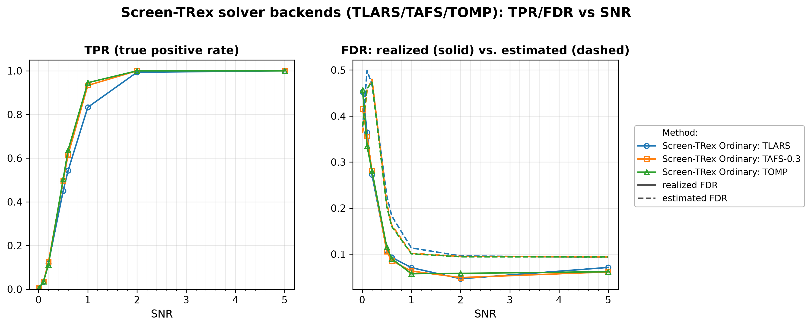
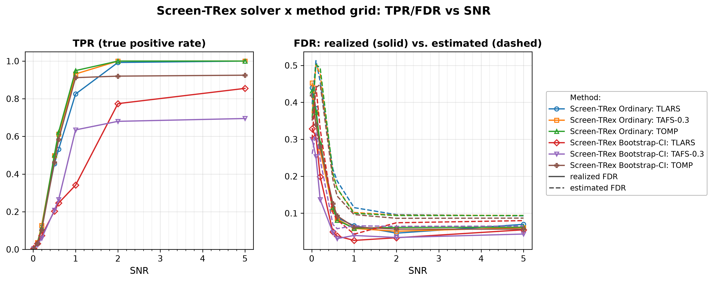

# Demo 06: Solver Backends for Screen-TRex — TLARS, TAFS, TOMP

## Purpose

The demo asks whether the **choice of Terminating Random Experiments (T-Rex) solver backend** changes screening
performance, or whether it
 is merely a speed knob.
 The same independent and identically distributed (i.i.d.) Gaussian design as
 [Demo 01](../demo_trex_scr_01_mc_sim_screen_trex/README.md) is used, so the numbers here are directly comparable to
 the baseline established there.
 Three backends are swept over the signal-to-noise ratio (SNR). They are **TLARS**, the terminating form of
 least-angle regression (LARS), **TAFS** with $\rho = 0.3$ (terminating adaptive forward stepwise) and **TOMP**
 (terminating orthogonal matching pursuit), first under the Ordinary thresholding rule alone and then crossed with
 the Bootstrap-CI rule, whose threshold comes from a bootstrap confidence interval (CI).
 Screening returns a *candidate set*, and the false discovery rate (FDR) and the true positive rate (TPR) are evaluated
 on the individual selected variables
 (see [What is actually measured](../README.md#what-is-actually-measured-in-these-demos)).

---

## Data Generation Parameters (`make_iid_dgp`)

We consider the linear model:

```math
\boldsymbol{y} = \boldsymbol{X}\boldsymbol{\beta} + \boldsymbol{\epsilon},
\qquad \boldsymbol{\epsilon} \sim \mathcal{N}(\boldsymbol{0}, \sigma_{\varepsilon}^2 \boldsymbol{I}_n)
```

- $\boldsymbol{y} \in \mathbb{R}^n$ is the response vector.
- $\boldsymbol{X} \in \mathbb{R}^{n \times p}$ is the design matrix.
- $\boldsymbol{\beta} \in \mathbb{R}^p$ is the coefficient vector, with $s$ nonzero entries.
- $\boldsymbol{\epsilon}$ is the noise vector, i.i.d. normal.
- $\sigma_{\varepsilon}^2$ is the noise variance, calibrated to a target linear SNR as the sample variance of
   $\boldsymbol{X}\boldsymbol{\beta}$ (divisor $n$) divided by the SNR.
- $n = 300$, $p = 1{,}000$, $s = 10$ (high-dimensional, $p > n$).

The design matrix has **no correlation structure**:

```math
X_{ij} \sim \mathcal{N}(0,1) \quad \text{i.i.d.}
```

- The active support is drawn uniformly at random *per Monte Carlo (MC) trial*, so the results are not tied to
   one support pattern.
- All active coefficients are $\beta_j = 1$, and the support comes from a random number generator (RNG) seeded at
   the trial seed plus `500000`, so it stays apart from the design and noise draws of the trial seed.
- This is the **same data-generating process (DGP) as Demo 01** with the same seeds. Trial `mc` at grid index
   `snr_idx` uses seed `24 + 1000 * snr_idx + mc`, so every series of both demos screens the **same 200 datasets**
   at one SNR point. Differences between the series at one SNR point therefore come from the solver, the
   thresholding rule and the random experiments, not from the data.

---

## Control Parameters

```text
K = 20                       # Random experiments per T-loop iteration
R_boot = 1000                # Bootstrap replicates (Bootstrap-CI rule only)
ci_grid_step = 0.001         # Bootstrap-CI threshold grid granularity
solver = TLARS / TAFS / TOMP # T-Rex solver backends compared
rho_afs = 0.3                # Adaptive forward stepwise shrinkage step (read by TAFS only)
tloop_stagnation_stop = true # Stagnation stop enabled for every backend here
tloop_max_stagnant_steps = 5 # Stagnant T-loop steps before the stop
MC = 200                     # Monte Carlo repetitions per grid point
```

Note that Screen-TRex has **no target-FDR parameter**, because unlike the classical T-Rex selector, screening
 thresholds the voting statistic instead of calibrating to a user-specified level.

---

## Methods Compared

Three T-Rex solver backends [[1]](#references), all driving `ScreenTRexMethod::TREX`:

- **TLARS** — terminating LARS, the default backend, which follows the least-angle regression path until the
   dummy-based stopping criterion fires.
- **TAFS-0.3** — terminating adaptive forward stepwise with shrinkage step $\rho = 0.3$, which moves the fit only a
   fraction $\rho$ toward the least-squares fit on the active set and so lies between forward stepwise ($\rho = 1$)
   and least-angle regression ($\rho \to 0$).
- **TOMP** — terminating orthogonal matching pursuit, the greediest of the three, taking the predictor most
   correlated with the current residual at each step.

Each backend is combined with the Screen-TRex thresholding rules:

- **Ordinary** — selects $\lbrace j : \Phi_j > 0.5 \rbrace$, a simple majority vote of the random experiments.
- **Bootstrap** — builds a bootstrap confidence band around the estimated FDR curve (`R_boot = 1000`
   replicates) and picks its threshold from that band.

---

## The Two Parts

- **Part 1 — solvers under the Ordinary rule.** Three series (TLARS, TAFS-0.3, TOMP), Ordinary screening
   only, over $\mathrm{SNR} \in \lbrace0.01, 0.1, 0.2, 0.5, 0.6, 1, 2, 5\rbrace$ with 200 MC trials per grid point.
- **Part 2 — solvers crossed with both rules.** The same three backends under both Ordinary and
   Bootstrap-CI thresholding, giving six series over the same SNR grid and MC budget.

Every trial draws a fresh design, support, and noise realization.

---

## Output Files

Written to `simulation_results/data/`:

- `scr_solvers_snr_n300_p1000_s10.txt` / `.csv` — Part 1: FDR, TPR, and estimated FDR per solver and SNR
   level.
- `scr_solver_method_snr_n300_p1000_s10.txt` / `.csv` — Part 2: the same metrics for all six
   solver × rule combinations.

Figures in Portable Network Graphics (PNG) and Portable Document Format (PDF) go to `simulation_results/plots/`,
produced by `./generate_plots.sh`.

---

## Running the Demo

```bash
./build/release/bin/trex_selector_methods/ad/trex_screening/demo_trex_scr_06_mc_sim_solvers/demo_trex_scr_06_mc_sim_solvers
./generate_plots.sh   # render the figures below from the saved CSVs
```

---

## Simulation Results

### Part 1 — Three Solvers, Ordinary Screening

- **The solver is not a pure speed knob.** At mid SNR the greedier backends are markedly more powerful than
   TLARS at comparable FDR. At $\mathrm{SNR} = 1$ the TPR is $0.933$ (TAFS-0.3) and $0.946$ (TOMP) against
   $0.833$ (TLARS), while the realized FDR is $0.063$, $0.057$, and $0.071$ respectively. The gap is already
   visible at $\mathrm{SNR} = 0.5\text{–}0.6$ ($0.497/0.505$ vs. $0.451$, and $0.617/0.637$ vs. $0.544$).
- **All three converge at high SNR.** By $\mathrm{SNR} = 2$ TAFS-0.3 and TOMP reach TPR $1.000$ and TLARS
   $0.994$, and at $\mathrm{SNR} = 5$ all three recover every active variable at FDR $0.061\text{–}0.071$. The choice
   of backend therefore only matters where the signal is neither absent nor obvious.
- **At very low SNR the backends are indistinguishable, and all uncontrolled.** For $\mathrm{SNR} \le 0.2$
   the realized FDR runs $0.272\text{–}0.457$ for all three with TPR $\le 0.124$, reproducing the Demo 01 finding
   that screening is not FDR-controlling when there is no recoverable signal.
- **The internal FDR estimate behaves the same way for every backend.** It peaks around $0.47\text{–}0.50$ at
   $\mathrm{SNR} = 0.1\text{–}0.2$ and then settles at $0.093\text{–}0.094$ for all three at $\mathrm{SNR} = 5$,
   sitting *above* the realized FDR once signal is present.

TPR (left) and FDR (right) vs. SNR, one line per solver backend. On the FDR panel the solid line
is the realized FDR and the dashed line the procedure's own estimated FDR.



### Part 2 — Three Solvers × Two Thresholding Rules

- **Under Bootstrap-CI the backend matters far more than under the Ordinary rule.** At $\mathrm{SNR} = 1$
   the bootstrap TPR spans $0.341$ (TLARS), $0.635$ (TAFS-0.3), and $0.912$ (TOMP) — more than half the
   achievable power — against a spread of roughly $0.12$ for the same three backends under the Ordinary
   rule.
- **TLARS and TAFS-0.3 are the conservative backends under Bootstrap-CI.** Both keep FDR at or below $0.055$ from
   $\mathrm{SNR} = 0.5$ onwards. TLARS gives up the most power around $\mathrm{SNR} = 1$ (TPR $0.34$ vs. $0.63$ for
   TAFS-0.3) but recovers at high SNR, where its TPR reaches $0.855$ at $\mathrm{SNR} = 5$. TOMP under
   Bootstrap-CI, in contrast, behaves almost like Ordinary screening. At $\mathrm{SNR} = 1$ its TPR is
   $0.912$ vs. $0.950$ ordinary, at FDR $0.063$ and $0.060$.
- **Bootstrap-CI stops short of full power.** TAFS-0.3 levels off at TPR $0.68\text{–}0.70$ from
   $\mathrm{SNR} = 2$ on and TOMP at $0.92\text{–}0.93$, while every Ordinary series reaches $1.000$.
- **The low-SNR regime is unaffected by either choice.** For $\mathrm{SNR} \le 0.2$ all six series have
   TPR $\le 0.127$ and FDR between $0.137$ and $0.452$. Neither the backend nor the thresholding rule
   rescues screening when there is nothing to find.
- **Practical takeaway.** Under the Ordinary rule TOMP and TAFS-0.3 buy substantial power over TLARS at mid SNR at
   a comparable error rate. Under Bootstrap-CI TLARS and TAFS-0.3 keep the lowest FDR, while TOMP keeps most of the
   power. At $\mathrm{SNR} = 1$ the backend moves the Bootstrap-CI TPR by $0.571$, a little more than switching
   TLARS from Ordinary to Bootstrap-CI ($0.825 \to 0.341$), so there the solver matters as much as the rule.

TPR (left) and FDR (right) vs. SNR, one line per solver × rule combination. On the FDR panel the
solid line is the realized FDR and the dashed line the procedure's own estimated FDR.



---

## References

1. Machkour, J., Muma, M., & Palomar, D. P., "False Discovery Rate Control for Fast Screening of
   Large-Scale Genomics Biobanks.", IEEE Statistical Signal Processing Workshop (SSP), 2023,
    pp. 666–670, IEEE.
    [DOI-Link](https://doi.org/10.1109/SSP53291.2023.10207957)
