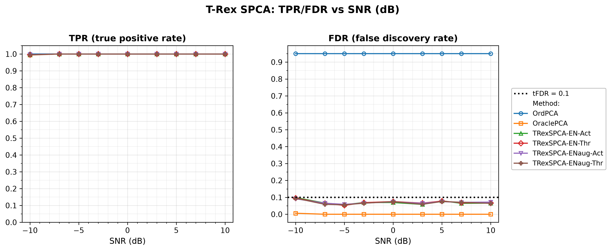
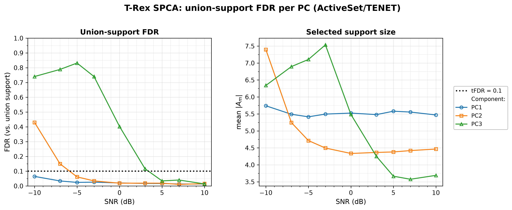
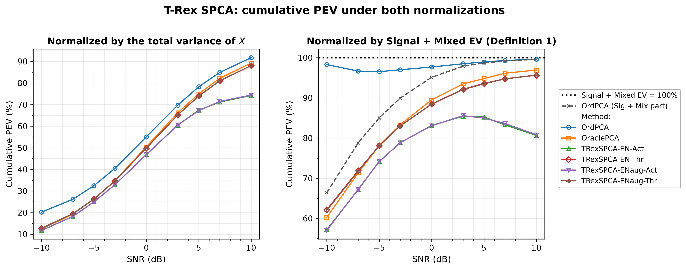

# Demo 01: T-Rex SPCA on a Sparse Factor Model

## Purpose

The demo compares the Terminating Random Experiments (T-Rex) selector for sparse principal component analysis (SPCA),
**T-Rex SPCA**
 [[1]](#references), against two principal component analysis (PCA) baselines on a synthetic sparse
 three-factor model, over a sweep of the signal-to-noise ratio (SNR) in decibels.
 Four solver/mode combinations are run — the elastic-net solver `TENET` vs. `TENET_AUG`, each with the
 `ActiveSet` and `Thresholded` loading-assembly modes — against **ordinary PCA** (no sparsity) and
 **oracle-thresholded PCA** (told the true support size).
 The question is whether the grouped variable selection (GVS) machinery of T-Rex+GVS controls the false
 discovery rate (FDR) of the estimated loading support, and what that control costs in explained variance. This
 demo mirrors **Fig. 2** of [[1]](#references) and, like it, uses $p_1 = 5$, while the companion
 [demo 02](../demo_trex_spca_02_mc_sim_pev/README.md) mirrors their Fig. 3 at $p_1 = 10$.
 FDR and the true positive rate (TPR) are evaluated on **the loading support of the first principal component
 (PC1) only**, and FDR *control* is assumed for PC1 only.
 The factor supports are drawn from a shared pool and overlap, and ordinary PCA's orthogonality constraint
 mixes the supports of components 2 and 3 across the true factors — the plug-in principal component (PC) that a
 later component's selector regresses on is already a blend of overlapping supports, so beyond PC1 there is no
 unambiguous per-component ground truth and hence no clean notion of a false discovery to control against. This mirrors
 the reference paper, whose Fig. 2 reports FDR and TPR "for the first PC". The proportion of explained variance
 (PEV) does not suffer that ambiguity and is cumulative over all $M$ components.

One framing is worth keeping in mind throughout. T-Rex SPCA supervises each component's selector with the *plug-in*
 ordinary PC $\boldsymbol z_m = \boldsymbol X \boldsymbol v_m$ — a one-shot construction, not the
 iterative refinement most sparse-PCA methods use. **The FDR guarantee is therefore conditional on the
 plug-in PC being a faithful proxy for its factor.** Where that proxy is good (PC1, factors above the noise
 floor) control is real. Where it degrades, the selector still controls FDR *with respect to the regression
 it was handed*, which is not the same claim. The union-FDR section below measures exactly where the
 condition holds.

---

## Data Generation Parameters (`DataGenerator::generate_sparse_factor_model`)

We consider a sparse $M$-factor model:

```math
\boldsymbol{X} = \boldsymbol{Z}\boldsymbol{V}^\top + \boldsymbol{E}
```

- $\boldsymbol{X} \in \mathbb{R}^{n \times p}$ is the observed data matrix.
- $\boldsymbol{Z} \in \mathbb{R}^{n \times M}$ holds the latent factor scores, column $m$ drawn
   $\mathcal{N}(0, \sigma_m^2)$ with $\sigma_m \in \lbrace5, 3, 1\rbrace$ — the factors are deliberately unequal in
   amplitude.
- $\boldsymbol{V} \in \mathbb{R}^{p \times M}$ is the sparse loading matrix, where each column carries exactly
   $p_1$ nonzero entries of value $0.9$.
- $\boldsymbol{E}$ is independent and identically distributed (i.i.d.) Gaussian noise, scaled to hit the target SNR
   in dB.
- $n = 50$, $p = 100$, $p_1 = 5$, $M = 3$.
- The $p_1$ active indices of each factor are drawn without replacement from a **shared pool** of
   `overlap_pool_size` $= 30$ candidates, so factor supports may partially coincide.

All methods see the same **center-only** $\boldsymbol{X}$ — mean subtraction, no column scaling. That keeps
 ordinary PCA, oracle PCA and T-Rex SPCA on a common covariance-PCA footing. The column scales must *not* be
 normalized here, because the factor amplitudes $\sigma_m$ live in the column variances, and z-scoring would destroy
 exactly the signal the factors are distinguished by.

---

## Control Parameters

```text
tFDR = 0.10           # Target FDR for the per-component selector
lambda_2 = -1         # < 0 selects the ridge penalty by k-fold CV (0 = none, > 0 = fixed)
scaling = L2          # Per-component selector scaling mode
MC = 200              # Monte Carlo repetitions per grid point
base_seed = 42        # Trial mc draws its data from base_seed_offset + mc * 1000,
                      # with base_seed_offset = base_seed + round(snr_db)
```

Note that only the **data** is seeded deterministically. Each trial's dummies are drawn from hardware entropy
 (selector seed $-1$) by design, which is what makes the Monte Carlo FDR estimate valid, so a re-run
 reproduces the committed numbers only to within Monte Carlo noise, not exactly.

---

## Methods Compared

| Method | Sparsity mechanism | `SPCAMode` | `ENSolverType` |
| --- | --- | --- | --- |
| **OrdPCA** | none — all $p$ loadings retained | — | — |
| **OraclePCA** | $\text{top-}p_1$ by magnitude, true support size known | — | — |
| **TRexSPCA-EN-Act** | T-Rex+GVS selection [[2]](#references) | `ActiveSet` | `TENET` |
| **TRexSPCA-ENaug-Act** | T-Rex+GVS selection [[2]](#references) | `ActiveSet` | `TENET_AUG` |
| **TRexSPCA-EN-Thr** | T-Rex+GVS selection [[2]](#references) | `Thresholded` | `TENET` |
| **TRexSPCA-ENaug-Thr** | T-Rex+GVS selection [[2]](#references) | `Thresholded` | `TENET_AUG` |

The two modes differ in how the loadings are rebuilt once the support is chosen. `ActiveSet` refits the plug-in
 PC on the selected columns by ridge regression (`lambda2_ridge_loadings`, default $10^{-6}$), while `Thresholded`
 keeps the $|\widehat{\mathcal A_m}|$ largest-magnitude entries of the ordinary PCA loading vector, so it takes only
 the support size from the selector.

---

## Metrics

FDR and TPR are evaluated on PC1's loading support. With $\mathcal S_1$ the true active support of
 factor 1 and $\widehat{\mathcal S_1}$ the estimated (nonzero) support of the first sparse loading vector,

```math
\mathrm{FDR} = \mathbb{E}\left[\frac{|\widehat{\mathcal{S}}_1 \setminus \mathcal{S}_1|}
{\max\{1, |\widehat{\mathcal{S}}_1|\}}\right],
\qquad
\mathrm{TPR} = \mathbb{E}\left[\frac{|\mathcal{S}_1 \cap \widehat{\mathcal{S}}_1|}
{\max\{1, |\mathcal{S}_1|\}}\right],
```

with the expectations estimated as Monte Carlo means over the 200 trials. FDR *control* is claimed for PC1
 only (see [Purpose](#purpose)), while the union-support variant for the later components is defined in the
 [dedicated results subsection](#union-support-fdr-beyond-pc1).

For the explained variance (EV), the classical quantity is the EV of the estimated components,

```math
\mathrm{EV} = \frac{1}{n-1}\,\mathrm{tr}\bigl(\widehat{\boldsymbol{Z}}^\top \widehat{\boldsymbol{Z}}\bigr)
            = \frac{1}{n-1} \sum_{m=1}^{M} \lVert \widehat{\boldsymbol{z}}_m \rVert_2^2 .
```

Sparse PCA drops the orthogonality constraint, so correlated components double-count shared variance under
 this trace. Zou, Hastie & Tibshirani [[3]](#references) therefore correct it. With
 $\widehat{\boldsymbol{Z}} = \boldsymbol{Q}\boldsymbol{R}$ the orthogonal-triangular (QR) decomposition of the
 estimated score matrix, the **adjusted EV** keeps only each component's incremental contribution,

```math
\mathrm{EV}_{\mathrm{adj}} = \frac{1}{n-1} \sum_{m=1}^{M} r_{mm}^2 .
```

The **TRex-SPCA** paper [[1]](#references) adopts this corrected EV and builds its **Definition 1** on top of
 it, asking *where* the variance comes from. Variance on the true active variables (Signal + Mixed EV) is
 worth explaining, while variance on null variables (Null EV) is not — and that split is exactly what separates
 the non-sparse baseline from the FDR-controlled methods. Accordingly, the demo reports three readings.

The first is the share of the **total** variance, bounded by 1,

```math
\mathrm{PEV} = \mathrm{EV}_{\mathrm{adj}} / \mathrm{Var}(\boldsymbol{X}).
```

The second is **Definition 1** of [[1]](#references),

```math
\mathrm{PEV}_{\mathrm{sig}} = \mathrm{EV}_{\mathrm{adj}} / \bigl(\lVert \boldsymbol{X}_{\mathcal{A}} \rVert_F^2 / (n-1)\bigr),
```

where the denominator is the **Signal + Mixed EV of the data** — the variance
 carried by the true active variables ($\mathcal{A}$ = union of the factor supports), fixed per dataset
 and shared by all methods. Methods that additionally capture null-variable variance push past $100\%$,
 so this ratio is **not** capped at 1 — exceeding $100\%$ is the failure the metric is designed to
 expose. (The denominator follows the legacy R reference `demo_trex_spca_03_fig3.R`, mode `"active"`, which
 reproduces the rise of the published Fig. 3(b) from about $40\%$. No constructible denominator reproduces all
 published anchors, see [demo 02](../demo_trex_spca_02_mc_sim_pev/README.md#relation-to-the-papers-fig-3).)

The third, tagged `PEVsigmix` in the output, is the method's *own* Signal + Mixed part over the same shared
 denominator. Read for OrdPCA it is the paper's "Ordinary PCA (Sig + Mix)" reference curve.

For the simulations the two normalizations are deliberately presented against each other, as the second
 figure below does. The total-variance panel prices the sparsity, and the Definition-1 panel shows where the
 non-sparse advantage actually comes from.

---

## The Sweep

A single **SNR sweep in decibels** over
$\mathrm{SNR} \in \lbrace-10, -7, -5, -3, 0, 3, 5, 7, 10\rbrace$ dB, 200 Monte Carlo (MC) trials per point. The axis
is plotted and tabulated in dB throughout, and it is never converted back to a linear ratio.

Section 2 reruns the same grid for the **union-support FDR per PC** (`ActiveSet`/`TENET` only) — see the
[dedicated results subsection](#union-support-fdr-beyond-pc1) for what it measures and why the union of the
factor supports is the only well-posed per-PC truth beyond PC1.

---

## Output Files

Written to `simulation_results/data/`:

- `demo_trex_spca_01_mc_sim.txt` / `.csv` — FDR, TPR and the PEV readings per method and SNR level. The
   comma-separated values (CSV) file tags them `PEV` (total-variance normalization), `PEVsig` (Definition 1) and
   `PEVsigmix` (the method's Sig + Mix part).
- `demo_trex_spca_01_mc_sim_union_fdr.csv` — Section 2: union-support FDR and mean support size per PC
   (`pc,metric,snr_db,value`, metrics `FDRunion` / `k`).

Figures in Portable Network Graphics (PNG) and Portable Document Format (PDF) go to `simulation_results/plots/`,
produced by `./generate_plots.sh`:

- `demo_trex_spca_01_mc_sim.png` — TPR and FDR over the sweep (support recovery only).
- `demo_trex_spca_01_mc_sim_union_fdr.png` — Section 2: union-support FDR per PC.
- `demo_trex_spca_01_mc_sim_pev.png` — the two PEV normalizations side by side (the explained-variance
   story lives entirely in this figure).

---

## Running the Demo

```bash
./build/release/bin/trex_selector_methods/ad/trex_spca/demo_trex_spca_01_mc_sim/demo_trex_spca_01_mc_sim
./generate_plots.sh   # render the figure below from the saved CSV
```

`TREX_SPCA_NUM_MC=<k>` overrides the Monte Carlo count for quick pilot runs (e.g. `TREX_SPCA_NUM_MC=10`),
and `TREX_SPCA_PARTS` selects the sections (default `12`, with `1` = method comparison and `2` = union-FDR sweep).

---

## Simulation Results

- **All four T-Rex SPCA variants hold the FDR at the $\mathrm{tFDR} = 0.10$ target across the whole sweep**,
   with realized values between $0.053$ and $0.099$ — highest at the hardest point ($-10$ dB) and settling
   around $0.05\text{–}0.08$ from $-7$ dB upward. The highest reading (`TRexSPCA-EN-Act`, $0.0990$ at
   $-10$ dB) stays just below the target. TPR is $1.000$ everywhere except $-10$ dB, where it is
   $0.995\text{–}0.996$.
- **OrdPCA's FDR of $0.95$ is not a defeat, it is arithmetic.** Retaining all $p = 100$ loadings against a
   true support of $p_1 = 5$ makes 95 of every 100 selections false by construction. It is a non-sparse
   reference line, not a competitor.
- **OraclePCA is the near-ideal reference**, with FDR $\leq 0.006$ and TPR $\geq 0.994$, because it is handed the
   true support size. Its FDR gap to the T-Rex variants is the price of *estimating* the support rather than
   being told its size, and on this design that price is small. It is no strict ceiling, because the T-Rex variants pass
   its TPR at $-10$ dB ($0.995\text{–}0.996$ vs. $0.994$), and `Thresholded` passes its Definition 1 reading at
   $-10$ and $-7$ dB.
- **`TENET` and `TENET_AUG` behave alike on this problem.** Their rows differ by at most $0.008$ in FDR in the
   `ActiveSet` mode and $0.007$ in the `Thresholded` mode, by at most $0.003$ in the Definition 1 reading, and the
   sign of the differences flips between SNR points. The dummies come from hardware entropy in every trial, so these
   differences include dummy noise, and the data cannot show whether the two solvers would select identically on
   identical dummies.

TPR (left) and FDR (right, with the $\mathrm{tFDR} = 0.10$ target as a dotted line) vs. SNR in decibels, one
line per method.

**Both panels read on PC1's loading support only — FDR control is claimed for the first PC
and nothing beyond it.** The overlapping factor supports leave the later components without an unambiguous
per-component ground truth (see [Purpose](#purpose)), so a per-PC FDR is not evaluable there.



### Union-support FDR beyond PC1

What can be said about the later components?
A per-factor FDR cannot be controlled!
It would brand legitimately selected leaked variables as false discoveries and measure the ambiguity of
 the truth rather than the selector.
The **union of the factor supports** is well-posed for every component, because a variable outside
 the union is null for *every* factor, so selecting it is a false discovery no matter how the components
 mix.
Section 2 of the demo (`TREX_SPCA_PARTS=2`) therefore scores each PC's selected support
 (`ActiveSet`/`TENET`, the selector's own active sets) against that union. This answers the one question the
 overlap leaves answerable. *Does the selector start harvesting pure-noise variables on the later components?*

Formally, with $\mathcal S_{\cup} = \bigcup_{k=1}^{M} \mathcal S_k$ the union of the true factor supports
 and $\widehat{\mathcal A_m}$ the selector's active set for component $m$,

```math
\mathrm{FDR}_{\cup}(m) = \mathbb{E}\left[\frac{|\widehat{\mathcal{A}}_m \setminus \mathcal{S}_{\cup}|}
{\max\{1, |\widehat{\mathcal{A}}_m|\}}\right],
```

again as a Monte Carlo mean, while the right panel of the figure reports the companion support size
 $\mathbb{E}\bigl[|\widehat{\mathcal A_m}|\bigr]$. For $m = 1$ this differs from the FDR above only in the
 more lenient truth ($\mathcal S_1 \subseteq \mathcal S_{\cup}$), which is why PC1's union-FDR sits
 slightly below its per-factor FDR.

- **PC1 is controlled everywhere** (union-FDR $0.013\text{–}0.065$, the union is a more lenient truth than factor 1's
   own support).
- **The second component (PC2) and the third (PC3) are controlled where their factors are strong, and break where
   they drown.** The factors have amplitudes $\sigma = (5, 3, 1)$, so relative to factor 1 the second factor sits
   $\approx 4$ dB and the third $\approx 14$ dB lower in effective SNR. PC2 holds the target from $-5$ dB up
   ($\leq 0.06$) and breaks below it ($0.15$ at $-7$ dB, $0.43$ at $-10$ dB), while PC3 holds only from $+5$ dB up
   ($\leq 0.04$), exceeds the target at $+3$ dB ($0.12$) and collapses below ($0.40$ at $0$ dB,
   $0.74\text{–}0.83$ at $\leq -3$ dB). The two crossings lie about 10 dB apart (between $-7$ and $-5$ dB for PC2,
   between $+3$ and $+5$ dB for PC3), in line with the $\approx 9.5$ dB amplitude gap between factors 2 and 3.
   A plausible reading is that once a factor is buried, its plug-in PC is essentially a noise direction, and the
   selector, asked to explain a noise response, selects noise variables. In the support-size panel PC3's selection
   is inflated ($6.3\text{–}7.5$ variables) at $-3$ dB and below, falls to $5.5$ at $0$ dB and $4.3$ at $+3$ dB,
   and settles at $3.6\text{–}3.7$ from $+5$ dB up.

**Consequences.** The FDR guarantee is **conditional on the plug-in PC being a faithful proxy for its
factor**. Where a factor is buried, the selector still controls the FDR of the noise regression it was
handed, so the nominal guarantee holds and is vacuous. Per-component control is therefore only as good as
the component's effective SNR. The data point to the one-shot plug-in construction rather than the selector as
the source of this caveat, but only demo 02's oracle-response comparison for PC1 tests that directly.



### The two PEV normalizations

The same cumulative explained variance, divided by two different denominators, tells two different stories.
 What the two panels plot is exactly the pair defined in [Metrics](#metrics):

```math
\text{left:}\quad
\mathrm{PEV} = \frac{\mathrm{EV}_{\mathrm{adj}}}{\mathrm{Var}(\boldsymbol{X})} \; \leq \; 1,
\qquad\qquad
\text{right:}\quad
\mathrm{PEV}_{\mathrm{sig}} = \frac{\mathrm{EV}_{\mathrm{adj}}}
{\lVert \boldsymbol{X}_{\mathcal{A}} \rVert_F^2 \,/\, (n-1)}
\;\; \text{(uncapped)},
```

with the dashed reference in the right panel showing OrdPCA's own Signal + Mixed part
 (`PEVsigmix`) over the same denominator.

- **Under the total-variance normalization (left panel), ordinary PCA wins at every SNR**
   ($20.2\% \to 91.7$\% across the grid), because it keeps all $p$ loadings. The T-Rex variants trail it, and
   `Thresholded` is the better of the two modes at every SNR point ($88.1\%$ vs. $74.2\text{–}74.4\%$ at $+10$ dB).
   This fits the `Thresholded` mode taking its loadings from ordinary PCA instead of from a ridge refit on the
   selected columns. Read alone, this panel says sparsity is a pure cost.
- **Under Definition 1 (right panel) the picture changes, and at low SNR ordinary PCA's lead is mostly Null EV.**
   The oracle and `Thresholded` curves now *rise* with SNR, as in the reference paper's Fig. 3(b), because the
   denominator is the variance the true active variables carry, and at low SNR most of that is noise no
   3-component method can capture. The `ActiveSet` pair peaks at $85.4\text{–}85.6\%$ at $+3$ dB and eases to
   $80.6\text{–}80.8\%$ at $+10$ dB. Ordinary PCA hugs the $100\%$ line ($96.5\text{–}99.6\%$) — but the dashed
   reference curve shows how.
   At $-10$ dB only $66.4\%$ of its $98.3\%$ points are Signal + Mixed EV, and the rest is variance harvested from
   null variables. The gap closes with rising SNR ($2.6$ points at $0$ dB, below $0.1$ point at $+10$ dB). The
   sparse methods carry far less of this excess, though not none at low SNR. From $0$ dB up their Definition 1 and
   Sig + Mix readings lie within $0.021$ of each other for the T-Rex variants and $0.043$ for OraclePCA, while at
   $-10$ dB the Definition 1 reading exceeds the Sig + Mix part by $0.08\text{–}0.10$ and $0.07$, against $0.32$
   for ordinary PCA. (The Sig + Mix part comes from the raw, unadjusted EV, so for correlated sparse components
   the difference is no clean Null EV measure.) `Thresholded` reaches $95.7\%$ and OraclePCA $96.9\%$ at
   $+10$ dB. (With only $M = 3$ extracted components the ordinary-PCA overshoot past $100\%$ stays latent, and
   demo 02's PC-count sweep is where it erupts to $165\%$.)
- **The two panels together are the actual result.** At low SNR ordinary PCA's lead in the left panel is bought
   largely with the variance the dashed decomposition in the right panel exposes as null, and at high SNR the lead
   shrinks to a few points ($91.7\%$ vs. $88.1\%$ for `Thresholded` and $89.3\%$ for OraclePCA at $+10$ dB). The
   FDR-controlled variants pay a modest, quantified price in captured variance, and in exchange claim much less
   variance that is not theirs.



For the full Fig.-3-style treatment of [[1]](#references) of this metric — swept over the PC count, the number of true
 active loadings and the target FDR as well — see [demo 02](../demo_trex_spca_02_mc_sim_pev/README.md).

---

## References

1. Machkour, J., Breloy, A., Muma, M., Palomar, D. P., & Pascal, F., "Sparse PCA with False Discovery Rate Controlled
   Variable Selection.", IEEE International Conference on Acoustics, Speech and Signal Processing (ICASSP), 2024,
   pp. 9716–9720, IEEE.
   [DOI-Link](https://doi.org/10.1109/ICASSP48485.2024.10448237)
2. Machkour, J., Muma, M., & Palomar, D. P., "False Discovery Rate Control for Grouped Variable Selection
   in High-Dimensional Linear Models using the T-Knock Filter.", European Signal Processing Conference (EUSIPCO), 2022,
    pp. 892–896, European Association for Signal Processing (EURASIP).
    [DOI-Link](https://doi.org/10.23919/EUSIPCO55093.2022.9909883)
3. Zou, H., Hastie, T., & Tibshirani, R., "Sparse Principal Component Analysis.", Journal of Computational
   and Graphical Statistics, vol. 15, no. 2, 2006, pp. 265–286, Taylor & Francis.
   [DOI-Link](https://doi.org/10.1198/106186006X113430)
