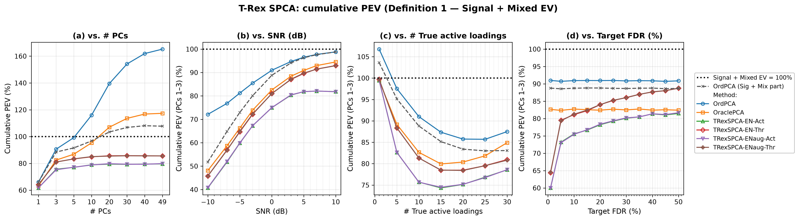
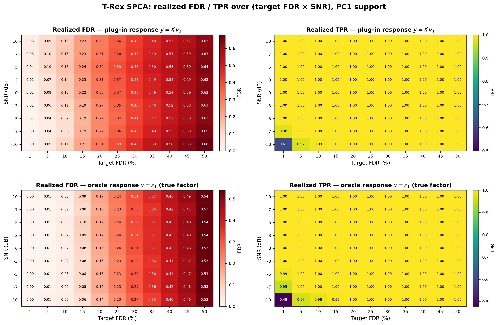

# Demo 02: Cumulative Explained Variance of T-Rex SPCA

## Purpose

While Demo 01 asks whether the false discovery rate (FDR) of the loading support is controlled, this demo asks two
 other questions. **What proportion of variance does the selected support actually explain, and where does a
 non-sparse method's apparent advantage come from?**

It runs all four sweeps of **Fig. 3** of [[1]](#references) — cumulative explained variance under the
 paper's Definition 1 — and reports the conventional total-variance normalization alongside it so the two can
 be compared directly.
The pairing is the point. Under one denominator ordinary principal component analysis (PCA) looks best, under the
 other its overshoot past 100 % exposes the variance it takes from null variables, and both readings are computed
 from the very same explained variance.

The Definition-1 denominator is the **Signal + Mixed explained variance (EV) of the data** — the variance carried by
 the true active variables, fixed per dataset and shared by all methods. This convention reproduces the published
 panels' qualitative behaviour (curves *rising* with the signal-to-noise ratio (SNR) from ≈40 %, ordinary PCA
 overshooting far past 100 %, the FDR-controlled methods staying below 100 %). An earlier revision of this demo
 instead normalized each method by its **own** Signal + Mixed EV ("Definition 1 as printed"), which is structurally
 ≥ 100 % for null-capturing methods and inverts the SNR trend — the published curves are unreachable under it.
 Digit-level coincidence with the paper's Fig. 3 remains impossible either way, because the paper's exact
 normalization cannot be reconstructed from its text (see [the dedicated section below](#relation-to-the-papers-fig-3)).

---

## Data Generation Parameters (`DataGenerator::generate_sparse_factor_model`)

The sparse $M$-factor model of [demo
 01](../demo_trex_spca_01_mc_sim/README.md#data-generation-parameters-datageneratorgenerate_sparse_factor_model),
 unchanged:

```math
\boldsymbol{X} = \boldsymbol{Z}\boldsymbol{V}^\top + \boldsymbol{E}
```

- $n = 50$, $p = 100$, $M = 3$ true factors, $\sigma_m \in \lbrace5, 3, 1\rbrace$.
- $p_1 = 10$ active loadings of value $0.9$ per factor, drawn without replacement from a **shared pool** of
   `overlap_pool_size` $= 30$ candidates, so factor supports partially coincide.
- All methods see the same **center-only** $\boldsymbol{X}$ (covariance-PCA footing).

---

## Control Parameters

```text
tFDR = 0.10           # Target FDR (swept in Part 4)
lambda_2 = -1         # < 0 selects the ridge penalty by k-fold CV (0 = none, > 0 = fixed)
scaling = L2          # Per-component selector scaling mode
MC = 200              # Monte Carlo repetitions per grid point
base_seed = 42        # Per-grid-point seed band, derived from the swept value
```

As in demo 01, only the **data** is seeded deterministically, while each trial's dummies come from hardware
 entropy, which is what makes the Monte Carlo estimate valid. A re-run therefore reproduces the committed
 numbers to within Monte Carlo noise, not exactly.

---

## Methods Compared

Identical to [demo 01](../demo_trex_spca_01_mc_sim/README.md#methods-compared): **OrdPCA**, **OraclePCA**, and the four
 Terminating Random Experiments (T-Rex) sparse principal component analysis (SPCA) variants crossing `TENET`/`TENET_AUG`
 with `ActiveSet`/`Thresholded`.

The metrics are those of [demo 01](../demo_trex_spca_01_mc_sim/README.md#metrics) — classical EV, corrected to the
 adjusted EV of [[3]](#references), reported as `PEV` (total-variance share), `PEVsig` (Definition 1) and `PEVsigmix`
 (the method's own Sig + Mix part, where OrdPCA's is the paper's "Ordinary PCA (Sig + Mix)" reference curve). As in demo
 01, realized FDR is evaluated on the support of the first principal component (PC1) only, and FDR *control* is assumed
 for PC1 only, because the overlapping factor supports make later components' ground truth ambiguous.

---

## The Sweeps

Each part varies **one** axis and holds the rest at their defaults, namely 3 extracted principal components (PCs),
 SNR $= 0$ dB, $p_1 = 10$ and $\mathrm{tFDR} = 0.10$.

| Part | Axis | Grid |
| --- | --- | --- |
| 1 | Number of **extracted** PCs | $\lbrace1, 3, 5, 10, 20, 30, 40, 49\rbrace$ |
| 2 | SNR (dB) | $\lbrace-10, -7, -5, -3, 0, 3, 5, 7, 10\rbrace$ |
| 3 | Number of true active loadings $p_1$ | $\lbrace1, 5, 10, 15, 20, 25, 30\rbrace$ |
| 4 | Target FDR | $\lbrace0.01, 0.05, 0.10, 0.15, \ldots, 0.50\rbrace$ |
| 5 | Realized FDR / true positive rate (TPR) **heatmaps** over the full target-FDR $\times$ SNR grid | $11 \times 9$ points, PC1 support, two selector responses |

Notes on the grids:

- **Part 1 varies only how many components are *extracted*.** The data keeps its $M = 3$ true factors
   throughout, so every component beyond the third is null by construction and can contribute nothing but
   Null EV. That is exactly what makes the panel diagnostic.
- **Part 1 stops at 49, not at 50.** $\boldsymbol{X}$ is centered, so
   $\operatorname{rank}(\boldsymbol{X}) \leq n - 1 = 49$ and a 50th component carries no variance at all —
   asking the per-PC selector to regress on that null direction throws outright, because its response vector
   is constant. 49 is the largest attainable PC count on an $n = 50$ design, not a safety margin.
- **Part 3 is bounded above by the overlap pool.** Each factor draws its support from a shared pool of 30
   candidates, so $p_1 \leq 30$.
- **Only the T-Rex variants respond to Part 4.** The two PCA baselines never see `tFDR`, so they are reported
   as flat reference lines.
- **Parts 2–4 are displayed as cumulative proportion of explained variance (PEV) only.** Their extraction is held at the
   $M = 3$ true factors, so what they show is the cumulative PEV of PCs 1–3 under both normalizations — the tables and
   figures carry nothing else. Support-recovery metrics belong to demo 01's sweep. Here they remain in the
   comma-separated values (CSV) files as the data record but are not displayed.
- **Part 5 is the support-recovery counterpart of Part 4**, run over the full 2D grid instead of the 0 dB slice, and
   only for PC1. Each trial runs the per-PC selector for grouped variable selection (GVS) with the elastic net (EN),
   T-Rex+GVS(EN), twice on the same data, once on the **plug-in response** $y = \boldsymbol{X} v_1$ (what T-Rex SPCA
   actually regresses on) and once on the **oracle response** $y = z_1$, the true factor scores. The pairing isolates
   the mechanism behind the FDR overshoot at loose targets — see the caveat section below.

---

## Output Files

Written to `simulation_results/data/`, one pair per sweep:

- `demo_trex_spca_02_mc_sim_pev_pcs.txt` / `.csv`
- `demo_trex_spca_02_mc_sim_pev_snr.txt` / `.csv`
- `demo_trex_spca_02_mc_sim_pev_loadings.txt` / `.csv`
- `demo_trex_spca_02_mc_sim_pev_tfdr.txt` / `.csv`
- `demo_trex_spca_02_mc_sim_pev_fdr_heatmap.csv` — Part 5 (`response,metric,tfdr,snr_db,value`)

The `pcs` table carries FDR, TPR, `PEV` (total-variance normalization), `PEVsig` (Definition 1) and
 `PEVsigmix` (the method's Sig + Mix part) per method, while the `snr`, `loadings` and `tfdr` **tables are
 restricted to the cumulative-PEV rows** (PCs 1–3). Every CSV still records all five metrics — the FDR
 caveat below reads its numbers from the `tfdr` CSV.

Figures in Portable Network Graphics (PNG) and Portable Document Format (PDF) go to `simulation_results/plots/`,
produced by `./generate_plots.sh`, which combines all four sweeps into one panel figure per normalization:

- `demo_trex_spca_02_mc_sim_pev_signal.png` — cumulative PEV under Definition 1.
- `demo_trex_spca_02_mc_sim_pev_total.png` — cumulative PEV as a share of the total variance.
- `demo_trex_spca_02_mc_sim_pev_fdr_heatmap.png` — Part 5: realized FDR / TPR heatmaps, both responses.

---

## Running the Demo

```bash
./build/release/bin/trex_selector_methods/ad/trex_spca/demo_trex_spca_02_mc_sim_pev/demo_trex_spca_02_mc_sim_pev
./generate_plots.sh   # render the figures below from the saved CSVs
```

`TREX_SPCA_NUM_MC=<k>` overrides the Monte Carlo count for quick pilot runs (e.g. `TREX_SPCA_NUM_MC=10`),
and `TREX_SPCA_PARTS` selects which parts run (default `12345`, while `TREX_SPCA_PARTS=5`, for example,
reruns only the FDR/TPR heatmap sweep).

The PC-count sweep is the most expensive part, because extracting 49 components means 49 independent T-Rex
selections per trial.

---

## Simulation Results

### Cumulative PEV under Definition 1

- **Panel (a) is the clearest statement in this suite.** The data has three true factors, so every component
   past the third can only add Null EV — and that is exactly what the curves show. Ordinary PCA climbs from
   $66.1\%$ at one PC past the $100\%$ line at about five PCs to $165.2\%$ at 49. By the time it has
   extracted 49 components it is reporting two thirds more variance than the true active variables carry.
   Its dashed Sig + Mix decomposition saturates at $107.8\%$ — everything between the solid and dashed
   curves is Null EV. OraclePCA reaches $117.3\%$ and even overtakes the dashed reference (crossover
   between 10 and 20 PCs). It is an oracle only about the support *size* $p_1$. A plausible reading is that on the
   components beyond the third, which carry no factor, its $\text{top-}p_1$ thresholding keeps mostly null variables
   (on average about 21 of the 100 variables are active) and the renormalization hands them full weight, so knowing
   the cardinality does not protect against thresholding noise. The four T-Rex variants flatten out by
   three-to-five PCs and stay there ($79.7\text{–}79.9\%$ `ActiveSet`, $85.5\text{–}85.6\%$ `Thresholded` at 49),
   declining to claim variance that is not theirs even when handed 46 components they do not need. The data do not
   record the supports on the extra components, so whether the selector returns (near-)empty supports there is not
   measured.
- **Panel (b) rises with SNR, as in the published Fig. 3(b).** At $-10$ dB the true active columns are
   dominated by noise that no 3-component method can capture, so everything sits low: $40.7\text{–}45.8\%$ for
   the T-Rex variants, $48.1\%$ for OraclePCA, $72.1\%$ for ordinary PCA. Ordinary PCA's dashed Sig + Mix curve
   sits at $51.7\%$ there, so $20.4$ points of its $24.0$-point lead over OraclePCA are Null EV. With rising SNR the
   `Thresholded` variants and OraclePCA converge toward the line ($92.9\text{–}93.0\%$ and $94.5\%$ at $+10$ dB), the
   `ActiveSet` variants level off near $82\%$ (the ridge-refit loadings' known variance gap), and ordinary PCA's
   solid and dashed curves merge at $98.8\%$ — at high SNR there is hardly any null variance left to harvest.
- **Panel (c) is non-monotone.** All methods start near
   $100\%$ at $p_1 = 1$ (ordinary PCA at $106.8\%$, again split by its dashed curve at $103.6\%$), sag to a
   minimum around $p_1 = 15\text{–}25$ ($74.3\text{–}74.5\%$ `ActiveSet`, $78.4\text{–}78.5\%$ `Thresholded`,
   $79.9\%$ OraclePCA, $85.7\%$ ordinary), and recover toward $p_1 = 30$. At $p_1 = 1$ the union of the factor
   supports holds at most three variables, and at $p_1 = 30$ every factor's support is the whole overlap pool, so
   the three supports coincide. The middle of the range is where support selection actually matters.
- **Panel (d) shows the price of a strict target.** The two ordinary-PCA references are `tFDR`-blind and sit flat
   ($90.9\%$ solid, $88.7\%$ dashed). The T-Rex variants pay most at the strictest target ($60.0\%$ `ActiveSet` /
   $64.4\text{–}64.5\%$ `Thresholded` at $\mathrm{tFDR} = 0.01$). The step to $\mathrm{tFDR} = 0.05$ adds
   $13.0\text{–}15.1$ points, and the range from $0.05$ to $0.50$ adds $8.3\text{–}9.4$ more ($75.6 \to 81.5\%$
   and $81.2 \to 88.7\%$ from $\mathrm{tFDR} = 0.10$ to $0.50$). Loosening the target buys captured variance
   slowly — and pays for it in realized FDR (see the caveat below).



### The same variance, normalized by the total variance

Read through the conventional denominator, the ranking of the methods stays the same, but nothing marks ordinary
PCA's surplus as Null EV, and the story becomes "sparsity costs variance":

- In panel (a) ordinary PCA rises to exactly $100.0\%$ at 49 PCs — with $n - 1 = 49$ components it spans the
   whole centered row space and reproduces the data completely. The T-Rex variants saturate at $48\text{–}52\%$
   after about five components and then stop, which is the same flatness as before seen from the other side.
   They add only $1.4\text{–}1.7$ points after five components.
- The gap between the two figures at $p_1 = 10$, 49 PCs is the whole argument in two numbers. Ordinary PCA
   explains $100\%$ of the total variance, and $165\%$ of the variance that belongs to the true active
   variables.


### Relation to the paper's Fig. 3

The paper's text does not pin down the normalization behind its plotted curves — no constructible
 denominator reproduces all published anchors, so digit-level agreement with Fig. 3 is not attainable from
 the paper alone. (A self-normalized reading of Definition 1 is ruled out entirely, because it is $\geq 100\%$ by
 construction for null-capturing methods and inverts the SNR trend.) This demo therefore uses the fixed
 active-column denominator throughout, which reproduces the figure's qualitative content, namely curves rising
 with SNR, ordinary PCA's Null-EV overshoot past $100\%$, the T-Rex variants staying below $100\%$, and the
 same ranking, read as a cost of sparsity under one normalization and as harvested Null EV under the other.

### A caveat on FDR at loose targets

Part 5 maps the realized FDR and TPR of PC1's support over the **full** (target FDR $\times$ SNR) grid — 200 Monte
 Carlo (MC) trials per cell, same datasets across each row's targets. The FDR panels show the realized FDR on a red
 scale from $0$, and whether a cell is in control is read against its column's target. Each configuration is run for two
 selector responses, and the pairing is a controlled test of the mechanism suspected behind the overshoot:

- **plug-in response** $y = \boldsymbol{X} v_1$ — the ordinary PC1, exactly what T-Rex SPCA regresses on.
   The regression's own true support is **dense** ($v_1$ is nonzero on every variable), while the scoring truth
   is the sparse factor-model support.
- **oracle response** $y = z_1$ — the true factor scores (unobservable in practice). Here the regression
   truth is no longer dense. The population regression of $z_1$ on $\boldsymbol{X}$ has its coefficients in the
   span of $\boldsymbol{V}$, so its support lies within the union of the factor supports and need not coincide with
   $\mathcal S_1$ while the supports overlap. Selector-level control and factor-model scoring therefore come much
   closer, though they need not coincide.



What the grid shows:

- **Under the plug-in response the realized FDR overshoots already at the strict targets, and from
   $\mathrm{tFDR} = 0.15$ at every SNR.**
   At $\mathrm{tFDR} = 0.05$ the realized FDR is $0.04\text{–}0.10$, above target at six of the nine SNR points, and
   at $0.10$ it is $0.08\text{–}0.15$, above target at $-10$ and $-3$ dB and from $0$ dB up (by at most $+0.05$).
   From $\mathrm{tFDR} = 0.15$ the exceedance is systematic at every SNR — $+0.04$ to $+0.09$ at $0.15$, growing
   to $+0.12$ to $+0.18$ at $0.50$ (realized $0.62\text{–}0.68$). The excess is present at every SNR, so low SNR is
   not its cause.
- **Under the oracle response most of the overshoot vanishes.** With the true factor
   as response, the realized FDR stays **at or below target through $\mathrm{tFDR} = 0.25$ at every
   SNR** (e.g. $0.06\text{–}0.10$ against $0.15$ and $0.14\text{–}0.17$ against $0.20$). From $0.30$ on the cells
   drift above target, five of nine by at most $+0.016$ at $0.30$ and all nine by $+0.03\text{–}0.04$ at $0.50$
   ($0.53\text{–}0.54$). The two responses share the data and the selector, so the comparison attributes the bulk
   of the plug-in overshoot to the response. A plausible reading is the **evaluation mismatch**, a dense-truth
   regression scored against a sparse truth, rather than a failure of the selector. A small overshoot remains at
   loose targets even under the oracle response, whose regression truth need not coincide with $\mathcal S_1$.
- **TPR is a non-issue except in the strict-target / low-SNR corner.** It is $\geq 0.95$ everywhere except
   at $\mathrm{tFDR} = 0.01$, $-10$ dB, where the selector keeps too few variables ($0.62$ plug-in, $0.48$
   oracle). Panel (d) runs at $0$ dB, where the PC1 TPR is $1.000$ even at $\mathrm{tFDR} = 0.01$, so its PEV dip
   at the strictest target does not come from this corner.

**Consequences.** At this suite's default $\mathrm{tFDR} = 0.10$ the realized PC1 FDR exceeds the target at several
   SNR points, by up to about $0.05$ ($0.152$ at $+5$ dB, both in the heatmap and in the FDR rows of the SNR sweep).
   Loosening the target is a poor trade under factor-model scoring, because from $0.10$ to $0.50$ it
   buys about six PEV points (panel (d), `ActiveSet`) while the realized factor-model FDR climbs roughly
   linearly to $\approx 0.62\text{–}0.68$.
The general lesson is the conditional nature of the guarantee.
 **T-Rex SPCA controls the FDR of the regression it is handed, and that transfers to the factor model
 only insofar as the plug-in PC is a faithful proxy for the factor** (see also demo 01's union-FDR
 section for the same condition read across components).

---

## References

1. Machkour, J., Breloy, A., Muma, M., Palomar, D. P., & Pascal, F., "Sparse PCA with False Discovery Rate Controlled
   Variable Selection.", IEEE International Conference on Acoustics, Speech and Signal Processing (ICASSP), 2024,
   pp. 9716–9720, IEEE.
   [DOI-Link](https://doi.org/10.1109/ICASSP48485.2024.10448237)
2. Machkour, J., Muma, M., & Palomar, D. P., "False Discovery Rate Control for Grouped Variable Selection
   in High-Dimensional Linear Models using the T-Knock Filter.", European Signal Processing Conference (EUSIPCO), 2022,
    pp. 892–896, European Association for Signal Processing (EURASIP).
    [DOI-Link](https://doi.org/10.23919/EUSIPCO55093.2022.9909883)
3. Zou, H., Hastie, T., & Tibshirani, R., "Sparse Principal Component Analysis.", Journal of Computational
   and Graphical Statistics, vol. 15, no. 2, 2006, pp. 265–286, Taylor & Francis.
   [DOI-Link](https://doi.org/10.1198/106186006X113430)
