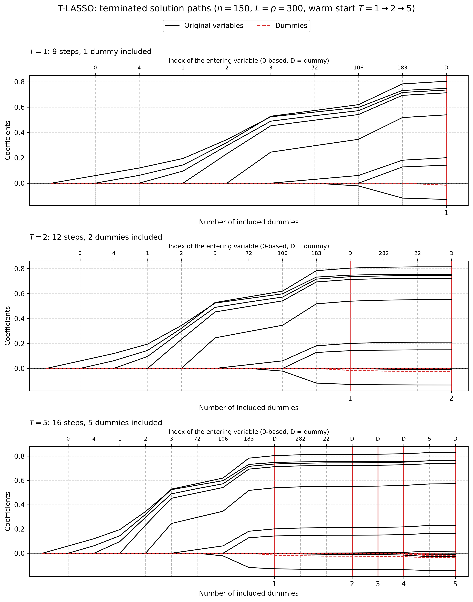

# Demo: T-LASSO Solver

## Purpose

This demo runs the terminating least absolute shrinkage and selection operator (T-LASSO) solver on its own, outside the
T-Rex selector. It follows the T-LARS path and adds the lasso modification, which removes a variable from the active set
when its coefficient crosses zero (a drop), so the path is the exact lasso path.

The demo has five parts:

1. early stopping with internal normalization, for $p > n$ and $n > p$,
2. the same data normalized outside the solver,
3. a checkpoint saved to disk, reloaded and continued,
4. data memory-mapped from disk,
5. terminated solution paths of one warm-started object, drawn as a figure.

---

## Key idea

A terminating solver does not compute the whole path. It stops once $T$ dummies have entered the active set:

```math
\hat{\boldsymbol{\beta}}^{(T)} = \mathrm{TLASSO}(\mathbf{X}, \mathbf{D}, \mathbf{y}; T).
```

The demo calls

```cpp
executeStep(T_stop, /*early_stop=*/true)
```

and the path stops as soon as the number of active dummies reaches `T_stop`.

---

## Running the demo

From the repository root, after `cmake --preset release && cmake --build --preset release-build` in `cpp/`:

```bash
cpp/build/release/bin/tsolvers/ad/demo_ts_02_tlasso/demo_ts_02_tlasso        # Parts 1-5
cpp/build/release/bin/tsolvers/ad/demo_ts_02_tlasso/demo_ts_02_tlasso 1 2 3  # Parts 1 to 3, as below
cpp/build/release/bin/tsolvers/ad/demo_ts_02_tlasso/demo_ts_02_tlasso 5      # Part 5 only
cpp/tsolvers/ad/demo_ts_02_tlasso/generate_plots.sh                          # path figure from the Part 5 data
```

The optional arguments select the parts to run. Part 4 writes about 44 GB of temporary files, so `1 2 3` and `5` leave
it out. `generate_plots.sh` uses the repository's `.venv` and writes the figure as Portable Network Graphics (PNG)
and Portable Document Format (PDF) files to `simulation_results/plots/`. The output below is a run against
library b95b984.

---

## Console walk-through

### Part 1: early stopping

Part 1 draws $n = 1{,}000$ observations of $p = 5{,}000$ variables and then $n = 5{,}000$ observations of $p = 1{,}000$
variables, each time with $L = 10p$ standard normal dummies (seed 42). Five true coefficients equal to 1 sit on the
variables 4, 27, 149, 398 and 420, and `snr = 1` gives a noise standard deviation of about 2.2. T-LASSO centers and
scales the data itself (`.normalize = true, .intercept = true`) and runs to $T = 10$.

```text
============================================================
Demo 1: Basic T-LASSO with Early Stopping
============================================================
High-dimensional (p > n)
Configuration:
  n = 1000, p = 5000
  num_dummies = 50000
  T_stop = 10
  True support size = 5
  True support: 27 149 398 420 4
  True coefficients: 1 1 1 1 1
  SNR = 1

[Info] TLASSO sequence
  Samples (n): 1000
  Features (p): 55000 (5000 real + 50000 dummies)
  Max steps: 7992

Selection:
  Predictors: {149, 398, 27, 420, 4}
  Dummies: {50753, 35807, 8104, 27720, 34444, 37521, 13891, 8333, 12185, 14004}
  Path: [+v149, +v398, +v27, +v420, +v4, +D45753, +D30807, +D3104, +D22720, +D29444, +D32521, +D8891, +D3333, +D7185, +D9004]

Selection Quality:
  True Positives:  5
  False Positives: 0
  False Negatives: 0
  FDP:             0
  TPP:             1
  Precision:       1
  Recall:          1
  F1 Score:        1

T-LASSO Diagnostics:
  Removals: 0
  Cycling ratio: 0.0000

============================================================
Demo 1: Basic T-LASSO with Early Stopping
============================================================
Low-dimensional (n > p)
Configuration:
  n = 5000, p = 1000
  num_dummies = 10000
  T_stop = 10
  True support size = 5
  True support: 27 149 398 420 4
  True coefficients: 1.0000 1.0000 1.0000 1.0000 1.0000
  SNR = 1.0000

[Info] TLASSO sequence
  Samples (n): 5000
  Features (p): 11000 (1000 real + 10000 dummies)
  Max steps: 39992

Selection:
  Predictors: {149, 27, 420, 398, 4}
  Dummies: {1358, 9675, 5174, 5655, 3412, 3702, 9011, 9141, 4658, 7113}
  Path: [+v149, +v27, +v420, +v398, +v4, +D358, +D8675, +D4174, +D4655, +D2412, +D2702, +D8011, +D8141, +D3658, +D6113]

Selection Quality:
  True Positives:  5
  False Positives: 0
  False Negatives: 0
  FDP:             0.0000
  TPP:             1.0000
  Precision:       1.0000
  Recall:          1.0000
  F1 Score:        1.0000

T-LASSO Diagnostics:
  Removals: 0
  Cycling ratio: 0.0000
```

T-LASSO takes the same 15 steps as T-LARS in both cases, because no coefficient crosses zero before the tenth dummy. The
five true variables enter first and ten dummies follow, so the selection is exactly the true support, with a false
discovery proportion (FDP) of 0 and a true positive proportion (TPP) of 1.

The `Dummies` line counts the columns of the combined matrix $[\mathbf{X}, \mathbf{D}]$ from 0, while the `Path` line
numbers the dummies on their own, so column `50753` is dummy `D45753`, because the $p = 5{,}000$ columns of $\mathbf{X}$
come first. The step limit `Max steps` is $8 \min(n - 1, p + L)$, because the intercept takes one degree of freedom,
which gives 7,992 and 39,992.

### Part 2: external normalization

Part 2 uses the same data but centers and scales $\mathbf{X}$ and $\mathbf{D}$ outside the solver with `LpNormScaler`
(unit $L_2$ norm) and centers $\mathbf{y}$. T-LASSO then runs without its own normalization and intercept
(`.normalize = false, .intercept = false`). The part starts with the case $n > p$.

```text
============================================================
=== Demo 2: T-LASSO with External Normalization ===
============================================================
Low-dimensional (n > p)
Configuration:
  n = 5000, p = 1000
  num_dummies = 10000
  T_stop = 10
  True support size = 5
  True support: 4 27 149 398 420
  True coefficients: 1.0000 1.0000 1.0000 1.0000 1.0000
  SNR = 1.0000

Applying external L2 normalization...
[Info] TLASSO sequence
  Samples (n): 5000
  Features (p): 11000 (1000 real + 10000 dummies)
  Max steps: 40000

Selection:
  Predictors: {149, 27, 420, 398, 4}
  Dummies: {1358, 9675, 5174, 5655, 3412, 3702, 9011, 9141, 4658, 7113}
  Path: [+v149, +v27, +v420, +v398, +v4, +D358, +D8675, +D4174, +D4655, +D2412, +D2702, +D8011, +D8141, +D3658, +D6113]

Selection Quality:
  True Positives:  5
  False Positives: 0
  False Negatives: 0
  FDP:             0.0000
  TPP:             1.0000
  Precision:       1.0000
  Recall:          1.0000
  F1 Score:        1.0000

T-LASSO Diagnostics:
  Removals: 0
  Cycling ratio: 0.0000
```

The selection and the path equal those of Part 1, and the case $p > n$ that follows repeats the Part 1 path as well. So
the external normalization and the internal one lead to the same solver run. Only the step limit changes to 40,000 and
8,000, because the data are not marked as precentered and the solver takes the rank as $n$ instead of $n - 1$.

### Part 3: checkpoint and warm start

Part 3 uses a small problem with $n = 100$, $p = 50$, $L = 50$ and the three true coefficients 2.5, −1.8 and 3.2 on the
variables 10, 25 and 40. It scales the data once in front, and three solvers read the same buffers without copies. A
reference solver runs to $T = 15$. A second solver runs to $T = 7$ and saves its state to `tlasso_checkpoint.bin`, and a
third one loads that file and continues to $T = 15$.

```text
============================================================
=== Demo 3: T-LASSO Serialization & Path Consistency ===
============================================================
Configuration:
  n = 100, p = 50
  num_dummies = 50
  T_stop = 15
  True support size = 3
  True support: 10 25 40
  True coefficients: 2.5000 -1.8000 3.2000
  SNR = 1.0000

✓ Reference completed with 32 steps

Checkpoint at partial stop: 19 steps
✓ Checkpoint saved at 'tlasso_checkpoint.bin'
Loaded from checkpoint: 19 steps

COMPARISON:
Reference steps: 32
Reloaded steps:  32
RSS diff:   0.0000
R2 diff:    0.0000
✓ Paths match

T-LASSO Diagnostics:
  Removals: 0
  Cycling ratio: 0.0000
✓ Checkpoint file removed
```

The checkpoint holds the first 19 steps, up to $T = 7$. The reloaded solver continues to the same 32 steps as the
reference, with differences of exactly 0 in the residual sum of squares (RSS) and in $R^2$ and the same actions. T-LARS
needs the same 32 steps on this data. Writers would not work here, because each of them centers and scales the buffers
in place, and a second writer on a held buffer raises an error under the in-place contract of the library.

### Part 4: memory-mapped data

Part 4 generates $n = 1{,}000$ observations of $p = 500{,}000$ variables with $L = 10p = 5{,}000{,}000$ dummies directly
on disk, about 44 GB, and runs T-LASSO as a writer on memory-mapped views of the files to $T = 10$. It then removes the
files. Its output has the form of Part 1, and it is left out here because of the disk space and the time it takes.

### Part 5: terminated solution paths

Part 5 repeats the quick start of the R tlars vignette. With $n = 150$, $p = 300$, five true coefficients equal to 1 and
$L = p = 300$ dummies, one T-LASSO object runs to $T = 1$ and is then warm-started to $T = 2$ and $T = 5$. Each call
continues the stored path, and a snapshot of the path after each call goes to `simulation_results/data/`. The setting
`snr = 5` gives a noise standard deviation of about 1, as in the vignette.

```text
=== Demo 5: T-LASSO Terminated Solution Paths ===
============================================================
Configuration:
  n = 150, p = 300
  num_dummies = 300
  T_stop = 5
  True support size = 5
  True support: 0 1 2 3 4
  True coefficients: 1 1 1 1 1
  SNR = 5

T_stop = 1: steps =  9, predictors =  8, dummies = 1, FDP = 0.375, TPP = 1.000
T_stop = 2: steps = 12, predictors = 10, dummies = 2, FDP = 0.500, TPP = 1.000
T_stop = 5: steps = 16, predictors = 11, dummies = 5, FDP = 0.545, TPP = 1.000

Selection:
  Predictors: {0, 4, 1, 2, 3, 72, 106, 183, 282, 22, 5}
  Dummies: {564, 399, 355, 321, 383}
  Path: [+v0, +v4, +v1, +v2, +v3, +v72, +v106, +v183, +D264, +v282, +v22, +D99, +D55, +D21, +v5, +D83]

Path data written to:
  .../cpp/tsolvers/ad/demo_ts_02_tlasso/simulation_results/data/tlasso_terminated_paths_path.csv
  .../cpp/tsolvers/ad/demo_ts_02_tlasso/simulation_results/data/tlasso_terminated_paths_actions.csv
```

The path equals the T-LARS path of [demo_ts_01_tlars](../demo_ts_01_tlars/README.md) to the last digit. The lasso
modification drops a variable whose coefficient crosses zero, and no coefficient changes sign before the fifth dummy, so
T-LASSO never drops a variable and takes the same 16 steps. The five true variables enter first, and three false ones
follow before the first dummy. The TPP stays at 1 while the FDP grows from 0.375 to 0.545. The figure shows the three
snapshots. Original variables are black, dummies red and dashed, a red vertical line marks each included dummy, and the
top axis names the variable that enters at each step.



---

## Technical notes

- Part 3 writes the checkpoint `tlasso_checkpoint.bin` into the working directory and removes it after the
  comparison.
- Part 4 writes $\mathbf{X}$, $\mathbf{D}$ and $\mathbf{y}$ into three temporary files of about 44 GB in total in the
  working directory, runs the solver on memory-mapped views and removes the files at the end.
- The path data and figures under `simulation_results/` are committed, so the figure is visible without a run.
