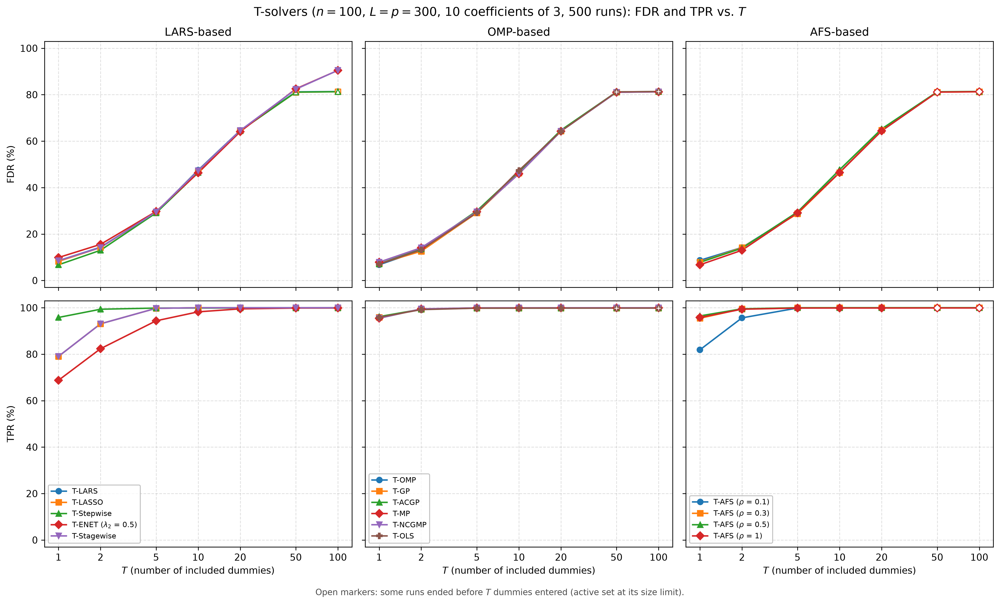
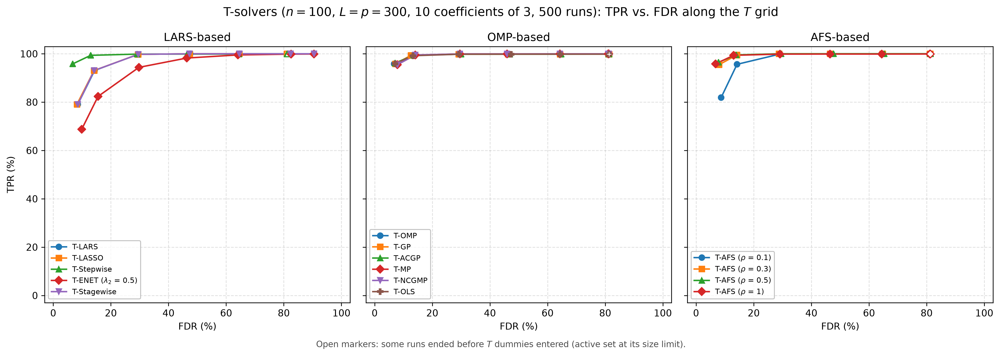
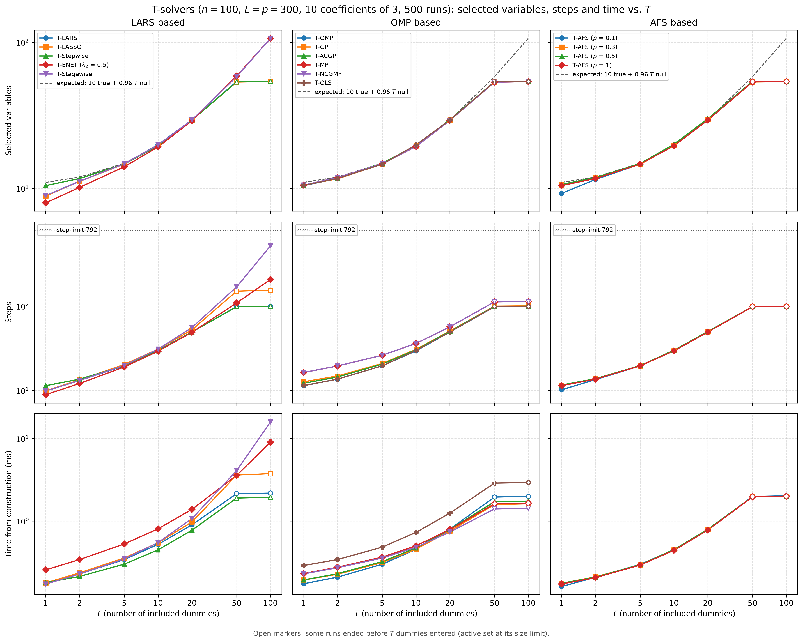
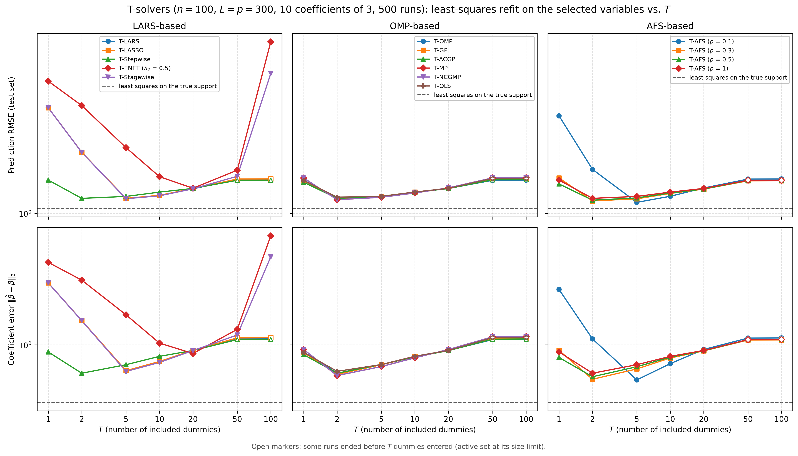

# Demo: FDR and TPR of the T-Solvers vs. T

## Purpose

This demo compares the terminated solution paths of all demo T-solvers by their false discovery rate (FDR) and true
positive rate (TPR) as the number $T$ of included dummies grows. It repeats the simulation study of the R tlars
vignette, runs it for every solver on the same data, and warm-starts each solver along the $T$ grid instead of
fitting every $T$ from scratch. A least-squares refit on the selected variables then shows which $T$ gives the best
estimate.

---

## Setup

- $n = 100$ observations and $p = 300$ variables with independent standard normal entries,
- ten true coefficients equal to 3 on a fixed random support, noise standard deviation about 1 (`snr = 90`),
- $L = p = 300$ standard normal dummies, drawn fresh in every run,
- $T \in \lbrace 1, 2, 5, 10, 20, 50, 100 \rbrace$ and 500 Monte Carlo runs,
- a fresh test set of 1,000 rows per run for the refit.

Each run centers and scales $\mathbf{X}$ and $\mathbf{D}$ and centers $\mathbf{y}$ once, and hands them to all 15
solver configurations as readers. These are the 12 solvers of the solver demos with their demo settings (T-ENET with
$\lambda_2 = 0.5$, T-NCGMP in its line-search variant) and T-AFS for $\rho \in \lbrace 0.1, 0.3, 0.5, 1 \rbrace$.
The readers are marked `precentered`: the centered design has rank $n - 1$, so the active sets stop at $n - 1 = 99$
variables, as with a fitted intercept (T-ENET with $\lambda_2 > 0$ runs without this cap).

A variable counts as selected when its coefficient is nonzero, as in the T-Rex selector and the vignette. With the
selected set $\widehat{\mathcal{A}}$ and the true support $\mathcal{A}$, the false discovery proportion (FDP) and the
true positive proportion (TPP) of a run are

```math
\mathrm{FDP} = \frac{\lvert \widehat{\mathcal{A}} \setminus \mathcal{A} \rvert}
{\max(1, \lvert \widehat{\mathcal{A}} \rvert)},
\qquad
\mathrm{TPP} = \frac{\lvert \widehat{\mathcal{A}} \cap \mathcal{A} \rvert}{\max(1, \lvert \mathcal{A} \rvert)},
```

and FDR and TPR are their means over the runs.

---

## Running the demo

From the repository root, after `cmake --preset release && cmake --build --preset release-build` in `cpp/`:

```bash
cpp/build/release/bin/tsolvers/ad/demo_ts_perf_01_fdr_tpr_vs_T/demo_ts_perf_01_fdr_tpr_vs_T         # 500 runs, 6 threads
cpp/build/release/bin/tsolvers/ad/demo_ts_perf_01_fdr_tpr_vs_T/demo_ts_perf_01_fdr_tpr_vs_T 20 8    # 20 runs, 8 threads
cpp/tsolvers/ad/demo_ts_perf_01_fdr_tpr_vs_T/generate_plots.sh                                       # figures
```

The two optional arguments are the number of runs and of threads. The runs are spread over the threads, and each
solver runs single-threaded inside its run. The 500 runs take about 7 s on an Apple Silicon machine with 6 threads.
The result files carry the number of runs in their name (`fdr_tpr_vs_T_mc500.csv` and `.txt`), so a short test run
does not overwrite the full one. The output below is a run against library b95b984, and its T-Stagewise rows come
from a rerun of that solver alone against library 09debc6 with the same seeds. The data are drawn with
`std::mt19937` and `std::normal_distribution`, and run $k$ uses the seed $1{,}000 + k$, so the results do not depend
on the number of threads. Another standard library, such as libstdc++ on Linux, may draw different data.

---

## Console walk-through

### FDR and TPR

```text
n = 100, p = 300, L = p = 300, true coefficients: 10 x 3, SNR = 90
True support: 34 48 63 67 76 128 138 162 191 278
T grid: 1 2 5 10 20 50 100
15 solvers, 500 runs on 6 threads

FDR (%)
solver                     T=1     T=2     T=5    T=10    T=20    T=50   T=100
------------------------------------------------------------------------------
T-LARS                     8.5    14.3    29.4    47.5    64.6    81.2    81.3
T-LASSO                    8.2    14.2    29.4    47.3    64.5    81.0    81.3
T-Stepwise                 6.8    13.0    29.1    46.5    64.4    81.1    81.3
T-ENET (lambda2 0.5)       9.9    15.6    29.7    46.3    64.1    82.5    90.5
T-Stagewise                8.5    14.2    29.5    47.3    64.6    82.4    90.5
T-OMP                      6.8    13.0    29.1    46.5    64.4    81.1    81.3
T-GP                       7.2    12.6    29.1    46.3    64.3    81.1    81.3
T-ACGP                     7.1    13.5    30.0    46.9    64.7    81.2    81.3
T-MP                       7.9    14.1    29.6    45.9    64.3    81.0    81.2
T-NCGMP                    7.9    14.1    29.6    45.9    64.3    81.0    81.2
T-OLS                      7.0    13.2    29.2    47.4    64.3    81.2    81.4
T-AFS (rho 0.1)            8.7    14.2    29.1    46.6    64.4    81.2    81.3
T-AFS (rho 0.3)            7.9    14.1    28.8    46.4    64.7    81.1    81.3
T-AFS (rho 0.5)            7.8    13.9    29.5    47.7    65.3    81.2    81.4
T-AFS (rho 1)              6.8    13.0    29.1    46.5    64.4    81.1    81.3

TPR (%)
solver                     T=1     T=2     T=5    T=10    T=20    T=50   T=100
------------------------------------------------------------------------------
T-LARS                    79.1    93.1    99.8   100.0   100.0   100.0   100.0
T-LASSO                   79.1    93.1    99.8   100.0   100.0   100.0   100.0
T-Stepwise                95.8    99.4    99.9    99.9    99.9    99.9    99.9
T-ENET (lambda2 0.5)      68.8    82.4    94.4    98.2    99.5    99.9    99.9
T-Stagewise               79.1    93.1    99.8   100.0   100.0   100.0   100.0
T-OMP                     95.8    99.4    99.9    99.9    99.9    99.9    99.9
T-GP                      95.9    99.4    99.8    99.8    99.9    99.9    99.9
T-ACGP                    96.2    99.4    99.8    99.8    99.8    99.9    99.9
T-MP                      95.5    99.5    99.9    99.9   100.0   100.0   100.0
T-NCGMP                   95.5    99.5    99.9    99.9   100.0   100.0   100.0
T-OLS                     95.9    99.2    99.8    99.8    99.8    99.8    99.8
T-AFS (rho 0.1)           81.9    95.6    99.9   100.0   100.0   100.0   100.0
T-AFS (rho 0.3)           95.5    99.5   100.0   100.0   100.0   100.0   100.0
T-AFS (rho 0.5)           96.5    99.5   100.0   100.0   100.0   100.0   100.0
T-AFS (rho 1)             95.8    99.4    99.9    99.9    99.9    99.9    99.9
```

At $T = 1$ every solver keeps the FDR between 6.8% and 9.9%, and the TPR separates the families. The solvers that
refit by least squares after each entry (T-Stepwise, the orthogonal matching pursuit (OMP) family and T-AFS for
$\rho \ge 0.3$) find 95.5% to 96.5% of the true variables. T-LARS, T-LASSO and T-Stagewise find 79.1%, T-ENET 68.8%,
and T-AFS at $\rho = 0.1$ sits close to its least-angle regression (LARS) end at 81.9%.

As $T$ grows, the FDR rises alike for all solvers, to about 29% at $T = 5$, 47% at $T = 10$ and 64%
at $T = 20$. This follows from the exchangeability of null variables and dummies. The 290 null variables and the 300
dummies are independent standard normal columns that carry no information about $\mathbf{y}$, so a solver cannot tell
them apart, and every order in which they enter the path is equally likely. When the $T$-th dummy enters, the number
$V_T$ of null variables that entered before it follows a negative hypergeometric distribution with mean

```math
\mathbb{E}[V_T] = \frac{p - s}{L + 1}\,T = \frac{290}{301}\,T \approx 0.96\,T.
```

With $s = 10$ true variables that are nearly always found, a path holds about $10 + 0.96\,T$ variables, which matches
the tables. At $T = 20$, for example, the OMP paths hold 29.3 variables, 19.3 of them null against the expected 19.3.
This is the idea behind the T-Rex selector. The included dummies count the null variables that entered, so they
estimate the false discoveries of a path. The TPR reaches 100% by $T = 5$ for most solvers. A single terminated path
therefore trades FDR against TPR through $T$, and the T-Rex selector controls the FDR by averaging many such paths
with a calibrated $T$ and $L$.

### Paths that end early

```text
Runs that reached T dummies (%)
solver                     T=1     T=2     T=5    T=10    T=20    T=50   T=100
------------------------------------------------------------------------------
T-LARS                     100     100     100     100     100      15       0
T-LASSO                    100     100     100     100     100      18       0
T-Stepwise                 100     100     100     100     100      16       0
T-ENET (lambda2 0.5)       100     100     100     100     100     100     100
T-Stagewise                100     100     100     100     100     100     100
T-OMP                      100     100     100     100     100      16       0
T-GP                       100     100     100     100     100      19       0
T-ACGP                     100     100     100     100     100      14       0
T-MP                       100     100     100     100     100      18       0
T-NCGMP                    100     100     100     100     100      18       0
T-OLS                      100     100     100     100     100      16       0
T-AFS (rho 0.1)            100     100     100     100     100      16       0
T-AFS (rho 0.3)            100     100     100     100     100      16       0
T-AFS (rho 0.5)            100     100     100     100     100      15       0
T-AFS (rho 1)              100     100     100     100     100      16       0

Average number of selected variables
solver                     T=1     T=2     T=5    T=10    T=20    T=50   T=100
------------------------------------------------------------------------------
T-LARS                     8.9    11.2    14.7    19.9    29.3    53.7    54.0
T-LASSO                    8.8    11.1    14.7    19.8    29.3    53.3    53.8
T-Stepwise                10.4    11.7    14.6    19.5    29.3    53.4    53.7
T-ENET (lambda2 0.5)       7.9    10.1    14.0    19.2    28.9    58.6   106.1
T-Stagewise                8.9    11.2    14.7    19.8    29.4    58.0   106.3
T-OMP                     10.4    11.7    14.6    19.5    29.3    53.4    53.7
T-GP                      10.5    11.6    14.6    19.5    29.3    53.5    53.8
T-ACGP                    10.5    11.7    14.8    19.6    29.5    53.6    53.9
T-MP                      10.5    11.8    14.7    19.3    29.2    53.2    53.6
T-NCGMP                   10.5    11.8    14.7    19.3    29.2    53.2    53.6
T-OLS                     10.5    11.7    14.6    19.8    29.3    53.6    53.9
T-AFS (rho 0.1)            9.2    11.5    14.6    19.6    29.3    53.6    53.8
T-AFS (rho 0.3)           10.6    11.8    14.6    19.6    29.5    53.4    53.7
T-AFS (rho 0.5)           10.6    11.8    14.7    20.0    29.9    53.7    54.0
T-AFS (rho 1)             10.4    11.7    14.6    19.5    29.3    53.4    53.7
```

The readers are precentered, so the active set of most solvers is capped at the rank $n - 1 = 99$ of the centered
design, dummies included. At $T = 50$ only 14% to 19% of the runs reach 50 dummies before the cap, and no run reaches
100. The paths then end with about 54 original variables and 45 dummies, and the FDR stays at about 81%. The open
markers in the figures show these $T$ values. T-NCGMP stops by the rules of T-MP and ends exactly like it.

Two solvers go further. T-ENET reaches 100 dummies in every run, because an elastic-net path with $\lambda_2 > 0$ may
hold more than $n$ variables, as in the algorithm of Zou and Hastie (2005). It ends at an FDR of 90.5% with about 106
selected variables. T-Stagewise freezes the variables it drops from the active set, and a frozen variable keeps its
coefficient, so its support grows past the cap while its active set stays at the cap. The dummies of the support count
toward $T$, so T-Stagewise reaches 50 dummies in every run and 100 dummies in 499 of the 500 runs. Its selection matches
the expected $10 + 0.96\,T$ with 58.0 variables at $T = 50$ and 106.3 at $T = 100$, more than $n$, and like T-ENET
it ends at an FDR of 90.5%. The cap still costs it steps, because its path cycles through drops and re-entries once the
active set is full. It needs 55.6 steps to reach $T = 20$, close to the 49 to 57 of the other solvers, but 168.5 to
reach $T = 50$ and 514.9 to reach $T = 100$, against 108.8 and 206.5 for T-ENET. On average it stays well below its
step limit of $8 \cdot 99 = 792$.

### Steps and run time

```text
Average number of steps
solver                     T=1     T=2     T=5    T=10    T=20    T=50   T=100
------------------------------------------------------------------------------
T-LARS                     9.9    13.2    19.7    29.9    49.3    98.5    99.0
T-LASSO                    9.9    13.4    20.4    30.9    52.4   150.1   153.9
T-Stepwise                11.4    13.7    19.6    29.5    49.3    98.3    99.0
T-ENET (lambda2 0.5)       8.9    12.1    19.0    29.2    48.9   108.8   206.5
T-Stagewise                9.9    13.2    19.9    30.9    55.6   168.5   514.9
T-OMP                     11.4    13.7    19.6    29.5    49.3    98.3    99.0
T-GP                      12.7    14.9    20.9    30.8    50.6    99.6   100.3
T-ACGP                    12.2    14.5    20.6    30.4    50.2    99.2    99.7
T-MP                      16.4    19.6    26.2    36.1    56.9   112.1   113.0
T-NCGMP                   16.4    19.6    26.2    36.1    56.9   112.1   113.0
T-OLS                     11.5    13.7    19.6    29.8    49.3    98.5    99.0
T-AFS (rho 0.1)           10.2    13.5    19.6    29.6    49.3    98.5    99.0
T-AFS (rho 0.3)           11.6    13.8    19.6    29.6    49.5    98.5    99.0
T-AFS (rho 0.5)           11.6    13.8    19.7    30.0    49.9    98.5    99.0
T-AFS (rho 1)             11.4    13.7    19.6    29.5    49.3    98.3    99.0

Average time from construction to T (ms, cumulative)
solver                     T=1     T=2     T=5    T=10    T=20    T=50   T=100
------------------------------------------------------------------------------
T-LARS                    0.17    0.23    0.34    0.52    0.90    2.14    2.18
T-LASSO                   0.18    0.23    0.35    0.54    0.97    3.61    3.75
T-Stepwise                0.18    0.21    0.30    0.45    0.77    1.90    1.93
T-ENET (lambda2 0.5)      0.25    0.34    0.53    0.80    1.38    3.58    9.06
T-Stagewise               0.17    0.23    0.35    0.55    1.07    4.08   15.98
T-OMP                     0.17    0.21    0.30    0.45    0.80    1.95    1.99
T-GP                      0.19    0.23    0.31    0.45    0.75    1.59    1.61
T-ACGP                    0.19    0.23    0.32    0.47    0.79    1.71    1.74
T-MP                      0.23    0.27    0.36    0.50    0.79    1.61    1.65
T-NCGMP                   0.23    0.27    0.35    0.48    0.73    1.40    1.43
T-OLS                     0.29    0.34    0.48    0.73    1.24    2.88    2.92
T-AFS (rho 0.1)           0.16    0.21    0.30    0.45    0.79    1.98    2.01
T-AFS (rho 0.3)           0.17    0.21    0.29    0.45    0.78    1.97    2.00
T-AFS (rho 0.5)           0.17    0.21    0.29    0.45    0.79    1.97    2.00
T-AFS (rho 1)             0.17    0.20    0.29    0.44    0.77    1.96    2.00
```

Up to $T = 20$, where every path still reaches its $T$, a whole warm-started path takes 0.7 to 1.4 ms for every
solver, and T-OMP needs about 0.8 ms. T-OLS belongs to this group, because the library scores its candidates in one
pass per step, and needs about 1.2 ms to $T = 20$ and 2.9 ms to $T = 100$. T-Stagewise needs about 1.1 ms to $T = 20$,
and its time grows to 4.1 ms at $T = 50$ and 16.0 ms at $T = 100$, the most of all solvers, while its path cycles
through drops and re-entries at the cap for 168.5 and 514.9 steps on average. T-LASSO shows the same effect more
mildly, with 150 steps at $T = 50$ against about 99 for T-LARS. The times at $T = 50$ and 100 therefore describe the
saturated regime rather than the solvers. They are measured inside the parallel loop and serve for comparison only.

The OMP family shows how the cost of a step depends on the length of the path. Up to $T = 10$ T-OMP is as fast as
gradient pursuit (T-GP) and approximate conjugate gradient pursuit (T-ACGP) or faster (0.17 against 0.19 ms at
$T = 1$), the three meet around $T = 20$, and on the long paths to $T = 50$ and 100, about 99 steps, T-GP needs
1.59 ms and T-ACGP 1.71 ms against 1.95 ms for T-OMP. The correlation scan over all $p + L = 600$ columns costs every
solver the same, while the incremental Cholesky update of T-OMP grows with the number $k$ of active columns. The
gradient pursuits save that update and pay with about one extra step, so they gain only once $k$ approaches $n$. That
is the regime in which Blumensath and Davies (2008) introduced them as faster alternatives to OMP, the full solution
path, while T-Rex stops its paths early. Matching pursuit, which skips the refit altogether, is cheaper still on the
long paths (T-MP 1.61 ms and T-NCGMP 1.40 ms at $T = 50$).

### Least-squares refit on the selected variables

After each $T$, the demo drops the dummies from the selection, fits least squares with an intercept on the selected
original variables of the unscaled data, and scores the fit on a fresh test set of 1,000 rows. The refit on the true
support is the reference, with a prediction root mean squared error (RMSE) of 1.06 against the noise level
$\sigma \approx 1$ and a coefficient error of 0.32.

```text
Prediction RMSE of the least-squares refit on the selected variables (test set)
solver                     T=1     T=2     T=5    T=10    T=20    T=50   T=100
------------------------------------------------------------------------------
T-LARS                    3.71    2.13    1.20    1.25    1.36    1.52    1.53
T-LASSO                   3.71    2.13    1.20    1.25    1.36    1.53    1.53
T-Stepwise                1.51    1.20    1.23    1.30    1.36    1.51    1.51
T-ENET (lambda2 0.5)      5.17    3.82    2.26    1.58    1.36    1.71    8.43
T-Stagewise               3.71    2.13    1.20    1.24    1.35    1.58    5.69
T-OMP                     1.51    1.20    1.23    1.30    1.36    1.51    1.51
T-GP                      1.50    1.20    1.23    1.30    1.36    1.53    1.53
T-ACGP                    1.47    1.20    1.23    1.30    1.36    1.51    1.52
T-MP                      1.55    1.18    1.22    1.29    1.37    1.55    1.56
T-NCGMP                   1.55    1.18    1.22    1.29    1.37    1.55    1.56
T-OLS                     1.50    1.22    1.23    1.30    1.36    1.54    1.55
T-AFS (rho 0.1)           3.36    1.72    1.14    1.23    1.37    1.53    1.53
T-AFS (rho 0.3)           1.55    1.17    1.20    1.28    1.35    1.50    1.50
T-AFS (rho 0.5)           1.44    1.18    1.21    1.29    1.35    1.50    1.51
T-AFS (rho 1)             1.51    1.20    1.23    1.30    1.36    1.51    1.51

Coefficient error of the refit, ||beta_hat - beta||_2
solver                     T=1     T=2     T=5    T=10    T=20    T=50   T=100
------------------------------------------------------------------------------
T-LARS                    3.33    1.60    0.60    0.72    0.89    1.13    1.14
T-LASSO                   3.33    1.60    0.60    0.72    0.90    1.14    1.15
T-Stepwise                0.87    0.57    0.68    0.80    0.89    1.11    1.11
T-ENET (lambda2 0.5)      4.97    3.52    1.79    1.03    0.84    1.35    8.33
T-Stagewise               3.33    1.60    0.59    0.71    0.89    1.21    5.53
T-OMP                     0.87    0.57    0.68    0.80    0.89    1.11    1.11
T-GP                      0.86    0.56    0.68    0.79    0.89    1.13    1.14
T-ACGP                    0.83    0.57    0.68    0.79    0.89    1.11    1.12
T-MP                      0.91    0.55    0.65    0.78    0.91    1.17    1.17
T-NCGMP                   0.91    0.55    0.65    0.78    0.91    1.17    1.17
T-OLS                     0.86    0.60    0.68    0.80    0.90    1.15    1.15
T-AFS (rho 0.1)           2.93    1.12    0.50    0.69    0.91    1.14    1.14
T-AFS (rho 0.3)           0.90    0.51    0.62    0.77    0.89    1.10    1.10
T-AFS (rho 0.5)           0.78    0.54    0.65    0.79    0.89    1.10    1.11
T-AFS (rho 1)             0.87    0.57    0.68    0.80    0.89    1.11    1.11

Least-squares refit on the true support: prediction RMSE 1.06, coefficient error 0.32

Failed solver runs: 0
Wall time: 7.3 s
```

Every solver has a sweet spot at a small $T$. The least-squares refit solvers reach a prediction RMSE of about 1.2
already at $T = 2$, where they have found about 99% of the true variables with few false ones. T-LARS, T-LASSO and
T-Stagewise miss a fifth of the true variables at $T = 1$ (RMSE 3.71) and are best at $T = 5$ (1.20), and T-ENET only
at $T = 20$ (1.36). T-AFS at $\rho = 0.1$ reaches the smallest error of all, 1.14 at $T = 5$, and the coefficient
error follows the same pattern, with its minimum of 0.50 at the same point. Beyond the sweet spot the errors grow
slowly, because every further null variable in the refit adds estimation noise, to about 1.5 at the cap. The refit
does not blow up there, because the dummies are dropped and about 54 variables remain for 100 rows. Only T-Stagewise
and T-ENET, whose selections grow past $n$ at $T = 100$, end with a minimum-norm refit that interpolates the training
data, with a prediction RMSE of 5.7 and 8.4. Both means rest on a wide spread between runs, with standard errors of
0.60 and 1.07.

---

## Figures

The first figure shows FDR (top row) and TPR (bottom row) against $T$, one column per library family. Solvers with
identical results overlap within a panel: T-LARS lies under T-LASSO, and T-MP under T-NCGMP. T-Stagewise lies on
T-LARS in TPR, and its FDR follows T-LARS up to $T = 20$ and T-ENET at $T = 50$ and 100.



The second figure shows TPR against FDR along the $T$ grid. The least-squares refit solvers start near the top left
corner, with a TPR of about 96% at an FDR of about 7%, while T-LARS, T-LASSO, T-Stagewise and T-ENET need a larger $T$
and a higher FDR for the same TPR.



The third figure shows the remaining tables against $T$ on log axes. The dashed line in the top row is the expected
selection $10 + 0.96\,T$ derived above. The OMP family and T-AFS follow it until the active-set cap stops their paths
after $T = 20$. T-ENET, which has no cap at $n - 1$, and T-Stagewise, whose frozen coefficients carry its selection
past the cap, stay on it up to $T = 100$ with about 106 variables. The LARS-based solvers start below the line because
they find fewer true variables at $T = 1$. The middle row shows T-Stagewise climbing to 514.9 steps at $T = 100$, below
the dotted step limit of 792, and T-LASSO climbing at saturation. The bottom row shows the rise of T-Stagewise, T-LASSO
and T-ENET at saturation, with T-Stagewise the slowest solver at $T = 50$ and 100, while the other solvers, T-OLS
included, stay within a factor of about two of each other.



The fourth figure shows both errors of the refit against $T$ on log axes, with the refit on the true support as the
dashed reference. The U shape of every solver marks its sweet spot, and the jumps of T-Stagewise and T-ENET at
$T = 100$ mark their selections past $n$.



---

## Technical notes

- The loop of the vignette passes the loop index `t` instead of `T_vec[t]` to `tlars()`. The published curves are
  therefore the results for $T = 1, \dots, 7$, drawn at the positions 1, 2, 5, 10, 20, 50 and 100. This demo runs the
  intended grid.
- Every solver gets the seed of its run for its tie-break engine, which resolves exact ties such as several dummies
  entering at once. The library default seeds that engine from `std::random_device`, which made single runs at $T = 50$
  differ between repetitions.
- The support is drawn once with the seed `12345` and printed 0-based. In the vignette it comes from an unseeded
  `sample()`.
- The active set is not the selection for every solver. T-Stagewise keeps frozen variables with their coefficients
  outside it, so this demo selects by nonzero coefficient, as the T-Rex selector does. For the same reason, a run
  reaches $T$ when $T$ dummies carry a nonzero coefficient, the count at which the library stops the path
  (`included_dummies()` of [`ts_perf_utils.hpp`](../../ts_perf_utils.hpp)).
- T-Stepwise gives the same tables as T-OMP, and T-NCGMP in its line-search variant the same as T-MP, as the full-path
  identities in the [T-solver README](../../README.md) state.
- Reference: T. Blumensath and M. E. Davies, *Gradient Pursuits*, IEEE Transactions on Signal Processing 56(6),
  2008, pp. 2370-2382.
