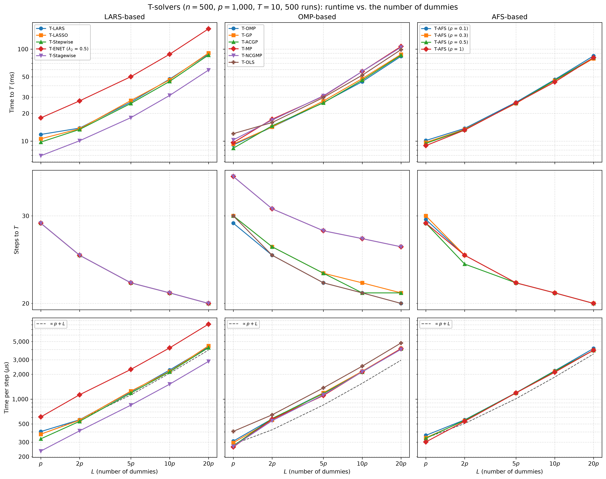
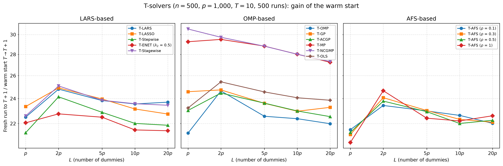

# Demo: Runtime of the T-Solvers vs. the Number of Dummies

## Purpose

This demo measures how the run time of the terminated solution paths grows with the number $L$ of dummies, for all
demo T-solvers on the same data. It splits the time to the $T$-th dummy into the number of steps and the time per
step, and it compares a warm start from $T$ to $T + 1$ with a fresh run to $T + 1$.

---

## Setup

- $n = 500$ observations and $p = 1{,}000$ variables with independent standard normal entries,
- ten true coefficients equal to 3 on a fixed random support, noise standard deviation about 1 (`snr = 90`),
- $L \in \lbrace p, 2p, 5p, 10p, 20p \rbrace$ standard normal dummies, and $T = 10$,
- 500 Monte Carlo runs, with medians over the runs.

Every run draws $20p = 20{,}000$ dummies once, and each $L$ uses the first $L$ of them, so the dummy sets are nested
across the grid. The run centers and scales $\mathbf{X}$ and $\mathbf{D}$ and centers $\mathbf{y}$ once, and all 15
solver configurations of [demo_ts_perf_01](../demo_ts_perf_01_fdr_tpr_vs_T/README.md) run on it as precentered readers
with the seed of the run for their tie-breaking. For every $L$ and solver the run measures the time from construction
to $T = 10$ with its number of steps, the extra time of a warm start to $T = 11$, and the time of a fresh run to
$T = 11$.

---

## Running the demo

From the repository root, after `cmake --preset release && cmake --build --preset release-build` in `cpp/`:

```bash
cpp/build/release/bin/tsolvers/ad/demo_ts_perf_02_runtime_vs_dummies/demo_ts_perf_02_runtime_vs_dummies        # 500 runs, 6 threads
cpp/build/release/bin/tsolvers/ad/demo_ts_perf_02_runtime_vs_dummies/demo_ts_perf_02_runtime_vs_dummies 5 3    # 5 runs, 3 threads
cpp/tsolvers/ad/demo_ts_perf_02_runtime_vs_dummies/generate_plots.sh                                          # figures
```

The two optional arguments are the number of runs and of threads. The runs are spread over the threads, and each
solver runs single-threaded inside its run, so the times show the cost of the algorithms rather than their parallel
speed. The 500 runs take about 9 minutes on an Apple Silicon machine with 6 threads. The result files carry the number
of runs in their name (`runtime_vs_dummies_mc500.csv` and `.txt`), so a short test run does not overwrite the full
one. The output below is a run against library b95b984. Two fixes in library 09debc6 change the paths of T-Stagewise,
so its rows come from a rerun of the 500 runs on that library in a session of their own, with the same seeds and
threads. The wall time in the output is that of the first run.

---

## Console walk-through

### Time and steps to $T = 10$

```text
n = 500, p = 1000, L in {1, 2, 5, 10, 20} x p, T = 10, true coefficients: 10 x 3, SNR = 90
15 solvers, 500 runs on 6 threads (single-threaded solvers)

Median time to T = 10 (ms)
solver                      L=p     L=2p     L=5p    L=10p    L=20p
-------------------------------------------------------------------
T-LARS                    11.81    13.84    26.55    47.23    88.59
T-LASSO                   10.59    13.59    27.63    46.39    90.58
T-Stepwise                 9.75    13.38    25.67    44.58    86.24
T-ENET (lambda2 0.5)      17.87    27.36    50.16    87.99   166.05
T-Stagewise                6.93    10.08    17.98    31.35    59.13
T-OMP                      9.08    14.21    26.28    44.27    83.42
T-GP                       9.29    14.26    27.27    47.77    87.59
T-ACGP                     8.38    14.66    26.07    45.99    85.92
T-MP                       9.62    17.30    30.71    57.16   106.97
T-NCGMP                   10.29    16.91    31.06    57.21   104.75
T-OLS                     12.06    15.91    29.78    52.01    98.65
T-AFS (rho 0.1)           10.15    13.74    26.43    46.67    84.41
T-AFS (rho 0.3)            9.67    13.42    25.67    45.51    79.00
T-AFS (rho 0.5)            9.45    13.26    25.92    45.78    80.79
T-AFS (rho 1)              8.93    13.17    25.96    43.86    80.91

Median steps to T = 10
solver                      L=p     L=2p     L=5p    L=10p    L=20p
-------------------------------------------------------------------
T-LARS                     29.0     25.0     22.0     21.0     20.0
T-LASSO                    29.0     25.0     22.0     21.0     20.0
T-Stepwise                 29.0     25.0     22.0     21.0     20.0
T-ENET (lambda2 0.5)       29.0     25.0     22.0     21.0     20.0
T-Stagewise                29.0     25.0     22.0     21.0     20.0
T-OMP                      29.0     25.0     22.0     21.0     20.0
T-GP                       30.0     26.0     23.0     22.0     21.0
T-ACGP                     30.0     26.0     23.0     21.0     21.0
T-MP                       36.0     31.0     28.0     27.0     26.0
T-NCGMP                    36.0     31.0     28.0     27.0     26.0
T-OLS                      30.0     25.0     22.0     21.0     20.0
T-AFS (rho 0.1)            29.5     25.0     22.0     21.0     20.0
T-AFS (rho 0.3)            30.0     25.0     22.0     21.0     20.0
T-AFS (rho 0.5)            29.0     24.0     22.0     21.0     20.0
T-AFS (rho 1)              29.0     25.0     22.0     21.0     20.0
```

The time to $T = 10$ grows about linearly with $L$ once $L \ge 2p$. T-LARS needs 12 ms at $L = p$ and 89 ms at
$L = 20p$, 7.5 times as much for 10.5 times as many columns. The number of steps falls at the same time, from 29 at
$L = p$ to 20 at $L = 20p$, and the exchangeability of null variables and dummies from
[demo_ts_perf_01](../demo_ts_perf_01_fdr_tpr_vs_T/README.md) predicts these counts. A path to the tenth dummy holds
the ten true variables and the ten dummies, plus on average

```math
\mathbb{E}[V_T] = \frac{p - s}{L + 1}\,T = \frac{990}{L + 1} \cdot 10
```

null variables: 9.9 at $L = p$, 4.9 at $L = 2p$, 2.0 at $L = 5p$ and 0.5 at $L = 20p$. The expected path lengths of
29.9, 24.9, 22.0 and 20.5 steps match the medians of most solvers within one step. T-MP and T-NCGMP need more steps,
36 at $L = p$, because matching pursuit can select a variable again.

### Time per step

```text
Median time per step (us)
solver                      L=p     L=2p     L=5p    L=10p    L=20p
-------------------------------------------------------------------
T-LARS                    403.3    560.9   1223.8   2255.6   4316.3
T-LASSO                   374.8    554.2   1250.8   2167.6   4433.7
T-Stepwise                329.3    537.1   1185.8   2145.7   4212.7
T-ENET (lambda2 0.5)      607.3   1128.7   2293.0   4188.4   8127.5
T-Stagewise               233.8    411.5    844.6   1517.8   2869.0
T-OMP                     308.9    575.1   1193.9   2137.5   4064.0
T-GP                      295.4    556.8   1192.9   2175.6   4106.0
T-ACGP                    270.2    581.3   1169.0   2135.6   4094.2
T-MP                      262.1    570.7   1103.5   2150.3   4090.3
T-NCGMP                   266.5    546.7   1125.4   2148.6   4019.1
T-OLS                     405.7    643.9   1369.2   2508.0   4801.1
T-AFS (rho 0.1)           362.9    559.6   1193.3   2210.9   4121.6
T-AFS (rho 0.3)           339.3    547.5   1185.5   2169.5   3910.2
T-AFS (rho 0.5)           333.9    553.5   1190.8   2186.2   3915.9
T-AFS (rho 1)             302.0    537.5   1189.3   2118.7   3929.0
```

The time per step grows with the number of columns $p + L$, since every step scans the correlations of all columns.
T-LARS needs 0.40 ms per step at $L = p$ and 4.3 ms at $L = 20p$, 10.7 times as much for 10.5 times as many columns.
The orthogonal matching pursuit (OMP) family starts lower, at about 0.3 ms, and grows 12 to 16 times, so at
$L = 20p$ all solvers except T-ENET and T-Stagewise need about 4 to 5 ms per step, where the scan over the columns
dominates. T-ENET needs about twice as long per step as the other solvers. More dummies therefore cut the path by the
null variables they keep out, but every step gets dearer, and in total a path to $T = 10$ at $L = 20p$ costs about
7.5 times a path at $L = p$.

T-Stagewise needs the least time per step at every $L$, 0.23 ms at $L = p$ and 2.9 ms at $L = 20p$. With the same
steps as T-LARS it reaches $T = 10$ first at every $L$, about 30% below the typical solver, in 59 ms at $L = 20p$
against 89 ms for T-LARS. Its rows come from a rerun in a session of their own, so part of this lead may come from the
timing of that session rather than from the solver.

Gradient pursuit (T-GP) and approximate conjugate gradient pursuit (T-ACGP) were proposed by Blumensath and Davies
(2008) as cheaper alternatives to OMP, and these short paths show no such saving. Every greedy step scans the
correlations of all $p + L$ columns, which costs $O(n(p + L))$. T-OMP adds an incremental Cholesky update for its
least-squares refit, which costs $O(nk + k^2)$ for $k$ active columns and stays small while the path holds 20 to 30
variables. The gradient pursuits replace that update by one gradient step, but their residual is no longer orthogonal
to the active columns, and T-GP needs one step more than T-OMP at every $L$ (21 instead of 20 at $L = 20p$). With
the same time per step (4.06, 4.11 and 4.09 ms at $L = 20p$), T-GP and T-ACGP finish within a few percent of T-OMP,
mostly a little later (87.6 and 85.9 ms against 83.4 ms at $L = 20p$), which lies inside the run-to-run noise of the
medians noted below. Their saving appears only on long paths, where
$k$ approaches $n$ and the Cholesky update dominates, as
[demo_ts_perf_01](../demo_ts_perf_01_fdr_tpr_vs_T/README.md) shows along $T$.

### Warm start

```text
Median warm start T = 10 -> 11 (ms)
solver                      L=p     L=2p     L=5p    L=10p    L=20p
-------------------------------------------------------------------
T-LARS                    0.516    0.752    1.172    2.110    4.010
T-LASSO                   0.513    0.760    1.182    2.108    4.038
T-Stepwise                0.499    0.748    1.206    2.091    4.022
T-ENET (lambda2 0.5)      1.002    1.498    2.313    4.223    8.021
T-Stagewise               0.380    0.458    0.787    1.430    2.722
T-OMP                     0.458    0.693    1.241    2.100    3.997
T-GP                      0.410    0.751    1.197    2.169    3.972
T-ACGP                    0.422    0.751    1.168    2.107    3.993
T-MP                      0.399    0.740    1.132    2.082    3.979
T-NCGMP                   0.453    0.732    1.171    2.078    4.006
T-OLS                     0.555    0.793    1.333    2.241    4.249
T-AFS (rho 0.1)           0.508    0.749    1.164    2.107    3.986
T-AFS (rho 0.3)           0.509    0.726    1.162    2.114    3.972
T-AFS (rho 0.5)           0.512    0.732    1.168    2.122    3.904
T-AFS (rho 1)             0.480    0.595    1.284    2.095    3.913

Median fresh run to T = 11 over warm start 10 -> 11 (ratio)
solver                      L=p     L=2p     L=5p    L=10p    L=20p
-------------------------------------------------------------------
T-LARS                     22.5     24.8     23.8     23.6     23.7
T-LASSO                    23.3     24.9     24.0     23.1     22.7
T-Stepwise                 21.3     24.1     22.9     22.0     21.9
T-ENET (lambda2 0.5)       22.1     22.8     22.5     21.5     21.5
T-Stagewise                22.6     25.1     23.9     23.6     23.5
T-OMP                      21.3     24.7     22.6     22.4     22.0
T-GP                       24.6     24.7     23.6     23.0     23.3
T-ACGP                     23.0     24.5     23.6     23.0     22.5
T-MP                       29.3     29.5     28.8     28.0     27.2
T-NCGMP                    30.6     29.7     28.8     28.0     27.3
T-OLS                      23.2     25.4     24.6     24.1     23.9
T-AFS (rho 0.1)            21.5     23.4     23.0     22.6     22.0
T-AFS (rho 0.3)            21.2     24.1     23.0     22.3     22.1
T-AFS (rho 0.5)            21.3     23.8     22.9     22.0     22.3
T-AFS (rho 1)              20.6     24.7     22.4     22.2     22.6

Failed solver runs: 0
Wall time: 545.8 s
```

A warm start from $T = 10$ to 11 costs about 1/23 of a fresh run to 11 for most solvers, over the whole range of $L$,
and about 1/29 for T-MP and T-NCGMP, whose paths are longer. A fresh run repeats the whole path of about 21 to 40
steps, while the warm start adds only the steps between the tenth and the eleventh dummy, on average
$1 + (p - s)/(L + 1)$, about two at $L = p$ and one at $L = 20p$.

---

## Figures

The first figure shows the time to $T$, the steps and the time per step against $L$ on log axes, one column per
library family. The dashed line in the bottom row grows in proportion to $p + L$ from the median of the family at
$L = p$.



The second figure shows the ratio of a fresh run to $T + 1$ over the warm start from $T$ to $T + 1$.



---

## Technical notes

- The runs share the memory bandwidth of the machine, and at $L = 20p$ every run holds about 84 MB of data. The absolute
  times are therefore higher than in a run alone and serve for comparison only. T-MP and T-NCGMP follow the same path,
  and their times differ by up to 7%, which marks the run-to-run noise of the medians.
- The nested dummy sets keep the comparison across $L$ tight, because a larger $L$ adds dummies to the same data
  instead of drawing new ones.
- Reference: T. Blumensath and M. E. Davies, *Gradient Pursuits*, IEEE Transactions on Signal Processing 56(6),
  2008, pp. 2370-2382.
