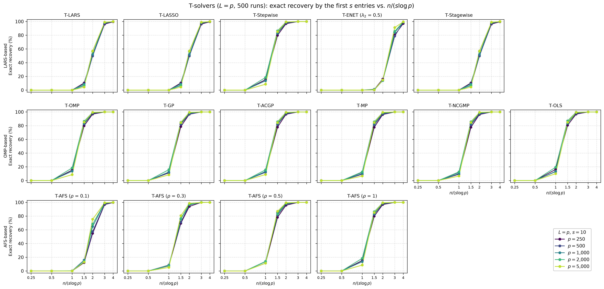
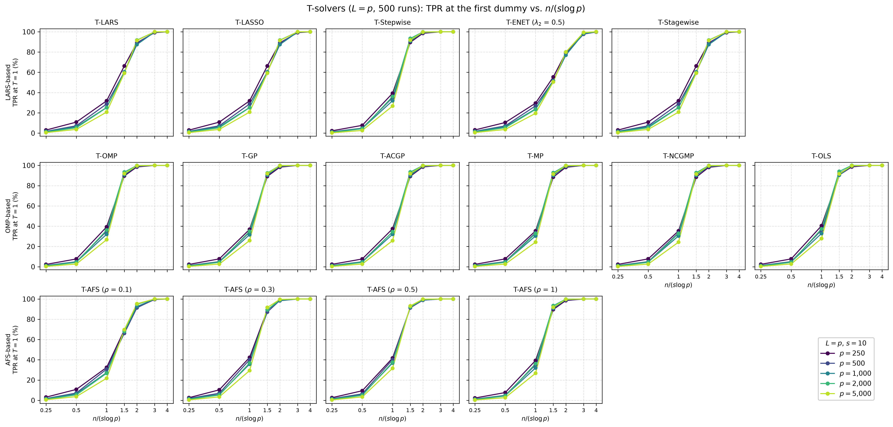
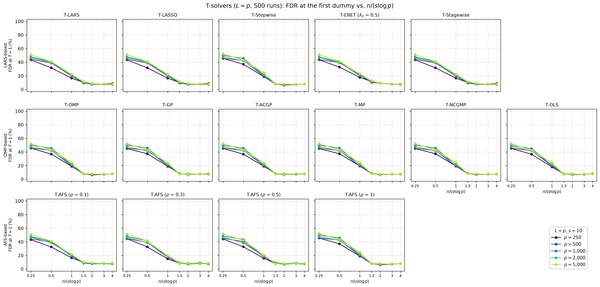
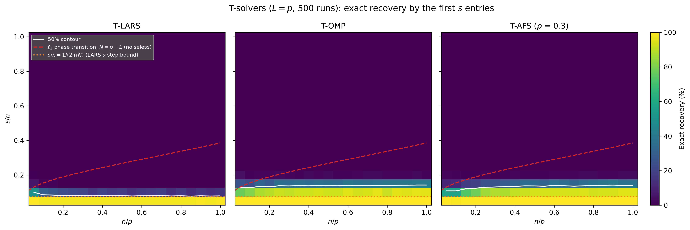

# Demo: Support Recovery of the T-Solvers vs. the Ratio n/(s log p)

## Purpose

This demo measures how many observations the demo T-solvers need to recover the true support. It counts a run as an
exact recovery when the first $s$ distinct variables that enter the path are the $s$ true ones, so a null variable or
a dummy among them is a miss. Part 1 plots this probability against $n/(s \log p)$ for several $p$, and curves that
fall onto each other confirm that $n$ has to grow like $s \log p$. Part 2 draws the Donoho–Tanner diagram over $n/p$
and $s/n$ for three solvers.

---

## Setup

- independent standard normal predictors and $L = p$ standard normal dummies,
- coefficients equal to 3 on a fixed random support and noise standard deviation about 1,
- every solver runs to the first dummy ($T = 1$), which also gives the true positive rate (TPR) and the false
  discovery rate (FDR) of that selection,
- 500 Monte Carlo runs.

**Part 1** uses $p \in \lbrace 250, 500, 1{,}000, 2{,}000, 5{,}000 \rbrace$ and $s = 10$, with

```math
n = \operatorname{round}\!\left(c \cdot s \ln p\right), \qquad c \in \lbrace 0.25, 0.5, 1, 1.5, 2, 3, 4 \rbrace,
```

so $n$ runs from 14 to 341. All 15 solver configurations of
[demo_ts_perf_01](../demo_ts_perf_01_fdr_tpr_vs_T/README.md) run on the same data.

**Part 2** uses $p = 400$ and the grid $n/p, s/n \in \lbrace 0.05, 0.10, \dots, 1 \rbrace$, so $n$ runs from 20 to
400 and every $s$ is a whole number. T-LARS, T-OMP and T-AFS ($\rho = 0.3$) run in each of the 400 cells.

For every data set the demo centers and scales $\mathbf{X}$ and $\mathbf{D}$ and centers $\mathbf{y}$ once, and the
solvers run on it as precentered readers with the seed of the run for their tie-breaking.

---

## Running the demo

From the repository root, after `cmake --preset release && cmake --build --preset release-build` in `cpp/`:

```bash
demo=cpp/build/release/bin/tsolvers/ad/demo_ts_perf_04_recovery_vs_dt_ratio/demo_ts_perf_04_recovery_vs_dt_ratio
$demo                 # 500 runs, 6 threads, Parts 1 and 2
$demo 5 3             # 5 runs, 3 threads
$demo 500 6 2         # Part 2 only
cpp/tsolvers/ad/demo_ts_perf_04_recovery_vs_dt_ratio/generate_plots.sh          # figures
```

The optional arguments are the number of runs, the number of threads and the parts to run. The runs are spread over
the threads, and each solver runs single-threaded inside its run. With 6 threads on an Apple Silicon machine, Part 1
takes about 2.5 minutes and Part 2 about 4.5 minutes. The result files carry the number of runs in their name
(`recovery_vs_dt_ratio_mc500` and `phase_transition_mc500`, each as `.csv` and `.txt`), so a short test run does not
overwrite the full one. The output below is a run against library b95b984.

---

## Console walk-through

### Part 1: exact recovery vs. $n/(s \log p)$

The two extremes of the $p$ grid show the scaling:

```text
============================================================
Part 1: Recovery vs. n/(s log p)
============================================================
p in {250, 500, 1000, 2000, 5000}, L = p, s = 10, n/(s log p) in {0.25, 0.5, 1, 1.5, 2, 3, 4}, T = 1
15 solvers, 500 runs

Exact recovery by the first s = 10 entries (%), p = 250
n/(s log p)               0.25     0.5       1     1.5       2       3       4
n                           14      28      55      83     110     166     221
------------------------------------------------------------------------------
T-LARS                     0.0     0.0     0.0    10.4    50.0    96.2    99.6
T-LASSO                    0.0     0.0     0.0    10.4    50.0    96.2    99.6
T-Stepwise                 0.0     0.0    15.2    79.8    96.8   100.0   100.0
T-ENET (lambda2 0.5)       0.0     0.0     0.0     0.8    16.0    80.2    97.0
T-Stagewise                0.0     0.0     0.0    10.4    50.0    96.2    99.6
T-OMP                      0.0     0.0    15.2    79.8    96.8   100.0   100.0
T-GP                       0.0     0.0    11.2    78.6    96.6   100.0   100.0
T-ACGP                     0.0     0.0    12.6    77.8    96.6   100.0   100.0
T-MP                       0.0     0.0     9.2    77.6    96.2   100.0   100.0
T-NCGMP                    0.0     0.0     9.2    77.6    96.2   100.0   100.0
T-OLS                      0.0     0.0    16.2    80.6    96.8   100.0   100.0
T-AFS (rho 0.1)            0.0     0.0     0.0    12.2    54.8    96.8    99.8
T-AFS (rho 0.3)            0.0     0.0     7.4    69.4    94.0   100.0   100.0
T-AFS (rho 0.5)            0.0     0.0    11.4    78.2    95.8   100.0   100.0
T-AFS (rho 1)              0.0     0.0    15.2    79.8    96.8   100.0   100.0

Exact recovery by the first s = 10 entries (%), p = 5000
n/(s log p)               0.25     0.5       1     1.5       2       3       4
n                           21      43      85     128     170     256     341
------------------------------------------------------------------------------
T-LARS                     0.0     0.0     0.0     4.4    57.0    99.0   100.0
T-LASSO                    0.0     0.0     0.0     4.4    57.0    99.0   100.0
T-Stepwise                 0.0     0.0     8.6    85.2    99.4   100.0   100.0
T-ENET (lambda2 0.5)       0.0     0.0     0.0     0.4    14.8    91.2    99.6
T-Stagewise                0.0     0.0     0.0     4.4    57.0    99.0   100.0
T-OMP                      0.0     0.0     8.6    85.2    99.4   100.0   100.0
T-GP                       0.0     0.0     8.4    84.4    99.4   100.0   100.0
T-ACGP                     0.0     0.0     8.8    84.4    99.4   100.0   100.0
T-MP                       0.0     0.0     6.6    84.6    99.4   100.0   100.0
T-NCGMP                    0.0     0.0     6.6    84.6    99.4   100.0   100.0
T-OLS                      0.0     0.0    10.0    85.0    99.4   100.0   100.0
T-AFS (rho 0.1)            0.0     0.0     0.0    13.0    75.4    99.4   100.0
T-AFS (rho 0.3)            0.0     0.0     5.2    80.6    98.6    99.8   100.0
T-AFS (rho 0.5)            0.0     0.0    11.4    87.0    99.4   100.0   100.0
T-AFS (rho 1)              0.0     0.0     8.6    85.2    99.4   100.0   100.0
```

From $p = 250$ to $p = 5{,}000$ the number of variables grows 20-fold, and at the same $n/(s \log p)$ the recovery
changes by a few percentage points only, so $n$ has to grow like $s \log p$. The solvers fall into two groups. The
orthogonal matching pursuit (OMP) family, T-Stepwise and T-AFS with $\rho \ge 0.3$ recover the support in 69% to 87%
of the runs at $n/(s \log p) = 1.5$ and in at least 94% at 2. T-LARS, T-LASSO, T-Stagewise and T-AFS with
$\rho = 0.1$ need about 1.5 times as many observations and cross 50% at 2. Their steep rise between 1.5 and 3
brackets the $s$-step bound of Donoho and Tsaig (2008), by which least-angle regression (LARS) recovers the support
in its first $s$ steps once $n > 2 s \ln N$ with $N = p + L$ columns, which is $n/(s \log p) > 2.16$ to $2.25$ here.
T-ENET needs the most observations and recovers the support in 78% to 91% of the runs at 3.

T-AFS moves between the two groups. With $\rho = 0.1$ it takes small steps and follows T-LARS, and with $\rho = 1$ it
takes full steps and equals T-OMP. T-OMP, T-Stepwise and T-AFS ($\rho = 1$) show the same rows, and so do T-MP and
T-NCGMP, as the identities in the [folder README](../../README.md) predict. T-LARS, T-LASSO and T-Stagewise also agree
in every exact-recovery entry, because they share the path up to the first drop, and their TPR and FDR differ by less
than 0.3 percentage points.

The small rise with $p$ at a fixed ratio, for instance of T-OMP from 79.8% to 85.2% at 1.5, fits the dummies, which
double the number of columns. Since $\ln(2p)/\ln p$ falls from 1.13 at $p = 250$ to 1.08 at $p = 5{,}000$, a fixed
$n/(s \log p)$ gives slightly more observations per $s \ln N$ at larger $p$.

### Part 1: TPR and FDR at the first dummy

```text
TPR at T = 1 (%), p = 1000
n/(s log p)               0.25     0.5       1     1.5       2       3       4
n                           17      35      69     104     138     207     276
------------------------------------------------------------------------------
T-LARS                     1.6     6.2    25.3    60.4    87.4    99.7   100.0
T-LASSO                    1.6     6.2    25.3    60.4    87.4    99.7   100.0
T-Stepwise                 1.1     4.6    32.0    90.6    99.5   100.0   100.0
T-ENET (lambda2 0.5)       1.7     6.3    23.9    51.7    77.0    98.3    99.9
T-Stagewise                1.6     6.2    25.3    60.4    87.4    99.7   100.0
T-OMP                      1.1     4.6    32.0    90.6    99.5   100.0   100.0
T-GP                       1.1     4.6    31.6    90.3    99.3   100.0   100.0
T-ACGP                     1.1     4.7    32.0    90.0    99.5   100.0   100.0
T-MP                       1.1     4.7    30.4    90.0    99.3   100.0   100.0
T-NCGMP                    1.1     4.7    30.4    90.0    99.3   100.0   100.0
T-OLS                      1.1     4.7    32.8    90.4    99.5   100.0   100.0
T-AFS (rho 0.1)            1.6     6.4    27.4    68.4    92.5    99.8   100.0
T-AFS (rho 0.3)            1.5     5.8    35.7    89.3    98.4   100.0   100.0
T-AFS (rho 0.5)            1.4     5.4    36.9    92.5    99.2   100.0   100.0
T-AFS (rho 1)              1.1     4.6    32.0    90.6    99.5   100.0   100.0

FDR at T = 1 (%), p = 1000
n/(s log p)               0.25     0.5       1     1.5       2       3       4
n                           17      35      69     104     138     207     276
------------------------------------------------------------------------------
T-LARS                    47.7    41.0    19.5    11.1     8.4     7.3     7.8
T-LASSO                   47.7    41.0    19.5    10.9     8.2     7.3     7.8
T-Stepwise                50.1    45.5    21.7     7.8     7.4     7.1     8.1
T-ENET (lambda2 0.5)      47.6    40.5    20.0    12.6     8.8     7.6     8.0
T-Stagewise               47.7    41.0    19.5    11.1     8.3     7.3     7.8
T-OMP                     50.1    45.5    21.7     7.8     7.4     7.1     8.1
T-GP                      50.3    45.8    21.4     7.7     7.2     7.7     7.7
T-ACGP                    50.1    45.5    21.3     7.8     6.9     7.4     7.8
T-MP                      50.2    45.7    21.0     8.5     7.1     7.3     7.7
T-NCGMP                   50.2    45.7    21.0     8.5     7.1     7.3     7.7
T-OLS                     49.9    44.9    20.6     7.5     7.3     7.2     8.0
T-AFS (rho 0.1)           47.7    40.5    19.0    10.1     7.7     7.7     7.6
T-AFS (rho 0.3)           48.1    41.5    17.4     8.9     7.2     7.9     8.0
T-AFS (rho 0.5)           48.5    43.4    18.3     8.8     7.0     8.0     7.5
T-AFS (rho 1)             50.1    45.5    21.7     7.8     7.4     7.1     8.1

Failed solver runs: 0
Wall time: 144.1 s
```

The TPR at the first dummy follows the same two groups. At $n/(s \log p) = 1.5$ the OMP family finds about 90% of the
true variables and T-LARS about 60%, and from 3 on every solver finds at least 98% at $p = 1{,}000$. Once the true
variables come first, the FDR settles at 7% to 9% for every solver, which the exchangeability of null variables and
dummies from
[demo_ts_perf_01](../demo_ts_perf_01_fdr_tpr_vs_T/README.md) predicts. Null variables and dummies are about equally
many ($p - s = 990$ and $L = 1{,}000$), so $V$ null variables enter before the first dummy with probability about
$(1/2)^{V+1}$, and

```math
\mathrm{FDR} \approx \sum_{k \ge 1} \left(\tfrac{1}{2}\right)^{k+1} \frac{k}{k + s} = 7.8\,\% \qquad (s = 10).
```

With too few observations the true variables rarely enter, and the FDR approaches 50%. The first entry is then a
dummy in about half of the runs, which leaves an empty selection, and a null variable in the other half.

### Part 2: the Donoho–Tanner diagram

The rows with $s/n \ge 0.30$ are zero in all three tables and are left out here:

```text
============================================================
Part 2: Donoho-Tanner phase transition
============================================================
p = 400, L = p, n/p and s/n in {0.05, 0.10, ..., 1}, T = 1
T-LARS, T-OMP and T-AFS (rho 0.3), 500 runs per cell

Exact recovery by the first s entries (%), T-LARS
 s/n \ n/p 0.05 0.10 0.15 0.20 0.25 0.30 0.35 0.40 0.45 0.50 0.55 0.60 0.65 0.70 0.75 0.80 0.85 0.90 0.95 1.00
--------------------------------------------------------------------------------------------------------------
      0.25    0    0    0    0    0    0    0    0    0    0    0    0    0    0    0    0    0    0    0    0
      0.20    0    0    0    0    0    0    0    0    0    0    0    0    0    0    0    0    0    0    0    0
      0.15    6    1    1    0    0    0    0    0    0    0    0    0    0    0    0    0    0    0    0    0
      0.10   51   30   27   24   23   21   17   20   17   18   14   17   17   19   14   17   12   16   13   15
      0.05  100   99   98   98   98   98   98   99   98   99   98   99   98   99   99   98   98   99   99   99

Exact recovery by the first s entries (%), T-OMP
 s/n \ n/p 0.05 0.10 0.15 0.20 0.25 0.30 0.35 0.40 0.45 0.50 0.55 0.60 0.65 0.70 0.75 0.80 0.85 0.90 0.95 1.00
--------------------------------------------------------------------------------------------------------------
      0.25    0    0    0    0    0    0    0    0    0    0    0    0    0    0    0    0    0    0    0    0
      0.20    4    1    1    1    2    2    1    2    1    3    1    1    1    2    2    1    1    1    2    1
      0.15   25   23   32   28   36   35   37   36   37   37   36   40   39   37   39   40   40   41   42   42
      0.10   77   81   88   89   92   91   92   92   94   92   92   95   93   94   96   92   96   95   96   96
      0.05  100  100  100  100  100  100  100  100  100  100  100  100  100  100  100  100  100  100  100  100

Exact recovery by the first s entries (%), T-AFS (rho 0.3)
 s/n \ n/p 0.05 0.10 0.15 0.20 0.25 0.30 0.35 0.40 0.45 0.50 0.55 0.60 0.65 0.70 0.75 0.80 0.85 0.90 0.95 1.00
--------------------------------------------------------------------------------------------------------------
      0.25    0    0    0    0    0    0    0    0    0    0    0    0    0    0    0    0    0    0    0    0
      0.20    1    1    1    1    1    0    1    1    1    1    1    1    1    2    2    2    1    1    2    2
      0.15   11   11   18   19   25   26   29   32   36   35   32   39   36   33   35   38   40   42   38   38
      0.10   58   58   73   78   86   88   88   91   92   93   93   93   94   93   94   93   93   94   95   95
      0.05  100   99   99  100  100  100  100  100  100  100  100  100  100  100  100  100  100  100  100  100

Failed solver runs: 0
Wall time: 276.6 s
```

T-LARS recovers the support in at least 98% of the runs at $s/n = 0.05$ over the whole range of $n/p$, in 12% to 51%
at 0.10 and in 6% or less above. Its edge lies at $s/n \approx 0.08$, right at the $s$-step bound
$1/(2 \ln N) = 0.075$ for $N = p + L = 800$ columns. T-OMP reaches further, with 77% to 96% at $s/n = 0.10$ and 23% to
42% at 0.15, and T-AFS ($\rho = 0.3$) is close to T-OMP from $n/p = 0.25$ on and weaker below.

Every edge is flat in $n/p$, so it sits at a fixed $s/n$ and thus at a fixed $n/(s \ln N)$, the scaling of Part 1. The
edges also agree with Part 1 in numbers. At $p = 400$ the 50% edge of T-LARS at $s/n \approx 0.08$ means
$n/(s \log p) \approx 2.1$, and the edge of T-OMP at about 0.14 means about 1.2, where the two solvers cross 50% in
Part 1 as well. All edges lie far below the $\ell_1$ phase transition of Donoho and Tanner, which reaches $s/n = 0.39$
at $n/p = 1$. That curve marks where the $\ell_1$ solution at the end of a noiseless path equals the true
coefficients, while exact recovery here asks that no wrong variable enters before the $s$ true ones.

---

## Figures

The first three figures show exact recovery, TPR and FDR at the first dummy against $n/(s \log p)$, one panel per
solver with the families in the rows and one curve per $p$. Every configuration reached the first dummy in at least
99.8% of the runs, so the figures carry no open markers.







The fourth figure shows the Donoho–Tanner diagram of Part 2 with the 50% contour of every solver. The dashed curve is
the noiseless $\ell_1$ phase transition for $N = p + L$ columns, computed from the statistical dimension of the
$\ell_1$ descent cone (Amelunxen, Lotz, McCoy and Tropp, 2014). The dotted line is the $s$-step bound
$s/n = 1/(2 \ln N)$.



---

## Technical notes

- A variable counts once among the first $s$ entries, also when T-MP selects it again or T-LASSO lets it enter
  again after a drop.
- The noise standard deviation stays at 1 for every $s$, because the demo sets the signal-to-noise ratio of the data
  generator to $9s$, the signal variance of $s$ coefficients equal to 3.
- Part 1 draws its support once per $p$, and Part 2 once per cell. With independent standard normal predictors the
  place of the support does not matter.
- References: D. L. Donoho and Y. Tsaig, *Fast solution of ℓ1-norm minimization problems when the solution may
  be sparse*, IEEE Transactions on Information Theory 54(11), 2008. D. Amelunxen, M. Lotz, M. B. McCoy and
  J. A. Tropp, *Living on the edge: phase transitions in convex programs with random data*, Information and
  Inference 3(3), 2014.
