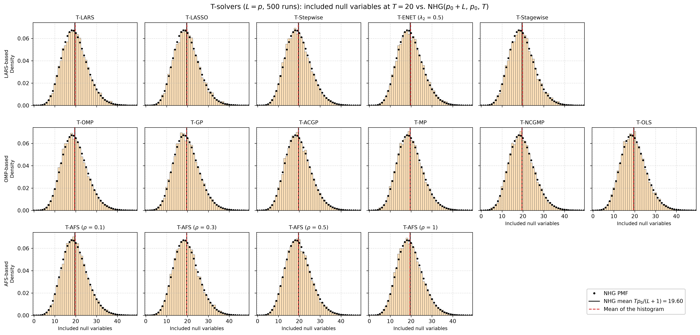
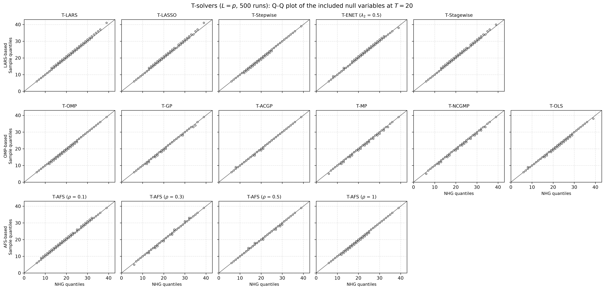
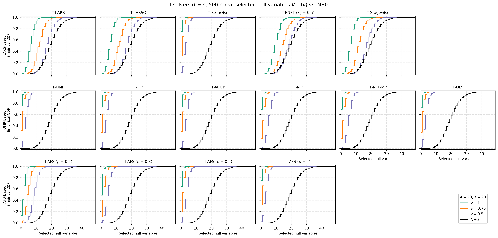

# Demo: Null Variables of the T-Solvers vs. the Negative Hypergeometric Distribution

## Purpose

The false discovery rate (FDR) control of the Terminating Random Experiments (T-Rex) selector rests on the number of
null variables that enter a solution path before it is terminated. When the null variables and the dummies are
exchangeable, a terminated path draws them like a sample without replacement, and the number $V$ of null variables
that enter before the $T$-th dummy follows the negative hypergeometric (NHG) distribution

```math
P(V = v) = \frac{\binom{v + T - 1}{v} \binom{p_0 + L - v - T}{p_0 - v}}{\binom{p_0 + L}{p_0}},
\qquad v = 0, \ldots, p_0, \qquad \mathbb{E}[V] = \frac{T \, p_0}{L + 1},
```

with $p_0$ null variables and $L$ dummies. The supplement of the T-Rex paper verifies this for T-LARS in its
Figures 10 and 11. This demo repeats the verification for all 15 solver configurations of
[demo_ts_perf_01](../demo_ts_perf_01_fdr_tpr_vs_T/README.md) and checks two statements.

- **Corollary 2 and assumption A-I.** The number of null variables included in one random experiment at $T$ follows
  $\mathrm{NHG}(p_0 + L, p_0, T)$.
- **Assumption A-II.** The number $V_{T,L}(v)$ of null variables that the T-Rex selector selects at the voting level
  $v \in [0.5, 1)$ is stochastically dominated by the same NHG distribution.

---

## Setup

The setup is the one of the supplement.

- $n = 150$ observations and $p = 300$ independent standard normal predictors.
- $p_1 = 5$ coefficients equal to 1 on a fixed random support, so $p_0 = 295$ null variables.
- A signal-to-noise ratio (SNR) of 1, calibrated on the sample.
- $K = 20$ random experiments per run, each with $L = p = 300$ fresh standard normal dummies.
- Every solver runs to $T = 20$ included dummies in every experiment.
- 500 Monte Carlo (MC) runs.

For every data set the demo centers and scales $\mathbf{X}$ and the $K$ dummy matrices and centers $\mathbf{y}$ once,
and the solvers run on them as precentered readers, with a tie-breaking seed per run and experiment.

A variable counts as included in experiment $k$ when its coefficient is nonzero after the solver stopped, as in the
T-Rex selector. The relative occurrence of variable $j$ over the experiments and the selected set at the voting level
$v$ are

```math
\Phi_{T,L}(j) = \frac{1}{K} \sum_{k=1}^{K} \mathbb{1}\left[ j \in \mathcal{C}_{k,L}(T) \right],
\qquad \widehat{\mathcal{A}}(v) = \left\lbrace j : \Phi_{T,L}(j) > v \right\rbrace,
```

and $V_{T,L}(v)$ counts the null variables in $\widehat{\mathcal{A}}(v)$. The demo records it for $v \to 1$ (included
in all 20 experiments), $v = 0.75$ (in at least 16) and $v = 0.5$ (in at least 11).

With $p_0 = 295$, $L = 300$ and $T = 20$ the NHG mean is $20 \cdot 295 / 301 = 19.60$. The caption of Figure 10 in
the supplement computes it with $p_0 = 290$ as 19.27, which belongs to $p_1 = 10$.

---

## Running the demo

From the repository root, after `cmake --preset release && cmake --build --preset release-build` in `cpp/`:

```bash
demo=cpp/build/release/bin/tsolvers/ad/demo_ts_perf_05_null_counts_vs_nhg/demo_ts_perf_05_null_counts_vs_nhg
$demo                 # 500 runs, 6 threads
$demo 4 2             # 4 runs, 2 threads
cpp/tsolvers/ad/demo_ts_perf_05_null_counts_vs_nhg/generate_plots.sh          # figures
```

The optional arguments are the number of runs and the number of threads. The runs are spread over the threads, and
each solver runs single-threaded inside its run. The result files carry the number of runs in their name
(`null_counts_vs_nhg_mc500.csv` and `.txt`), so a short test run does not overwrite the full one.

The console prints two tables.

- **Included null variables**, pooled over the runs and the experiments ($500 \cdot 20 = 10{,}000$ counts per
  solver). The table lists the mean and the standard deviation next to those of the NHG, the Kolmogorov distance
  $D = \max_x \lvert \widehat{F}(x) - F_{\mathrm{NHG}}(x) \rvert$ and the share of the experiments that reached $T$
  dummies.
- **Selected null variables** $V_{T,L}(v)$ over the runs. The table lists the mean per voting level and the largest
  excess $\max_x \left( F_{\mathrm{NHG}}(x) - \widehat F_v(x) \right)$ of the NHG cumulative distribution function
  (CDF) over the empirical one. An excess of zero means that the NHG dominates $V_{T,L}(v)$ at every value.

The comma-separated values (CSV) file lists the frequency of every count per solver and statistic (`included`,
`selected_v1`, `selected_v0.75` and `selected_v0.5`), together with $p_0$, $L$, $T$ and $K$, so the plotter computes
the NHG reference itself.

---

## Simulation Results

The output below is the full run with 500 runs on 6 threads against library 61fd84c (wall time 29 s). The T-Stagewise
rows come from a rerun of that solver alone on library 09debc6, with the same seeds.

### Included null variables (Corollary 2 and A-I)

```text
Included null variables at T = 20 (pooled over runs and experiments)
solver                    mean      sd    KS D   reached
--------------------------------------------------------
NHG                      19.60    6.01
T-LARS                   19.77    6.15   0.012   100.0 %
T-LASSO                  19.75    6.13   0.011   100.0 %
T-Stepwise               19.48    6.03   0.013   100.0 %
T-ENET (lambda2 0.5)     19.75    6.11   0.014   100.0 %
T-Stagewise              19.76    6.15   0.010   100.0 %
T-OMP                    19.48    6.03   0.013   100.0 %
T-GP                     19.56    5.99   0.006   100.0 %
T-ACGP                   19.58    5.99   0.004   100.0 %
T-MP                     19.52    5.99   0.006   100.0 %
T-NCGMP                  19.52    5.99   0.006   100.0 %
T-OLS                    19.51    5.94   0.010   100.0 %
T-AFS (rho 0.1)          19.76    6.00   0.013   100.0 %
T-AFS (rho 0.3)          19.60    6.06   0.006   100.0 %
T-AFS (rho 0.5)          19.58    6.00   0.004   100.0 %
T-AFS (rho 1)            19.48    6.03   0.013   100.0 %
```

Every experiment reached $T = 20$ dummies, and all 15 configurations follow the NHG. Their means lie between
19.48 and 19.77 against 19.60, their standard deviations between 5.94 and 6.15 against 6.01, and their Kolmogorov
distances are at most 0.014. The 5 % critical value of the Kolmogorov test is 0.061 for 500 independent counts and
0.014 for 10,000, so the distances pass even the stricter reference. The solvers build their paths in very different
ways, yet the count matches the NHG for all of them. The null variables and the dummies are independent standard
normal columns that are independent of $\mathbf{y}$, so a solver that treats all columns alike admits them in random
order relative to each other, as assumption A-I requires.

T-Stagewise follows the NHG since library 09debc6, with a mean of 19.76, a standard deviation of 6.15 and a distance of
0.010. Its non-negative least squares (NNLS) step removes variables from the active set and keeps their coefficients
frozen, so they stay in the selection. A frozen dummy now counts toward $T$ like an active one, just as the frozen null
variables count in the selection, so the path stops at 20 dummies of the support. Before, a removed dummy no longer
counted, the path ran on until 20 dummies were active again, and the count of included null variables rose to a mean
of 21.35 (distance 0.104).

T-Stepwise and T-AFS ($\rho = 1$) repeat the rows of T-OMP, and T-NCGMP repeats T-MP, as the identities in the
[folder README](../../README.md) predict.

### Selected null variables (A-II)

```text
Selected null variables V(v) over the runs: mean and largest excess of the NHG CDF over the ECDF
solver                      mean v1   mean v0.75    mean v0.5    excess v1 excess v0.75  excess v0.5
----------------------------------------------------------------------------------------------------
T-LARS                         6.47        12.04        17.23        0.000        0.000        0.008
T-LASSO                        6.19        11.95        17.18        0.000        0.000        0.008
T-Stepwise                     0.31         1.21         3.42        0.000        0.000        0.000
T-ENET (lambda2 0.5)           9.67        14.57        18.37        0.000        0.001        0.023
T-Stagewise                    6.46        12.03        17.21        0.000        0.000        0.008
T-OMP                          0.31         1.21         3.42        0.000        0.000        0.000
T-GP                           0.34         1.34         3.66        0.000        0.000        0.000
T-ACGP                         0.33         1.26         3.56        0.000        0.000        0.000
T-MP                           0.43         1.75         5.24        0.000        0.000        0.000
T-NCGMP                        0.43         1.75         5.24        0.000        0.000        0.000
T-OLS                          0.35         1.26         3.32        0.000        0.000        0.000
T-AFS (rho 0.1)                1.98         4.66         8.84        0.000        0.000        0.000
T-AFS (rho 0.3)                0.70         2.11         4.76        0.000        0.000        0.000
T-AFS (rho 0.5)                0.47         1.59         3.92        0.000        0.000        0.000
T-AFS (rho 1)                  0.31         1.21         3.42        0.000        0.000        0.000

Failed solver runs: 0
Wall time: 29.0 s
```

The NHG dominates the number of selected null variables at $v \to 1$ and $v = 0.75$ in every configuration (an excess
of at most 0.001). At $v = 0.5$ the excess is zero for the orthogonal matching pursuit (OMP) family, T-Stepwise and
T-AFS, and small for the least-angle regression (LARS) family (0.008 for T-LARS, T-LASSO and T-Stagewise, 0.023 for
T-ENET). These excesses sit in the lower tail, at 4 to 14 selected null variables, which matches the
supplement, where the NHG CDF lies slightly above the empirical CDF for $v = 0.5$ between 6 and 12. With 500 runs the
standard error of an empirical CDF value near 0.1 is about 0.013, so all of them lie within about two standard
errors. The [Python](../../../../Python/tsolvers/ad/demo_ts_perf_05_null_counts_vs_nhg/README.md) and
[R](../../../../R/tsolvers/ad/demo_ts_perf_05_null_counts_vs_nhg/README.md) ports show the excess of T-ENET at the
same place, though. Pooled over the 1,500 runs of the three languages it reaches 0.033 (4.1 standard errors) at 12.
Its $V_{T,L}(0.5)$ is more concentrated than the NHG, with a standard deviation of 4.3 against 6.01, so T-ENET misses
strict stochastic dominance by about 0.03 in the lower tail, while its mean and upper tail stay below the NHG.
T-Stagewise missed it by the same margin before library 09debc6 (0.026, 3.2 standard errors). Pooled over the new
runs it stays at 0.006 (1.9 standard errors), with a mean of 17.2 and a standard deviation of 4.1 as for T-LARS.

The solver families differ in how close they come to the bound. The LARS family selects 17.2 to 18.4 null variables
at $v = 0.5$, close to the NHG mean of 19.60, because its candidate sets repeat from one experiment to the next, and
a null variable that enters one path enters most of them. The greedy solvers select only 3.3 to 5.2 at $v = 0.5$,
and T-AFS falls from 8.8 at $\rho = 0.1$ to 3.4 at $\rho = 1$ as its steps grow toward those of T-OMP. A greedy
solver refits on the whole active set after every entry, so each dummy that enters changes the residual and most
likely the null variables that follow, and fewer null variables collect a majority of the votes. Assumption A-II
thus holds for the greedy solvers by a wide margin and for the LARS family with little slack.

---

## Figures

`generate_plots.sh` draws three figures with one panel per solver and the solver families in the rows.

- `null_counts_vs_nhg_mc500_pmf` shows the histogram of the included null variables with the NHG probability mass
  function (PMF) and both means, the counterpart of Figure 10a of the supplement.
- `null_counts_vs_nhg_mc500_qq` shows the quantile-quantile (Q-Q) plot of the same counts against the NHG, the
  counterpart of Figure 10b.
- `null_counts_vs_nhg_mc500_ecdf` shows the empirical CDF of $V_{T,L}(v)$ at each of the three voting levels with
  the NHG CDF, the counterpart of Figure 11.







---

## Technical notes

- The 20 experiments of a run share $\mathbf{X}$ and $\mathbf{y}$, so their included counts are dependent. Each count
  still follows the NHG marginally, but the pooled 10,000 counts carry less information than 10,000 independent
  ones, and the Kolmogorov distance has no exact reference value.
- The demo draws the $K \cdot L = 6{,}000$ dummy columns of a run in one call of the data generator and hands the
  $k$-th block of 300 columns to experiment $k$.
- Reference: Machkour, J., Muma, M., & Palomar, D. P., "The Terminating-Random Experiments Selector: Fast
  High-Dimensional Variable Selection with False Discovery Rate Control.", Signal Processing 231, 2025, 109894, and
  its supplementary material, Appendix G. [DOI-Link](https://doi.org/10.1016/j.sigpro.2025.109894)
